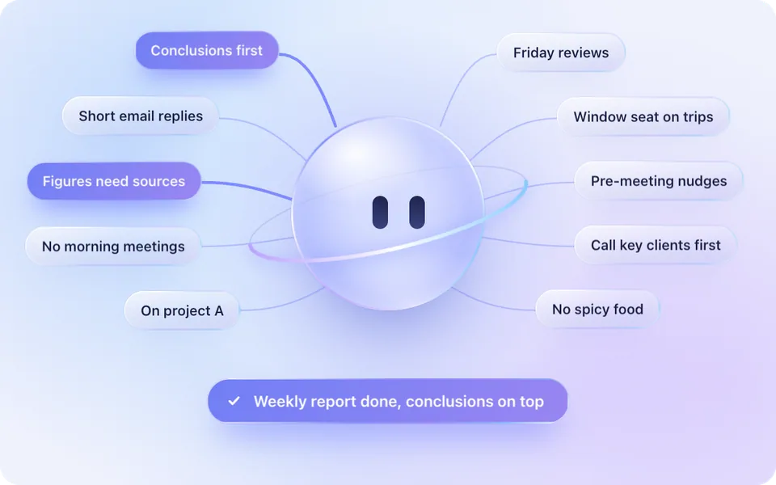
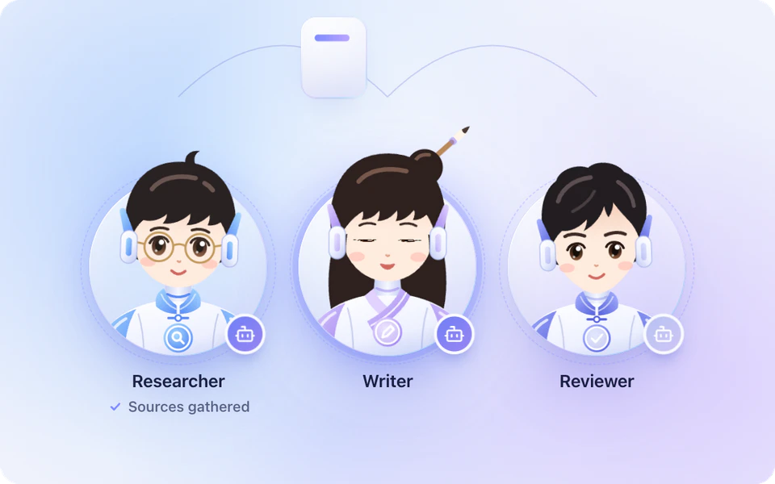
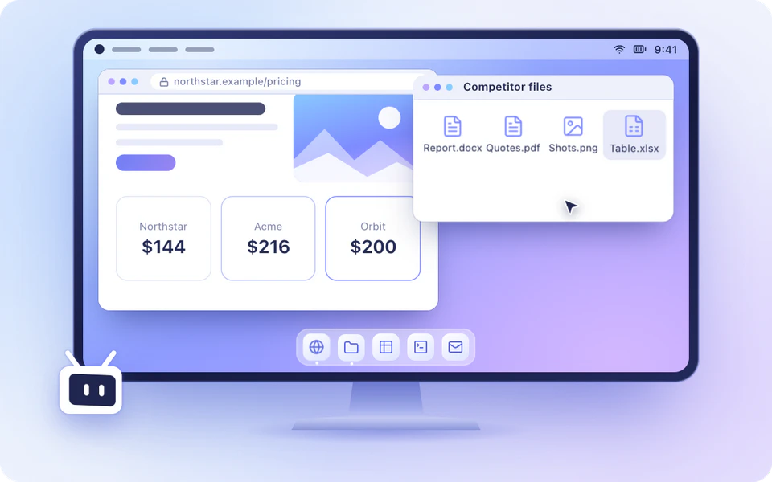
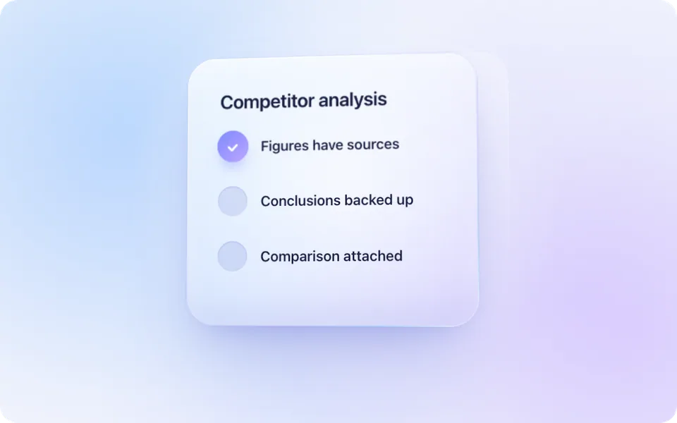
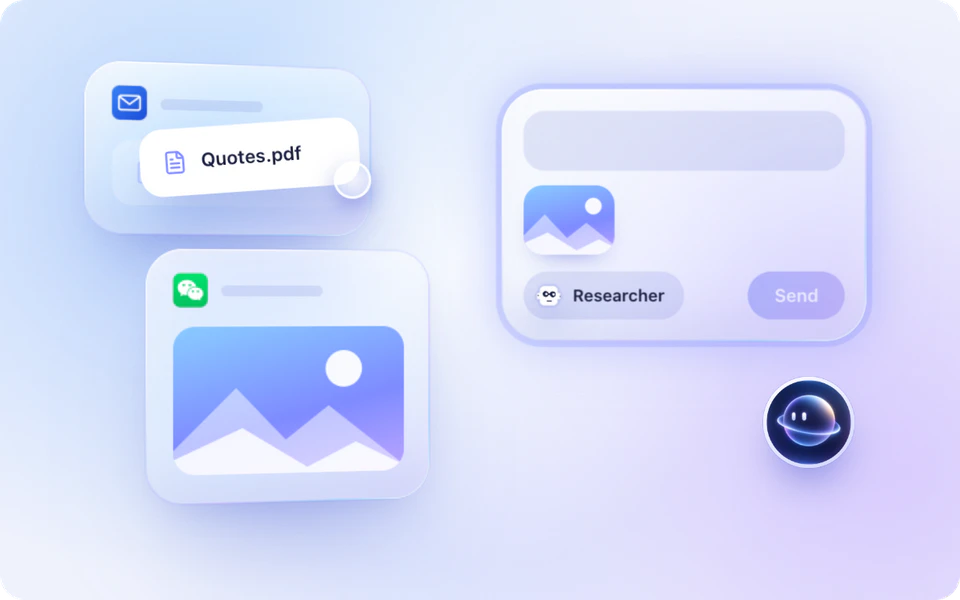
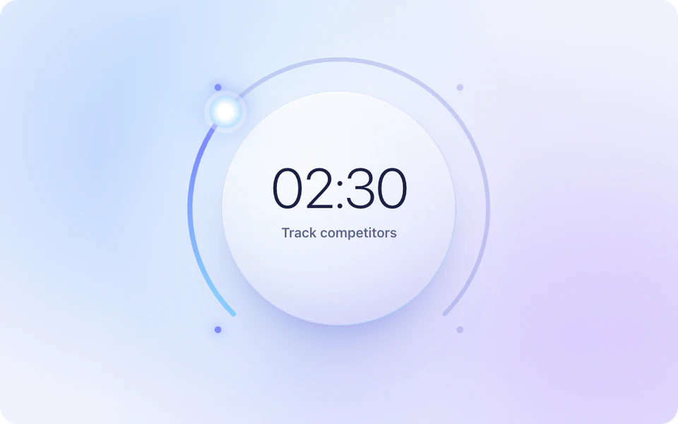
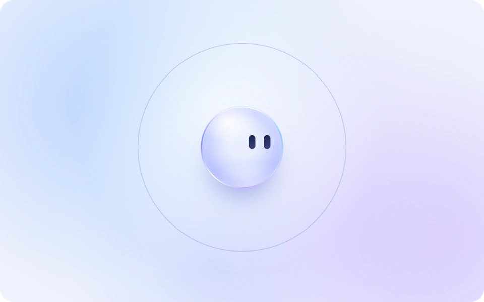

<p align="center">
  
</p>

<h1 align="center">OutcomeGo</h1>

<p align="center">
  <b>Runs on your own computer. An AI personal assistant that knows you better.</b>
</p>

<p align="center">
  Deploy it locally. It remembers your preferences, projects and ways of working,<br>
  gets work done on a computer of its own, and asks you when a call is yours to make.
</p>

<p align="center">
  
  
  
  
  
  
  
</p>

<p align="center">
  <a href="README.md">中文</a> | English
</p>

<p align="center">
  <a href="#highlights">Highlights</a> · <a href="#get-started">Get started</a> · <a href="#apps">Apps</a> · <a href="#documentation">Documentation</a>
</p>

## Highlights

<h3 align="center">An assistant that knows you, and is yours</h3>

<p align="center">It remembers your preferences, projects and ways of working.</p>

<p align="center">
  
</p>

<br>

<h3 align="center">You get a team that hands off</h3>

<p align="center">Clear roles in a group chat, passing one shared file along.</p>

<p align="center">
  
</p>

<br>

<h3 align="center">A computer for every bot</h3>

<p align="center">Its own screen, with a browser, files and spreadsheets. Watch or take over anytime.</p>

<p align="center">
  
</p>

<br>

<h3 align="center">Bots take the grind. You make the calls.</h3>

<p align="center">Bots finish what they can. One card asks you for the rest.</p>

<p align="center">
  
</p>

<br>

<h3 align="center">No excuses. Just outcomes.</h3>

<p align="center">Criteria first. Every result checked, with evidence.</p>

<p align="center">
  
</p>

<br>

<h3 align="center">Drag it over, start talking</h3>

<p align="center">From any app, drop files or pictures on the bot floating window to start a chat.</p>

<p align="center">
  
</p>

<br>

<h3 align="center">While you rest, they carry on</h3>

<p align="center">On a schedule or on an event, as long as this computer is on.</p>

<p align="center">
  
</p>

<br>

<h3 align="center">Bring in your work and your life</h3>

<p align="center">WeChat, Feishu, DingTalk, Amap, Notion, email, NAS and more.</p>

<p align="center">
  
</p>

<br>

<h3 align="center">Your data. Your model.</h3>

<p align="center">Chats, files and memory are stored on this computer. Switch models anytime.</p>

<p align="center">
  
</p>

<p align="center"><sub>Cloud models, voice, search and third-party plugins receive the content you use them with. To keep the model local too, connect a local model server such as Ollama.</sub></p>

## Get started

Deploy the server on your own computer, then connect to it from the desktop app or your phone.

You need an **x64 or arm64 machine** with a running **Docker Engine for Linux containers** and
**Docker Compose 2.20+**. We recommend **8 GB RAM** and **8 GB free disk**. On macOS and Windows,
Docker Desktop supplies the engine and Compose. See the [requirements](docs/getting-started/installation.md#requirements).

### 1. Install the OutcomeGo server

Run this on the machine that will host your assistant.

**macOS / Linux**

```sh
curl -fsSL https://github.com/jingyi0605/OutcomeGo/releases/latest/download/install.sh | sh
```

**Windows PowerShell**

```powershell
irm https://github.com/jingyi0605/OutcomeGo/releases/latest/download/install.ps1 | iex
```

The installer downloads the OutcomeGo CLI, adds it to your `PATH`, and starts guided setup. Node.js
and Bun are not required.

### 2. Finish setup

Choose how you'll connect, then create your OutcomeGo username and password. Setup defaults to a
private connection over your LAN or VPN, starts the server, and prints your **server URL**.
Setup includes private Tailscale HTTPS, public HTTPS, and existing proxy options. Use
`outcomego setup --advanced` for additional server settings.

### 3. Open the app

[Download the desktop app](https://github.com/jingyi0605/OutcomeGo/releases/latest), enter the server URL from setup,
and sign in with the account you just created. The app then helps you connect a model with a
ChatGPT or Claude sign-in, or an OpenAI, Anthropic, or OpenRouter API key, and checks that it
replies. Then create your first bot and send it a task. To use your own model server, add it in
**Settings → Model** or on the host with `outcomego provider add`; see
[model providers](docs/configuration/models.md#use-your-own-model-server).

The host and Docker must stay running for bots and routines to work. Server-side work continues
when you close the app. Keep the desktop app open when bots need access to your physical computer.

## Apps

| App | Get it |
| --- | --- |
| Desktop for macOS (Apple silicon), Linux (x64) and Windows (x64) | [GitHub Releases](https://github.com/jingyi0605/OutcomeGo/releases/latest) |
| Android 8.0+ | [GitHub Releases](https://github.com/jingyi0605/OutcomeGo/releases/latest) or [build from source](apps/android/README.md) |
| iPhone / iPad (beta) | [Build from source](apps/ios/README.md) |

All apps connect to your server for chat and live screens. Most server settings, such as the model, are in the desktop app.

## Useful commands

```sh
outcomego status    # Check the server and its version
outcomego doctor    # Diagnose setup or connection problems
outcomego setup     # Change the connection mode
outcomego update    # Update the CLI and server with backup and rollback
```

See [server commands](docs/manage/server.md), [remote access](docs/configuration/remote-access.md),
[backups](docs/manage/backups.md), and [troubleshooting](docs/manage/troubleshooting.md) for ongoing operation.

## Documentation

- [FORK.md](FORK.md): attribution, branch rules, identifiers and the list of changes in this fork.
- [Server settings](docs/configuration/server.md): where to change each setting after setup.
- [Plugins](docs/usage/plugins.md): connect accounts and control bot access.
- [How hosting works](docs/overview/architecture.md): what runs where and what needs to stay on.
- [The attention cockpit](docs/20261126-注意力驾驶舱设计理念.en.md): longer-term design thinking on attention, decisions and delegation.
- [Development from source](docs/development/from-source.md): run from source and run checks.

## Relationship to OpenTeam

OutcomeGo (formerly aiTeamOS), an independent fork of OpenTeam, not affiliated with or endorsed by upstream.

See [FORK.md](FORK.md) for attribution, branch rules and the list of changes.

### Standing on excellent work

OutcomeGo exists because OpenTeam is an outstanding project, and we want to say so first.
[Raghav Pillai](https://github.com/raghavpillai) built a complete, self-hosted way to work with
AI agents: bots that own a real computer, keep their memory and logins between tasks, work
together in group chats, run routines on a schedule, and reach you from desktop and mobile apps.
The architecture is clean, the product is polished, and it ships at a remarkable pace.
Everything in this repository sits on top of that work, and we merge upstream changes
selectively and regularly so that we keep benefiting from it.


## License

OutcomeGo is licensed under the [GNU General Public License v3.0](LICENSE), the same license as
OpenTeam. Some bundled third-party components, such as noVNC, fonts, and a few plugins, keep their
own licenses, which are included alongside them. "OpenTeam" and its logo belong to the upstream
author.
