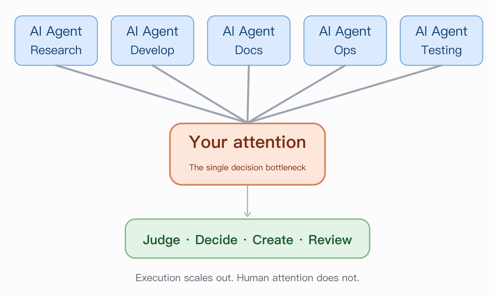
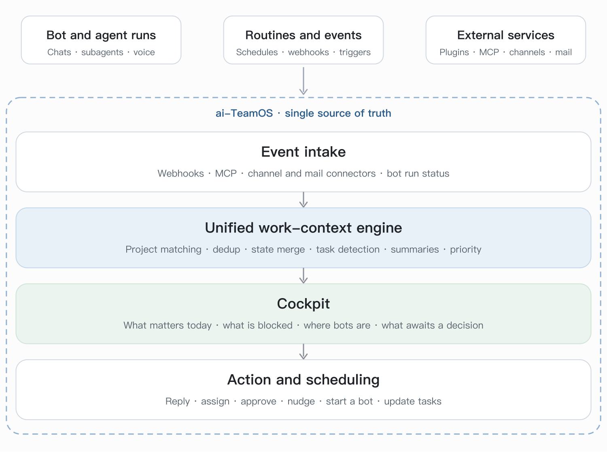
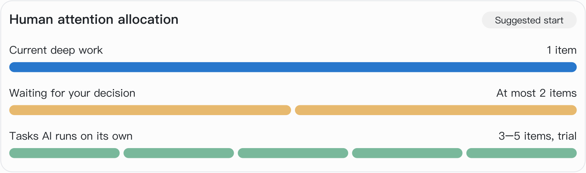
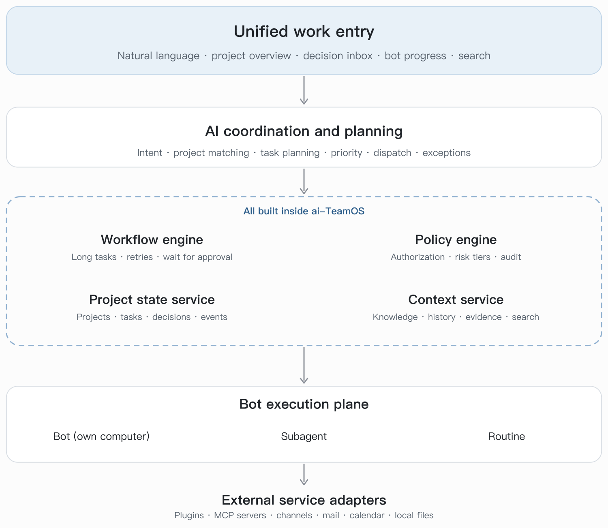

<p align="center">
  
</p>

<h1 align="center">OutcomeGo</h1>

<p align="center">
  <b>Keep your attention for what truly needs your judgment</b>
</p>

<p align="center">
  
  
  
  
  
  
  
  
</p>

<p align="center">
  A personal and team work operating system for the AI-agent era: agents run in parallel, you step in only at the moments that matter.
</p>

<p align="center">
  <a href="README.md">中文</a> | English
</p>

OutcomeGo (formerly aiTeamOS), an independent fork of OpenTeam, not affiliated with or endorsed by upstream.

OutcomeGo is an independent fork of OpenTeam, with no affiliation with or endorsement from upstream.
See [FORK.md](FORK.md) for attribution, branch rules and the list of changes.

## Standing on excellent work

OutcomeGo exists because OpenTeam is an outstanding project, and we want to say so first.
[Raghav Pillai](https://github.com/raghavpillai) built a complete, self-hosted way to work with
AI agents: bots that own a real computer, keep their memory and logins between tasks, work
together in group chats, run routines on a schedule, and reach you from desktop and mobile apps.
The architecture is clean, the product is polished, and it ships at a remarkable pace.
Everything in this repository sits on top of that work, and we merge upstream changes
selectively and regularly so that we keep benefiting from it.

## What this fork focuses on

### 1. Compatibility with the mainland China ecosystem

OpenTeam is built around services and networks that are often hard to reach or unsuitable from
mainland China. This fork adapts it so that it works well there.

Available now:

- Voice and speech providers usable in China, such as Volcengine.
- A Chinese-language Android client.

Planned:

- Model, push-notification and messaging integrations that do not rely on services that are
  blocked or unreliable in the mainland. Firebase push, for example, generally does not reach
  phones in China.
- Defaults, documentation, update checks and release channels that do not depend on upstream
  infrastructure.

Generic fixes that benefit everyone are sent upstream as pull requests. Work that only makes
sense for China stays in this fork.

### 2. A cockpit for the attention economy of the AI-agent era

AI extends what each person can do. One person can now direct research, writing, coding,
browsing and operations at the same time. **Attention has not grown with it.** The limit is no
longer what you can do, but how much you can notice, decide and verify.



Research on attention points the same way. Switching tasks leaves attention residue on the
previous one ([Leroy, 2009](https://doi.org/10.1016/j.obhdp.2009.04.002)). Knowledge work with AI
shifts from doing to verifying and supervising ([Microsoft Research and CMU, CHI 2025](https://doi.org/10.1145/3706598.3713778)).
Agents that depend on each other can add to the supervision load instead of reducing it. So the
goal is not more agents. It is fewer interruptions, and a lower cost each time you step in.

The question this fork explores:

> How do we raise the value of each person's attention, and through it, their personal
> productivity?

**One principle:** unless something has to be judged by you, it should not keep occupying your
attention. Execution can run in parallel. Your attention should be spent serially, on one thing.

#### One system, one source of truth

Today work is scattered across islands: agent conversations, email, chat apps, to-do lists, notes,
workflow tools. You become the only connector between them, collecting, matching, ranking and
following up by hand.

OutcomeGo takes a different route. **It does not add more tools around the agents. It brings the
parts of those tools that matter into one product, and makes that product the only source of
truth** for projects, tasks, agent runs, conversations and decisions. No separate workflow engine,
no second task database, no note-taking tool acting as a task store.

| Capability people usually get from separate tools | Direction in OutcomeGo |
| --- | --- |
| Task and project database | Built-in projects, tasks and decisions, in the same database as bots and conversations |
| Workflow automation and scheduling | Built-in routines, event triggers and agent runs |
| Agent status collection | Agent runs are first-class records, with no log scraping |
| Inbox for email and chat | Mail and channel connectors feed one event stream |
| Human decisions | Decision cards collect items that need the user's judgment |
| Notes and knowledge | Built-in memory, files and search across all of the above |
| Reminders and calendar | Routines and notifications on desktop, iOS and Android |

External services still connect, as plugins, MCP servers and channels. They are sources and
destinations. They do not hold the state.



<sub>Illustration of the direction, not of the current state. External services connect only as sources, and state lives in OutcomeGo.</sub>

#### The cockpit

The home screen should answer one question: **"What is worth my attention right now?"** It is
not a board with dozens of cards.

- **Three states.** What you are working on (one item at a time), what people and agents are
  working on (many in parallel), and what is waiting for you. The figure below is the starting
  point we plan to experiment with. The numbers are adjustable parameters, not research-derived optima.

  

- **Decision cards.** Every request for your input says what to decide, what is recommended,
  the evidence and uncertainty, and what happens if you wait. You should not need to read a
  long report to see why someone is asking.
- **Ranked by impact and cost of waiting.** Emergencies interrupt immediately. Blocking
  decisions come next. Routine approvals are batched into fixed windows. Exploratory ideas go to a
  periodic review.
- **Ask in plain language.** "Where is project A, and what needs me?" is answered from tasks,
  mail, agent state and history together, without opening five apps.

#### Delegation with quality gates

Misunderstanding is the most expensive kind of rework for non-coding work. The design is built
around catching it before you see the result:

1. **Intent confirmation.** Before a complex task, the agent states its understanding, and
   separates confirmed facts, inferences and unknowns. It asks only the one question that would
   change the result.
2. **Acceptance criteria up front.** Goal, deliverable, completion standard and time budget are
   written down before work starts.
3. **Automatic review.** A reviewer checks the output against the approved requirements, and
   reports specific defects with evidence, not just a score. Automatic revision stops after two
   rounds, and the root problem then goes to the decision queue.
4. **Rules that accumulate.** Corrections are classified as project-level, task-type-level or
   personal preference, and only confirmed rules become permanent.

#### Safe autonomy

Agents may read authorized data, research, draft, and update internal task state on their own.
Items that need the user's judgment enter the decision flow. Tool permissions and execution gates
follow OpenTeam's existing behavior; this project does not claim to provide tool-level enforcement.
Text from mail, web pages and chats is treated as untrusted input, never as instructions. Context is
isolated per project.

#### Focus rhythm

Notifications are batched into a few fixed windows. Only urgent incidents may interrupt deep
work. Every task keeps a resume point, so switching back costs seconds, not a re-read.

#### Measuring success

We do not count agent output, number of calls or hours worked. We track a few numbers:

- Task switches and unnecessary interruptions per day.
- Minutes of deep work and number of core results delivered.
- How many revision rounds non-coding deliverables need.
- Time spent on acceptance.

Any numeric targets we set (for example, parallel limits or revision rounds) are trial values
to experiment with, not research-backed guarantees.

#### Target layers



<sub>Illustration. Every layer is built inside this project, not brought in as an external system. The table below shows which parts exist.</sub>

#### What exists and what is planned

| Area | Status |
| --- | --- |
| Bots with their own computers, shared workspace, memory, group chats, subagents | Upstream, available |
| Routines on schedules and events, mail plugin, Slack, Gmail and more, MCP | Upstream, available |
| Approval step for outbound messages (external drafts) | Upstream, available |
| Desktop, iOS and a native Android client with push notifications | Available (Android is this fork) |
| Realtime voice conversation across clients | Available in this fork, draft spec in [specs](specs) |
| Projects, tasks and decisions as first-class objects | Planned |
| Decision inbox with ranking and batched windows | Planned |
| Intent confirmation, acceptance criteria and review gates | Planned |
| Event pipeline with deduplication, project matching and idempotency | Planned |
| Policy engine for risk-based approval | Planned |
| Cockpit home screen and natural-language project queries | Planned |

Personal WeChat has no stable official interface for reading chats. We will not build on
unauthorized database decryption or client injection. Enterprise WeChat and manual forwarding are
the realistic first steps, and WeChat is a separate feasibility study.

Design notes will be added to [specs](specs) as each part is specified.

## What is in this fork today

This branch is based on upstream OpenTeam v0.0.15 and selectively syncs later upstream fixes.
So far it includes [#258](https://github.com/raghavpillai/openteam/pull/258) from v0.0.16
(cleanup of Docker images pulled by digest during updates). Upstream version bumps are not
merged, because this fork keeps its own version line.

Compared with upstream OpenTeam v0.0.15, this branch adds:

- A native **Android client** with chat, bots, routines, push notifications, a share target and
  a cloud computer viewer. Submitted upstream as
  [#236](https://github.com/raghavpillai/openteam/pull/236).
- **Realtime voice conversation** across the server, worker, desktop, iOS and Android, with VAD,
  Opus transport, Volcengine and Deepgram providers, and narration of slow tool work.
- A **model-provider catalog and custom providers**: the server supports OpenAI Chat, OpenAI
  Responses and Anthropic Messages, with 38 vendor presets. Desktop, iOS and Android can add
  providers from Settings, choose the protocol, and display vendor icons.
- **Android release updates**: GitHub Releases ship a signed APK and `android-update.json`.
  The app verifies the update manifest, APK checksum, application ID, version code and signing
  certificate before installing; debug builds use a separate `.debug` application ID and can
  sit beside the release app.
- Haptic feedback across Android settings, sign-in, sessions, chat and routines, plus a unified
  OutcomeGo brand icon across desktop, iOS and Android.
- Magpie multimodal model metadata
  ([#198](https://github.com/raghavpillai/openteam/pull/198)) and network fixes
  ([#250](https://github.com/raghavpillai/openteam/pull/250),
  [#251](https://github.com/raghavpillai/openteam/pull/251)).

The full list is in [FORK.md](FORK.md).

The latest published GitHub release is `v0.1.0-beta.14`, the first public release using the OutcomeGo
name and new internal identities. iOS Release is deferred by decision, and real device upgrades and
backup imports remain separate acceptance checks. The
repository is now [`jingyi0605/OutcomeGo`](https://github.com/jingyi0605/OutcomeGo); the beta.13
release notes still contain installer commands using the old slug. See [FORK.md](FORK.md) and the
[release decision](specs/004.1-项目更名与下一版本发布/docs/release-decision.md) for current gates.

## Branches

| Branch | Purpose |
| --- | --- |
| `OutcomeGo` | GitHub default branch and product line, updated with upstream changes. |
| `main` | Mirror of upstream `main`. Never receives local commits. Pull requests to upstream start here. |

## What OpenTeam provides

Everything below comes from upstream OpenTeam and works the same way in this fork.

- **Give bots a computer.** Each bot has its own screen and browser. All bots share a workspace
  and website sign-ins, so they can build on each other's files and you only sign in once.
- **Keep context.** Conversations resume after restarts. Bots remember what they learn about
  themselves and you across conversations.
- **Work as a team.** Bring multiple bots into a group chat, let them message each other, or delegate
  tasks to subagents.
- **Automate recurring work.** Save instructions as routines that run on a schedule or respond
  to configured events.
- **Connect your tools.** Add skills and plugins for services such as Gmail, GitHub, Slack, and
  Notion, or connect a custom MCP server. Connected accounts are available to every bot.

[](docs/images/openteam-desktop-mobile.png)

## Get started

You need an **x64 or arm64 machine** with a running **Docker Engine for Linux containers** and
**Docker Compose 2.20+**. We recommend **8 GB RAM** and **8 GB free disk**. On macOS and Windows,
Docker Desktop supplies the engine and Compose. See the [requirements](docs/getting-started/installation.md#requirements).

### 1. Install the OutcomeGo server

The public `latest` installer installs OutcomeGo `v0.1.0-beta.14`. To use the former product
identity, select beta.13 explicitly on the [Releases page](https://github.com/jingyi0605/OutcomeGo/releases).

Run this on the machine that will host your bots.

**macOS / Linux**

```sh
curl -fsSL https://github.com/jingyi0605/OutcomeGo/releases/latest/download/install.sh | sh
```

**Windows PowerShell**

```powershell
irm https://github.com/jingyi0605/OutcomeGo/releases/latest/download/install.ps1 | iex
```

The installer downloads the OutcomeGo CLI, adds it to your `PATH`, and starts guided setup. Node.js
and Bun are not required.

### 2. Finish setup

Choose how you'll connect, then create your OutcomeGo username and password. Setup defaults to a
private connection over your LAN or VPN, starts the server, and prints your **server URL**.
Setup includes private Tailscale HTTPS, public HTTPS, and existing proxy options. Use
`outcomego setup --advanced` for additional server settings.

### 3. Open the app

[Download the desktop app](https://github.com/jingyi0605/OutcomeGo/releases/latest), enter the server URL from setup,
and sign in with the account you just created. The app then helps you connect a model with a
ChatGPT or Claude sign-in, or an OpenAI, Anthropic, or OpenRouter API key, and checks that it
replies. Then create your first bot and send it a task. To use your own model server, add it in
**Settings → Model** or on the host with `outcomego provider add`; see
[model providers](docs/configuration/models.md#use-your-own-model-server).

The host and Docker must stay running for bots and routines to work. Server-side work continues
when you close the app. Keep the desktop app open when bots need access to your physical computer.

## Apps

| App | Get it |
| --- | --- |
| Desktop for macOS (Apple silicon), Linux (x64) and Windows (x64) | [GitHub Releases](https://github.com/jingyi0605/OutcomeGo/releases/latest) |
| Android 8.0+ | [GitHub Releases](https://github.com/jingyi0605/OutcomeGo/releases/latest) or [build from source](apps/android/README.md) |
| iPhone / iPad (beta) | [Build from source](apps/ios/README.md) |

All apps connect to your server for chat and live screens. Most server settings, such as the model, are in the desktop app.

## Useful commands

```sh
outcomego status    # Check the server and its version
outcomego doctor    # Diagnose setup or connection problems
outcomego setup     # Change the connection mode
outcomego update    # Update the CLI and server with backup and rollback
```

See [server commands](docs/manage/server.md), [remote access](docs/configuration/remote-access.md),
[backups](docs/manage/backups.md), and [troubleshooting](docs/manage/troubleshooting.md) for ongoing operation.

## Documentation

- [FORK.md](FORK.md): attribution, branch rules, identifiers and the list of changes in this fork.
- [Server settings](docs/configuration/server.md): where to change each setting after setup.
- [Plugins](docs/usage/plugins.md): connect accounts and control bot access.
- [How hosting works](docs/overview/architecture.md): what runs where and what needs to stay on.
- [Development from source](docs/development/from-source.md): run from source and run checks.

See the upstream [OpenTeam repository](https://github.com/raghavpillai/openteam) for upstream documentation.

## License

OutcomeGo is licensed under the [GNU General Public License v3.0](LICENSE), the same license as
OpenTeam. Some bundled third-party components, such as noVNC, fonts, and a few plugins, keep their
own licenses, which are included alongside them. "OpenTeam" and its logo belong to the upstream
author.
