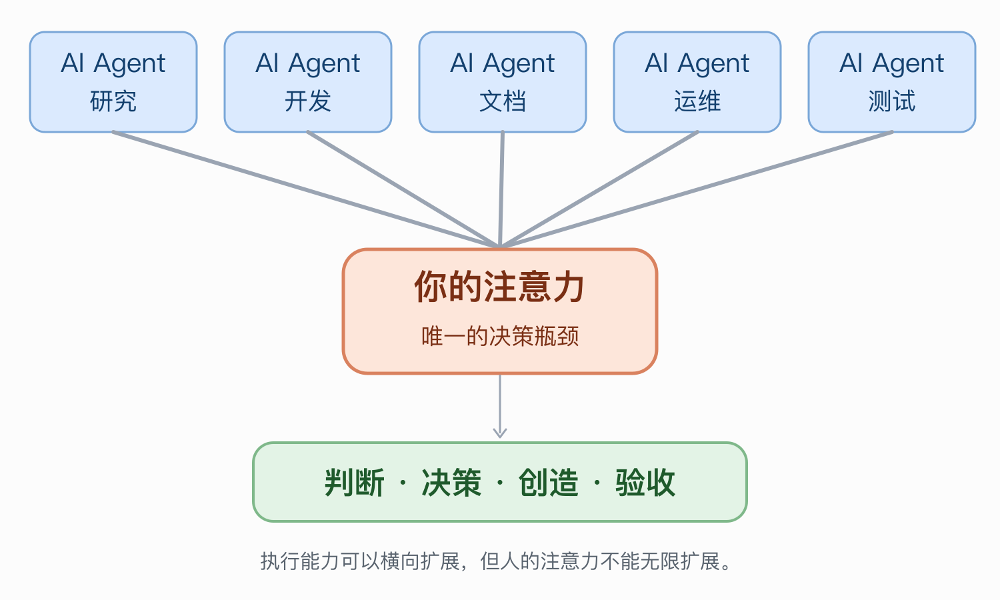
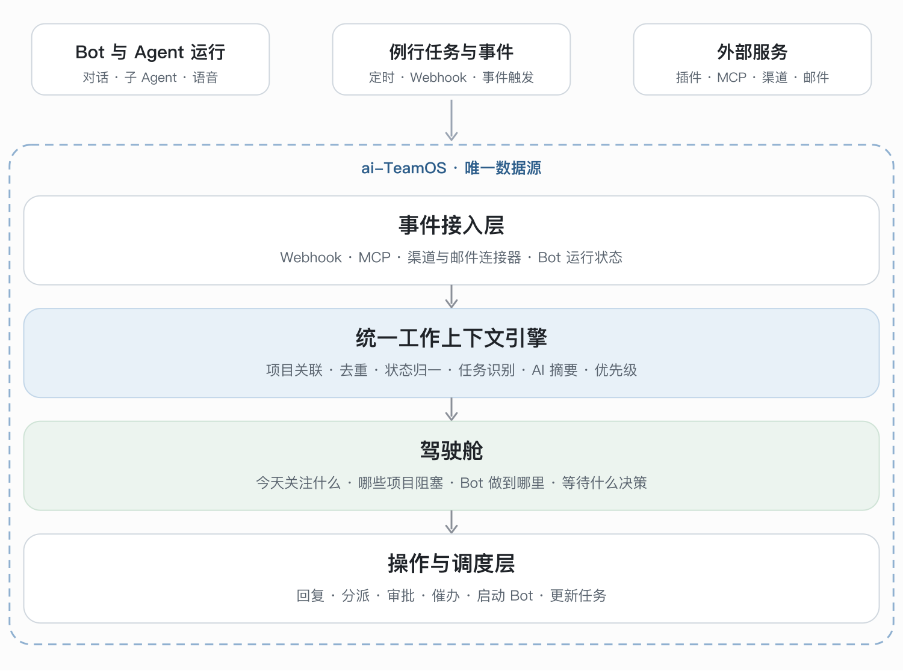
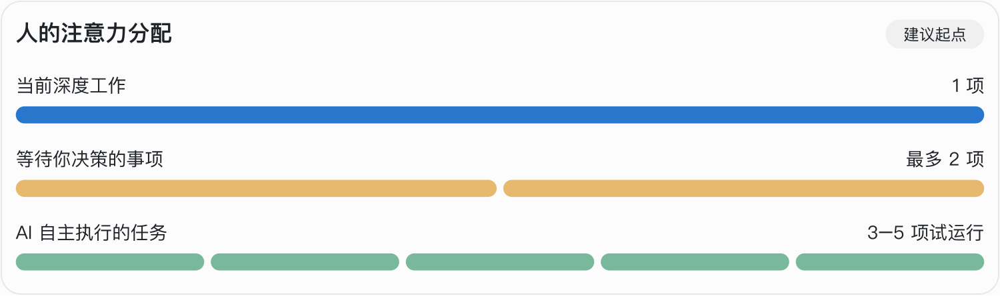
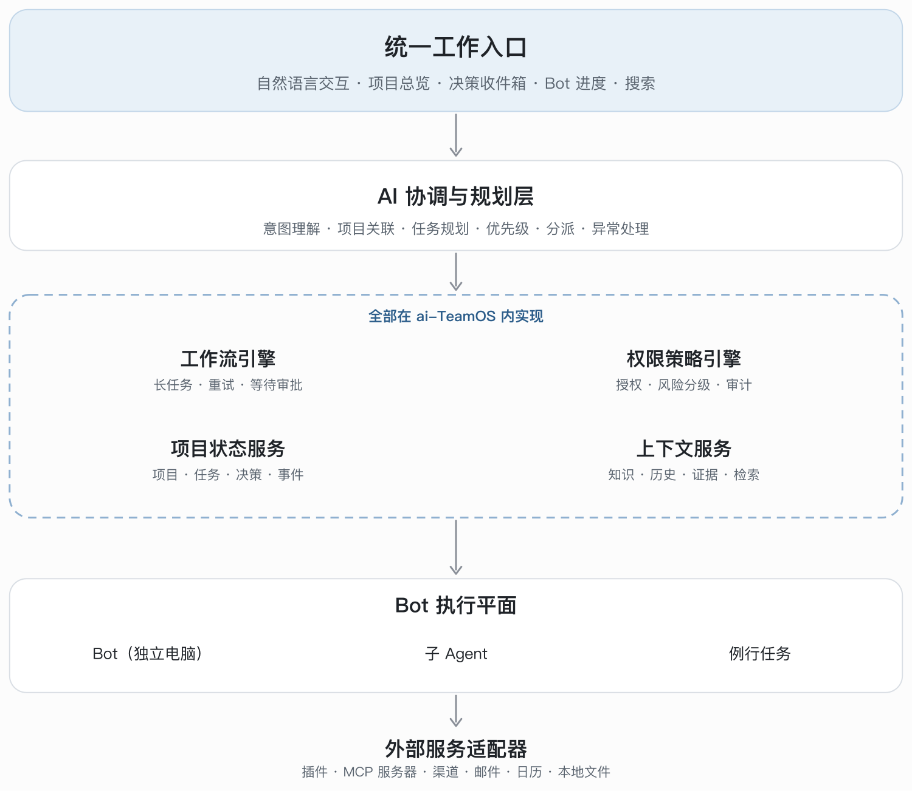

<p align="center">
  
</p>

<h1 align="center">OutcomeGo</h1>

<p align="center">
  <b>把注意力留给真正需要你判断的事</b>
</p>

<p align="center">
  
  
  
  
  
  
  
  
</p>

<p align="center">
  面向 AI Agent 时代的个人与团队工作操作系统：让 Agent 并行执行，让你只在关键时刻介入。
</p>

<p align="center">
  中文 | <a href="README.en.md">English</a>
</p>

OutcomeGo (formerly aiTeamOS), an independent fork of OpenTeam, not affiliated with or endorsed by upstream.

OutcomeGo 是 OpenTeam 的独立 fork，与上游没有隶属关系，也未获得其背书。署名、分支规则和改动清单见 [FORK.md](FORK.md)。

## 致敬源项目

OutcomeGo 之所以存在，是因为 OpenTeam 是一个非常出色的项目，我们想先说这一点。
[Raghav Pillai](https://github.com/raghavpillai) 构建了一套完整的自托管 AI Agent 工作方式：
每个 bot 拥有真实的电脑，在任务之间保留记忆和登录状态，能在群聊中协作，按计划运行例行任务，
并通过桌面端和移动端随时找到你。架构清晰，产品打磨精细，迭代速度令人惊叹。
本仓库的一切都建立在这项工作之上，我们会有选择地、定期合并上游的更新，持续从中受益。

## 本分支的两个重点

### 一、OpenTeam 的中国大陆本地化生态兼容

OpenTeam 依赖的许多服务和网络环境，在中国大陆难以访问或并不适用。本分支负责让它在国内好用。

已有：

- 国内可用的语音与语音识别服务，例如火山引擎。
- 中文界面的 Android 客户端。

计划中：

- 不依赖大陆被屏蔽或不稳定服务的模型、推送和消息渠道集成。例如 Firebase 推送在国内手机上通常收不到。
- 不依赖上游基础设施的默认配置、文档、更新检查和发布渠道。

对所有人都有益的通用修复，会以 pull request 的形式提交给上游；只对中国有意义的工作留在本分支。

### 二、探索 All in AI 的新工作方式：注意力驾驶舱

AI 让每个人的能力边界不断扩展：一个人现在可以同时指挥研究、写作、编码、浏览和运维。
**但注意力并没有随之增长。** 瓶颈已经不是你能做多少，而是你能留意、判断和验证多少。



关于注意力的研究也指向同一个方向。切换任务会留下“注意力残留”
（[Leroy, 2009](https://doi.org/10.1016/j.obhdp.2009.04.002)）；有了 AI，知识工作的重心从直接执行转向核验与监督
（[Microsoft Research 与 CMU，CHI 2025](https://doi.org/10.1145/3706598.3713778)）；彼此依赖的 Agent 反而可能增加人的监督负担。
所以目标不是更多的 Agent，而是更少的打扰，以及每次介入时更低的理解成本。

本分支探索的问题是：

> 如何提升每个人的注意力价值，从而进一步提升个人的工作效率？

**一条原则：** 除非一件事必须由你来判断，否则它不应该持续占用你的注意力。
执行可以并行，注意力应当串行地投入在一件事上。

#### 一个系统，一份唯一的数据

今天的工作散落在各个孤岛里：Agent 的对话、邮件、聊天软件、待办、笔记、自动化工具。
你成了这些系统之间唯一的连接器，要亲手收集、关联、排序和跟进。

OutcomeGo 选择另一条路：**不是在 Agent 周围再添更多工具，而是把这些工具中真正有用的能力
集成进本项目，并让本项目成为唯一的数据源**，承载项目、任务、Agent 运行、对话和决策。
不再需要另一套工作流引擎，不再需要第二个任务数据库，也不用笔记软件充当任务库。

| 通常要靠多个外部工具提供的能力 | OutcomeGo 中的方向 |
| --- | --- |
| 任务与项目数据库 | 内置项目、任务和决策，与 bot、对话在同一个数据库中 |
| 工作流自动化与定时调度 | 内置例行任务（Routine）、事件触发和 Agent 运行 |
| Agent 状态采集 | Agent 运行本身就是一等记录，不需要抓取日志 |
| 邮件与聊天收件箱 | 邮件和渠道连接器汇入同一条事件流 |
| 人工决策 | 决策卡片汇总需要用户判断的事项 |
| 笔记与知识 | 内置记忆、文件和覆盖以上所有内容的搜索 |
| 提醒与日程 | 桌面端、iOS 和 Android 上的例行任务与通知 |

外部服务仍然可以通过插件、MCP 服务器和渠道接入。它们是信息的来源和去向，不保存状态。



<sub>示意图，表达的是方向而不是现状。外部服务只作为来源接入，状态保存在 OutcomeGo 中。</sub>

#### 驾驶舱

首页只回答一个问题：**“现在什么事情最值得我关注？”** 而不是一块堆满几十张卡片的看板。

- **三种状态。** 我正在处理的（同一时刻只有一项）、他人和 Agent 正在处理的（可以多项并行）、
  等待我处理的。下图是我们打算试验的起点，数字是可调的参数，不是研究得出的最佳值。

  

- **决策卡片。** 每一次需要你介入的请求，都说明要你决定什么、推荐什么、依据和不确定性是什么、
  不处理会有什么影响。你不需要读完一份长报告，才知道为什么有人找你。
- **按影响程度和等待成本排序。** 紧急事故立即通知；阻塞关键交付的决策优先处理；常规审批在固定窗口批量处理；
  探索性想法进入定期回顾。
- **用自然语言提问。** “客户 A 的项目推进到哪一步？有什么需要我处理？”由任务、邮件、Agent 状态和历史记录
  共同回答，不必再打开五个应用。

#### 带质量门禁的委托

对于非编程任务，代价最高的返工来自理解偏差。设计的重点是在你看到结果之前就把它拦住：

1. **意图确认。** 复杂任务开始前，Agent 先说明自己的理解，并区分已确认的事实、推断和未知信息。
   它只问一个真正会改变结果的问题。
2. **先写验收标准。** 开工前写明目标、交付物、完成标准和时间预算。
3. **自动审查。** 审查者把成果与已批准的要求逐项对照，给出带证据的具体缺陷，而不只是一个分数。
   自动修订最多两轮，之后把根本问题提交到决策队列。
4. **规则沉淀。** 每次你的修改意见会被归类为项目级、任务类型级或个人偏好，只有经过确认的才成为长期规则。

#### 有边界的自主

Agent 可以自行读取已授权的数据、做调研、写草稿、更新内部任务状态。
需要用户判断的事项会进入决策流程；具体工具权限和执行门禁沿用 OpenTeam 现有行为，本项目不宣称提供
工具级强制拦截。来自邮件、网页和聊天的文字一律视为不可信输入，不当作指令。上下文按项目隔离。

#### 专注的节奏

通知被合并到少数几个固定窗口，只有紧急故障才允许打断深度工作。每个任务都保留恢复点，
切换回来时只需几秒，而不是重新读一遍。

#### 如何衡量

我们不统计 Agent 的产出量、调用次数或工作了多少小时，只跟踪几个指标：

- 每天的任务切换次数和非必要打断次数。
- 深度工作的分钟数和完成的核心成果数。
- 非编程交付物平均需要几轮修改。
- 验收所花的时间。

设计中出现的数值目标（例如并行上限、修订轮数）只是供试验的参数，不是研究得出的保证。

#### 目标分层



<sub>示意图。各层都在本项目内实现，而不是引入外部系统。下表列出其中哪些已经存在。</sub>

#### 已有与计划

| 方面 | 状态 |
| --- | --- |
| 拥有独立电脑的 bot、共享工作区、记忆、群聊、子 Agent | 上游已有 |
| 按计划和事件运行的例行任务、邮件插件、Slack、Gmail 等、MCP | 上游已有 |
| 对外发送消息前的审批步骤（外部草稿） | 上游已有 |
| 桌面端、iOS，以及带推送通知的原生 Android 客户端 | 已有（Android 来自本分支） |
| 跨端实时语音对话 | 本分支已有，规格草案见 [specs](specs) |
| 项目、任务、决策作为一等对象 | 计划中 |
| 带排序和批量窗口的决策收件箱 | 计划中 |
| 意图确认、验收标准和审查门禁 | 计划中 |
| 带去重、项目关联和幂等性的事件流水线 | 计划中 |
| 按风险分级审批的策略引擎 | 计划中 |
| 驾驶舱首页与自然语言项目查询 | 计划中 |

个人微信没有稳定的官方接口可以读取聊天记录。我们不会把未经授权的数据库解密或客户端注入作为方案。
企业微信和人工转发是现实的第一步，微信接入将作为单独的可行性研究。

设计文档会随着各部分的规格化陆续加入 [specs](specs)。

## 本分支目前已有的内容

本分支基于上游 OpenTeam v0.0.15，并选择性同步之后的上游修复。目前已包含 v0.0.16 中的
[#258](https://github.com/raghavpillai/openteam/pull/258)（更新时清理按 digest 拉取的 Docker 镜像）。
上游的版本号变更不会合并，因为本分支使用独立的版本线。

与上游 OpenTeam v0.0.15 相比，本分支增加了：

- 原生 **Android 客户端**：聊天、bot、例行任务、推送通知、分享入口和云端电脑查看器。
  已作为 [#236](https://github.com/raghavpillai/openteam/pull/236) 提交给上游。
- 覆盖服务端、worker、桌面端、iOS 和 Android 的**实时语音对话**：包含语音活动检测、Opus 传输、
  火山引擎和 Deepgram 服务商，以及对耗时工具操作的语音旁白。
- **模型服务商目录与自定义服务商**：服务端支持 OpenAI Chat、OpenAI Responses 和 Anthropic
  Messages 协议，内置 38 个厂商预设；桌面端、iOS 和 Android 都可以从设置中添加服务商、
  选择协议并显示厂商图标。
- **Android 发布更新**：GitHub Release 提供签名 APK 和 `android-update.json`，应用会校验
  更新清单、APK 校验和、应用 ID、版本号和签名证书后再安装；调试包使用独立的 `.debug`
  应用 ID，可以和正式版并存。
- Android 设置、登录、会话、聊天和例程页面支持震动反馈；桌面端、iOS 和 Android 的
  OutcomeGo 品牌图标已统一。
- Magpie 多模态模型元数据（[#198](https://github.com/raghavpillai/openteam/pull/198)）和网络修复
  （[#250](https://github.com/raghavpillai/openteam/pull/250)、
  [#251](https://github.com/raghavpillai/openteam/pull/251)）。

完整清单见 [FORK.md](FORK.md)。

当前 GitHub 最新发布版本为 `v0.1.0-beta.13`。`v0.1.0-beta.14` 尚未发布；Android 签名 APK 和 macOS arm64 签名/公证包只在本地构建。beta.13 仍以旧名称和旧内部身份构建，不是 OutcomeGo beta.14。GitHub 仓库现为
[`jingyi0605/OutcomeGo`](https://github.com/jingyi0605/OutcomeGo)，旧网页地址会跳转到新 slug；beta.13 Release 正文中的安装器命令仍指向旧 slug。签名、CI 和发布门槛见 [FORK.md](FORK.md)
与[发布决策记录](specs/004.1-项目更名与下一版本发布/docs/release-decision.md)。

## 分支

| 分支 | 用途 |
| --- | --- |
| `OutcomeGo` | GitHub 默认分支和产品主线，定期合并上游。 |
| `main` | 上游 `main` 的镜像，不接收本地提交。向上游提交 PR 从这里开始。 |

## OpenTeam 提供的能力

以下能力来自上游 OpenTeam，在本分支中的用法相同。

- **给 bot 一台电脑。** 每个 bot 有自己的屏幕和浏览器。所有 bot 共享工作区和网站登录状态，
  可以在彼此的文件上继续工作，你只需登录一次。
- **保留上下文。** 对话在重启后继续。bot 会跨对话记住关于自己和你的信息。
- **像团队一样工作。** 把多个 bot 拉进群聊，让它们互相发消息，或把任务委派给子 Agent。
- **自动化重复工作。** 把指令保存为例行任务，按计划运行，或响应配置好的事件。
- **连接你的工具。** 为 Gmail、GitHub、Slack、Notion 等服务添加技能和插件，或接入自定义 MCP 服务器。
  已连接的账号对每个 bot 都可用。

[](docs/images/openteam-desktop-mobile.png)

## 快速开始

你需要一台 **x64 或 arm64 机器**，运行 **面向 Linux 容器的 Docker Engine** 和 **Docker Compose 2.20+**。
建议 **8 GB 内存**和 **8 GB 可用磁盘**。在 macOS 和 Windows 上，Docker Desktop 会提供引擎和 Compose。
参见[环境要求](docs/getting-started/installation.md#requirements)。

### 1. 安装服务端

当前公开的 `latest` 安装器对应 beta.13 旧版身份，会安装旧版服务端和 CLI。OutcomeGo beta.14 尚未发布。请先在 [Releases](https://github.com/jingyi0605/OutcomeGo/releases) 确认目标版本，不要将 beta.13 当作 OutcomeGo beta.14 安装。

在将要托管 bot 的机器上运行。

**macOS / Linux**

```sh
curl -fsSL https://github.com/jingyi0605/OutcomeGo/releases/latest/download/install.sh | sh
```

**Windows PowerShell**

```powershell
irm https://github.com/jingyi0605/OutcomeGo/releases/latest/download/install.ps1 | iex
```

安装器会下载 OutcomeGo CLI，把它加入 `PATH`，并启动引导式设置。不需要 Node.js 和 Bun。

### 2. 完成设置

选择连接方式，然后创建你的 OutcomeGo 用户名和密码。设置默认使用局域网或 VPN 上的私有连接，
启动服务端，并打印你的**服务器地址**。
设置中包含私有 Tailscale HTTPS、公开 HTTPS 和已有代理等选项。使用
`outcomego setup --advanced` 可调整更多服务端设置。

### 3. 打开应用

[下载桌面端](https://github.com/jingyi0605/OutcomeGo/releases/latest)，输入设置时得到的服务器地址，并用刚创建的账号登录。
应用随后会帮你用 ChatGPT 或 Claude 登录，或用 OpenAI、Anthropic、OpenRouter 的 API 密钥连接模型，并检查它能否回复。
然后创建你的第一个 bot 并发给它一个任务。要使用自己的模型服务，请在桌面端的
**设置 → 模型**中添加服务商；也可以在主机上执行 `outcomego provider add`。
标准协议、自定义服务商和本地模型的说明参见[模型服务商](docs/configuration/models.md#use-your-own-model-server)。

主机和 Docker 必须保持运行，bot 和例行任务才能工作。关闭应用后，服务端的工作会继续。
当 bot 需要访问你的物理电脑时，请保持桌面端打开。

## 应用

| 应用 | 获取方式 |
| --- | --- |
| macOS（Apple 芯片）、Linux（x64）和 Windows（x64）桌面端 | [GitHub Releases](https://github.com/jingyi0605/OutcomeGo/releases/latest) |
| Android 8.0+ | [GitHub Releases](https://github.com/jingyi0605/OutcomeGo/releases/latest) 或[从源码构建](apps/android/README.md) |
| iPhone / iPad（测试版） | [从源码构建](apps/ios/README.md) |

所有应用都连接到你的服务端进行聊天和查看实时屏幕。大多数服务端设置（例如模型）都在桌面端里。

## 常用命令

```sh
outcomego status    # 检查服务端及其版本
outcomego doctor    # 诊断设置或连接问题
outcomego setup     # 更改连接方式
outcomego update    # 更新 CLI 和服务端，带备份和回滚
```

日常运维参见[服务端命令](docs/manage/server.md)、
[远程访问](docs/configuration/remote-access.md)、
[备份](docs/manage/backups.md)和[故障排查](docs/manage/troubleshooting.md)。

## 文档

- [FORK.md](FORK.md)：本分支的署名、分支规则、标识符和改动清单。
- [服务端设置](docs/configuration/server.md)：设置完成后在哪里修改各项设置。
- [插件](docs/usage/plugins.md)：连接账号并控制 bot 的访问权限。
- [托管如何工作](docs/overview/architecture.md)：什么运行在哪里，什么必须保持开启。
- [从源码开发](docs/development/from-source.md)：从源码运行并执行检查。

OpenTeam 上游项目见 [github.com/raghavpillai/openteam](https://github.com/raghavpillai/openteam)。

## 许可证

OutcomeGo 采用 [GNU 通用公共许可证 v3.0](LICENSE)，与 OpenTeam 相同。部分捆绑的第三方组件，
例如 noVNC、字体和少数插件，保留各自的许可证，许可证文件随组件一并提供。
“OpenTeam”及其标志属于上游作者。
