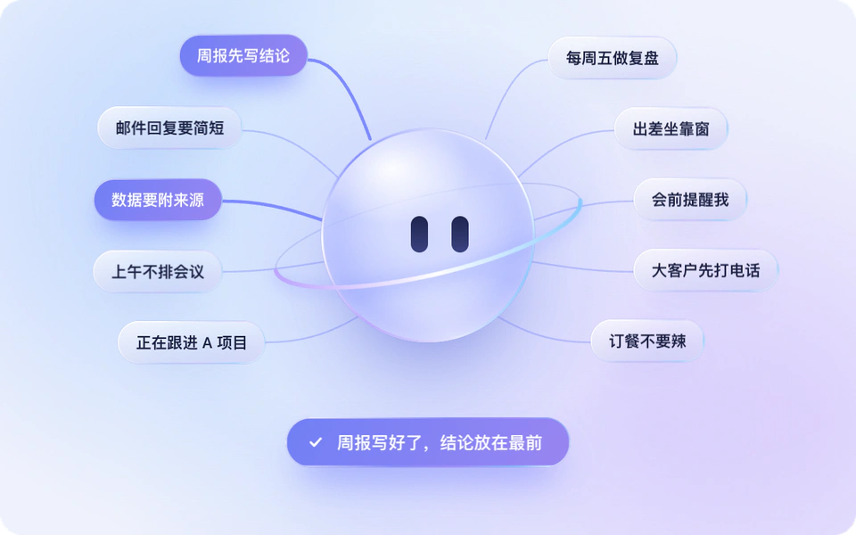
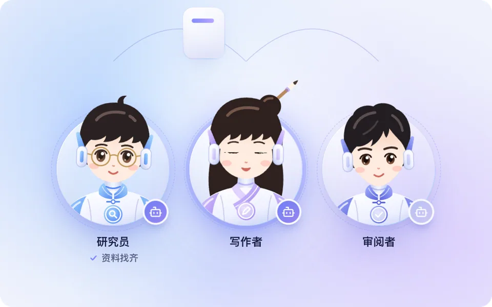
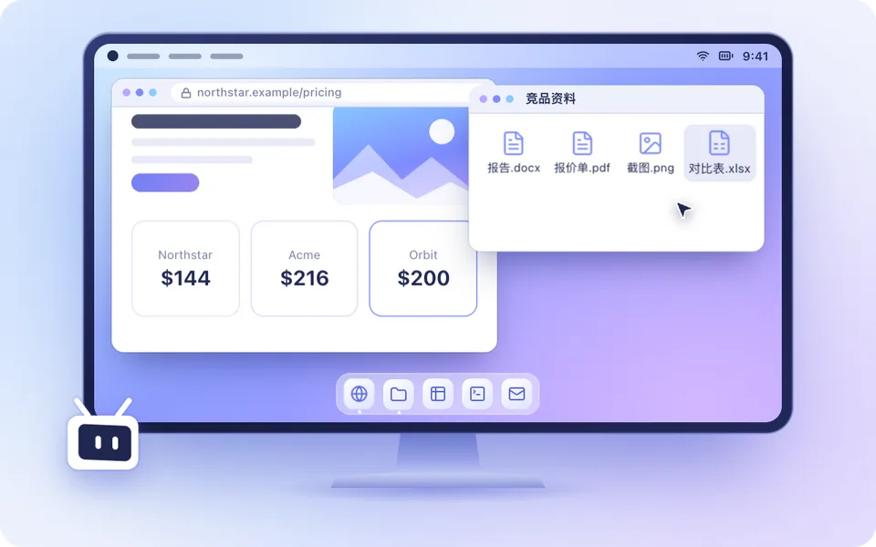
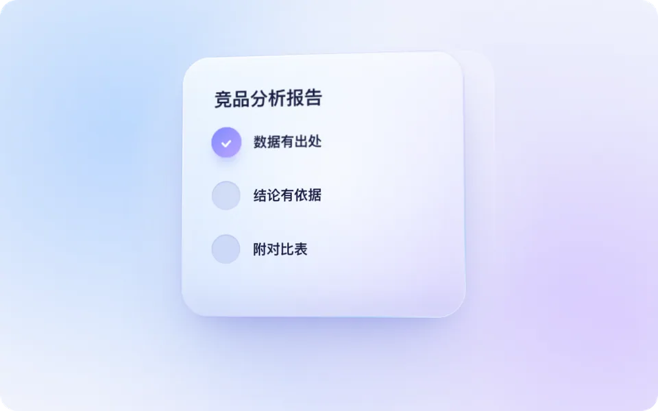
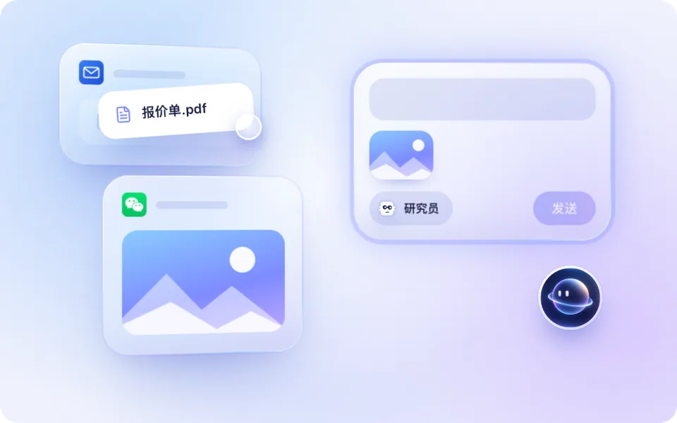
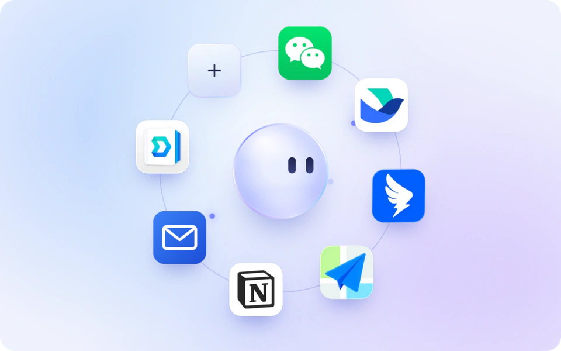

<p align="center">
  
</p>

<h1 align="center">OutcomeGo</h1>

<p align="center">
  <b>本地部署，做更懂你的 AI 个人助理</b>
</p>

<p align="center">
  部署在你自己的电脑上，记住你的偏好、项目和工作习惯，<br>
  在它自己的电脑里替你干活，需要你拿主意时再来问你。
</p>

<p align="center">
  
  
  
  
  
  
  
</p>

<p align="center">
  中文 | <a href="README.en.md">English</a>
</p>

<p align="center">
  <a href="#亮点">亮点</a> · <a href="#快速开始">快速开始</a> · <a href="#应用">应用</a> · <a href="#文档">文档</a>
</p>

## 亮点

以下动图取自桌面端本机部署过程中展示的海报，是功能示意动画，不是实际界面截图。

<h3 align="center">做懂你的、属于你的个人助理</h3>

<p align="center">记住你的偏好、项目和工作习惯，不用每次从头交代。</p>

<p align="center">
  
</p>

<br>

<h3 align="center">你拥有的，是一支会接力的团队</h3>

<p align="center">拉进一个群，各司其职，在共享文件上一棒接一棒。</p>

<p align="center">
  
</p>

<br>

<h3 align="center">每个机器人，一台电脑</h3>

<p align="center">独立的屏幕，浏览器、文件、表格都能用，随时观看，随时接管。</p>

<p align="center">
  
</p>

<br>

<h3 align="center">累活留给机器人，你的精力留给决策</h3>

<p align="center">能办的自己办完，要你定的，才用一张卡片来问你。</p>

<p align="center">
  
</p>

<br>

<h3 align="center">不会甩锅，只会甩给你成果</h3>

<p align="center">先定验收标准，交付时逐条对照，附上依据。</p>

<p align="center">
  
</p>

<br>

<h3 align="center">随手一拖，就能开聊</h3>

<p align="center">在任意应用里，把文件或图片拖到机器人浮窗，立刻发起对话。</p>

<p align="center">
  
</p>

<br>

<h3 align="center">在你休息的时候，ta们还在继续</h3>

<p align="center">按计划或按事件开工，这台电脑开着就不会停。</p>

<p align="center">
  
</p>

<br>

<h3 align="center">将你的工作和生活都接进来</h3>

<p align="center">微信、飞书、钉钉、高德、Notion、邮件、NAS 等应用，都可以集成。</p>

<p align="center">
  
</p>

<p align="center"><sub>已内置微信（ClawBot 单聊）、钉钉、高德、Notion、邮件等插件；飞书和 NAS 暂无内置插件，需要自行接入 MCP 服务器。</sub></p>

<br>

<h3 align="center">数据归你，模型任选</h3>

<p align="center">对话、文件和记忆都存在这台电脑上，模型随时可换。</p>

<p align="center">
  
</p>

<p align="center"><sub>使用云端模型、语音、搜索或第三方插件时，相关内容会发送给对应的服务商；希望模型也留在本地，可接入 Ollama 等本地模型服务。</sub></p>

## 快速开始

把服务端部署在你自己的电脑上，再用桌面端或手机连接它。

> [!NOTE]
> 桌面端一键本地部署（在应用内完成部署，过程中展示上面这组海报）正在开发中，尚未包含在已发布的版本里，进度见
> [Spec 012](specs/012-桌面端一键本地部署/README.md)。目前请使用下面的命令行安装器。

你需要一台 **x64 或 arm64 机器**，运行 **面向 Linux 容器的 Docker Engine** 和 **Docker Compose 2.20+**。
建议 **8 GB 内存**和 **8 GB 可用磁盘**。在 macOS 和 Windows 上，Docker Desktop 会提供引擎和 Compose。
参见[环境要求](docs/getting-started/installation.md#requirements)。

### 1. 安装服务端

在将要托管助理的机器上运行。

**macOS / Linux**

```sh
curl -fsSL https://github.com/jingyi0605/OutcomeGo/releases/latest/download/install.sh | sh
```

**Windows PowerShell**

```powershell
irm https://github.com/jingyi0605/OutcomeGo/releases/latest/download/install.ps1 | iex
```

安装器会下载 OutcomeGo CLI，把它加入 `PATH`，并启动引导式设置。不需要 Node.js 和 Bun。

### 2. 完成设置

选择连接方式，然后创建你的 OutcomeGo 用户名和密码。设置默认使用局域网或 VPN 上的私有连接，
启动服务端，并打印你的**服务器地址**。
设置中包含私有 Tailscale HTTPS、公开 HTTPS 和已有代理等选项。使用
`outcomego setup --advanced` 可调整更多服务端设置。

### 3. 打开应用

[下载桌面端](https://github.com/jingyi0605/OutcomeGo/releases/latest)，输入设置时得到的服务器地址，并用刚创建的账号登录。
应用随后会帮你用 ChatGPT 或 Claude 登录，或用 OpenAI、Anthropic、OpenRouter 的 API 密钥连接模型，并检查它能否回复。
然后创建你的第一个 bot 并发给它一个任务。要使用自己的模型服务，请在桌面端的
**设置 → 模型**中添加服务商；也可以在主机上执行 `outcomego provider add`。
标准协议、自定义服务商和本地模型的说明参见[模型服务商](docs/configuration/models.md#use-your-own-model-server)。

主机和 Docker 必须保持运行，bot 和例行任务才能工作。关闭应用后，服务端的工作会继续。
当 bot 需要访问你的物理电脑时，请保持桌面端打开。

## 应用

| 应用 | 获取方式 |
| --- | --- |
| macOS（Apple 芯片）、Linux（x64）和 Windows（x64）桌面端 | [GitHub Releases](https://github.com/jingyi0605/OutcomeGo/releases/latest) |
| Android 8.0+ | [GitHub Releases](https://github.com/jingyi0605/OutcomeGo/releases/latest) 或[从源码构建](apps/android/README.md) |
| iPhone / iPad（测试版） | [从源码构建](apps/ios/README.md) |

所有应用都连接到你的服务端进行聊天和查看实时屏幕。大多数服务端设置（例如模型）都在桌面端里。

## 常用命令

```sh
outcomego status    # 检查服务端及其版本
outcomego doctor    # 诊断设置或连接问题
outcomego setup     # 更改连接方式
outcomego update    # 更新 CLI 和服务端，带备份和回滚
```

日常运维参见[服务端命令](docs/manage/server.md)、
[远程访问](docs/configuration/remote-access.md)、
[备份](docs/manage/backups.md)和[故障排查](docs/manage/troubleshooting.md)。

## 文档

- [FORK.md](FORK.md)：本分支的署名、分支规则、标识符和改动清单。
- [服务端设置](docs/configuration/server.md)：设置完成后在哪里修改各项设置。
- [插件](docs/usage/plugins.md)：连接账号并控制 bot 的访问权限。
- [托管如何工作](docs/overview/architecture.md)：什么运行在哪里，什么必须保持开启。
- [注意力驾驶舱设计理念](docs/20261126-注意力驾驶舱设计理念.md)：关于注意力、决策和委托的长期设计思考。
- [从源码开发](docs/development/from-source.md)：从源码运行并执行检查。

## 与 OpenTeam 的关系

OutcomeGo (formerly aiTeamOS), an independent fork of OpenTeam, not affiliated with or endorsed by upstream.

OutcomeGo 是 OpenTeam 的独立 fork，与上游没有隶属关系，也未获得其背书。署名、分支规则和改动清单见 [FORK.md](FORK.md)。

### 致敬源项目

OutcomeGo 之所以存在，是因为 OpenTeam 是一个非常出色的项目，我们想先说这一点。
[Raghav Pillai](https://github.com/raghavpillai) 构建了一套完整的自托管 AI Agent 工作方式：
每个 bot 拥有真实的电脑，在任务之间保留记忆和登录状态，能在群聊中协作，按计划运行例行任务，
并通过桌面端和移动端随时找到你。架构清晰，产品打磨精细，迭代速度令人惊叹。
本仓库的一切都建立在这项工作之上，我们会有选择地、定期合并上游的更新，持续从中受益。

### OpenTeam 提供的能力

以下能力来自上游 OpenTeam，在本分支中的用法相同。

- **给 bot 一台电脑。** 每个 bot 有自己的屏幕和浏览器。所有 bot 共享工作区和网站登录状态，
  可以在彼此的文件上继续工作，你只需登录一次。
- **保留上下文。** 对话在重启后继续。bot 会跨对话记住关于自己和你的信息。
- **像团队一样工作。** 把多个 bot 拉进群聊，让它们互相发消息，或把任务委派给子 Agent。
- **自动化重复工作。** 把指令保存为例行任务，按计划运行，或响应配置好的事件。
- **连接你的工具。** 为 Gmail、GitHub、Slack、Notion 等服务添加技能和插件，或接入自定义 MCP 服务器。
  已连接的账号对每个 bot 都可用。

[](docs/images/openteam-desktop-mobile.png)

### 中国大陆本地化生态兼容

OpenTeam 依赖的许多服务和网络环境，在中国大陆难以访问或并不适用。本分支负责让它在国内好用。

已有：

- 国内可用的语音与语音识别服务，例如火山引擎。
- 中文界面的 Android 客户端。
- 微信、钉钉、高德地图插件。

计划中：

- 不依赖大陆被屏蔽或不稳定服务的模型、推送和消息渠道集成。例如 Firebase 推送在国内手机上通常收不到。
- 不依赖上游基础设施的默认配置、文档、更新检查和发布渠道。

对所有人都有益的通用修复，会以 pull request 的形式提交给上游；只对中国有意义的工作留在本分支。

### 本分支增加的内容

本分支最近一次与上游同步到 OpenTeam 0.0.19（2026-11-15）。本分支使用独立的版本线，不沿用上游的版本号。
在上游能力之上，本分支增加了：

- 原生 **Android 客户端**：聊天、bot、例行任务、推送通知、分享入口和云端电脑查看器。
  已作为 [#236](https://github.com/raghavpillai/openteam/pull/236) 提交给上游。
- 覆盖服务端、worker、桌面端、iOS 和 Android 的**实时语音对话**：包含语音活动检测、Opus 传输、
  火山引擎和 Deepgram 服务商，以及对耗时工具操作的语音旁白。
- **模型服务商目录与自定义服务商**：服务端支持 OpenAI Chat、OpenAI Responses 和 Anthropic
  Messages 协议，内置 38 个厂商预设；桌面端、iOS 和 Android 都可以从设置中添加服务商、
  选择协议并显示厂商图标。
- **Android 发布更新**：GitHub Release 提供签名 APK 和 `android-update.json`，应用会校验
  更新清单、APK 校验和、应用 ID、版本号和签名证书后再安装；调试包使用独立的 `.debug`
  应用 ID，可以和正式版并存。
- Android 设置、登录、会话、聊天和例程页面支持震动反馈；桌面端、iOS 和 Android 的
  OutcomeGo 品牌图标已统一。
- Magpie 多模态模型元数据（[#198](https://github.com/raghavpillai/openteam/pull/198)）和网络修复
  （[#250](https://github.com/raghavpillai/openteam/pull/250)、
  [#251](https://github.com/raghavpillai/openteam/pull/251)）。

完整清单见 [FORK.md](FORK.md)。版本和安装包见 [GitHub Releases](https://github.com/jingyi0605/OutcomeGo/releases)。iOS Release 按决定延期；真实设备升级和备份导入仍需单独验收。
签名、CI 和发布门槛见 [FORK.md](FORK.md) 与[发布决策记录](specs/004.1-项目更名与下一版本发布/docs/release-decision.md)。

### 分支

| 分支 | 用途 |
| --- | --- |
| `OutcomeGo` | GitHub 默认分支和产品主线，定期合并上游。 |
| `main` | 上游 `main` 的镜像，不接收本地提交。向上游提交 PR 从这里开始。 |

## 许可证

OutcomeGo 采用 [GNU 通用公共许可证 v3.0](LICENSE)，与 OpenTeam 相同。部分捆绑的第三方组件，
例如 noVNC、字体和少数插件，保留各自的许可证，许可证文件随组件一并提供。
“OpenTeam”及其标志属于上游作者。
