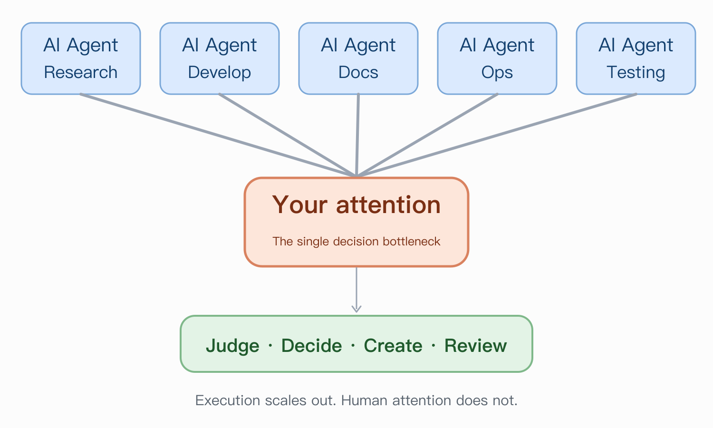
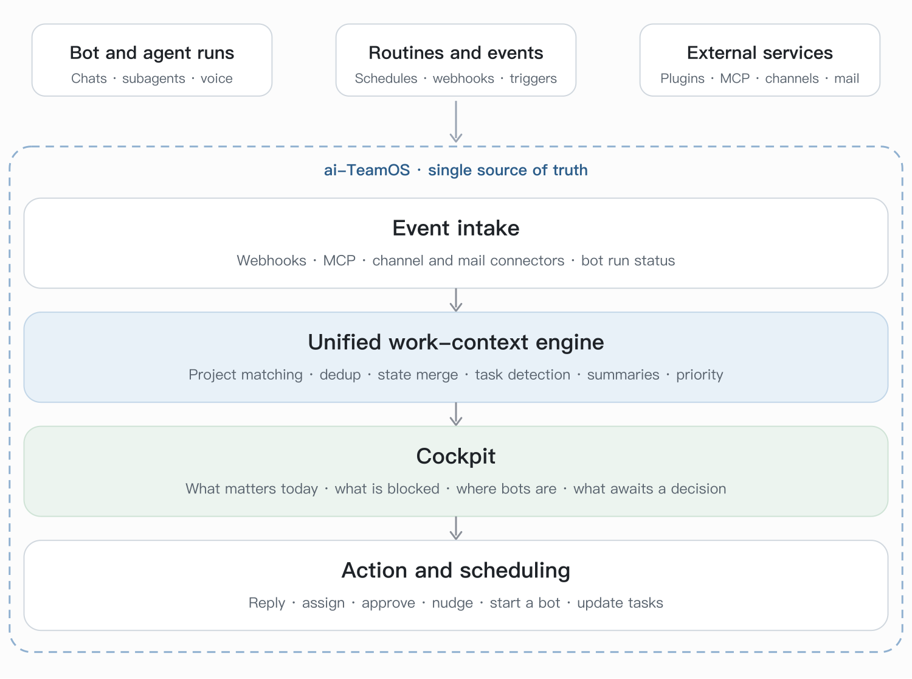
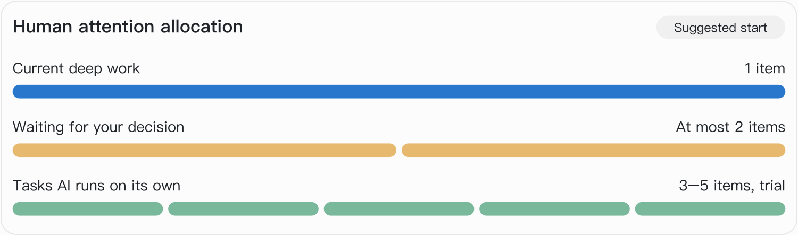
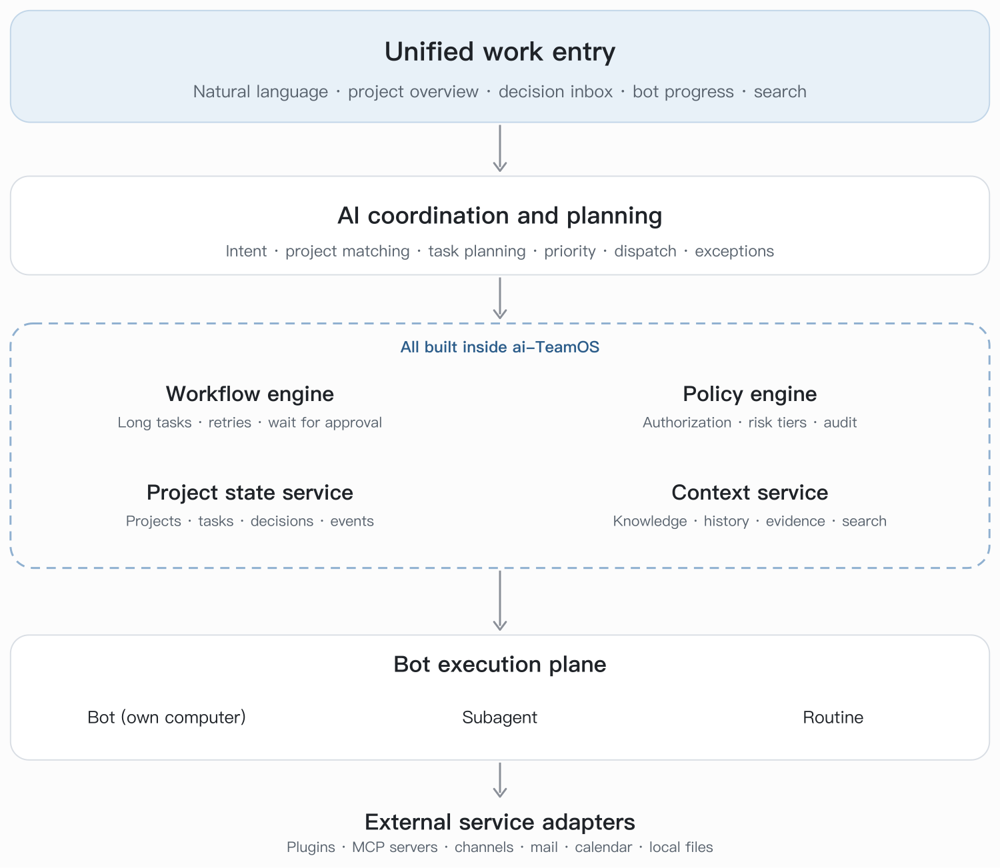

# The attention cockpit

[Back to the repository](../README.en.md) · [中文](20261126-注意力驾驶舱设计理念.md)

> This was a section of the repository README until its redesign on 2026-11-26. The text is unchanged.
> The status table reflects the time of writing and may lag behind the code; see [specs](../specs) for progress.

AI extends what each person can do. One person can now direct research, writing, coding,
browsing and operations at the same time. **Attention has not grown with it.** The limit is no
longer what you can do, but how much you can notice, decide and verify.

Research on attention points the same way. Switching tasks leaves attention residue on the
previous one ([Leroy, 2009](https://doi.org/10.1016/j.obhdp.2009.04.002)). Knowledge work with AI
shifts from doing to verifying and supervising ([Microsoft Research and CMU, CHI 2025](https://doi.org/10.1145/3706598.3713778)).
Agents that depend on each other can add to the supervision load instead of reducing it. So the
goal is not more agents. It is fewer interruptions, and a lower cost each time you step in.

The question this fork explores:

> How do we raise the value of each person's attention, and through it, their personal
> productivity?

**One principle:** unless something has to be judged by you, it should not keep occupying your
attention. Execution can run in parallel. Your attention should be spent serially, on one thing.

## One system, one source of truth

Today work is scattered across islands: agent conversations, email, chat apps, to-do lists, notes,
workflow tools. You become the only connector between them, collecting, matching, ranking and
following up by hand.

OutcomeGo takes a different route. **It does not add more tools around the agents. It brings the
parts of those tools that matter into one product, and makes that product the only source of
truth** for projects, tasks, agent runs, conversations and decisions. No separate workflow engine,
no second task database, no note-taking tool acting as a task store.

| Capability people usually get from separate tools | Direction in OutcomeGo |
| --- | --- |
| Task and project database | Built-in projects, tasks and decisions, in the same database as bots and conversations |
| Workflow automation and scheduling | Built-in routines, event triggers and agent runs |
| Agent status collection | Agent runs are first-class records, with no log scraping |
| Inbox for email and chat | Mail and channel connectors feed one event stream |
| Human decisions | Decision cards collect items that need the user's judgment |
| Notes and knowledge | Built-in memory, files and search across all of the above |
| Reminders and calendar | Routines and notifications on desktop, iOS and Android |

External services still connect, as plugins, MCP servers and channels. They are sources and
destinations. They do not hold the state.

Illustration of the direction, not of the current state. External services connect only as sources, and state lives in OutcomeGo.

## The cockpit

The home screen should answer one question: **"What is worth my attention right now?"** It is
not a board with dozens of cards.

- **Three states.** What you are working on (one item at a time), what people and agents are
  working on (many in parallel), and what is waiting for you. The figure below is the starting
  point we plan to experiment with. The numbers are adjustable parameters, not research-derived optima.

  

- **Decision cards.** Every request for your input says what to decide, what is recommended,
  the evidence and uncertainty, and what happens if you wait. You should not need to read a
  long report to see why someone is asking.
- **Ranked by impact and cost of waiting.** Emergencies interrupt immediately. Blocking
  decisions come next. Routine approvals are batched into fixed windows. Exploratory ideas go to a
  periodic review.
- **Ask in plain language.** "Where is project A, and what needs me?" is answered from tasks,
  mail, agent state and history together, without opening five apps.

## Delegation with quality gates

Misunderstanding is the most expensive kind of rework for non-coding work. The design is built
around catching it before you see the result:

1. **Intent confirmation.** Before a complex task, the agent states its understanding, and
   separates confirmed facts, inferences and unknowns. It asks only the one question that would
   change the result.
2. **Acceptance criteria up front.** Goal, deliverable, completion standard and time budget are
   written down before work starts.
3. **Automatic review.** A reviewer checks the output against the approved requirements, and
   reports specific defects with evidence, not just a score. Automatic revision stops after two
   rounds, and the root problem then goes to the decision queue.
4. **Rules that accumulate.** Corrections are classified as project-level, task-type-level or
   personal preference, and only confirmed rules become permanent.

## Safe autonomy

Agents may read authorized data, research, draft, and update internal task state on their own.
Items that need the user's judgment enter the decision flow. Tool permissions and execution gates
follow OpenTeam's existing behavior; this project does not claim to provide tool-level enforcement.
Text from mail, web pages and chats is treated as untrusted input, never as instructions. Context is
isolated per project.

## Focus rhythm

Notifications are batched into a few fixed windows. Only urgent incidents may interrupt deep
work. Every task keeps a resume point, so switching back costs seconds, not a re-read.

## Measuring success

We do not count agent output, number of calls or hours worked. We track a few numbers:

- Task switches and unnecessary interruptions per day.
- Minutes of deep work and number of core results delivered.
- How many revision rounds non-coding deliverables need.
- Time spent on acceptance.

Any numeric targets we set (for example, parallel limits or revision rounds) are trial values
to experiment with, not research-backed guarantees.

## Target layers

Illustration. Every layer is built inside this project, not brought in as an external system. The table below shows which parts exist.

## What exists and what is planned

| Area | Status |
| --- | --- |
| Bots with their own computers, shared workspace, memory, group chats, subagents | Upstream, available |
| Routines on schedules and events, mail plugin, Slack, Gmail and more, MCP | Upstream, available |
| Approval step for outbound messages (external drafts) | Upstream, available |
| Desktop, iOS and a native Android client with push notifications | Available (Android is this fork) |
| Realtime voice conversation across clients | Available in this fork, draft spec in [specs](../specs) |
| Projects, tasks and decisions as first-class objects | Planned |
| Decision inbox with ranking and batched windows | Planned |
| Intent confirmation, acceptance criteria and review gates | Planned |
| Event pipeline with deduplication, project matching and idempotency | Planned |
| Policy engine for risk-based approval | Planned |
| Cockpit home screen and natural-language project queries | Planned |

Personal WeChat has no stable official interface for reading chats. We will not build on
unauthorized database decryption or client injection. Enterprise WeChat and manual forwarding are
the realistic first steps, and WeChat is a separate feasibility study.

Design notes will be added to [specs](../specs) as each part is specified.
