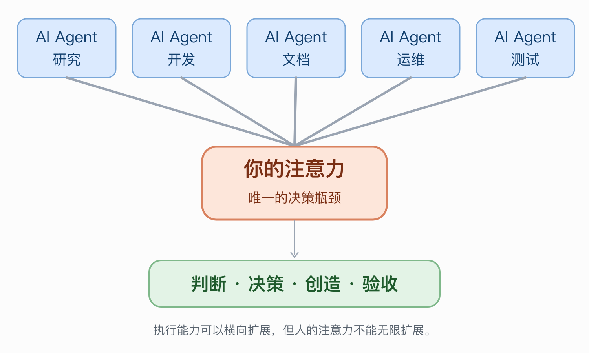
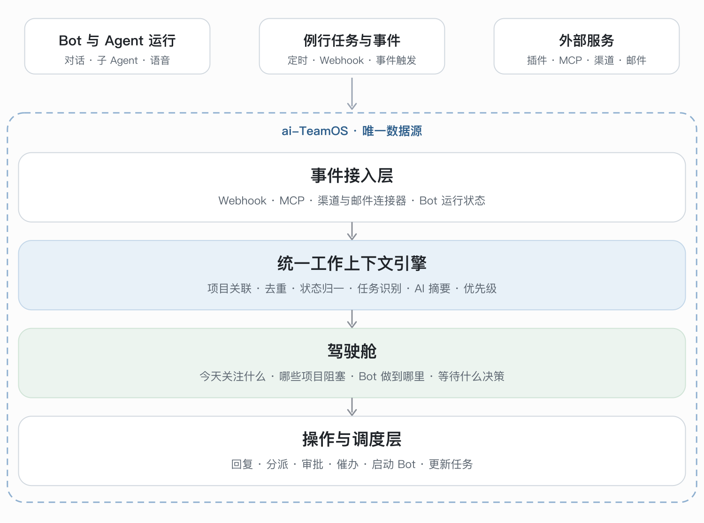
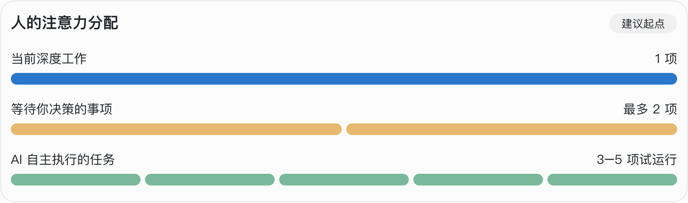
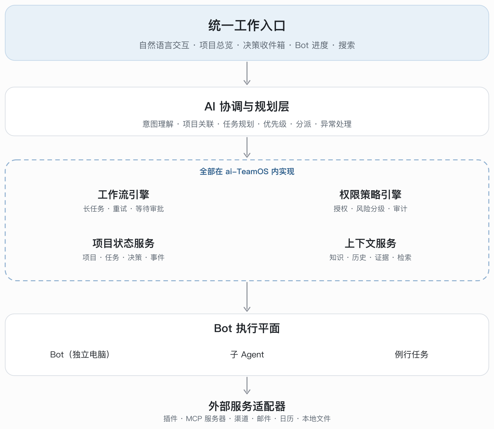

# 注意力驾驶舱设计理念

[返回仓库首页](../README.md) · [English](20261126-注意力驾驶舱设计理念.en.md)

> 本文原是仓库 README 的一节，2026 年 11 月 26 日 README 改版时移到这里，正文保持原样。
> 文中的状态表反映撰写时的情况，可能落后于当前代码，进度以 [specs](../specs) 为准。

AI 让每个人的能力边界不断扩展：一个人现在可以同时指挥研究、写作、编码、浏览和运维。
**但注意力并没有随之增长。** 瓶颈已经不是你能做多少，而是你能留意、判断和验证多少。

关于注意力的研究也指向同一个方向。切换任务会留下“注意力残留”
（[Leroy, 2009](https://doi.org/10.1016/j.obhdp.2009.04.002)）；有了 AI，知识工作的重心从直接执行转向核验与监督
（[Microsoft Research 与 CMU，CHI 2025](https://doi.org/10.1145/3706598.3713778)）；彼此依赖的 Agent 反而可能增加人的监督负担。
所以目标不是更多的 Agent，而是更少的打扰，以及每次介入时更低的理解成本。

本分支探索的问题是：

> 如何提升每个人的注意力价值，从而进一步提升个人的工作效率？

**一条原则：** 除非一件事必须由你来判断，否则它不应该持续占用你的注意力。
执行可以并行，注意力应当串行地投入在一件事上。

## 一个系统，一份唯一的数据

今天的工作散落在各个孤岛里：Agent 的对话、邮件、聊天软件、待办、笔记、自动化工具。
你成了这些系统之间唯一的连接器，要亲手收集、关联、排序和跟进。

OutcomeGo 选择另一条路：**不是在 Agent 周围再添更多工具，而是把这些工具中真正有用的能力
集成进本项目，并让本项目成为唯一的数据源**，承载项目、任务、Agent 运行、对话和决策。
不再需要另一套工作流引擎，不再需要第二个任务数据库，也不用笔记软件充当任务库。

| 通常要靠多个外部工具提供的能力 | OutcomeGo 中的方向 |
| --- | --- |
| 任务与项目数据库 | 内置项目、任务和决策，与 bot、对话在同一个数据库中 |
| 工作流自动化与定时调度 | 内置例行任务（Routine）、事件触发和 Agent 运行 |
| Agent 状态采集 | Agent 运行本身就是一等记录，不需要抓取日志 |
| 邮件与聊天收件箱 | 邮件和渠道连接器汇入同一条事件流 |
| 人工决策 | 决策卡片汇总需要用户判断的事项 |
| 笔记与知识 | 内置记忆、文件和覆盖以上所有内容的搜索 |
| 提醒与日程 | 桌面端、iOS 和 Android 上的例行任务与通知 |

外部服务仍然可以通过插件、MCP 服务器和渠道接入。它们是信息的来源和去向，不保存状态。

示意图，表达的是方向而不是现状。外部服务只作为来源接入，状态保存在 OutcomeGo 中。

## 驾驶舱

首页只回答一个问题：**“现在什么事情最值得我关注？”** 而不是一块堆满几十张卡片的看板。

- **三种状态。** 我正在处理的（同一时刻只有一项）、他人和 Agent 正在处理的（可以多项并行）、
  等待我处理的。下图是我们打算试验的起点，数字是可调的参数，不是研究得出的最佳值。

  

- **决策卡片。** 每一次需要你介入的请求，都说明要你决定什么、推荐什么、依据和不确定性是什么、
  不处理会有什么影响。你不需要读完一份长报告，才知道为什么有人找你。
- **按影响程度和等待成本排序。** 紧急事故立即通知；阻塞关键交付的决策优先处理；常规审批在固定窗口批量处理；
  探索性想法进入定期回顾。
- **用自然语言提问。** “客户 A 的项目推进到哪一步？有什么需要我处理？”由任务、邮件、Agent 状态和历史记录
  共同回答，不必再打开五个应用。

## 带质量门禁的委托

对于非编程任务，代价最高的返工来自理解偏差。设计的重点是在你看到结果之前就把它拦住：

1. **意图确认。** 复杂任务开始前，Agent 先说明自己的理解，并区分已确认的事实、推断和未知信息。
   它只问一个真正会改变结果的问题。
2. **先写验收标准。** 开工前写明目标、交付物、完成标准和时间预算。
3. **自动审查。** 审查者把成果与已批准的要求逐项对照，给出带证据的具体缺陷，而不只是一个分数。
   自动修订最多两轮，之后把根本问题提交到决策队列。
4. **规则沉淀。** 每次你的修改意见会被归类为项目级、任务类型级或个人偏好，只有经过确认的才成为长期规则。

## 有边界的自主

Agent 可以自行读取已授权的数据、做调研、写草稿、更新内部任务状态。
需要用户判断的事项会进入决策流程；具体工具权限和执行门禁沿用 OpenTeam 现有行为，本项目不宣称提供
工具级强制拦截。来自邮件、网页和聊天的文字一律视为不可信输入，不当作指令。上下文按项目隔离。

## 专注的节奏

通知被合并到少数几个固定窗口，只有紧急故障才允许打断深度工作。每个任务都保留恢复点，
切换回来时只需几秒，而不是重新读一遍。

## 如何衡量

我们不统计 Agent 的产出量、调用次数或工作了多少小时，只跟踪几个指标：

- 每天的任务切换次数和非必要打断次数。
- 深度工作的分钟数和完成的核心成果数。
- 非编程交付物平均需要几轮修改。
- 验收所花的时间。

设计中出现的数值目标（例如并行上限、修订轮数）只是供试验的参数，不是研究得出的保证。

## 目标分层

示意图。各层都在本项目内实现，而不是引入外部系统。下表列出其中哪些已经存在。

## 已有与计划

| 方面 | 状态 |
| --- | --- |
| 拥有独立电脑的 bot、共享工作区、记忆、群聊、子 Agent | 上游已有 |
| 按计划和事件运行的例行任务、邮件插件、Slack、Gmail 等、MCP | 上游已有 |
| 对外发送消息前的审批步骤（外部草稿） | 上游已有 |
| 桌面端、iOS，以及带推送通知的原生 Android 客户端 | 已有（Android 来自本分支） |
| 跨端实时语音对话 | 本分支已有，规格草案见 [specs](../specs) |
| 项目、任务、决策作为一等对象 | 计划中 |
| 带排序和批量窗口的决策收件箱 | 计划中 |
| 意图确认、验收标准和审查门禁 | 计划中 |
| 带去重、项目关联和幂等性的事件流水线 | 计划中 |
| 按风险分级审批的策略引擎 | 计划中 |
| 驾驶舱首页与自然语言项目查询 | 计划中 |

个人微信没有稳定的官方接口可以读取聊天记录。我们不会把未经授权的数据库解密或客户端注入作为方案。
企业微信和人工转发是现实的第一步，微信接入将作为单独的可行性研究。

设计文档会随着各部分的规格化陆续加入 [specs](../specs)。
