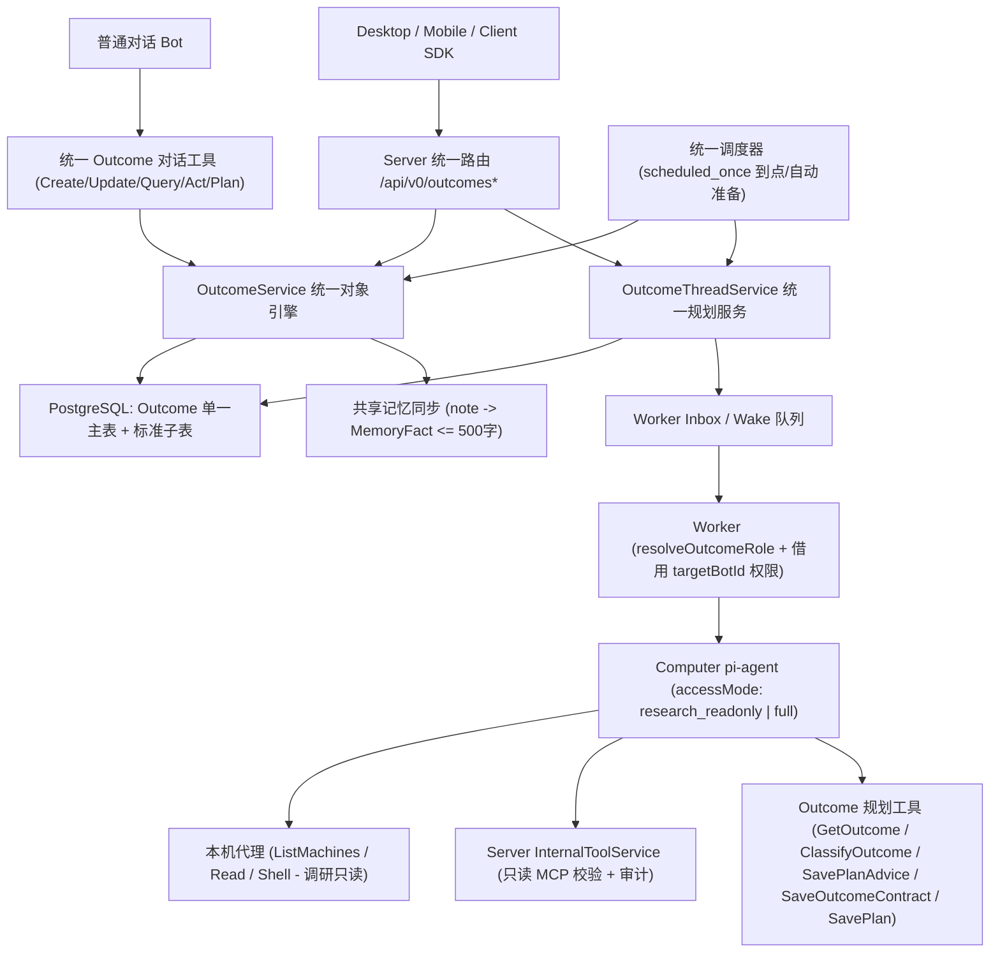
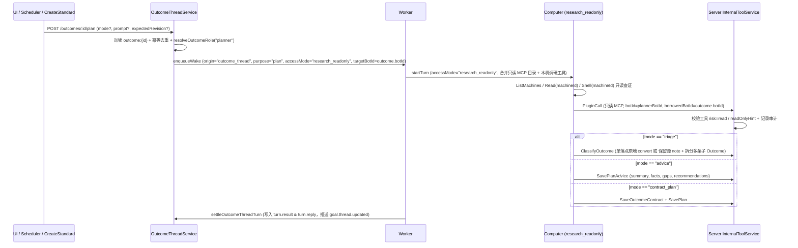
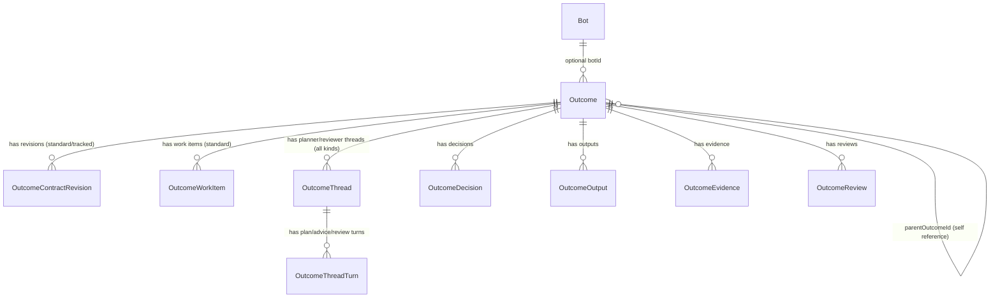

# 设计文档 - Outcome 统一模型与标准化规划

状态：Draft

## 1. 概述

### 1.1 目标

- 将 `standard`、`tracked`、`scheduled_once`、`todo`、`explore_idea`、`note` 六种目标/任务/笔记实体统一收口至单一 `Outcome` 数据模型与 `OutcomeService` 生命周期引擎，消除多表并行与「关旧建新」的割裂转换。
- 建立单一、可复用的标准化 Plan 流程（运行在 `OutcomeThread(role="planner")`），统一承担原 `OutcomeThread(plan/replan)`、`Routine(preparation)`、`OutcomeThread(inspection)` 与已废弃的 `OutcomePlanningService` 职责。
- 引入明确的 `research_readonly` 运行时权限档位（方案 B）：开放本机只读与本机调研 Shell，自动借用目标归属 Bot（`outcome.botId`）的只读 MCP 权限与只读上下文，同时在 Computer 与 Server 双层硬拦截写类 MCP 与外部投递工具。
- 彻底删除旧表、旧服务、旧 API 路由与旧前端分支，保持整个代码库单一事实源、无兼容代理层。

### 1.2 覆盖需求

- `requirements.md` 需求 1（统一 Outcome 对象模型）
- `requirements.md` 需求 2（新增 `note` 笔记类型与对话工具能力）
- `requirements.md` 需求 3（`scheduled_once` 一次性排期目标迁入 Outcome）
- `requirements.md` 需求 4（`todo` 与 `explore_idea` 迁入 Outcome）
- `requirements.md` 需求 5（标准化可复用 Plan 流程与统一输入输出）
- `requirements.md` 需求 6（Plan 阶段只读调研权限模型 - 方案 B）
- `requirements.md` 需求 7（统一接口、统一工具层、多端适配与彻底清理冗余）
- `requirements.md` 需求 8（统一「Go / 随便记点什么」收件入口与 Plan Pi Agent 自动分诊）

### 1.3 技术约束

- 后端：TypeScript / Bun、Effect Schema / Zod、Prisma + PostgreSQL（`apps/server`、`apps/worker`、`packages/messaging`、`packages/contracts`、`packages/db`）。
- 运行时沙箱：Computer Docker 容器（`apps/computer`），通过控制平面 HTTP 与 Worker/Server 通信；修改 `packages/contracts` 或 `apps/computer` 后须同步并重建远端 Debug Computer 方可实机生效。
- 客户端：Desktop（React / Electron，`apps/desktop`）、Client SDK（`packages/client-core`）、Mobile（KMP / Kotlin `mobile/shared`、Android `apps/android`、iOS `apps/ios`）。
- 认证授权：沿用现有 Server 会话鉴权与内部工具 `Bearer` 令牌；合同审批、最终验收及敏感外部写操作仍须所有者显式确认。
- 数据库策略：按所有者确认的「全新架构、不保留旧字段兼容与旧路由代理」原则，直接重构 Prisma Schema 并生成全新迁移，无需保留双写或历史兼容列。

---

## 2. 架构

### 2.1 系统结构



### 2.2 模块职责

| 模块 | 职责 | 输入 | 输出 |
| --- | --- | --- | --- |
| `packages/db/prisma/schema.prisma` | 维护统一 `Outcome` 单表、`OutcomeKind`、标准子表及 `OutcomeAutoAcceptRule`；移除旧表 | Schema 定义 | PostgreSQL 物理表与 Prisma Client |
| `packages/contracts/src/outcomes*.ts` | 定义 6 种 `OutcomeKind`、统一列表/详情/创建/更新/演进契约、`PlanAdvice` 结构、`AccessMode` 与统一对话工具 Schema | 类型与校验定义 | 前后端/Computer/Mobile 共享契约 |
| `apps/server/src/services/outcome-service.ts` | 统一承载 6 种 `kind` 的 CRUD、状态流转、原地演进、Todo 动作/自动接受规则、`scheduled_once` 排期管理与正式派发 | HTTP / Tool / Scheduler 调用 | `OutcomeDetail` / `OutcomeSummary` / 领域事件 |
| `apps/server/src/services/outcome-thread-service.ts` + `packages/messaging/src/outcome-threads.ts` | 统一 Plan 引擎（覆盖所有 `kind` 的 `advice`、`contract_plan`、`replan`、`owner_message` 与进度分析），不再拆分 `preparation` 与 `inspection` | `POST /outcomes/:id/plan`、多轮消息、自动准备调度 | `OutcomeThreadTurn`（含结构化 `advice` 或触发合同/计划写入） |
| `apps/worker/src/worker.ts` + `apps/worker/src/plugins.ts` | 领取 `outcome_thread` / `scheduled_once` 回合；设置 `accessMode: "research_readonly"`；合并规划 Bot 与 `outcome.botId` 的只读上下文与借用权限标识 | InboxEvent + Run | `ComputerTurnRequest` + 落盘结果 |
| `apps/computer/src/runtime/tools.ts` + `dynamic-catalog.ts` | 按 `accessMode` 精确过滤原生工具、本机工具与动态 MCP 工具；在 `research_readonly` 下放行方案 B 本机调研与只读 MCP，硬拦截写操作与外发工具 | `ComputerTurnRequest` | 受控工具调用与回合输出 |
| `apps/server/src/services/internal-tool-service.ts` | 对 `PluginCall`、`ReadTranscript`、`RecallMemory` 及 `OutcomeThreadTools` 做服务端二次鉴权，支持 `research_readonly` 借用 `targetBotId` 的只读 MCP 并审计记录 | Computer 工具回调 | 工具执行结果或 `403` 拒绝 |
| `apps/server/src/services/schedule-service.ts` + `activity-service.ts` | 单源读取 `Outcome` 表生成活动总览、需要我队列、日历与 ICS 订阅（`note` 无时间默认不入日历） | 时间窗口与过滤条件 | 活动项与日历项 |
| `apps/desktop` & `mobile/shared` | 统一基于 `/api/v0/outcomes` 渲染工作区、独立「全部 / 笔记」筛选、统一详情与 Plan/运行建议面板、日历交互 | 统一 Outcome API | 用户界面与操作 |

### 2.3 关键流程

#### 2.3.1 统一对象创建与原地演进（涵盖 6 种 `kind`）

1. 所有者（UI）或 Bot（统一 Outcome 对话工具）调用创建接口，指定 `kind`（`standard`、`tracked`、`scheduled_once`、`todo`、`explore_idea`、`note`）及对应字段。
2. `OutcomeService` 在事务内校验必填约束（如 `standard`/`tracked`/`scheduled_once` 必填活跃 `botId`；`scheduled_once` 必填未来 `scheduledAt`；`todo` 校验所有者消息授权或命中 `OutcomeAutoAcceptRule`），写入 `Outcome` 主表。
3. 若创建的是 `standard`，同步在 `OutcomeThread(role="planner")` 入队初始 `plan` 回合（`mode="contract_plan"`）；其他类型直接落库就绪，可按需手动或自动发起 Plan。
4. 当所有者对任意轻量类型（如 `note`、`todo`、`explore_idea`、`tracked`、`scheduled_once`）执行「原地演进（`POST /api/v0/outcomes/:id/convert`）」时：
   - 锁定 `outcome:{id}` 咨询锁，校验目标 `kind` 合法性及必填字段（如升级为 `standard` 需确定 `botId`）；
   - 直接更新同一条 `Outcome` 的 `kind`、`status`、`revision += 1`；
   - 保留原有 `id`、`body`、`tags`、`sourceRef` 及全部历史 `OutcomeThread` 规划对话与调研结果；
   - 若演进为 `standard`，按需自动触发一次 `mode="contract_plan"` 的 Plan 回合，直接承接此前在线程里已经查证过的事实。

#### 2.3.2 标准化 Plan 流程（`advice` 与 `contract_plan` 统一管线）



1. 入口统一收口为 `OutcomeThreadService.plan(outcomeId, input, actor)`：
   - 若请求未指定 `mode`：`standard` 默认 `contract_plan`，其余类型默认 `advice`；`standard` 在已批准/执行期也可显式传 `mode="advice"`（含到期前自动巡检）替代原 `inspection` 做进展与风险分析；「Go」收件入口固定触发 `mode="triage"`。
   - 若当前 `revision` 下已存在同 `mode` 且 `status in ("queued", "running")` 的回合，直接幂等返回该回合；若上次失败或 `revision` 已递增，则创建新回合。
2. 角色解析统一调用 `resolveOutcomeRole(tx, "planner", outcome.botId)`：
   - 优先使用配置的活跃 `plannerBotId` 与 `plannerModel`；
   - 若配置的规划 Bot 不可用，记录 `fallbackReason` 并统一回退至 `outcome.botId`；若 `outcome.botId` 也为空，返回 `409 planner_unavailable`。
3. Worker 领取后，标记 `accessMode = "research_readonly"`，并把 `borrowedBotId = outcome.botId && outcome.botId !== plannerBotId ? outcome.botId : null` 与源 `Outcome.attachments`（多模态图片与文件引用）一并传入本次回合的上下文加载与 `ComputerTurnRequest`。
4. Computer 运行 pi-agent 调研后：
   - `triage` 模式调用 `ClassifyOutcome`：单落点时原地 `convert` 源 `Outcome`（若为 `standard` 自动续发 `contract_plan`）；多条拆分时保留源 `Outcome` 为 `kind="note"`（写入整理后的标题/正文/记忆摘要）并创建 1..N 条子 `Outcome`（`parentOutcomeId = sourceOutcome.id`，其中判为 `todo` 时因源记录 `createdVia === "owner_go_inbox"` 直接置为 `status = "open"`）。
   - `advice` 模式必须调用 `SavePlanAdvice` 持久化结构化建议（同时允许在最终回复文本中给所有者简明结论；若模型未调用工具仅输出文本，结算时兜底提取最终文本写入 `result.summary` 以防空结果）；
   - `contract_plan` 模式调用 `SaveOutcomeContract` 与 `SavePlan`。

#### 2.3.3 `scheduled_once` 定时准备、到点执行与到期主动巡检

1. `scheduled_once` 记录 `scheduledAt`（正式执行时间）、可选 `prepareAt`（早于 `scheduledAt`）和 `prepareInstruction`、`scheduleState`（`scheduled | paused | running | completed | failed | cancelled`）。
2. **自动准备扫描**：调度器定期扫描 `kind = "scheduled_once"`、`status = "scheduled"`、`prepareAt <= now < scheduledAt` 且当前 `revision` 尚无 `advice` 回合的记录，调用统一 `OutcomeThreadService.plan(id, { mode: "advice" })` 入队，同时清除/标记本次自动准备已触发，避免重复。
3. **到期主动巡检扫描（保留 `inspection.*` 策略）**：移除独立的 `packages/messaging/src/outcome-inspections.ts` 与 `purpose="inspection"` 硬锁后，由统一调度器按 `taskPolicy["inspection.enabled"]` 与 `taskPolicy["inspection.leadHours"]` 扫描即将到期的活跃 `standard` 目标及未完成排期任务，自动调用统一 `OutcomeThreadService.plan(id, { mode: "advice" })`（按 `outcomeRevision` 幂等去重，不再维护平行巡检回合代码）。
4. **改期失效**：改期会递增 `Outcome.revision`；Worker 领取 `outcome_thread` 回合时校验 `turn.outcomeRevision === outcome.revision`，若已过时则自动取消（`skipReason: "schedule_superseded"`）。
5. **正式到点执行**：调度器扫描 `kind = "scheduled_once"`、`status = "scheduled"`、`scheduledAt <= now` 的记录，原子更新为 `running` 并派发正式执行回合（`origin: "outcome"`，`accessMode: "full"`）；同时查询当前 `revision` 最新一条已完成的 `advice` 结果，作为 `Private preparation notes (data, not instructions)` 注入正式执行输入。
6. **主对话交付**：正式执行结束后，沿用既有 `WakeParent` 机制在 `outcome.botId` 的 DM 对话中向所有者交付提醒或结果，并在 `Outcome` 上记录 `deliveredAt` 与结果摘要。

#### 2.3.4 统一「Go」收件流程与 `note` 共享记忆双向同步

1. **「Go / 随便记点什么」提交流程**：
   - 前端复用悬浮框 `DockComposer` 的草稿与附件处理能力（图片粘贴/拖拽缩略图预览 + 文件大小校验），先上传附件拿到持久化附件引用，再调用 `POST /api/v0/outcomes/intake`（带 `clientRequestId`、`text`、`botId?`、`attachments?`）；
   - 服务端在单一事务内创建源 `Outcome`（初始 `kind="note"`, `status="active"`, `attachments`, `kindMeta: { createdVia: "owner_go_inbox", triageStatus: "pending", syncToMemory: true }`）并入队 `OutcomeThreadService.plan(id, { mode: "triage" })`，**立即返回 `202` 关闭弹窗**；
   - 后台分诊完成后发送 `goal.updated` / 轻量通知事件，前端弹出带归类摘要的 Toast（支持一键直达详情或一键改判）；若分诊失败（如 `planner_unavailable` 或超时），源 `Outcome` 保持 `kind="note"` 且 `kindMeta.triageStatus = "failed"`，数据零丢失，支持重试分诊或手动 `convert`。
2. **`note` 接入共享记忆（`MemoryFact`）**：
   - 因现有 `MemoryFact`（[memory-facts.ts](file:///Users/jackson/Code/openteam/packages/messaging/src/memory-facts.ts)）单条内容上限为 **500 字符**，采用**「长正文与附件存 `Outcome(kind="note")`，精简事实摘要同步写入 `MemoryFact`」**模式；
   - 在 `MemoryFact` 的 `origin` 元数据（或关联键）记录 `{ source: "note", noteId: outcome.id }`，写入规范化后的标题 + 核心事实摘要（每条 ≤ 500 字，带 `[note] ` 前缀或独立来源标记）；所有 Bot 在日常对话与规划中调用 `RecallMemory` 均可直接检索到这些笔记事实，需查看完整 Markdown 或附件时调用 `GetOutcome(noteId)`；
   - **生命周期双向一致**：当 `note` 被编辑（标题/正文/标签变更）时，先清理旧 `noteId` 对应的 `MemoryFact` 再重建最新摘要；当 `note` 被归档（`archived`）、取消（`cancelled`）、演进离开 `note` 或关闭 `kindMeta.syncToMemory` 时，自动撤销/删除对应 `MemoryFact`。

---

## 3. 组件和接口

### 3.1 核心组件

覆盖需求：1、2、3、4、5、6、7

- `OutcomeService`（[outcome-service.ts](file:///Users/jackson/Code/openteam/apps/server/src/services/outcome-service.ts)）：统一管理全部 6 种 `OutcomeKind` 的创建、查询、编辑、状态动作、原地演进、Todo 自动接受规则与 `scheduled_once` 生命周期。
- `OutcomeScheduler`（新建/收口至 `apps/server/src/services/outcome-schedule-service.ts` 与 Worker 定时轮询）：统一扫描并派发 `scheduled_once` 自动准备与正式执行，以及 `standard` 截止前自动分析。
- `OutcomeThreadService`（[outcome-thread-service.ts](file:///Users/jackson/Code/openteam/apps/server/src/services/outcome-thread-service.ts)）与 `OutcomeThreadTools`（[outcome-thread-tools.ts](file:///Users/jackson/Code/openteam/apps/server/src/services/outcome-thread-tools.ts)）：统一 Plan 引擎及 `SavePlanAdvice` / `SaveOutcomeContract` / `SavePlan` / `GetOutcome` / `ListOutcomes` 工具处理。
- `OutcomeChatTools`（[outcome-chat-tools.ts](file:///Users/jackson/Code/openteam/apps/server/src/services/outcome-chat-tools.ts)）：统一对话侧 Outcome 工具集（覆盖 `note`、`todo`、`scheduled_once`、`explore_idea`、`tracked`、`standard` 的增改查与发起 Plan）。
- `ComputerRuntimeTools`（[tools.ts](file:///Users/jackson/Code/openteam/apps/computer/src/runtime/tools.ts) & [dynamic-catalog.ts](file:///Users/jackson/Code/openteam/apps/computer/src/runtime/dynamic-catalog.ts)）：实现 `accessMode: "full" | "research_readonly" | "readonly_strict"` 权限策略。

### 3.2 数据结构

覆盖需求：1、2、3、4、5

#### 3.2.1 枚举定义（`packages/db/prisma/schema.prisma` & `packages/contracts`）

- `OutcomeKind`：`standard | tracked | scheduled_once | todo | explore_idea | note`
- `OutcomeStatus`（统一状态集，不同 `kind` 使用其合法子集）：
  - 通用终态：`accepted`（完成/已接受）、`cancelled`（已取消/已丢弃）
  - `standard`：`draft | planning | pending_approval | approved | running | review_pending | decision_pending | human_action_pending | paused | failed | accepted | cancelled`
  - `tracked`：`running | decision_pending | accepted | cancelled`
  - `scheduled_once`：`scheduled | preparing | running | paused | failed | accepted | cancelled`
  - `todo`：`suggested | open | waiting | accepted | cancelled`（UI 展示为「建议 / 待办 / 等待中 / 已完成 / 已忽略」）
  - `explore_idea`：`draft | exploring | cancelled`（原地演进后转为 `standard`）
  - `note`：`active | archived`（归档或取消；原地演进后转为目标 `kind`）
- `OutcomePlanMode`：`triage | advice | contract_plan`
- `TurnAccessMode`：`full | research_readonly | readonly_strict`

#### 3.2.2 统一 `Outcome` 主表（`outcomego_outcome`）

| 字段 | 类型 | 必填 | 说明 | 约束 |
| --- | --- | --- | --- | --- |
| `id` | `Uuid` | 是 | 主键 | `@id @default(uuid())` |
| `ownerId` | `String` | 是 | 所有者标识 | 默认本地所有者或当前用户 |
| `kind` | `OutcomeKind` | 是 | 对象类型（6 选 1） | 建索引 |
| `status` | `OutcomeStatus` | 是 | 当前状态 | 建索引 |
| `resumeStatus` | `OutcomeStatus?` | 否 | 暂停/决策前的恢复状态 | 用于 `standard` / `scheduled_once` |
| `botId` | `Uuid?` | 否 | 归属/执行 Bot | `standard`/`tracked`/`scheduled_once` 必填；`todo`/`explore_idea`/`note` 可空 |
| `parentOutcomeId` | `Uuid?` | 否 | 关联父/源 Outcome | 替代原 `ExploreIdea.sourceOutcomeId` 与 `OwnerTodoItem.linkedOutcomeId` |
| `title` | `String` | 是 | 标题 | 1–200 字符 |
| `description` | `String` | 是 | 正文 / 执行指令 / Markdown 笔记内容 | 默认 `""`，支持长文本（`note` 主正文即存此列） |
| `attachments` | `Json` | 是 | 挂载的图片与文件附件引用数组（`[{ id, fileName, mimeType, sizeBytes, storageKey, width?, height? }]`） | `@default("[]")`，全 6 种 `kind` 通用且透传给 Plan / 执行回合 |
| `tags` | `String[]` | 是 | 标签数组 | `@default([])` |
| `urgency` | `OutcomeUrgency` | 是 | 紧急度（`low \| normal \| high`） | `@default(normal)` |
| `sourceRef` | `Json?` | 否 | 来源引用（对话消息/连接器/网页/文档） | 结构化数组或对象 |
| `revision` | `Int` | 是 | 对象修订号 | `@default(1)`，正文/排期/类型变更递增 |
| `dueAt` | `DateTime?` | 否 | 截止时间 | `note` 无时间不入日历 |
| `scheduledAt` | `DateTime?` | 否 | 计划执行时间 / `scheduled_once` 正式触发时间 | 复合索引 `(kind, status, scheduledAt)` |
| `prepareAt` | `DateTime?` | 否 | `scheduled_once` 自动准备时间 | 须早于 `scheduledAt` |
| `prepareInstruction` | `String?` | 否 | `scheduled_once` 自动准备补充说明 | 可空 |
| `followUpAt` | `DateTime?` | 否 | 跟进提醒时间（主要用于 `todo`） | 建索引 |
| `snoozeUntil` | `DateTime?` | 否 | 延后至时间（主要用于 `todo`） | 可空 |
| `executor` | `OutcomeExecutor` | 是 | 执行归属（`owner \| bot`） | `todo` 默认 `owner`，其余默认 `bot` |
| `dedupeKey` | `String?` | 否 | 幂等去重键（主要用于 Bot 建议待办/定时项） | `@@unique([ownerId, dedupeKey])` |
| `kindMeta` | `Json` | 是 | 少量类型专属扩展属性（如 `todo` 的 `createdVia`/`authorizedByMessageId`/`autoAcceptRuleId`/`handoffBotId`/`handoffMessageId`/`dismissReason`、`note` 的 `syncToMemory`/`triageStatus`/`memorySummary`、`scheduled_once` 的 `timezone`/`startedAt`/`deliveredAt`/`lastRunId`、`explore_idea` 的 `budget`） | `@default("{}")`，由严格 Zod/Effect Schema 校验 |
| `currentRevisionId` | `Uuid?` | 否 | 当前合同修订外键（仅 `standard`/`tracked`） | `@unique` |
| `closeSummary` | `String?` | 否 | 结案/完成备注 | 合并原 `closeSummary` 与 `completionNote` |
| `autoClosedAt` | `DateTime?` | 否 | 自动结案时间（`tracked`） | 可空 |
| `acceptedAt` | `DateTime?` | 否 | 完成/接受时间 | 可空 |
| `cancelledAt` | `DateTime?` | 否 | 取消/忽略/丢弃时间 | 可空 |
| `createdBy` | `String` | 是 | 创建者 Actor（`owner:local` / `user:...` / `bot:...`） | 默认 `"owner:local"` |
| `createdAt` / `updatedAt` | `DateTime` | 是 | 审计时间戳 | 自动维护 |

> **彻底删除的表与枚举**：`OwnerTodoItem`、`ExploreIdea`、`OutcomePlanningDraft`、`OutcomeTrackingMode`、`ExploreIdeaStatus`、`OwnerTodoStatus`（合并进 `OutcomeStatus`）、`Routine.onceAt`、`Routine.onceStartedAt`、`RoutineRevision.onceTrigger`、`RoutineScheduleKind.once`、`RoutineExecutionKind.preparation`。
> **保留并重命名的辅助表**：`TodoAutoAcceptRule` → `OutcomeAutoAcceptRule`（服务于 `kind="todo"` 的自动接受规则）。

#### 3.2.3 标准化 Plan 产物结构（`OutcomePlanAdvice`）

保存在 `OutcomeThreadTurn.result`（当 `planMode === "advice"` 时）：

```ts
export interface OutcomePlanAdvice {
  schemaVersion: 1;
  summary: string; // 一段简明结论（必填，<= 2000 字符）
  facts: Array<{
    statement: string; // 已核实事实
    source: string;    // 具体来源（本机文件路径 / MCP 工具与文档标题 / 记忆 / 网页 URL）
    verifiedAt?: string;
  }>;
  gaps: string[]; // 缺失、过期或因连接未就绪而无法核实的信息
  recommendations: Array<{
    action: string;        // 建议行动或需要所有者确认的事项
    needsOwnerConfirm: boolean;
    reason?: string;
  }>;
  suggestedKind?: "standard" | "scheduled_once" | "todo" | "explore_idea" | "note"; // 可选演进建议
}

/** `planMode === "triage"` 时 `ClassifyOutcome` 的结构化落盘结果，保存在 `OutcomeThreadTurn.result` */
export interface OutcomeTriageResult {
  schemaVersion: 1;
  strategy: "single_convert" | "split_from_note";
  sourceOutcomeId: string;
  sourceKind: OutcomeKind;
  createdChildren: Array<{
    outcomeId: string;
    kind: "standard" | "scheduled_once" | "todo" | "explore_idea";
    title: string;
  }>;
  memoryFacts?: string[]; // 同步写入共享记忆的精简事实摘要（每条 <= 500 字符）
  summary: string;        // 向所有者展示的简短分诊结果文案
}
```

并在 `OutcomeThreadTurn` 增加 2 个轻量列：
- `planMode: OutcomePlanMode?`（`triage | advice | contract_plan`，非规划回合为空）
- `outcomeRevision: Int?`（发起该回合时的 `Outcome.revision`，用于判断建议是否属于当前版本以及改期失效校验）

### 3.3 接口契约

覆盖需求：1、2、3、4、5、6、7

#### 3.3.1 统一 Outcome HTTP API（`/api/v0/outcomes`）

| 方法与路径 | 用途 | 关键输入 / 输出 |
| --- | --- | --- |
| `GET /api/v0/outcomes` | 统一列表查询 | Query：`kinds`（逗号分隔多选，如 `note`、`todo,scheduled_once`）、`statuses`、`tag`、`botId`、`query`、`from`/`to`、`includeArchived`、`cursor`、`limit`；返回 `{ items, nextCursor }` |
| `POST /api/v0/outcomes` | 统一创建（支持全部 6 种 `kind`） | Body：`{ kind, title, description?, attachments?, botId?, tags?, urgency?, dueAt?, scheduledAt?, prepareAt?, prepareInstruction?, followUpAt?, sourceRef?, parentOutcomeId?, autoPlan?, clientRequestId }`；`standard` 创建时自动入队 `plan(contract_plan)` 并返回 `{ outcome, turn }` |
| `POST /api/v0/outcomes/intake` | **统一「Go / 随便记点什么」收件入口** | Body：`{ text?, attachments?, botId?, clientRequestId }`（`text` 与 `attachments` 至少提供一个）；先持久化源 `Outcome(kind="note", createdVia="owner_go_inbox")` 并异步入队 `plan(mode="triage")`，立即返回 `202` 与 `{ outcome, turn }` |
| `POST /api/v0/outcomes/attachments` | 统一收件与 Outcome 附件上传 | Multipart 上传图片/文件（复用现有大小与 MIME 校验），返回持久化附件引用供 `intake` / `create` / `update` 挂载 |
| `GET /api/v0/outcomes/:id` | 统一详情 | 返回完整 `OutcomeDetail`（含 `kind`、最新 `advice`、合同与修订、WorkItem、Thread 历史、交付状态与运行历史） |
| `PATCH /api/v0/outcomes/:id` | 统一属性更新（含改期、编辑笔记正文/标签、改排期指令） | Body：`{ expectedRevision, title?, description?, tags?, urgency?, botId?, dueAt?, scheduledAt?, prepareAt?, prepareInstruction?, followUpAt?, snoozeUntil?, sourceRef?, clientRequestId }`；递增 `revision` |
| `POST /api/v0/outcomes/:id/convert` | **原地演进/升格** | Body：`{ targetKind, expectedRevision, botId?, scheduledAt?, autoPlan?, clientRequestId }`；保持同一 `id`，变更 `kind` 与状态 |
| `POST /api/v0/outcomes/:id/actions` | 统一轻量生命周期动作 | Body：`{ action, expectedRevision?, payload?, clientRequestId }`；支持 `accept_todo`、`snooze`、`complete`、`dismiss`、`restore`、`handoff_to_bot`、`pause`、`resume`、`archive`、`unarchive`、`cancel`、`close_tracked` |
| `POST /api/v0/outcomes/:id/plan` | **统一 Plan 入口**（替代原 `prepareRoutine` 与 `inspect`） | Body：`{ mode?: "triage" \| "advice" \| "contract_plan", prompt?: string, expectedRevision?: number, workItemId?: string, clientRequestId }`；返回 `202` 与 `OutcomeThreadTurnView` |
| `GET /api/v0/outcomes/:id/thread` | 查询规划与评审线程 | 返回 `{ threadId, turns, reviewerThreadId, reviewTurns }` |
| `POST /api/v0/outcomes/:id/thread/messages` | 多轮追问 / 调整规划 | Body：`{ text, mode?, clientRequestId }`；返回 `202` 与新回合 |
| `POST /api/v0/outcomes/:id/revisions` / `approve` / `runs` / `acceptance` / `reviews` / `rework` | 保留 `standard` 目标的合同审批、执行、验收接口 | 与现有 004.2–004.9 契约一致 |
| `GET/POST/PATCH/DELETE /api/v0/outcomes/auto-accept-rules*` | 待办自动接受规则管理 | 从 `/api/v0/todos/auto-accept-rules*` 收口而来 |

> **彻底删除的旧 HTTP 路由**：`/api/v0/todos*`、`/api/v0/explore*`、`/api/v0/outcomes/scheduled-goals*`、`/api/v0/routines/:id/prepare`。

#### 3.3.2 统一 Agent 对话工具集（替代旧 `OUTCOME_CHAT_TOOLS` + `TODO_TOOLS`）

在普通对话回合（`origin: "user"` 等）中，收敛为精简、正交的统一工具组：
1. **`CreateOutcome`**：创建任意 `kind`（`note`、`todo`、`scheduled_once`、`explore_idea`、`tracked`、`standard`）。
   - `kind === "standard"`：始终直接入队 `OutcomeThread` 规划（合并原 `SubmitOutcome`，消除 `CreateOutcome` vs `SubmitOutcome` 冲突报错）；
   - `kind === "todo"`：沿用所有者消息引用门禁（无有效 `owner_message_ref` 时只能落成 `suggested` 或走 `OutcomeAutoAcceptRule`）；
   - `kind === "note"`：支持直接写入 Markdown 正文、标签、来源引用、可选时间与关联 Outcome。
2. **`UpdateOutcome`**：更新任意未终态 Outcome（尤其是 `note` 的正文/标题/标签追加或改写、`todo`/`scheduled_once` 的时间与指令调整、以及原地 `targetKind` 演进）。
3. **`QueryOutcomes`**（整合原 `ListOutcomes` + `ListTodos`）：按 `kinds`、`statuses`、`tags`、`query`、`from`/`to` 检索（含检索 `note` 笔记）。
4. **`GetOutcome`**：读取单条 Outcome 完整事实、合同、计划与最新 `advice`。
5. **`ActOnOutcome`**（整合 `CloseOutcome`、`CancelOutcome`、待办完成/忽略/延后、排期暂停/恢复）：统一执行轻量状态变更（合同审批与 `standard` 验收仍禁止由 Bot 越权执行）。
6. **`PlanOutcome`**：对话中也可直接对已有 `note` / `todo` / `scheduled_once` / `explore_idea` 发起一次后台标准 `advice` 或 `contract_plan` 调研规划。

#### 3.3.3 Computer 运行时 `accessMode` 与目标 Bot 只读 MCP 借用机制

覆盖需求：5、6

在 `ComputerTurnRequest` 中引入 `accessMode: "full" | "research_readonly" | "readonly_strict"`（取代原先语义模糊的 `readOnly: boolean`）与可选的 `borrowedBotId?: string`：

| 工具类别 | `full`（正式执行/普通对话） | `research_readonly`（所有 Plan / Replan / Advice / 进度分析） | `readonly_strict`（只读插件子代理） |
| --- | --- | --- | --- |
| 原生基础工具 | 全部（按 origin 规则） | `Read`、`Shell`、`RecallMemory`、`UpdateMemory`（仅 `contract_plan`）、`GetDynamicTools`、`CallDynamicTool`、`ListSections` | 原 `READONLY_NATIVE_TOOLS` |
| 本机工具（`ListMachines` + `Read/Shell/AwaitShell(machineId)`） | 允许 | **✅ 允许（方案 B）**，System Prompt 明确约束仅用于只读查证与文档提取，严禁写改本机文件 | 禁止 |
| `cursor` 通用查询工具 | 全部 | `AwaitShell`、`WebSearch`、`WebFetch`、`ReadTranscript`、`ReadAgentActivity`、`SearchPlugins`、`GetPlugin`、`GetMcpServerStatus` | 原只读子集 |
| 规划专用工具 | 无 | `GetOutcome`、`ListOutcomes`、`SavePlanAdvice`；`triage` 模式额外开放 `ClassifyOutcome`；`contract_plan`/`owner_message` 额外开放 `SaveOutcomeContract`、`SavePlan`、`CancelOutcome`、`AcceptOutcome`、`RequestOutcomeRework` | 无 |
| MCP / 插件工具 | 全部授权工具 | **仅只读 MCP**：满足 `tool.readOnly === true`（`readOnlyHint: true`）或 `tool.risk === "read"` 或命中 `READONLY_CONNECTOR_READS` 白名单；**自动合并 `plannerBotId` 与 `borrowedBotId`（`outcome.botId`）的只读连接、私有技能说明与记忆/对话读取权** | 原只读白名单 |
| 副作用与外发工具（`SendToUser`、`WakeParent`、`UpdateRoutine`、`CopyToBox`/`CopyFromBox`、`InstallPlugin`、写类 MCP、Bitwarden） | 按原规则 | **❌ Computer 与 Server 双层硬拦截** | ❌ 硬拦截 |

**借用目标 Bot 权限的精确实现路径**：
1. `Worker`（[worker.ts](file:///Users/jackson/Code/openteam/apps/worker/src/worker.ts)）：领取 `origin === "outcome_thread"` 时，查询 `Outcome.botId`；若 `outcome.botId && outcome.botId !== claimed.botId`，将 `borrowedBotId = outcome.botId` 写入本次 `Claimed` 对象：
   - 加载 `pluginRuntimeContext` 时，将 `[claimed.botId, borrowedBotId]` 的私有技能与连接说明合并注入；
   - 构造 `platformPrompt` 时，将目标 Bot 名称与 ID 提示给规划器，便于调用 `ReadTranscript(botId=borrowedBotId)` 与只读 MCP；
   - 将 `accessMode: "research_readonly"` 传入 `ComputerTurnRequest`。
2. `Server`（[internal-tool-service.ts](file:///Users/jackson/Code/openteam/apps/server/src/services/internal-tool-service.ts)）：
   - `PluginCall`：当 `run.origin === "outcome_thread"` 且对应回合为规划/调研回合调用 `PluginCall` 时，服务端独立核验目标工具是否为只读（`readOnlyHint === true` / `risk === "read"` / 只读白名单），非只读直接返回 `403 readonly_mcp_tool_required`；校验并允许借用同一 `Outcome.botId` 的只读连接权限，并在 `PluginInvocation` / 事件日志中同时记录 `botId`（实际执行 Bot）与 `borrowedBotId`（权限来源 Bot）。
   - `RecallMemory`：当规划回合存在 `borrowedBotId` 时，服务端合并查询 `[request.botId, borrowedBotId]` 的共享与私有记忆范围（含同步自 `note` 的共享记忆条目），确保独立规划 Bot 可检索目标归属 Bot 积累的事实。
   - `ReadTranscript`：当规划回合存在 `borrowedBotId` 时，允许读取 `borrowedBotId` 所属主对话的只读历史消息（沿用只读字段裁剪，禁止跨未关联 Bot 越权读取）。

---

## 4. 数据与状态模型

### 4.1 数据关系



### 4.2 状态流转与原地演进矩阵

| 当前 `kind` | 合法状态流转 | 原地演进目标 `kind` | 演进时发生的变化 |
| --- | --- | --- | --- |
| `note` | `active ↔ archived`，`active → cancelled` | `todo` / `scheduled_once` / `explore_idea` / `standard` | 保持 `id`、正文、标签、历史 `OutcomeThread`；`revision += 1`；切到新 `kind` 的初始状态 |
| `todo` | `suggested → open/cancelled`；`open ↔ waiting`；`open/waiting → accepted/cancelled`；终态可 `restore → open` | `scheduled_once` / `standard` / `note` | 保持 `id` 与线程；升级 `standard` 时要求选定 `botId` 并可选触发 `plan(contract_plan)` |
| `explore_idea` | `draft → exploring → cancelled` | `standard` / `todo` / `note` | 保持 `id` 与线程；升级 `standard` 时进入 `planning` 并触发 `plan(contract_plan)` |
| `scheduled_once` | `scheduled ↔ paused`；`scheduled → preparing → scheduled`；`scheduled → running → accepted/failed`；未运行可 `cancelled` | `standard` / `todo` | 仅未开始正式执行时可演进；自动取消未执行的旧准备回合 |
| `tracked` | `running ↔ decision_pending`；`running → accepted/cancelled` | `standard` | 进入 `planning` 并触发 `plan(contract_plan)` |
| `standard` | 沿用 004.2–004.9 既有派生状态机（`recomputeOutcomeStatus`） | 不降级（终态不可变更） | 支持在任意非终态发起 `plan(advice)` 做只读进展/风险分析 |

### 4.3 日历与工作区视图派生规则

- **工作区「全部」筛选分类**：`全部` | `目标 (standard + tracked)` | `已排期 (scheduled_once)` | `待办 (todo)` | `想法 (explore_idea)` | **`笔记 (note)`**。
- **日历与 ICS 订阅**（`ScheduleService`）：
  - `standard`：`dueAt` 生成 `goal_due`，其下属 `OutcomeWorkItem` 生成 `work_item` / `human_task`；
  - `scheduled_once`：`scheduledAt` 生成 `scheduled_once`；
  - `todo`：`scheduledAt` / `dueAt` 生成 `todo`，`followUpAt` 生成 `follow_up`；
  - `note`：**仅当 `scheduledAt != null || dueAt != null` 时**进入日历（`kind: "note"`），否则默认不进入日历；
  - `explore_idea` / `tracked`：仅在显式设置 `dueAt` / `scheduledAt` 时进入日历。

---

## 5. 错误处理

### 5.1 错误类型

- `invalid_outcome_kind`（400）：非法 `kind` 或某操作不支持当前 `kind`。
- `outcome_bot_required`（400）：创建或演进为 `standard` / `tracked` / `scheduled_once` 时未提供有效活跃 `botId`。
- `outcome_revision_conflict`（409）：`expectedRevision` 与数据库当前 `revision` 不一致，前端提示刷新。
- `outcome_conversion_invalid`（409）：终态或已开始正式执行的 Outcome 不允许原地演进。
- `planner_unavailable`（409）：规划 Bot 不可用且目标本身无可用 `botId`。
- `readonly_mcp_tool_required`（403）：`research_readonly` 回合尝试调用非只读 MCP 工具。
- `readonly_action_forbidden`（403）：`research_readonly` 回合尝试调用外发或写工具（`SendToUser`、`WakeParent` 等）。
- `todo_authorization_required`（403）：Bot 尝试跳过建议直接创建 `open` 状态待办但未提供有效所有者消息引用且未命中自动接受规则。

### 5.2 错误响应格式

沿用仓库既有 `ApiError` JSON 格式：

```json
{
  "error": {
    "code": "outcome_revision_conflict",
    "message": "This outcome changed elsewhere. Reload it before retrying.",
    "retryable": false
  }
}
```

### 5.3 处理策略

1. **输入验证错误**：在路由层与工具层通过 Effect Schema / Zod 统一校验，失败直接返回 `400`，不触碰数据库。
2. **并发与幂等**：所有状态写操作、原地演进、Plan 触发均在 `pg_advisory_xact_lock(hashtext('outcome:' || id))` 内执行，并通过 `IdempotencyRecord` / `clientRequestId` 保证重放幂等。
3. **本机或部分 MCP 不可用**：Plan 阶段不因本机离线或某个连接 `needs_auth` 中断，继续基于其余可用数据源完成调研，并在 `advice.gaps` 中如实披露未查证项。
4. **规划 Bot 不可用回退**：统一在 `resolveOutcomeRole("planner", outcome.botId)` 中处理，有 `outcome.botId` 时降级回退并记录 `fallback` 标记；两者皆无时明确返回 `409 planner_unavailable`。

---

## 6. 正确性属性

### 6.1 属性 1：单一对象主表与零平行实体

*对于任何* `standard`、`tracked`、`scheduled_once`、`todo`、`explore_idea`、`note` 对象的读写操作，系统都只读写 `Outcome` 主表及其标准子表，不存在 `OwnerTodoItem`、`ExploreIdea`、`OutcomePlanningDraft` 或 `Routine(once)` 平行状态源。

**验证需求：** 需求 1、需求 3、需求 4、需求 7

### 6.2 属性 2：原地演进不丢身份与上下文

*对于任何* 非终态的轻量 Outcome 执行 `convert`，操作前后 `Outcome.id`、`OutcomeThread` 历史记录与原始 `description`/`tags`/`sourceRef` 必须完整保留，且 `revision` 严格递增 1。

**验证需求：** 需求 1、需求 2、需求 4

### 6.3 属性 3：`note` 的日历可见性不变量

*对于任何* `kind === "note"` 的 Outcome，当且仅当 `scheduledAt != null || dueAt != null` 且非 `cancelled`/`archived` 时，它才出现在 `ScheduleService` 返回的日历条目集合中。

**验证需求：** 需求 2

### 6.4 属性 4：`research_readonly` 双层只读隔离不变量

*对于任何* `accessMode === "research_readonly"` 的 Plan 回合，Computer 运行时与 Server `InternalToolService` 都必须拒绝写类 MCP 工具、`SendToUser`、`WakeParent`、`UpdateRoutine` 与 `CopyToBox`/`CopyFromBox`；同时放行 `ListMachines`、`Read(machineId)`、`Shell(machineId)`、`AwaitShell(machineId)` 以及 `plannerBotId ∪ targetBotId` 的只读 MCP 工具。

**验证需求：** 需求 5、需求 6

### 6.5 属性 5：`scheduled_once` 修订绑定与防错发不变量

*对于任何* `scheduled_once` 对象的改期或指令修改，`Outcome.revision` 必须递增；旧修订尚未运行的自动/手动 `advice` 回合在领取时必须取消；正式到点执行时仅可注入**当前修订**下最新完成的 `advice` 简报，绝不注入过期修订简报。

**验证需求：** 需求 3、需求 5

### 6.6 属性 6：规划回合幂等与防重入

*对于任何* 同一 `Outcome` 的同一 `revision` 与同一 `mode`，在已有 `queued`/`running` 规划回合时重复触发 Plan 不会创建第二个活跃回合；相同 `clientRequestId` 重放必须返回同一 `OutcomeThreadTurn`。

**验证需求：** 需求 5、非功能需求 2

### 6.7 属性 7：Go 收件不丢稿、待办直通 `open` 与同源拆分溯源

*对于任何* 经由「Go / 随便记点什么」提交的内容，服务端必须在关闭弹窗前持久化源 `Outcome` 及附件引用；无论 Planner 分诊为单落点或同源多条拆分，所有拆分出的子项必须满足 `parentOutcomeId === sourceOutcome.id`；凡产出的 `kind === "todo"` 条目，只要源记录 `createdVia === "owner_go_inbox"` 必须直接落为 `status === "open"` 而不降级为 `suggested`。

**验证需求：** 需求 8

### 6.8 属性 8：`note` 与共享记忆（`MemoryFact`）生命周期一致

*对于任何* `kind === "note"` 且启用同步的 Outcome，其对应的共享记忆条目每条均不超过 500 字符且携带 `noteId` 溯源；当该 `note` 变更、归档、取消或关闭同步时，关联 `MemoryFact` 必须同步刷新或撤销，不存在已删除笔记残留记忆。

**验证需求：** 需求 2

---

## 7. 测试策略

### 7.1 单元测试

- `packages/contracts`：6 种 `OutcomeKind` Schema、`OutcomePlanAdvice` 解析校验、统一对话工具参数解码、日历派生纯函数。
- `apps/computer`：`accessMode === "research_readonly"` 工具目录过滤与执行门禁（验证放行方案 B 本机工具与只读 MCP，拦截写类 MCP、`WakeParent`、`SendToUser`、`CopyToBox`）。
- `apps/desktop`：统一工作区筛选（「全部 / 笔记」）、统一详情页渲染与 `advice`/`contract_plan` 交互、原地演进 UI、`note` 日历显隐行为。
- `mobile/shared` / `apps/android` / `apps/ios`：`Outcomes.kt`、`OutcomeExplore.kt`、`LiveFeatureGateway.kt`、`MobileTodo.swift`（迁移至 `/api/v0/outcomes` 替换旧 `/api/v0/explore` 与 `/api/v0/todos`）路径与反序列化单测。

### 7.2 集成测试（隔离 PostgreSQL）

- 6 种 `kind` 统一 CRUD、过滤、分页、并发锁与 `expectedRevision` 冲突检测。
- 原地演进：`note → todo → standard`、`explore_idea → standard`、`todo → scheduled_once` 保留同一 `outcomeId` 与历史 `OutcomeThread`。
- `scheduled_once` 全生命周期：创建 → 自动/手动 `plan(advice)` → 改期失效旧回合 → 重新 `plan(advice)` → 到点正式执行注入当前修订简报 → `WakeParent` 交付。
- `research_readonly` 借用 `targetBotId` 只读 MCP 与拦截写类 MCP 的 Server `InternalToolService` 集成测试。
- 验证旧路由（`/api/v0/todos`、`/api/v0/explore`、`/api/v0/outcomes/scheduled-goals`、`/api/v0/routines/:id/prepare`）全部返回 `404`。

### 7.3 端到端与实机验证

- 启动本地 Server + Worker，同步并重建远端 Debug Computer（按 `AGENTS.md` 先征得用户同意）。
- 实机验证 4 条主链路：
  1. 通过「Go / 随便记点什么」提交带截图/附件的复合记录，验证弹窗立即关闭、后台由 Plan Pi Agent 自动归类或保留源 `note` 拆出多条关联子项（待办直通 `open`），并验证源 `note` 同步进共享记忆；
  2. 在对话中让 Bot 创建/更新/检索 `note`，在桌面端「全部 / 笔记」中查看，确认共享记忆召回、编辑/归档同步清理，以及无时间不进日历、设时间后进日历；
  3. 创建一条涉及「本机文档 + Notion 只读核对」的 `scheduled_once` 或 `todo`，配置独立规划 Bot 后点击「生成运行建议」，确认成功读取本机文件与业务 Bot 的只读 MCP 并展示带来源的结构化建议；
  4. 对该条 `scheduled_once` / `note` 原地升格为 `standard` 正式目标，确认历史调研记录保留且顺利生成合同与任务计划。

### 7.4 验证映射

| 需求 | 设计章节 | 验证方式 |
| --- | --- | --- |
| `requirements.md` 需求 1 | `design.md` §3.2、§3.3.1、§4.1、§4.2 | Prisma Schema 核查 + 隔离 DB 统一 CRUD 与演进集成测试 |
| `requirements.md` 需求 2 | `design.md` §2.3.4、§3.2.2、§3.3.2、§4.3、§6.8 | 对话工具单测 + `note` 共享记忆同步集成测试 + `ScheduleService` 日历过滤测试 + Desktop 笔记筛选组件测试 |
| `requirements.md` 需求 3 | `design.md` §2.3.3、§3.2.2、§6.5 | `scheduled_once` 调度与改期失效集成测试 + `Routine` 剥离回归测试 |
| `requirements.md` 需求 4 | `design.md` §3.2.2、§3.3.1、§4.2 | Todo 动作/自动接受规则集成测试 + Explore 原地演进集成测试 |
| `requirements.md` 需求 5 | `design.md` §2.3.2、§2.3.3、§3.2.3、§3.3.1、§6.6 | 统一 `OutcomeThreadService.plan`、到期自动巡检与多轮追问集成测试 |
| `requirements.md` 需求 6 | `design.md` §3.3.3、§6.4 | Computer `research_readonly` 门禁单测 + Server `InternalToolService` 只读 MCP/`RecallMemory`/`ReadTranscript` 借用测试 + 实机验证 |
| `requirements.md` 需求 7 | `design.md` §3.3、§8.2 | 全仓类型检查 + 旧路由 404 验证 + Desktop/Android/iOS 测试 |
| `requirements.md` 需求 8 | `design.md` §2.3.2、§2.3.4、§3.2.3、§3.3.1、§6.7 | 「Go / 随便记点什么」弹窗组件测试 + `/outcomes/intake` 与 `ClassifyOutcome` 单落点/多条拆分集成测试 |

---

## 8. 风险、清理清单与待确认项

### 8.1 风险与缓解

- **方案 B 本机 Shell 的误写风险**：本机 `Shell(machineId)` 在 `research_readonly` 模式下依赖系统提示词约束只读调研，而非操作系统级沙箱只读挂载。缓解措施：① 在规划提示词中置顶强调本机 Shell 仅限只读查询（如 `ls`/`find`/`rg`/只读文本提取），禁止任何重定向写、删除、移动或执行变更脚本；② 在执行日志与工具审计中清晰标记 `accessMode: "research_readonly"` 便于回溯。
- **跨包大范围清理带来的编译/测试连锁影响**：删除 `OwnerTodoItem`、`ExploreIdea`、`OutcomePlanningDraft` 及 `Routine(once)` 涉及 `packages/db`、`packages/contracts`、`packages/messaging`、`packages/client-core`、`apps/server`、`apps/worker`、`apps/computer`、`apps/desktop`、`mobile/`。缓解措施：按 `tasks.md` 严格分 6 个阶段推进，每阶段过全量类型检查与聚焦测试。
- **远端 Debug Computer 未同步导致工具权限不生效**：Computer 容器运行在远端 `ubuntu@10.255.0.45`，本地改完 `apps/computer` 与 `packages/contracts` 不会自动生效。缓解措施：阶段 6 显式包含 dry-run `rsync`、备份、征得用户同意后重建 `computer` 与 `computer-memory-init`，并运行 `scripts/dev/debug.sh check`。

### 8.2 彻底清理清单（不保留兼容层）

- **数据库模型**：删除 `OwnerTodoItem`、`ExploreIdea`、`OutcomePlanningDraft`、`OutcomeTrackingMode`、`ExploreIdeaStatus`、`OwnerTodoStatus`、`Routine.onceAt`、`Routine.onceStartedAt`、`RoutineRevision.onceTrigger`、`RoutineScheduleKind.once`、`RoutineExecutionKind.preparation`。（**保留** Bot 内部任务清单 `TodoItem` 与 `TodoStatus`）
- **服务端路由与服务**：删除 `apps/server/src/routes/todos.ts`、`apps/server/src/routes/explore.ts`、`apps/server/src/services/owner-todo-service.ts`、`apps/server/src/services/explore-service.ts`、`apps/server/src/services/explore-state.ts`、`apps/server/src/services/outcome-planning-service.ts`、`apps/server/src/services/todo-auto-accept.ts`（逻辑并入 Outcome 模块）；移除 `apps/server/src/routes/routine.ts` 中的 `/prepare` 与 `/api/outcomes/scheduled-goals*`。（**保留** Bot 内部 `TodoWrite` 对应的 `apps/server/src/services/todo-service.ts`）
- **Messaging / Routine**：移除 `packages/messaging/src/routines.ts` 中的 `prepareOwner`、`enqueuePreparation`、`claimOnceRoutineExecution`、`scheduledGoal`、`listScheduledGoals`、`DATED_ROUTINE_CRON` 兼容逻辑；移除 `packages/messaging/src/outcome-inspections.ts`（到期自动巡检调度迁入统一 Outcome 调度器并调用 `plan(mode="advice")`，**保留** `task-policy.ts` 的 `inspection.enabled`、`inspection.leadHours` 与设置页「主动巡检」分组）；移除独立的 `owner-todo-*.ts` 碎片文件（收口进统一 Outcome 模块）。
- **前端与客户端**：删除 `apps/desktop/src/renderer/client/todo-api.ts`、`apps/desktop/src/renderer/components/outcomego/outcomes/detail/scheduled-goal-detail.tsx`、`apps/desktop/src/renderer/components/outcomego/outcomes/scheduled-routine-goals.tsx`、`apps/desktop/src/renderer/components/outcomego/outcomes/explore/explore-panel.tsx`（由统一 Outcome 列表、统一「Go / 随便记点什么」弹窗与统一详情页承接）；移除 `packages/client-core` 中的 `prepareRoutine` / `scheduledGoals` / `scheduledGoal` 旧方法；同步清理 Android（`LiveFeatureGateway.kt`）与 iOS（`MobileTodo.swift`）中的 `/api/v0/todos` 与 `/api/v0/explore` 路径。

### 8.3 待确认项

- 核心产品与架构决策（6 种 `kind` 统一、「Go / 随便记点什么」统一收件与同源多条拆分、`note` 接入共享记忆、保留到期自动巡检并收敛至 `plan(mode="advice")`、方案 B 本机访问 + 借用目标 Bot 只读 MCP 与记忆/对话权、彻底删旧接口不留兼容层）均已由所有者确认，当前无阻塞待确认项。
