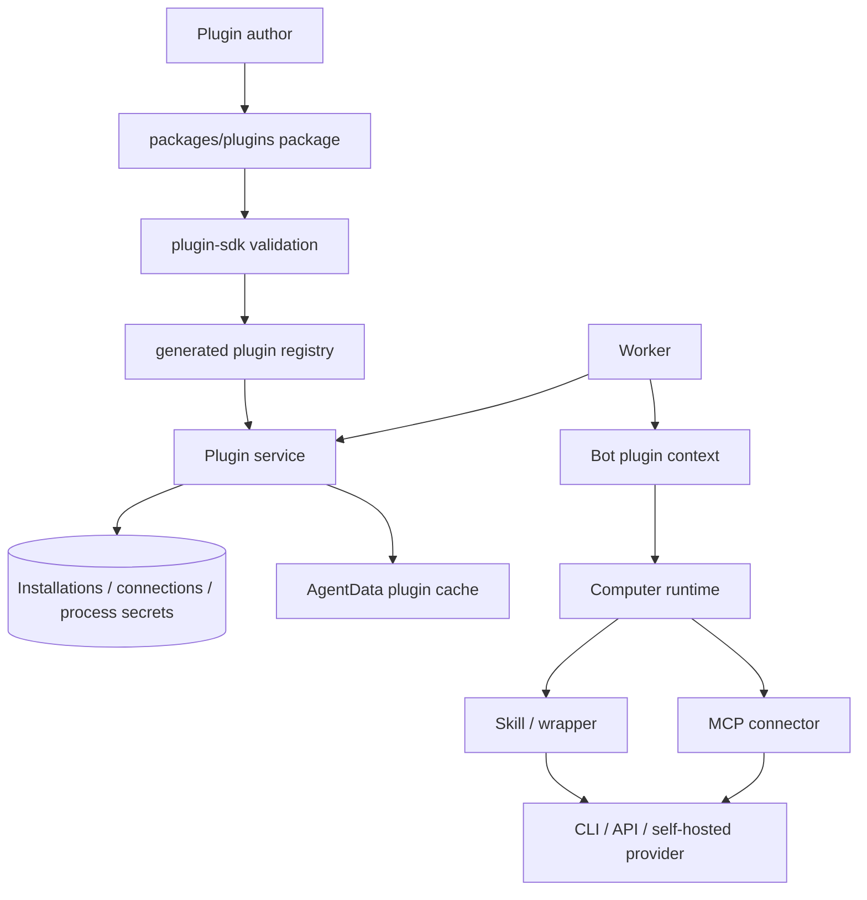

# 设计文档 - 插件扩展体系

状态：草案

关联文档：[README.md](README.md) · [requirements.md](requirements.md) · [tasks.md](tasks.md)

## 1. 概述

### 1.1 目标

插件体系使用现有 OpenTeam Server、Worker、computer runtime、插件 SDK 和 `packages/plugins` 目录形成稳定的扩展边界。父规格负责共同规则；具体 provider 的 API、CLI、OAuth、网络和字段读取由子规格负责。

### 1.2 覆盖需求

- `requirements.md` 需求 1、2：包契约和能力分层。
- `requirements.md` 需求 3、4：配置、secret 和 runtime field 生命周期。
- `requirements.md` 需求 5、6：Bot scope、工具风险和安全边界。
- `requirements.md` 需求 7、8：provider 兼容性和账号生命周期。
- `requirements.md` 需求 9、10：测试、发布和子规格治理。

### 1.3 技术约束

- 插件包目录：`packages/plugins/<plugin-key>/`。
- 共享定义：`packages/plugin-sdk`。
- Server 生命周期：`apps/server/src/services/plugin/`。
- Bot context：`apps/worker/src/plugins.ts`、`packages/messaging/src/plugin-skill-catalog.ts`。
- Bot computer runtime：`apps/computer/src/runtime/`、`apps/computer/src/mcp-manager.ts`。
- 插件缓存：`agent-data/plugin-skills` 和 `agent-data/plugins/cache`。
- 凭据存储：现有 `ProcessSecret`、connector credentials 和 OAuth storage，按插件类型选择。
- 生成方式：`packages/plugins/scripts/generate.ts` 发现插件并生成 registry。
- 安全策略：插件 secret 不进入包、registry、公开 API、活动日志或测试输出。

## 2. 总体架构

### 2.1 系统结构



### 2.2 数据和能力流

1. 插件作者提交包文件和 manifest。
2. SDK 解析并校验包，生成稳定插件定义。
3. Server 安装插件快照，保存 manifest，不保存用户运行值在包文件中。
4. 用户通过设置页面配置 setup fields、connector account 或 plugin runtime fields。
5. Server 根据插件类型把值写入对应的受保护存储。
6. `AgentDataStore` 将 Skill 和包文件同步到 Bot computer。
7. Worker 为主 Bot 或指定 worker 构造插件 context。
8. Bot 调用 Skill、Shell、MCP 或浏览器工具。
9. Runtime 根据 scope、连接状态和配置启动对应 provider 进程或发起 provider 请求。
10. 结果经过 provider 适配、secret redaction 和工具结果渲染后返回模型。

### 2.3 模块职责

| 模块 | 职责 | 所有权 | 不负责 |
| --- | --- | --- | --- |
| `plugin-sdk` | 定义和校验 package、field、connector、Skill 和 runtime component | 包契约 | provider 账号和数据库事务 |
| `packages/plugins/scripts/generate.ts` | 发现目录、构建 connector、收集资源、生成 registry | 包构建 | 用户值和连接状态 |
| `PluginInstallations` | 安装、更新、替换 runtime fields、卸载 | 插件安装生命周期 | provider API 请求 |
| `PluginQueries` | 返回目录、安装、连接和状态的公开视图 | secret-free 查询 | secret 值回显 |
| `PluginConnectors` / transport | 启动、连接、调用和关闭 MCP | connector 运行时 | Skill-only CLI 动作 |
| `process-secrets` | 保存和读取 plugin runtime fields | Bot process 环境 | provider item 选择 |
| `plugins.ts` / Skill catalog | 向 worker 提供 Skill 和 runtime package | worker context | provider 认证决策 |
| `computer runtime` | 执行 Shell、Read、Browser、MCP 和子进程清理 | Bot computer 执行 | 修改插件 manifest |
| 插件包自身 | provider 适配、Skill、脚本和资源 | provider-specific 行为 | 复制通用生命周期 |

## 3. 插件能力模型

### 3.1 插件类型

| 类型 | manifest | 运行位置 | 典型能力 | 账号存储 |
| --- | --- | --- | --- | --- |
| Skills-only | `components: ["skills"]`，`connections: []` | Bot computer Shell/Browser | CLI、文件流程、浏览器操作 | plugin runtime fields 或 Bot computer 配置 |
| Remote MCP | `components: ["mcp"]`，HTTP connector | Server/connector transport | Provider API 和结构化工具 | plugin connection credentials/OAuth |
| Packaged MCP | `components: ["mcp"]`，stdio connector | Bot computer | 自包含 MCP server 和本地工具 | connector configuration/credentials |
| Hybrid | `components: ["skills", "mcp"]` | Skill + connector | 结构化读取与浏览器工作流 | 各自声明，禁止无说明复制 |
| Runtime components | `rules`、`commands`、`agents`、`hooks` | 支持的 Bot/runtime | workflow 扩展 | package files，不能携带 secret |

### 3.2 manifest 的共同边界

`PluginDefinition` 必须包含：

- 稳定 `key`、语义化 `version`、显示名称、描述、publisher 和 category。
- `components`、`connections`、`skills` 和可选 runtime components。
- `setupFields`、connector setup、OAuth 声明和安装步骤。
- icon、source revision、上游文件清单和 package files。

以下内容禁止进入 manifest 或 package files：

- API Key、密码、OAuth token、refresh token、session key。
- `.env`、credentials 文件、auth 文件和用户个人配置。
- 未经过来源固定的上游二进制或脚本。
- 指向本地绝对路径、用户目录或不可验证临时路径的配置。

### 3.3 工具风险和能力声明

connector tool 必须声明：

```ts
interface PluginToolDefinition {
  name: string;
  description: string;
  risk: "read" | "write" | "destructive";
  inputSchema: Record<string, unknown>;
}
```

风险声明用于工具目录、只读 worker 和测试验证。它不是一个新的全局审批平台；实际写入确认仍由现有工具合同、用户确认和 provider 连接流程负责。

### 3.4 Skills scope

Skill 默认只给 `main`。需要给其他 worker 时必须显式声明 `agents`：

```json
{
  "name": "provider-login",
  "agents": ["main", "computerUse"]
}
```

- `main`：可读取 Skill，并按需调用 Shell、connector 和 Task。
- `executor`：只有被声明和当前任务允许时才使用 Skill/connector。
- `knowledgeWork`：可使用知识工作需要的 provider 能力。
- `computerUse`：主要使用浏览器、桌面和 Skill；不默认继承 parent connector。
- `videoReview`、`watchVideo`：除非子规格明确声明，不接收凭据类 Skill。

### 3.5 Connector scope

connector account 通过稳定 connection ID、alias 和 namespace 路由。公开 namespace 可以变化，内部 connection ID 保持稳定。

- 主 Bot 和支持 parent connector 的 worker使用同一连接 ID。
- `computerUse` 默认不直接调用父级 connector；需要网页登录时使用显式 Skill 或由主 Bot 完成结构化读取后再委派。
- 只读 plugin agent 只能调用 connector tool 中风险为 `read` 的工具。
- 连接状态为 `needs_auth`、`error` 时，Bot 必须报告实际状态并进入现有认证/重连流程。

## 4. 配置、secret 和 runtime field

### 4.1 三种配置值

| 类型 | 示例 | 存储 | 公开视图 | 运行时用途 |
| --- | --- | --- | --- | --- |
| 普通 setup value | 邮箱、display name、非敏感 scope | connection configuration 或 installation values | 可按 schema 返回 | connector 或设置展示 |
| connector secret | API token、OAuth secret | connection credentials / OAuth storage | 仅 configured 状态 | connector process/HTTP |
| plugin runtime field | CLI server URL、主密码、CLI client ID | plugin ProcessSecret owner key | Saved/Not set | Bot computer process environment |

一个字段是否 secret 和是否 runtime field 是两个维度：

- `secret: true` 表示不能回显，必须使用受保护输入和脱敏。
- `environment` 表示执行 Bot process 时需要注入。
- 普通 runtime field 可以是 `secret: false`，例如 Vaultwarden server URL 和邮箱；它仍不进入插件包或系统 prompt。

### 4.2 runtime field 生命周期

```text
plugin setup value
  → validateValues
  → storePluginEnvironment(plugin:<key>)
  → processEnvironment(botId)
  → Shell/MCP child environment
  → SecretRedactor / process cleanup
```

必须保持：

- runtime field 名称全局冲突检测。
- plugin owner key 与 Bot/personal owner key 分开。
- Bot-specific secret 的 precedence 高于 plugin runtime field，保持现有行为。
- 更新 manifest 时清理不再声明的 environment names。
- 卸载插件时删除该 plugin owner key 的全部值。
- 读取结果和公开 API 不返回 secret value。

### 4.3 provider 配置不能写入 Skill

Skill 只包含动作和方法，不包含：

- server URL 的真实值；
- 用户邮箱、用户名或 item id；
- API Key、密码、TOTP 或 session；
- 测试账号的真实凭据。

Skill 可以引用 `plugin-skills/cache.json` 中的相对支持文件路径，但支持文件也必须是无用户值的静态内容。

## 5. 插件生命周期

### 5.1 安装

1. `SearchPlugins` / Marketplace 获得稳定 plugin key。
2. `GetPlugin` 读取 manifest、组件、setup fields 和 connectors。
3. Server 校验 setup values 和 environment fields。
4. 事务创建 `PluginInstallation`、connector connections 和 plugin runtime fields。
5. 同步 Skill、connector package files 和 cache index。
6. 下一个 Bot turn 获取新插件能力。

### 5.2 配置与连接

- Skills-only 插件没有 connector account，使用 installation-level runtime fields。
- connector 插件按 account alias 创建独立 connection。
- setup value 和 secret value 分开保存，公开 view 只显示非敏感值和配置状态。
- 修改连接配置时增加 generation/fingerprint，运行时拒绝旧请求覆盖新配置。
- OAuth refresh token、API token 和 connector env 只进入对应 connector runtime。

### 5.3 更新和回滚

插件更新由 package key + version + manifest digest 识别：

1. 下载或读取新包。
2. 验证 package files、source revision、icon、manifest 和 connector build。
3. 计算 package revision。
4. 生成更新摘要，标记 connector transport、endpoint、setup 或 runtime component 变化。
5. 兼容变化保留账号和 runtime fields。
6. 需要重新连接的变化停止旧 runtime，并按状态进入 reconnect。
7. 更新失败保留旧版本；回滚恢复旧 manifest、cache 和运行状态。

### 5.4 卸载

卸载顺序：

1. 停止所有 connector runtime。
2. 删除连接账号、connector credentials 和 OAuth session。
3. 删除 plugin runtime fields。
4. 删除 Skill/package cache index 和安装快照。
5. 记录不含 secret 的卸载活动。

### 5.5 状态模型

| 状态 | 含义 | 进入条件 | 允许行为 |
| --- | --- | --- | --- |
| `installed` | 包已安装 | 安装事务完成 | 加载 Skill/连接 |
| `needs_setup` | 必需 field 缺失 | 安装值不完整 | 显示配置入口 |
| `needs_auth` | connector 未认证 | OAuth/token 缺失 | 认证或重连 |
| `ready` | 能力可用 | 配置和 runtime 健康 | Bot 调用 |
| `error` | 最近一次运行失败 | 启动、认证或工具失败 | 查看错误、重启或修正 |
| `updating` | 正在替换版本 | 更新开始 | 暂停旧 runtime |
| `uninstalling` | 正在清理 | 卸载开始 | 禁止新调用 |

## 6. 安全和错误设计

### 6.1 Secret redaction 边界

Secret 必须在以下位置进行处理：

- Shell command、description、stdout、stderr 和 terminal header。
- Read 文件内容。
- MCP stdio stderr 和诊断。
- connector result 的 resolved env 值。
- 浏览器 snapshot、console、form receipt 和页面状态。
- 插件错误、活动、测试 fixture 和发布日志。

凭据值是否进入当前模型上下文由插件任务决定。凭据类 Skill 可以为用户请求读取并使用 username/password/TOTP，但不得自动写入持久化插件活动或发送到未请求的外部目标。

### 6.2 Provider 内容

Provider 返回的页面、邮件、Vault item、MCP result 和 CLI output 都是外部数据：

- 可以作为当前任务的数据被读取、总结或转换。
- 不得覆盖系统提示、插件 manifest、Contract、用户授权或 Skill scope。
- 要求执行新的写操作时，Bot 必须回到用户请求和现有确认流程。
- 返回值中的字段名、错误消息和 URL 只能进入定义好的安全结果结构。

### 6.3 错误合同

插件 API、connector 和 Skill wrapper 统一使用稳定 error code + 安全 message + retryable + stage：

```json
{
  "error": {
    "code": "plugin_runtime_unavailable",
    "message": "The plugin runtime is unavailable.",
    "details": {
      "retryable": true,
      "stage": "runtime",
      "correlationId": "<id>"
    }
  }
}
```

错误类型至少包括：

- `plugin_not_found`
- `plugin_setup_invalid`
- `plugin_environment_conflict`
- `plugin_package_invalid`
- `plugin_integrity_failed`
- `plugin_runtime_unavailable`
- `plugin_auth_required`
- `plugin_auth_failed`
- `plugin_tool_invalid`
- `plugin_read_only_violation`
- `plugin_provider_unreachable`
- `plugin_provider_incompatible`

provider-specific 子规格可以增加稳定 code，但必须在子规格中声明 stage、retryable 和敏感字段过滤规则。

## 7. 数据、缓存和发布

### 7.1 数据所有权

- `PluginInstallation`：拥有安装快照、manifest、版本、publisher 和安装状态。
- `PluginConnection`：拥有 connector transport、configuration、credentials、状态、tool snapshot 和 account alias。
- `ProcessSecret`：拥有 plugin runtime fields、Bot secret 和个人 secret。
- `plugin-skills/cache.json`：拥有非 secret Skill 路径、插件包路径和 revision。
- `plugin-runtimes`：拥有打包 MCP 的可执行资源缓存，不拥有账号 secret。
- Provider：拥有外部资源、Vault 项目、邮件、OAuth 授权和 provider 事实。

OpenTeam 不能把 provider 数据复制成第二个事实源；需要检索时由 connector 或 wrapper 按任务读取。

### 7.2 Package revision

Package revision 至少由以下内容稳定计算：

```text
plugin key
plugin version
manifest components
skills
files
binaryFiles
upstream source revision
```

账户 credentials、runtime fields、OAuth tokens 和本地 session 不参与 package revision，也不进入导出 ZIP。

### 7.3 发布门槛

插件发布前必须提供：

- package/manifest 生成和校验结果；
- 受影响 SDK、server、worker、computer 测试结果；
- provider fixture 或真实隔离服务回放；
- 版本和来源完整性信息；
- 兼容账号、更新、回滚、卸载证据；
- 已知限制、未执行环境验证和回滚方法。

## 8. 测试策略

### 8.1 SDK 和包测试

- manifest schema、字段、路径、资源、版本、组件和 source inventory。
- Skills agent scope、support file cache 和 package revision。
- runtime field 普通/secret 组合、环境变量冲突和字段清理。
- connector input schema、风险声明、OAuth metadata 和配置替换。

### 8.2 Server 生命周期测试

- 安装、重复安装、字段保存、字段轮换、环境冲突、更新、回滚和卸载。
- connector account 创建、重命名、移除、状态恢复和工具刷新。
- 公开 API secret-free view、活动记录和错误响应。

### 8.3 Worker/Computer 测试

- 主 Bot、executor、knowledgeWork、computerUse 的 Skill scope。
- Shell/MCP env 注入、SecretRedactor、stderr、Read 和 terminal state。
- CLI/stdio 子进程超时、取消、进程组回收和重启。
- 浏览器 secret fill、snapshot、console 和 form receipt 脱敏。

### 8.4 Provider 兼容性测试

每个 provider 子规格必须提供：

- 固定 provider/CLI 版本；
- 正常登录、读取和必要写操作 fixture；
- DNS、TLS、超时、认证、权限、schema 变化和 provider 限流错误；
- 自托管或反向代理网络条件；
- 结果字段和敏感内容审计。

### 8.5 父级验收场景

1. 安装一个 Skills-only provider 插件，保存普通 runtime field 和 secret field，Bot 成功读取。
2. 安装一个 connector 插件，创建两个账号，确认 namespace 和 credentials 隔离。
3. 更新插件包，保留兼容账号，触发不兼容变化时能重连或回滚。
4. 让 `computerUse` 使用凭据类 Skill 登录 fixture 网站，确认浏览器结果脱敏。
5. provider 返回恶意内容，确认它不能改写插件配置或系统指令。
6. 卸载插件，确认运行值、连接、Skill cache 和子进程被清理。
7. 运行现有 1Password 回归，确认其 token、Skill 和浏览器路径不变。

## 9. 子规格关系和交付顺序

```text
005 总规格
  ├── 005.1 Bitwarden/Vaultwarden 凭据插件
  ├── 005.2 通用账号与运行配置（预留）
  └── 005.3 插件兼容性与发布（预留）
```

`005.1` 的实现顺序：

1. 先完成 runtime field 共享契约。
2. 再实现 Bitwarden package、CLI 安装器和只读 wrapper。
3. 再接入 Bot、`computerUse`、脱敏和生命周期测试。
4. 最后完成 Vaultwarden 兼容矩阵和文档回填。

`005.2` 只能在 `005.1` 暴露出需要多账号或通用运行配置的事实后创建；不能为了预想中的多账号提前复制一套 account model。

`005.3` 负责把已经验证过的插件包、来源、版本、更新和回滚流程提取为独立发布能力；在此之前，具体子规格必须自己提供足够的发布证据。

## 10. 风险和待确认项

### 10.1 风险

- 普通 runtime field 当前与 plugin secret 共用受保护存储和进程注入路径，公开设置层需要清晰区分文本输入和 secret 输入。
- Skills-only 插件的只读包装层不能替代主机级沙箱；拥有 Shell 的 Bot 仍有更广泛的系统能力。
- 不同 provider 的 CLI/API 版本兼容性不可由 SDK 自动推断，必须由子规格提供实测矩阵。
- `computerUse` 不直接继承 parent connector，Hybrid 插件需要同时设计结构化工具和浏览器 Skill 的数据流。
- 插件全局 runtime fields 会被所有 Bot 使用；需要专用账号或后续账号路由时，应创建新的子规格而不是隐式改变现有行为。

### 10.2 待确认项

- 是否将 `plugin runtime field` 作为 SDK 的正式公共名称，还是保留 environment field 的兼容别名。
- 是否为自托管 provider 增加统一的连接检查接口，或继续由每个子规格实现 provider-specific `status`。
- 是否需要把 plugin package revision 和 provider compatibility matrix 接入 Marketplace 更新摘要。
- `005.2` 是否需要支持同一 Skills 插件的多个独立配置；在确认前，Skills-only 插件保持单一全局配置。
