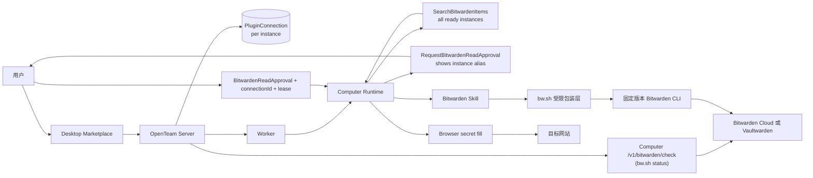

# 设计文档 - Bitwarden 与 Vaultwarden 凭据插件接入

状态：实施中（2026-11-16 多实例演进修订）

父规格：[Spec 005：插件扩展体系](../005-插件扩展体系/design.md)

## 1. 概述

### 1.1 目标

- 复用当前受控 Skills 与 Computer 私有执行模型，为 Bot 和 `computerUse` 提供跨多实例的 Bitwarden/Vaultwarden 登录项读取能力。
- 支持管理员按实例添加、编辑、重命名（默认显示账户邮箱，重复邮箱支持别名）和删除多个 Bitwarden Cloud / Vaultwarden 实例，每个实例独立配置 5 个字段。
- 实例连接状态严格由 Bot computer 容器上的真实 `bw.sh status`（`login + unlock + sync`）校验决定，仅实际可用时显示「已连接」（`ready`）。
- 通过固定版本、完整性校验和受限包装脚本使用 Bitwarden CLI，避免将任意 Vault 写操作或通用 MCP 工具暴露给模型。
- 自动将已有单全局 `plugin:bitwarden` 配置迁移至第一个实例，保持现有安全边界、Skill 缓存、Shell 脱敏和浏览器 secret fill 行为。

### 1.2 覆盖需求

- `requirements.md` 需求 1、2：插件目录、多实例安装与每实例配置字段。
- `requirements.md` 需求 3：普通 runtime field 与受保护凭据字段的隔离与传递。
- `requirements.md` 需求 4、9：CLI 生命周期和 Vaultwarden 自托管兼容。
- `requirements.md` 需求 5、6、7：跨实例检索、审批展示、凭据读取、浏览器登录和安全边界。
- `requirements.md` 需求 8、10：错误分类、测试和发布验收。
- `requirements.md` 需求 11：多实例管理、真实连接状态校验、邮箱命名/别名与旧配置迁移。

### 1.3 技术约束

- 插件包：`packages/plugins/bitwarden/`。
- 实例模型：在 `plugin.json` 中声明 `setup.kind = "none"`（5 个实例字段）与受控内建连接器 `connections: [{ key: "bitwarden", transport: "builtin", endpoint: "outcomego://bitwarden", auth: "none", tools: [] }]`；不向模型动态命名空间（`pluginDynamicNamespaces`）暴露通用 MCP 工具，仍保留 `components` 对 Skill 与实例连接模型的校验兼容。
- 运行位置：Bot computer 容器内的私有路径与包装脚本；不在 OpenTeam server 进程中直接访问 Vaultwarden。
- 凭据存储：每个实例独立存储在 `PluginConnection`（普通配置字段在 `configuration.values`，敏感字段在 `credentials.values`）；不再使用全局 `plugin:bitwarden` `ProcessSecret`（升级时自动迁移并清理）。
- Skill 传递：复用 `plugin-skills/cache.json` 和 `pluginSkillAgent`。
- 浏览器填充：复用现有 browser reference driver 的 secret fill 标记和结果脱敏。
- 外部依赖：固定版本的 Bitwarden CLI、Bitwarden/Vaultwarden server、Bot computer 的网络和证书信任链。
- 发布约束：插件生成器必须将文本和二进制资源打入 registry，安装时不得依赖未声明的 node_modules。

## 2. 架构

### 2.1 系统结构



关键数据流：

1. 用户在 Marketplace 添加并配置一个或多个 Bitwarden 实例，每个实例独立保存 5 个字段至对应 `PluginConnection`。
2. Server 将实例凭据下发给 Bot computer 私有检查端点（`/v1/bitwarden/check`）执行 `bw.sh status`（`config server` → `login --apikey` → `status` 邮箱校验 → `unlock` → `sync`）；只有实测通过，Server 才将该实例状态置为 `ready`（「已连接」），并在用户未自定义别名时将实例名称设为账户邮箱。
3. Worker 将 Skill 元数据和支持文件同步到 Bot computer，并把适用的 Skill 提供给 `main` 和 `computerUse`；同时跳过 Bitwarden 实例的 MCP 命名空间暴露。
4. Bot 使用 `SearchBitwardenItems` 跨所有 `ready` 实例获取非 secret metadata（包含来源 `connectionId` 与实例名称）；首次读取某个 item 时调用 `RequestBitwardenReadApproval`，Server 在审批卡片中显示来源实例名称并持久化 `connectionId` 与候选绑定关系。
5. 用户选择或批准后，Computer 私有路径消费短时 lease，Server 只把对应获批实例的受保护字段注入 wrapper 子进程，向该实例的 Bitwarden/Vaultwarden 发起登录、解锁、同步和读取请求。
6. 读取结果以 `browserReference` 返回当前 Bot，用于当前任务或浏览器安全填充；普通 Shell、MCP process 和其他子机器人不能读取任何实例的 `BW_*` 字段。

### 2.2 模块职责

| 模块 | 职责 | 输入 | 输出 |
| --- | --- | --- | --- |
| `packages/plugins/bitwarden/plugin.json` | 声明插件元数据、`setup.fields`、受控 `builtin` 连接器与 Skill | 插件定义 | 可校验的 `PluginDefinition` |
| `packages/plugins/bitwarden/skills/bitwarden/SKILL.md` | 告诉 Bot 跨实例搜索、请求授权和读取 Login item | 用户任务、Skill 路径 | first-party 工具调用计划 |
| `ensure-cli.sh` | 安装、校验和定位固定 CLI | 平台、版本、下载地址 | CLI 可执行文件路径 |
| `bw.sh` | 执行 server 配置、登录、解锁、同步和读取白名单动作 | 实例 runtime fields、动作参数 | 安全的字段级结果或错误摘要 |
| `packages/plugin-sdk` | 校验 runtime field 与 `outcomego://bitwarden` 连接器契约 | 插件定义 | 合法字段与连接器模型 |
| `apps/server` 插件与内部工具服务 | 管理多实例 CRUD、旧配置迁移、调度 `/v1/bitwarden/check`、控制检索/审批/lease 路由 | setup values、实例操作、tool call | `PluginConnection` 状态、审批与一次性 lease |
| `apps/computer` runtime & HTTP | 执行 `/v1/bitwarden/check`、多实例 search 聚合、单实例 read 与引用脱敏 | 检查请求、Bot turn、授权 lease | 实例可用性结果、候选列表、引用 |
| `apps/desktop` 插件详情与实例 UI | 渲染多实例卡片、5 个字段保存/部分更新表单、邮箱名称/别名与「已连接」状态 | `PluginSettingsView` | 实例增删改、重命名、重试交互 |
| `packages/messaging` Skill catalog | 将 Skill 提供给主 Bot 和指定子机器人，不生成 MCP 命名空间 | 插件安装记录、Skill 缓存 | `agent_skills` 和 Skill instructions |
| `browser reference driver` | 标记 secret fill 并保护页面观察结果 | username、password、TOTP | 脱敏后的页面状态 |
| 兼容性测试 harness | 验证 CLI 与 Vaultwarden 组合 | fixture/server URL/凭据 | 可复核的测试报告 |

### 2.3 关键流程

#### 2.3.1 安装、多实例配置与真实连接检查流程

1. 插件生成器发现 `packages/plugins/bitwarden`，读取 `plugin.json` 和支持文件。
2. 安装插件时创建 `PluginInstallation` 和初始默认 `PluginConnection`（`alias = "default"`，`status = "disconnected"`）；若检测到旧版 `ProcessSecret(ownerKey = "plugin:bitwarden")`，自动把已保存的 5 个字段迁移至第一个 `PluginConnection` 并清理旧键（若 `BW_EMAIL` 有效且非空，初始别名可直接设为邮箱，状态仍保持待验证直到真实检查通过）。
3. 用户可在「账户 / 实例」区域点击添加更多实例，或展开已有实例编辑 5 个字段（`BW_SERVER_URL`、`BW_EMAIL`、`BW_CLIENT_ID`、`BW_CLIENT_SECRET`、`BW_MASTER_PASSWORD`）。
4. 保存配置时，Server 校验 URL（`https-origin`）、必填项与主密码保留空白语义，更新对应 `PluginConnection` 的 `configuration.values` 与 `credentials.values`，重置 `status = "disconnected"`，随后调用 Computer 私有端点 `POST /v1/bitwarden/check`。
5. Computer 在临时进程环境运行 `bw.sh status` 验证 server、API Key、账户邮箱、主密码解锁与同步；成功则 Server 将该实例 `status` 更新为 `"ready"`（「已连接」），若 `alias` 仍为 `"default"`（或未手工自定义），自动将其更新为 `BW_EMAIL`（若同插件下该邮箱别名已存在，则自动附加区分后缀如 `email (host)` 或由用户自定义别名）。
6. 若 `bw.sh status` 失败或 Computer 不可达，Server 将该实例置为 `"error"`（或在缺少凭据时为 `"disconnected"`）并写入不含 secret 的安全阶段错误摘要到 `statusMessage`。

#### 2.3.2 跨实例检索与单次读取流程

1. Bot 根据用户任务确定目标 hostname、标题或显式 item id。
2. Bot 调用 `SearchBitwardenItems`（可选指定 `connectionId` 或 `instance`）；Server 查询所有 `status = "ready"` 的 Bitwarden 实例并颁发一次性搜索 lease。
3. Computer 消费搜索 lease 获取各已连接实例的独立隔离环境，分别在独立临时目录并发或顺序运行 `bw.sh search`，聚合并标注每个候选的 `connectionId` 与 `instanceName`（实例别名/邮箱）。若无任何已连接实例，返回明确未连接提示。
4. 首次读取某个实例下某个 item 时调用 `RequestBitwardenReadApproval`，Server 创建包含实例名称的聊天审批 widget 与 `BitwardenReadApproval` 记录（绑定 `connectionId` 与候选集），等待用户回答。
5. 用户回答后，恢复 run 携带非 secret approval reference；`ReadBitwardenCredential` 校验 `botId`、`channelId`、`connectionId`、`itemId`、状态、过期时间和 task reference，并确认目标实例仍为 `ready`。
6. Computer 私有路径消费一次性 read lease，只读取获批 `connectionId` 对应的 5 个受保护字段，建立隔离的 CLI 配置目录并执行 `bw.sh` 读取 `username`、`password` 或 `totp`。
7. 读取结果以 `browserReference` 返回 Bot；token、Client Secret、主密码、session key 和配置环境不会进入普通工具结果或模型上下文。
8. CLI 进程、临时 session、临时配置和 lease 被回收或过期。

#### 2.3.3 浏览器登录流程

1. 主 Bot 启动 `computerUse` 子机器人，并在任务中说明目标网站和登录成功条件。
2. `computerUse` 读取 Bitwarden Skill，确认页面 hostname。
3. 子机器人通过受控工具调用 `SearchBitwardenItems` 跨已连接实例搜索；首次读取时通过同一个授权 widget（显示实例名称）选择并批准 item，再调用 `ReadBitwardenCredential`。
4. 子机器人将读取结果传给现有浏览器填充工具，填充动作设置 secret marker。
5. 浏览器 snapshot、控制台和错误摘要继续由现有 reference driver 脱敏。
6. 遇到 SSO、Passkey、CAPTCHA、人工 MFA 或不明确账号时，走既有人工接管流程。

#### 2.3.4 实例字段替换、重命名、移除与插件卸载流程

1. 用户可在实例设置卡片中单独替换任意字段（保留未提交的其余已保存字段）；保存后重置 `ready` 并自动重新校验，只有再次通过 `bw.sh status` 后才恢复「已连接」。
2. 用户可随时通过重命名修改实例别名（允许 `@` 等邮箱字符，确保同一插件下唯一），为重复邮箱设置易于区分的名称。
3. 删除单个实例时仅清除该 `PluginConnection` 及其关联未完成审批记录，不影响其他实例。
4. 卸载插件时删除 `PluginInstallation`、所有 `PluginConnection`、关联 `BitwardenReadApproval`、遗留 `plugin:bitwarden` secrets（如有）以及插件 Skill 缓存。
5. CLI 安装目录是否删除由插件缓存生命周期决定；不得删除用户工作区内与插件无关的文件。

## 3. 组件和接口

### 3.1 插件包定义与多实例连接模型

`packages/plugins/bitwarden/plugin.json` 结构调整为受控多实例连接声明：

```json
{
  "schemaVersion": 1,
  "key": "bitwarden",
  "version": "1.1.0",
  "name": "Bitwarden / Vaultwarden",
  "description": "Bots sign in with usernames, passwords and one-time codes from Bitwarden or self-hosted Vaultwarden.",
  "publisher": "OutcomeGo",
  "category": "Login and Credential Management",
  "featured": false,
  "components": ["mcp", "skills"],
  "setup": {
    "kind": "none",
    "connectionKey": "bitwarden",
    "title": "Connect Bitwarden / Vaultwarden",
    "description": "...",
    "steps": ["..."],
    "fields": [
      { "key": "BW_SERVER_URL", "label": "Server URL", "required": true, "secret": false, "format": "https-origin" },
      { "key": "BW_EMAIL", "label": "Account email", "required": true, "secret": false },
      { "key": "BW_CLIENT_ID", "label": "Personal API client ID", "required": true, "secret": true },
      { "key": "BW_CLIENT_SECRET", "label": "Personal API client secret", "required": true, "secret": true },
      { "key": "BW_MASTER_PASSWORD", "label": "Master password", "required": true, "secret": true, "preserveWhitespace": true }
    ],
    "requiredScopes": []
  },
  "connections": [
    {
      "key": "bitwarden",
      "name": "Bitwarden / Vaultwarden",
      "transport": "builtin",
      "auth": "none",
      "endpoint": "outcomego://bitwarden",
      "tools": []
    }
  ],
  "setupFields": [],
  "skills": [
    { "name": "bitwarden", "path": "skills/bitwarden", "agents": ["main", "computerUse"] }
  ]
}
```

关键约束：

- `packages/plugin-sdk/src/manifest.ts` 允许 `endpoint === "outcomego://bitwarden"` 的 `builtin` 连接器；此类实例仅用于承载多实例配置、真实连通性检查与状态展示。
- `packages/contracts/src/plugin-namespaces.ts`（`pluginDynamicNamespaces`）显式跳过 `outcomego://bitwarden`（或 `pluginKey === "bitwarden"` 且 `tools: []`）的连接记录，不向模型暴露任何 MCP 命名空间或通用 MCP 工具。
- Skill 的 `agents` 必须保持 `["main", "computerUse"]`。

### 3.2 实例字段与命名/别名规则

每个 Bitwarden 实例独立包含以下 5 个字段（沿用受保护语义）：

| 字段 key | 类型 | secret | 实例存储位置 | 必填 | 用途 |
| --- | --- | --- | --- | --- | --- |
| `BW_SERVER_URL` | string | 否 | `configuration.values.BW_SERVER_URL` | 是 | Bitwarden Cloud 或 Vaultwarden root URL |
| `BW_EMAIL` | string | 否 | `configuration.values.BW_EMAIL` | 是 | 专用 Bitwarden/Vaultwarden 用户邮箱 |
| `BW_CLIENT_ID` | string | 是 | `credentials.values.BW_CLIENT_ID` | 是 | Bitwarden API Key Client ID |
| `BW_CLIENT_SECRET` | string | 是 | `credentials.values.BW_CLIENT_SECRET` | 是 | Bitwarden API Key Client Secret |
| `BW_MASTER_PASSWORD` | string | 是 | `credentials.values.BW_MASTER_PASSWORD` | 是 | 解锁本地加密 Vault 的主密码 |

字段与别名规则：

- `BW_SERVER_URL` 和 `BW_EMAIL` 使用普通文本输入，不进入普通 Bot Shell、MCP 进程或公开 prompt；设置页的实例表单只显示每个字段的「已保存 / 未设置」状态，支持部分字段替换更新而不暴露明文（`PluginConfigurationView` 为敏感与 Bitwarden 实例受保护字段统一屏蔽明文回显）。
- 三个 secret 字段使用密码输入控件，详情页只显示 Saved/Not set。
- 所有字段不设置 default；`BW_SERVER_URL` 复用 `format: "https-origin"` 校验；`BW_MASTER_PASSWORD` 声明 `preserveWhitespace: true`，原样保存；`BW_EMAIL` 保存时 trim，保留大小写。
- **实例名称（`alias`）与重复邮箱别名**：
  - `validAlias` 放宽字符集以允许邮箱常见字符（包括 `@`，例如 `^[A-Za-z0-9][A-Za-z0-9 _@.-]{0,78}[A-Za-z0-9]$`）。
  - 添加或配置实例时，当实测 `bw.sh status` 校验通过且当前 `alias` 为初始默认值 `"default"`（或尚未由用户手动改名）时，服务端自动把实例 `alias` 更新为该实例的 `BW_EMAIL`；随后用户修改该实例邮箱且未自定义别名时可同步更新（若用户已手工设置别名则保留自定义别名）。
  - 当同插件下已存在相同邮箱的实例时：允许用户在添加或重命名时设置自定义别名；若自动命名撞名，则自动生成不冲突的唯一别名（如 `${email} (${serverHost})` 或附加序号 `${email} #2`），确保 `(installationId, connectorKey, alias)` 唯一约束始终满足。

### 3.3 SDK 与服务端实例检查扩展

1. 保留现有 `PluginField.environment` 对普通与 secret string 字段的支持（确保 1Password 与既有 `PluginField` 契约完全兼容）。
2. `packages/plugin-sdk/src/manifest.ts` 允许 `connector.transport === "builtin"` 的内建连接器包含 `outcomego://bitwarden`。
3. `apps/computer` 新增受控私有 HTTP 端点 `POST /v1/bitwarden/check`（与 `/v1/web-providers/check` 相同鉴权）：接收单次检查所需的 5 个字段（仅存在于请求体与临时子进程环境，不落盘、不写日志），调用缓存包内的 `bw.sh status`（实际完成 `config server`、`login --apikey`、邮箱核对、`unlock` 与 `sync`），返回 `{ ok, errorCode, stage, message, retryable, detail }`。
4. `apps/server` 的 `PluginService.connect` 与配置保存流程针对 `bitwarden` 实例执行以下状态机：
   - 任一配置保存/字段替换后，立即清理旧 `status` 为 `"disconnected"`，并触发 `connect(connectionId)`；
   - `connect` 校验 5 个字段齐全后，调用 `computerFetch("/v1/bitwarden/check", ...)`；
   - 仅当 Computer 返回 `ok === true`（`authenticated && unlocked && synced`）时，将 `PluginConnection.status` 置为 `"ready"`（「已连接」），并在需要时自动设置 `alias = BW_EMAIL`（或去重后的别名）；
   - 任一环节失败（缺失字段、Computer 离线、`server_unreachable`、`tls_untrusted`、`login_failed`、`vault_locked`、`sync_failed` 等）时，将 `status` 置为 `"error"`（字段不全为 `"disconnected"`）并在 `statusMessage` 写入脱敏后的安全摘要，绝不伪报「已连接」。
5. 桌面端 `apps/desktop/src/renderer/components/outcomego/plugin-detail-view.tsx`：
   - 在 Bitwarden 详情页使用「账户 / 实例」区块管理多个实例，允许添加实例、展开编辑任一实例的 5 个字段（支持部分替换并显示 `Saved` / `Not set`）、重命名别名、重新连接与移除实例。
   - 修复 `DetailBlock` 传入已翻译 `label={t("Skills")}` 导致显示 `1 个事件` 的问题，统一使用未翻译 key 判断单复数后再翻译显示 `1 个技能`。

### 3.4 CLI 包装层接口

`bw.sh` 是服务端授权后的 Computer 私有执行路径使用的脚本。Skill 通过 first-party 工具调用它，不能直接从普通 Shell 调用；脚本使用第一个位置参数区分动作，禁止透传任意 `bw` 参数。

| 动作 | 参数 | 输出 | 允许的 secret |
| --- | --- | --- | --- |
| `status` | 无 | server、登录、解锁、同步状态摘要 | 不输出值 |
| `search` | hostname/完整 HTTPS URI；`--title <query>` 显式标题查询 | item id、标题、URI hostname 等非 secret 摘要 | 不读取 password |
| `username` | item id | Computer 私有 wrapper 内部 JSON `{ok, kind, itemId, value}`；first-party 工具向模型返回 `browserReference` | value 只进入 Computer 私有环境 |
| `password` | item id | Computer 私有 wrapper 内部 JSON `{ok, kind, itemId, value}`；first-party 工具向模型返回 `browserReference` | value 只进入 Computer 私有环境 |
| `totp` | item id | Computer 私有 wrapper 内部 JSON `{ok, kind, itemId, value}`；first-party 工具向模型返回 `browserReference` | value 只进入 Computer 私有环境 |

包装层约束：

1. 参数必须经过长度、字符和动作级 schema 校验。
2. `item id` 必须是合法 CLI item identifier，禁止通过参数注入 shell 选项。
3. `search` 不能打印完整 item JSON。
4. `username`、`password` 和 `totp` 不能同时读取多个 item。
5. 脚本内部的 `login`、`unlock`、`sync` 只作为读取动作的准备步骤，不对 Skill 暴露为独立任意命令。
6. `bw.sh` 用 `exec python3` 启动标准库实现（computer 镜像已有 Python 3）；子进程独立进程组，SIGTERM/SIGINT/超时回收进程组，session 只在内存和子进程环境中传递。
7. stderr 只输出固定错误类别和安全摘要，不输出 CLI 原始响应中的 token、Authorization header 或主密码提示内容。

### 3.5 跨实例 Login item 选择与审批卡片

选择器与工具接口接收：

```text
SearchBitwardenItems:
  query: string        # hostname/HTTPS URL，或 title=true 时的标题关键词
  title?: boolean
  connectionId?: string  # 可选：限定在某个已连接实例内搜索；省略时搜索全部已连接实例

RequestBitwardenReadApproval:
  candidates: Array<{
    connectionId: string
    itemId: string
    title: string
    hostname: string
  }>
```

检索与选择规则：

1. **搜索范围**：`SearchBitwardenItems` 仅检索 `status === "ready"` 的 Bitwarden 实例；若不存在任何已连接实例，立即返回 `bitwarden_not_connected`。未指定 `connectionId` 时，向所有已连接实例分发检索并聚合候选结果；每个候选附带 `connectionId` 与 `instanceName`（对应 `PluginConnection.alias`）。若部分实例成功、部分实例临时报错，返回成功实例候选的同时附带安全 `warnings`（标注失败实例名和错误码，不暴露 secret）；若全部实例均失败，返回错误。
2. **匹配优先级**：每个实例内部仍按完整 URI 精确匹配优先于 exact hostname，不回退到注册域或其他子域；显式 `--title` 按标题搜索，不按 username 搜索。
3. **审批卡片展示与唯一绑定**：
   - `RequestBitwardenReadApproval` 校验每个候选的 `connectionId` 属于当前已安装且 `status === "ready"` 的 Bitwarden 实例。
   - 聊天审批 widget 明确展示每个候选的来源实例名称（邮箱或别名），例如：
     - 单候选：`Allow reading the Bitwarden item "${title}" (${instanceName}) for ${hostname}?`，选项显示 `${title} - ${hostname} (${instanceName})`。
     - 多候选：`Which Bitwarden item may be read for this task?`，选项显示 `${title} - ${hostname} (${instanceName})`，option `value` 唯一编码为 `${connectionId}:${itemId}`（服务端在 `BitwardenReadApproval` 中同步持久化候选项映射，确保即便是不同实例下的同 UUID 也能唯一锁定目标实例）。
4. **读取绑定**：`ReadBitwardenCredential` 校验 `approval` 已批准、未过期、属于当前任务上下文，且 `approval.connectionId` 与 `approval.itemId` 匹配；`ConsumeBitwardenReadLease` 仅返回该 `connectionId` 对应的 5 个环境变量。
5. 结果为空时返回 `item_not_found`。不得仅凭模糊标题自动选择多个不同账号中的一个。登录任务必须将浏览器当前 hostname 作为主要匹配输入。

### 3.6 CLI 安装器

`ensure-cli.sh` 参考 1Password 的安装器结构，但不复制 1Password 的文件或命令：

- 固定 CLI 2026.10.1，使用官方 Linux/macOS x64/ARM64 archive 和 release 资产 SHA-256。
- 固定每个支持平台的下载地址和 SHA-256。
- 支持 Bot computer 当前平台和架构；不支持的平台返回明确错误。
- 下载使用 HTTPS、连接超时和总超时。
- 先在目标文件系统内创建临时目录，再完成校验、解包、可执行权限设置和原子安装。
- 已安装版本与预期版本不一致时停止，不静默覆盖。
- 安装失败不得留下可执行的半成品。
- 版本升级必须同步更新 README、兼容性矩阵和测试 fixture。

### 3.7 网络和 TLS

- `BW_SERVER_URL` 只保存 HTTPS server root origin，不在 URL 中嵌入凭据。
- CLI 使用系统证书链验证 HTTPS。
- 第一版不支持反向代理路径前缀；使用独立 HTTPS origin，不猜测 API path。
- `localhost`、容器服务名和内网域名的可达性以 Bot computer 的运行网络为准。
- 自签名证书必须通过把 CA 配置到 Bot computer 的可信证书链解决，不新增 `--insecure` 或类似开关。

### 3.8 错误契约

包装脚本向 Skill 返回稳定的错误类别和用户可读摘要。内部可附带诊断 id，但不得包含 secret。

```json
{
  "ok": false,
  "errorCode": "vault_locked",
  "message": "The Bitwarden vault could not be unlocked.",
  "retryable": false,
  "stage": "unlock"
}
```

成功读取只返回不含凭据值的引用：

```json
{
  "ok": true,
  "kind": "password",
  "itemId": "<opaque-item-id>",
  "browserReference": "$OUTCOMEGO_BITWARDEN_PASSWORD_<opaque-suffix>",
  "expiresInSeconds": 900
}
```

wrapper 的 `value` 只在 Computer 私有执行路径中解析，随后写入带 TTL 的 `OUTCOMEGO_BITWARDEN_*` 环境变量；first-party 工具只返回变量名和 `browserReference`，不返回 value。父任务与 `computerUse` 子任务通过运行请求中的 credential scope 共享引用解析，浏览器 `browser_type`、`browser_fill_form` 和 Computer `type` 在写入前解析引用。引用无法解析时写入路径必须失败关闭，不能把变量引用字面量发给页面。浏览器结果和页面观察继续使用现有私有值脱敏；子任务完成后释放共享 scope，没有子任务时由 TTL 清理环境变量和 Computer 内存中的值。

## 4. 数据与状态模型

### 4.1 数据关系

新增最小实例关联字段（在 `BitwardenReadApproval` 上记录 `connectionId`、实例名及可选候选绑定），关系如下：

```text
PluginInstallation(bitwarden)
  └── PluginConnection[] (connectorKey = "bitwarden", transport = "builtin")
        ├── id (UUID, 实例 ID)
        ├── alias (默认账户邮箱；重复邮箱支持别名)
        ├── status ("disconnected" | "ready" | "error")
        ├── statusMessage (安全阶段摘要)
        ├── configuration.values: { BW_SERVER_URL, BW_EMAIL }
        └── credentials.values: { BW_CLIENT_ID, BW_CLIENT_SECRET, BW_MASTER_PASSWORD }

BitwardenReadApproval
  ├── connectionId (UUID -> PluginConnection.id, nullable for legacy rows)
  ├── instanceName (审批时的实例别名快照)
  ├── candidates (JSON, 多候选时记录 [{ connectionId, itemId, title, hostname }])
  ├── itemId / title / hostname
  └── status / expiresAt / leaseTokenHash / leaseExpiresAt

AgentData/plugin-skills/cache.json
  └── bitwarden Skill + supporting scripts
```

- `PluginInstallation.manifest` 保存字段定义和包内容，不保存用户填写的值。
- 每个实例的 5 个字段只存在对应 `PluginConnection` 的 `configuration` / `credentials` 中，不写入 `ProcessSecret`，也不会由 `processEnvironment` 注入普通 Shell。
- `plugin-skills/cache.json` 只保存 Skill 文件路径和插件包路径，不保存用户值。
- Bitwarden/Vaultwarden 中的 Login item 是外部事实来源，OpenTeam 不复制其内容。

### 4.2 运行状态与旧配置自动迁移

CLI 流程使用独立临时目录和进程内 session：Linux 优先 `/dev/shm`，其他平台使用系统临时目录，权限 0700。CLI 自身可能写认证 token 和加密 Vault；结束/可捕获信号清理目录，不写长期缓存。SIGKILL/主机崩溃不能保证即时清理，部署侧应清理临时目录。

#### 实例连接状态（`PluginConnection.status`）

| 状态 | 含义 | 进入条件 | 退出条件 |
| --- | --- | --- | --- |
| `disconnected` | 未配置或待验证（含迁移后初始态） | 新建实例、字段变更或旧配置迁移完成 | 触发 `bw.sh status` 检查 |
| `ready`（「已连接」） | 已通过 Bot computer 上 `bw.sh status` 实测可用 | `login + email 核对 + unlock + sync` 全部成功 | 修改字段、断开或复检失败 |
| `error` | 实测检查失败 | 网络、TLS、API Key、主密码、同步或 CLI 故障 | 用户修正配置并重检通过 |

#### 单次读取阶段状态

| 状态 | 含义 | 进入条件 | 退出条件 |
| --- | --- | --- | --- |
| `not_configured` | 实例缺少必需字段 | 存在未填写字段 | 用户保存全部 5 个字段 |
| `cli_missing` | 固定版本 CLI 尚未安装 | 第一次检查/读取或缓存丢失 | 安装成功 |
| `server_unreachable` | DNS、TCP、超时或 TLS 失败 | server 无法访问 | 网络或证书恢复 |
| `login_required` | API Key 登录失败或邮箱不匹配 | CLI 登录请求失败 | 配置修正并重新执行 |
| `locked` | Vault 未解锁 | 主密码错误或解锁失败 | 正确主密码解锁 |
| `synced` | 当前流程已完成同步 | sync 成功 | 读取完成或流程失败 |
| `ready` | 实例或已选定 item 可读取 | 检查/匹配唯一且类型正确 | 字段读取完成 |
| `ambiguous` | 匹配到多个 item | search 结果不唯一 | 用户指定 item |
| `field_missing` | 目标字段为空或不存在 | 读取字段失败 | 用户选择其他 item 或补充字段 |

#### 旧单全局 `plugin:bitwarden` 自动迁移规则

- 触发时机：插件版本升级（`PluginManagement.update` / `updateReleased`）、服务端启动恢复或幂等迁移入口检测到 `PluginInstallation(pluginKey = "bitwarden")` 尚未拥有 `PluginConnection` 记录且 `ProcessSecret` 存在 `ownerKey = "plugin:bitwarden"` 时。
- 迁移动作（单事务执行）：
  1. 读取 `ownerKey = "plugin:bitwarden"` 下的 `BW_SERVER_URL`、`BW_EMAIL`、`BW_CLIENT_ID`、`BW_CLIENT_SECRET`、`BW_MASTER_PASSWORD`。
  2. 将 `BW_SERVER_URL`、`BW_EMAIL` 写入第一个 `PluginConnection.configuration.values`，将 `BW_CLIENT_ID`、`BW_CLIENT_SECRET`、`BW_MASTER_PASSWORD` 写入 `credentials.values`。
  3. 若读取到的 `BW_EMAIL` 合法，将第一个实例 `alias` 设为 `BW_EMAIL`；否则设为 `"default"`。
  4. 将第一个实例 `status` 设为 `"disconnected"`（不跳过真实检查，待 Computer 执行 `bw.sh status` 通过后变为 `"ready"`；若迁移时 Computer 在线且配置完整，可异步触发一次连接检查）。
  5. 删除 `ProcessSecret` 中 `ownerKey = "plugin:bitwarden"` 的旧记录，保证后续只从实例记录读取。
- 幂等性：若 `bitwarden` 已存在 `PluginConnection` 记录，则跳过迁移，不覆盖既有实例配置。

### 4.3 配置生命周期

- 安装：创建 `PluginInstallation` 与初始默认 `PluginConnection`（`alias = "default"`），允许后续通过「添加账户 / 实例」创建更多实例。
- 实例保存与连接：校验并写入对应 `PluginConnection`，触发 Computer `bw.sh status` 实测；成功则标记 `"ready"` 并在需要时自动设置 `alias = BW_EMAIL`。
- 部分字段替换：只更新提交的字段，保留同实例其余已保存字段，不干扰其他实例；保存后重置状态并重新校验。
- 更新：更新 `manifest` 时保留已有全部 `PluginConnection` 实例及其配置，并自动执行一次旧 `plugin:bitwarden` 迁移检查。
- 删除实例与卸载：删除单个实例仅清理该 `PluginConnection`；卸载插件时级联删除所有实例、未完成审批记录、遗留 `plugin:bitwarden` secrets（如有）及 Skill 缓存。
- CLI 缓存：由插件包缓存和安装器管理，不包含 session、API Key 或主密码。

## 5. 错误处理

### 5.1 错误类型

- `plugin_setup_invalid`：字段缺失、类型错误、URL 不合法或环境变量冲突。
- `cli_unavailable`：平台不支持、依赖缺失或固定 CLI 无法执行。
- `cli_integrity_failed`：下载文件校验、版本校验或解包校验失败。
- `server_unreachable`：DNS、连接拒绝、超时或响应不可达。
- `tls_untrusted`：证书不受信任、主机名不匹配或证书过期。
- `login_failed`：API Key 无效、账号不存在或 server 拒绝登录。
- `interactive_auth_required`：需要 MFA、设备批准、SSO 或其他交互式认证。
- `vault_locked`：主密码错误、Vault 解锁失败或 CLI 锁状态异常。
- `sync_failed`：同步请求失败或返回不可识别内容。
- `item_not_found`：没有匹配的 Login item。
- `item_ambiguous`：多个 item 匹配且没有明确选择。
- `item_type_unsupported`：目标 item 不是 Login 类型。
- `field_missing`：目标 Login item 没有请求的字段。
- `read_only_violation`：请求了第一版不支持的写操作。

### 5.2 错误响应格式

```json
{
  "ok": false,
  "errorCode": "<stable-code>",
  "message": "<safe user-facing message>",
  "retryable": true,
  "stage": "<configure|install|server|login|unlock|sync|search|read>",
  "detail": {
    "field": "<optional field name>",
    "serverOrigin": "<optional origin only>",
    "exitCode": 1
  }
}
```

禁止字段：

- `clientSecret`
- `masterPassword`
- `sessionKey`
- `Authorization`
- 完整 credential value
- 包含 query、token 或密码的原始 URL
- 完整 Vault item JSON

### 5.3 处理策略

1. 输入验证错误：在配置保存或包装脚本参数解析阶段失败，不发起网络请求。
2. 安装器错误：删除临时安装目录，保留之前可用版本。
3. 网络和 TLS 错误：按错误类别返回，不自动降级到 HTTP 或关闭 TLS。
4. 登录、解锁和同步错误：结束当前流程并回收 session，不使用旧 session 重试。
5. 可重试错误：只允许用户或当前任务按既有重试策略重新开始完整流程。
6. item 歧义或首次读取：返回非 secret 候选摘要，发送聊天 widget 等待用户选择并授权；授权按每个 item、每次任务保存，拒绝或关闭时不调用字段读取动作。
7. 只读违规：不调用 CLI 写命令，直接返回不支持。

## 6. 正确性属性

### 6.1 属性 1：运行时字段不会进入公开插件视图

*对于任何* 已安装的 Bitwarden 插件和任意一组 runtime fields，公开安装详情、插件目录、Skill cache、插件活动和普通 Bot prompt 都不能包含配置值；环境变量名称属于公开 manifest 元数据。

**验证需求：** `requirements.md` 需求 2、需求 3、需求 7。

### 6.2 属性 2：读取接口不能执行 Vault 写操作

*对于任何* 包装脚本动作参数，动作集合之外的命令、参数和写操作都必须在网络请求前被拒绝。

**验证需求：** `requirements.md` 需求 5、需求 7。

### 6.3 属性 3：凭据读取必须对应唯一目标并获得任务授权

*对于任何* 没有显式 item id 的读取请求，只有当选择器得到唯一 Login item 且当前任务已获得该 item 的聊天授权时，系统才能读取 username、password 或 TOTP；多候选必须先由用户在 widget 中选择。

**验证需求：** `requirements.md` 需求 5、需求 6。

### 6.4 属性 4：失败流程不能使用旧 session 冒充成功

*对于任何* 登录、解锁、同步或读取失败，下一次尝试都必须建立新的受控 CLI 流程，并且不能返回上一次流程缓存的 credential value。

**验证需求：** `requirements.md` 需求 4、需求 8。

### 6.5 属性 5：插件卸载与实例隔离

*对于任何* 已安装的 Bitwarden 插件，删除某个实例不得影响其他实例的配置和连接状态；卸载完成后所有实例、`PluginConnection` 凭据与遗留 `plugin:bitwarden` `ProcessSecret` 均必须被清理，不得再被任何读取或检查路径访问。

**验证需求：** `requirements.md` 需求 1、需求 3、需求 8、需求 11。

### 6.6 属性 6：1Password 行为保持兼容

*对于任何* 现有 1Password 安装，SDK 与插件连接模型扩展不得改变 `OP_SERVICE_ACCOUNT_TOKEN` 的保存、注入、脱敏、轮换和卸载行为。

**验证需求：** `requirements.md` 需求 10。

### 6.7 属性 7：未实测可用绝不显示「已连接」且跨实例读取严格隔离

*对于任何* Bitwarden 实例，只有 Bot computer 执行 `bw.sh status` 返回成功时才能进入 `status = "ready"`；任意实例搜索出的候选只能在其所属 `connectionId` 获得用户审批后从该 `connectionId` 对应的凭据读取，不得跨实例错读或读取未连接实例。

**验证需求：** `requirements.md` 需求 5、需求 11。

## 7. 测试策略

### 7.1 单元测试

- `PluginField.environment` 允许 secret 和非 secret string 字段，并拒绝非 string、重复环境变量和非法名称。
- Bitwarden plugin manifest、Skill frontmatter、supporting files 和 package paths。
- server URL 解析、邮箱 trim、item id 参数、hostname 归一化和候选排序。
- CLI 动作白名单、参数转义、错误分类和返回结构。
- CLI stderr、Shell title 和 chunk split secret 的脱敏。
- `bw.sh` 在缺失配置、安装失败、登录失败、解锁失败、同步失败、item 歧义和字段缺失时的行为。
- 1Password 现有环境字段测试继续通过。

### 7.2 集成测试

- 插件安装、重复安装、字段轮换、环境冲突、字段删除和卸载。
- 普通 Bot process environment 不包含 Bitwarden protected runtime fields；只有服务端授权 lease 的 Computer 内部路径可以消费这些字段。
- 插件 Skill cache 包含 `SKILL.md` 和包装脚本，且不包含配置值。
- Shell 取消时 CLI 进程组被回收。
- Bitwarden CLI fixture 可完成 configure、login、unlock、sync 和 field read。
- Vaultwarden HTTP/TLS/DNS/timeout 错误分类。

### 7.3 端到端测试

- Marketplace 安装 Bitwarden 插件并保存五个字段。
- 主 Bot 根据 hostname 查找唯一 Login item 并读取 username、password、TOTP。
- `computerUse` 使用 Skill 在测试网站完成登录。
- 多匹配时 Bot 不读取密码并要求用户选择。
- 直接读取 password 时结果只包含请求字段，不包含完整 item JSON。
- 用户轮换主密码或 API Key 后下一次读取使用新配置。
- 卸载后 Bot 不再看到 Bitwarden Skill 和 runtime fields。
- 现有 1Password 网站登录流程回归。

### 7.4 Vaultwarden 兼容性验收

必须使用至少一个真实或隔离的 Vaultwarden 实例完成以下矩阵，并把结果写入 `docs/20261112-Vaultwarden兼容性矩阵.md`：

| 场景 | 结果要求 |
| --- | --- |
| HTTPS root URL | 可配置、可登录、可同步 |
| 反向代理 HTTPS | 可完成完整读取链路 |
| 内网 DNS | Bot computer 可解析并访问 |
| API Key 登录 | 成功或记录明确不兼容原因 |
| 主密码解锁 | 成功或记录明确错误 |
| Login item 搜索 | exact hostname 和多匹配均正确 |
| username/password/TOTP | 三种字段分别可读 |
| 无效 API Key | 返回 `login_failed` |
| 错误主密码 | 返回 `vault_locked` |
| 未受信任证书 | 返回 `tls_untrusted`，不跳过校验 |
| server 不可达 | 返回 `server_unreachable` |

### 7.5 验证映射

| 需求 | 设计章节 | 验证方式 |
| --- | --- | --- |
| `requirements.md` 需求 1 | `design.md` §3.1、§4.3 | 插件生成、安装、卸载和 Skill cache 集成测试 |
| `requirements.md` 需求 2 | `design.md` §3.2、§4.3、§5.2 | 字段校验、设置视图脱敏、轮换测试 |
| `requirements.md` 需求 3 | `design.md` §3.3、§4.1 | SDK、server environment 和 1Password 回归测试 |
| `requirements.md` 需求 4 | `design.md` §3.6、§3.7、§4.2 | CLI installer、进程回收和 lifecycle 测试 |
| `requirements.md` 需求 5 | `design.md` §3.4、§3.5、§6.2、§6.3 | wrapper allowlist、item selector 和 read tests |
| `requirements.md` 需求 6 | `design.md` §2.3.3 | `computerUse` fixture、browser secret fill 回归测试 |
| `requirements.md` 需求 7 | `design.md` §3.4、§5.2、§6.1、§6.2 | secret redaction、write rejection、日志审计测试 |
| `requirements.md` 需求 8 | `design.md` §5 | 错误 fixture、重试和 session 清理测试 |
| `requirements.md` 需求 9 | `design.md` §3.7、§7.4 | Vaultwarden 真实实例或隔离实例验收 |
| `requirements.md` 需求 10 | `design.md` §7 | package、typecheck、相关 workspace tests 和文档走查 |
| `requirements.md` 需求 11 | `design.md` §3.1–§3.5、§4.1–§4.3、§6.7 | 多实例 CRUD、Computer `bw.sh status` 检查、邮箱命名/别名、跨实例检索审批及迁移集成测试 |

## 8. 风险与实施基线

### 8.1 风险

- Vaultwarden 与 Bitwarden CLI 的兼容范围可能随版本变化；必须固定 CLI，并维护目标 Vaultwarden 版本矩阵。
- Vaultwarden 没有 1Password Service Account 的完全等价物；专用账号和 Collection 权限是部署约束，不是 OpenTeam 的强制只读沙箱。
- Bitwarden 的五个 runtime fields 标记为 protected；普通 Shell、MCP process 和子机器人不会收到 `BW_*`，读取必须经过服务端授权记录、widget 响应和短时一次性 lease。
- Bot computer 可能位于远程 Docker 主机，用户桌面能访问 Vaultwarden 不代表 Bot computer 能访问。
- Bitwarden CLI 的安装包、运行时依赖和平台分发方式可能需要根据最终支持的平台调整。
- 当前通用 Shell 能力允许模型执行任意命令；插件包装层只能约束 Skill 约定的接口，不能单独形成主机级安全边界。

### 8.2 已确定基线与外部验收

- CLI 固定 2026.10.1，Linux/macOS x64/ARM64；不使用系统任意版本或邮箱/密码 fallback。
- API Key 通过 `BW_CLIENTID` / `BW_CLIENTSECRET` 映射传递；`BW_EMAIL` 对照登录后的 `status.userEmail` 验证账号，主密码仅在 unlock 子进程注入。
- TOTP 纳入第一版；每个实例通过 `PluginConnection` 管理 5 个配置字段，并通过 `/v1/bitwarden/check` 在 Bot computer 执行 `bw.sh status` 后才置为 `ready`（「已连接」）。
- 每次动作均配置、登录、账号验证、解锁、同步；无自动重试。JSON stdout 输出；错误不转发原始 stderr。CLI 输出最多 8 MiB，单命令超时 90 秒；单实例候选最多 50 条，超过时要求缩小查询。
- 只有 CLI 返回明确网络/TLS/交互认证信息时才细分；否则返回阶段错误，不猜测账号存在性或服务端内部原因。
- 实例凭据不进入普通插件进程环境或 MCP 命名空间；服务端 `BitwardenReadApproval` 绑定 bot、channel、widget、`connectionId`、`itemId` 和当前唤醒引用；Computer 私有调用消费 lease 后才执行对应实例的 wrapper。
- direct read 的 credential value 不进入当前模型、现有会话或终端记录；模型只能看到 `browserReference`，浏览器写入路径负责解析和脱敏。现有浏览器脱敏覆盖标记控件，不能承诺移除网站任意反射文本。
- 浏览器目标页面可以是用户明确授权的 HTTP 页面；写入边界仍按目标 hostname 校验，HTTP 跨站 frame 不允许承载凭据。
- Vaultwarden 真实版本、远程 computer 网络与真实网页登录未实测时标记 PENDING；交付独立验收脚本，不启动开发服务或重建远程 computer。

复核与来源覆盖见 [规格复核与覆盖矩阵](docs/20261113-规格复核与覆盖矩阵.md)。
