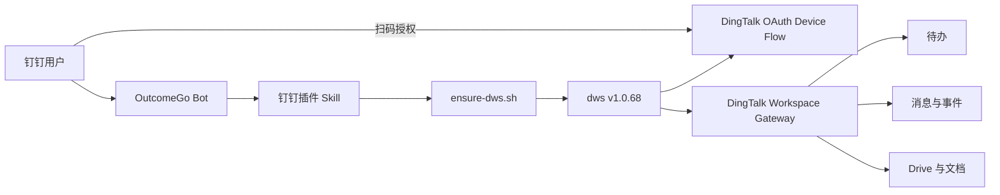

# 设计文档 - 钉钉个人工作区插件

状态：IN_PROGRESS

## 1. 概述

### 1.1 目标

- 将官方 DWS CLI 作为 OutcomeGo skills-only 插件的外部运行时。
- 以当前钉钉用户 OAuth 身份访问待办、消息和已授权 Drive/文档资源。
- 让 Bot 能在不读取 OutcomeGo 内部令牌的情况下完成安装、登录、查询和受控写入。

### 1.2 覆盖需求

- `requirements.md` 需求 1：插件安装和个人授权
- `requirements.md` 需求 2：待办查看和处理
- `requirements.md` 需求 3：消息查看和回复
- `requirements.md` 需求 4：Drive 文档查看和编辑
- `requirements.md` 需求 5：插件可维护性和验证

### 1.3 技术约束

- 插件：`packages/plugins/dingtalk-workspace`
- 插件形态：skills-only；不新增 OutcomeGo MCP connector。
- 外部运行时：DingTalk Workspace CLI `v1.0.68`
- 授权方式：远程 Computer 使用 `dws auth login --device --no-browser` 的 OAuth 设备流，用户在自己的设备上打开 verification URL 并扫码/确认授权；本地 loopback 登录不作为远程默认流程。
- 执行位置：Bot Computer；CLI 登录状态和缓存留在执行该技能的计算机。
- 依赖：macOS/Linux 对应架构的官方 DWS release archive、系统 `curl`、`tar`、SHA-256 工具。
- 代码语言：插件安装脚本使用 POSIX shell；项目代码标识符和注释使用英文；Spec 和插件说明使用中文。

## 2. 架构

### 2.1 系统结构



OutcomeGo 只负责分发技能和执行命令；DWS 负责 OAuth、令牌刷新、组织/用户 profile、API 调用、分页和产品命令契约。

### 2.2 模块职责

| 模块 | 职责 | 输入 | 输出 |
| --- | --- | --- | --- |
| `plugin.json` | 声明插件身份、技能、安装说明和上游地址 | 插件元数据 | 插件目录条目 |
| `skills/dingtalk-setup` | 安装 DWS、验证版本、引导登录、状态检查、登录态迁移和退出登录 | Bot Computer、用户授权、一次性 bundle | 可用的 `dws` 和登录状态 |
| `skills/dingtalk-workspace` | 针对三项用户目标编写的个人工作区路由技能及简要引用材料 | 用户意图、目标标识 | DWS 命令和可读结果 |
| `skills/dingtalk-setup/scripts/ensure-dws.sh` | 下载、校验和安装固定版本的 DWS | OS、架构、release URL | Bot Computer 上的 `dws` |
| `README.md` | 说明安装边界、个人授权和验证方法 | 插件源码 | 维护者和用户文档 |
| `upstream.json` | 记录 CLI/技能的官方来源与版本 | 上游版本 | 可追溯 provenance |

### 2.3 关键流程

#### 2.3.1 安装和登录

1. Bot 读取 `dingtalk-setup` Skill。
2. Skill 执行 `skills/dingtalk-setup/scripts/ensure-dws.sh --install`。
3. 脚本根据当前 OS/架构下载 `v1.0.68`，校验 `checksums.txt`，解包到用户本地 CLI 目录。
4. Skill 执行 `dws --version` 和 `dws auth status --readonly --format json`。
5. 未登录时执行 `dws auth login --device --no-browser`，DWS 展示 OAuth 设备流授权信息。
6. 用户通过钉钉扫码/确认授权。
7. Skill 执行 `dws auth status --format json` 和一个最小只读命令确认登录；若组织未授权 CLI 个人数据访问，保留服务端错误并停止在线资源检查。

#### 2.3.2 登录态迁移和 Computer 状态

1. `dws-status.sh` 在选定 Computer 上执行 `dws auth status --readonly --format json`，只报告本地状态。
2. 源 Computer 使用 `dws-auth-export.sh` 将 portable auth bundle 写入 workspace 内的受保护路径。
3. 用户通过 `CopyToBox` 将 bundle 从已注册的用户 Computer 复制到目标 Computer 的 `/workspace`；认证包不经过聊天正文或插件 manifest。
4. 目标 Computer 使用 `dws-auth-import.sh` 调用 `dws auth import`，随后执行状态检查。
5. 只有状态包含 `authenticated: true` 时才删除目标侧 bundle；导入失败或状态不确定时保留 bundle 供用户恢复。
6. `dws auth logout` 只作用于当前 Computer；插件不把登录态误报为 Marketplace connection。

#### 2.3.3 待办和消息

1. Bot 使用 `dws todo`、`dws chat` 或 `dws event` 对用户意图进行路由。
2. 只读操作直接执行并返回结构化结果。
3. 写入操作先确认目标、身份和影响；需要时先运行 `--dry-run`。
4. 发送/编辑/完成结果保留 DWS 返回的真实标识和状态。
5. 事件监听保持前台或由用户明确要求的后台生命周期，不把监听结果伪装成历史查询；`event +listen-im` 会创建订阅，本轮只做 Schema 检查。

#### 2.3.4 Drive 和文档

1. 使用 `dws drive +search` 定位文件或文档。
2. 使用 `dws doc +fetch` 识别并读取文档内容。
3. 根据当前 Schema 选择 `dws doc +update` 或其他已注册命令；不凭旧文档猜测参数。
4. 编辑前确认文档标识、权限和修改范围。
5. 写入后重新读取或查询版本/结果，确认实际服务端状态。

## 3. 组件和接口

### 3.1 核心组件

覆盖需求：1、2、3、4、5

- `plugin.json`：skills-only 插件定义。
- `ensure-dws.sh`：版本固定、架构选择和校验安装器。
- `dingtalk-setup`：安装、登录、状态和故障排查技能。
- `dingtalk-workspace`：针对待办、消息、Drive/文档三项目标编写的个人工作区路由技能及引用材料。
- `upstream.json`：记录 `DingTalk-Real-AI/dingtalk-workspace-cli` 的 release 版本。

### 3.2 数据结构

#### 3.2.1 CLI 发布清单

| 字段 | 类型 | 必填 | 说明 | 约束 |
| --- | --- | --- | --- | --- |
| `version` | string | 是 | DWS 版本 | 固定为 `v1.0.68` |
| `os` | string | 是 | `darwin` 或 `linux` | 仅支持已验证平台 |
| `arch` | string | 是 | `arm64` 或 `amd64` | 与官方资产一致 |
| `asset` | string | 是 | release 资产名 | 不允许用户输入任意 URL |
| `sha256` | string | 是 | 资产摘要 | 必须匹配官方 `checksums.txt` |

#### 3.2.2 个人连接状态

| 字段 | 类型 | 必填 | 说明 | 约束 |
| --- | --- | --- | --- | --- |
| `authenticated` | boolean | 是 | 当前 profile 是否已授权 | 只取 `dws auth status` |
| `profile` | string | 否 | 当前组织/用户 profile | 不写入普通日志 |
| `expiresAt` | string | 否 | 令牌状态信息 | 仅用于状态展示 |
| `message` | string | 否 | 登录或错误提示 | 不含 token |

### 3.3 接口契约

覆盖需求：1、2、3、4

#### 3.3.1 DWS 安装

- 类型：Shell command
- 标识：`skills/dingtalk-setup/scripts/ensure-dws.sh --install`
- 输入：当前 OS、架构、可写用户 CLI 目录
- 输出：`dws` 可执行文件、版本和校验摘要
- 校验：资产白名单、SHA-256、解包结果、`dws --version`
- 错误：平台不支持、下载失败、摘要不匹配、解包失败

#### 3.3.2 DWS 登录

- 类型：CLI/OAuth device flow
- 标识：`dws auth login --device --no-browser`
- 输入：用户在钉钉客户端完成扫码或授权
- 输出：DWS 本机 profile 和可刷新令牌
- 校验：`dws auth status --format json`
- 错误：授权取消、设备码过期、网关不可用、令牌失效

#### 3.3.3 Computer 登录态管理

- 状态：`skills/dingtalk-setup/scripts/dws-status.sh`
- 导出：`skills/dingtalk-setup/scripts/dws-auth-export.sh <workspace-output-path>`
- 导入：`skills/dingtalk-setup/scripts/dws-auth-import.sh [--force] <workspace-bundle-path>`
- 退出：`dws auth logout [--profile <selector>] --yes`
- 输入：当前 Computer 的 DWS profile，或 workspace 内的一次性 portable auth bundle
- 输出：脱敏状态 JSON；导入成功时删除已验证的目标侧 bundle
- 限制：portable export/import 遵循 DWS 平台后端限制；当前不提供 Marketplace account card

#### 3.3.3 产品命令

- 类型：CLI
- 标识：`dws todo +get-related-tasks`、`dws chat +chat-messages`、`dws drive +search`、`dws doc +fetch`；写入使用同一 CLI 的当前 Schema。
- 输入：用户目标、分页游标、操作参数、当前 OAuth profile
- 输出：JSON 或可读结构化结果
- 校验：按 DWS 当前 `--help`/schema 和技能规则执行
- 错误：权限不足、目标不唯一、命令未注册、结果未知、服务端业务错误

## 4. 数据与状态模型

### 4.1 数据关系

插件本身不复制钉钉业务数据。DWS 本机 profile 保存个人 OAuth 状态；每次业务命令通过当前 profile 解析用户和组织身份。OutcomeGo 只保存插件安装包和技能文件，不保存 DWS Refresh Token。

### 4.2 状态流转

| 状态 | 含义 | 进入条件 | 退出条件 |
| --- | --- | --- | --- |
| `not_installed` | 本机没有 DWS | 首次使用 | 安装成功或安装失败 |
| `installed_unauthenticated` | CLI 已安装但未授权 | 安装完成、无 profile | 扫码登录或退出 |
| `authenticated` | 当前用户 OAuth 可用 | `auth status` 成功 | 退出、过期或撤销 |
| `capability_limited` | 登录有效但某能力未开放 | 命令 `unknown` 或权限错误 | 管理员/服务开通或换用支持能力 |
| `ready` | 目标只读或受控写入可执行 | 安装、授权和能力检查通过 | 外部错误或用户注销 |
| `migrating` | portable auth bundle 正在目标 Computer 验证 | 用户明确请求迁移 | `authenticated`、`not_authenticated` 或迁移失败 |

## 5. 错误处理

### 5.1 错误类型

- `dws_not_installed`：Bot Computer 找不到 `dws`。
- `dws_platform_unsupported`：当前 OS/架构没有固定资产。
- `dws_checksum_mismatch`：下载文件摘要与官方清单不一致。
- `dws_not_authenticated`：当前用户尚未完成 OAuth。
- `dws_auth_expired`：Access/Refresh Token 失效。
- `dws_capability_unavailable`：企业或当前网关未开放命令。
- `dws_permission_denied`：用户无权访问目标资源。
- `dws_target_ambiguous`：目标会话、文件或待办不唯一。
- `dws_write_result_unknown`：写操作结果不能确定。
- `dws_auth_bundle_unverified`：登录态导入完成但状态未确认，bundle 暂不删除。

### 5.2 错误响应格式

插件技能不把 DWS 原始敏感字段直接写入用户回复。至少保留：

```json
{
  "ok": false,
  "errorCode": "dws_permission_denied",
  "message": "当前用户没有目标文档的编辑权限",
  "retryable": false
}
```

### 5.3 处理策略

1. 安装错误：停止，不执行业务命令，并报告支持的平台和恢复命令。
2. 登录错误：保持未授权状态，提示重新执行 `dws auth login --device --no-browser`。
3. 命令不可用：先按 DWS 当前帮助或 schema 验证，不改写成猜测的替代命令。
4. 权限错误：保留目标标识，停止越权尝试。
5. 目标不唯一：请求用户选择，不默认使用第一项。
6. 写入结果未知：保留返回信息，禁止自动重放；用户确认后再查询状态。
7. 认证包导入结果未知：不删除 bundle，不把迁移声称为成功。

## 6. 正确性属性

### 6.1 属性 1：版本和完整性

*对于任何* 支持的 OS/架构，安装器都只能安装清单中的 `v1.0.68` 资产，并且只有 SHA-256 匹配时才安装。

**验证需求：** `requirements.md` 需求 1、需求 5

### 6.2 属性 2：个人身份一致性

*对于任何* 产品命令，业务身份都必须来自 DWS 当前 OAuth profile，不能由用户输入任意 userId 覆盖当前登录身份。

**验证需求：** `requirements.md` 需求 1、需求 2、需求 3、需求 4

### 6.3 属性 3：写入可追踪

*对于任何* 发送、编辑、完成、删除或权限变更操作，系统都必须能记录目标、动作和 DWS 结果；若结果未知则不能自动重复写入。

**验证需求：** `requirements.md` 需求 2、需求 3、需求 4

### 6.4 属性 4：Computer 登录态范围

*对于任何* 登录、状态、导入或退出操作，命令都必须在用户选定的 Computer 上执行；认证包只有在目标 Computer 的状态验证为 `authenticated: true` 后才允许清理。

**验证需求：** `requirements.md` 需求 1、需求 5

## 7. 测试策略

### 7.1 单元测试

- 插件 manifest 解析和目录生成。
- 安装器资产选择、版本、路径和 SHA-256 清单。
- 技能文件存在、引用路径有效、README 与 manifest 一致。

### 7.2 集成测试

- `dws --version`。
- `dws auth status --format json` 未登录状态。
- `dws` 只读命令的帮助/schema 检查。
- 模拟缺失 CLI、摘要不匹配和未授权场景。

### 7.3 端到端测试

- 用户扫码登录后查询个人身份。
- 查询待办和 Drive/文档。
- 在测试消息/测试待办/测试文档上执行受控写入。
- 验证消息回复和文档编辑后的真实状态。

### 7.4 验证映射

| 需求 | 设计章节 | 验证方式 |
| --- | --- | --- |
| `requirements.md` 需求 1 | `design.md` §2.3.1、§3.3.1、§5 | 安装器校验、版本检查、OAuth 状态检查 |
| `requirements.md` 需求 2 | `design.md` §2.3.2、§3.3.3、§6.3 | DWS 待办帮助/只读烟测/受控写入 |
| `requirements.md` 需求 3 | `design.md` §2.3.2、§3.3.3、§6.3 | 消息查询、回复和事件 schema 检查 |
| `requirements.md` 需求 4 | `design.md` §2.3.3、§3.3.3、§6.3 | Drive/文档读取、更新和权限错误测试 |
| `requirements.md` 需求 5 | `design.md` §3.2、§7 | 插件生成、类型检查、测试和版本 provenance |

## 8. 风险与待确认项

### 8.1 风险

- DWS 业务命令由企业 MCP 网关注册情况决定，文档中存在的命令不代表每个组织都已开通。
- 用户 token 的有效期、profile 存储位置和设备独占刷新规则由 DWS 管理，OutcomeGo 不能替代其恢复机制。
- 消息全量查看、应用消息和文档编辑的实际范围由钉钉用户权限和企业策略决定。
- 本地 CLI 安装和登录状态位于 Bot Computer；更换 Computer 可能需要重新登录。

### 8.2 待确认项

- 当前用户的钉钉组织是否已开放 DWS CLI 和目标产品能力。
- 当前账号是否有至少一个可读的 Drive 文档和一个可编辑测试文档。
- 当前账号是否有可安全测试的消息会话、测试待办或测试群。
