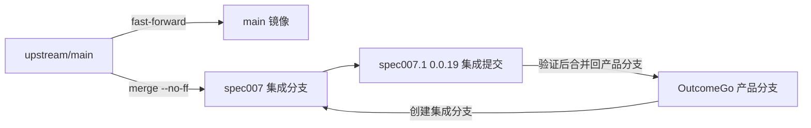

# 设计文档 - 上游主分支同步

状态：COMPLETE

文档关系：

- 总览：[`README.md`](README.md)
- 需求：[`requirements.md`](requirements.md)
- 任务：[`tasks.md`](tasks.md)
- 当前版本子规格：[`../007.1-同步上游0.0.19/design.md`](../007.1-同步上游0.0.19/design.md)

## 1. 概述

### 1.1 目标

- 建立 `main` 镜像和 `OutcomeGo` 产品分支的双层同步模型。
- 用功能和兼容性边界组织上游合并，而不是按文件或提交简单选择一侧。
- 让数据库、协议、客户端、插件和发布资产的冲突都能回溯到明确决策。
- 将当前上游 `0.0.19` 的实现放入子规格 `spec007.1`。

### 1.2 覆盖需求

- `requirements.md` 需求 1：建立同步基线
- `requirements.md` 需求 2：形成上游功能清单
- `requirements.md` 需求 3：逐项解决合并冲突
- `requirements.md` 需求 4：完成当前版本同步
- `requirements.md` 需求 5：完成分层验证

### 1.3 技术约束

- Git：`upstream/main`、`origin/main`、`OutcomeGo`，使用 merge 保留双方历史。
- 后端：Bun、TypeScript、Server、Worker、Computer。
- 客户端：Electron Desktop、Swift iOS、Kotlin Android。
- 数据存储：PostgreSQL、Prisma、`outcomego_*` 物理表。
- 发布：OutcomeGo 独立版本、Android 签名更新清单、Desktop/iOS 发布身份。
- 工程规则：不启动开发服务器；Android 调试包只能使用项目脚本。

## 2. 架构

### 2.1 分支结构

`main` 只跟踪上游，允许从 `origin/main` 快进到 `upstream/main`。`OutcomeGo` 保留独立产品历史。同步实现从 `OutcomeGo` 创建临时集成分支，使用 `git merge --no-commit --no-ff upstream/main` 生成可审查冲突集，完成后再形成合并提交。

### 2.2 冲突处理优先级

1. **产品身份优先级**：OutcomeGo 的品牌、包名、URL scheme、数据库表映射、发布身份和版本线必须保留。
2. **数据安全优先级**：幂等升级、旧安装可读、敏感数据不泄露、删除性迁移可回滚优先于代码简洁。
3. **协议一致性优先级**：公共契约先统一，再修改各端调用；不能只修单个客户端。
4. **功能保留优先级**：OutcomeGo 的实时语音、Android、网络出口、Webhook、凭据插件和定制 provider 继续存在。
5. **上游行为优先级**：在不违反以上规则时，优先采用上游已验证的实现和测试。
6. **显式分歧原则**：无法安全合并的行为必须写入分歧表，并保留上游提交引用。

### 2.3 模块职责

| 模块 | 职责 | 主要冲突 | 解决方式 |
| --- | --- | --- | --- |
| `main` 镜像 | 跟踪上游历史 | 无 fork 产品逻辑 | 快进到 `upstream/main` |
| Git 基线 | 记录提交、共同祖先和冲突清单 | 多共同祖先、补丁等价 | 同时保存 `rev-list`、`merge-base --all`、`git cherry` |
| 数据库 | 保护 `outcomego_*` 表和升级 | Prisma、SQL、删除字段、索引 | 以 OutcomeGo 映射为目标重写迁移并做旧库回放 |
| 契约与运行时 | 保持 Server/Worker/Computer 一致 | memory、draft、question、routine、control | 先合并数据模型和状态机，再合并调用方 |
| Desktop | 接入上游交互和 ScreenBot | `openteam` 路径与 OutcomeGo 组件并存 | 保留现有组件边界，逐文件迁移行为 |
| iOS | 接入上游 voice、preview、question 行为 | Swift 模型、资源、版本身份 | 保留 OutcomeGo bundle identity，按功能测试合并 |
| Android | 保留 fork 的移动端能力 | 上游缺少或移除 Android 对应实现 | 以 OutcomeGo Android 为主，补契约兼容 |
| 插件 | 合并 T3、Maps、WhatsApp 等 | marketplace 清单和命名 | 逐插件接入，独立检查权限、资源和文档 |
| 文档与发布 | 对齐功能说明而不覆盖 fork 发布线 | 版本号、品牌、安装说明 | 迁移功能文档，保留 OutcomeGo 发布文件 |

## 3. 关键流程

### 3.1 基线和快进

1. 检查工作树、分支和远程 URL。
2. 获取 `upstream/main`，记录目标提交和日期。
3. 将 `origin/main` 快进到上游提交；该步骤只更新镜像，不修改 `OutcomeGo`。
4. 保存 `OutcomeGo...upstream/main` 的提交统计、共同祖先、`git cherry` 和合并预览。

### 3.2 冲突分类和逐项解决

1. 用 `git diff --name-only --diff-filter=U` 收集未解决文件。
2. 按下表顺序处理：身份与数据库、契约与运行时、Server/Worker/Computer、Desktop、iOS、Android、插件、文档与发布。
3. 每组先解决生产代码，再解决测试、fixture 和文档，避免测试掩盖协议不一致。
4. 每组完成后执行局部类型检查和测试，并把结果写回 `tasks.md`。
5. 对上游删除性变更建立兼容层或记录有理由的分歧，不直接删除现有用户能力。

### 3.3 分组冲突解决方案

| 顺序 | 冲突组 | 代表路径 | 解决方案 |
| ---: | --- | --- | --- |
| 1 | 产品身份与发布 | `README.md`、`.github/RELEASING.md`、`apps/*/package.json`、`apps/ios/release.json` | 保留 OutcomeGo 文案、包名、bundle identity 和版本线；只移植上游新增的发布检查、依赖和功能说明。 |
| 2 | Prisma 与 SQL | `packages/db/prisma/schema.prisma`、`packages/db/prisma/raw-schema.sql`、`packages/db/scripts/deploy-schema.ts` | 以 `outcomego_*` 映射为唯一物理目标；将上游升级逻辑改写为映射后的表名；所有删除和重命名都必须幂等并有旧库回放。 |
| 3 | Bot Instructions | `Bot.instructions`、Android bot 编辑器、模板导入 | 上游 #291 是删除性变更。当前版本保留 OutcomeGo Android 的字段和存储，记录为 intentional divergence；后续若删除，必须另立迁移规格并先导出用户数据。 |
| 4 | 例程与调度 | `packages/messaging/src/routines.ts`、`automation-files.ts`、`apps/worker/src/worker.ts`、Desktop routine editor | 优先采用上游多 schedule、validationError、schedule anchor 和生命周期修复；重新接入 OutcomeGo 的 Webhook、CRON_TZ、并发去重和 Android 配置。 |
| 5 | 记忆与提示 | `packages/messaging/src/memory-*`、`apps/worker/src/worker.ts`、`packages/db` | 采用上游 correction supersession、lease、取消 fencing 和恢复逻辑；保留 OutcomeGo 的提示身份和现有 schema 映射；补充跨版本数据回放。 |
| 6 | 草稿、问题卡与消息状态 | `apps/server/src/services/external-draft-service.ts`、`packages/product-core/src/questions.ts`、`packages/contracts` | 采用 durable receipt、send/discard recovery、question retirement 和 history 状态；先更新 contracts，再适配 Desktop/iOS/Android；保留 OutcomeGo 的 inbox/outcome 扩展。 |
| 7 | Computer 与网络 | `apps/computer`、`apps/server/src/screen-*`、`packages/plugin-sdk/src/browser-network` | 采用上游 control handoff、network reset 和连接恢复；保留 OutcomeGo 的 Windows/Android/iOS provider、exit selection、DNS/TLS health 和 public-only policy。 |
| 8 | Desktop 交互 | `apps/desktop/src` | 以 OutcomeGo 组件目录为落点迁移上游行为；ScreenBot、Keyboard、preview 和 animation 按功能接入；不按 `openteam` 文件路径直接覆盖 `outcomego` 组件。 |
| 9 | iOS | `apps/ios/Sources`、`apps/ios/Tests`、`release.json` | 保留 OutcomeGo bundle/display identity 和实时语音、网络出口；选择性接入 voice note、preview、question、composer 和 routing 修复；每个 Swift 模型变更同步 fixture。 |
| 10 | Android | `apps/android`、`mobile/shared`、`packages/contracts` | 以 OutcomeGo Android 为主实现；先适配公共契约和数据字段，再决定是否引入上游 UI 行为；不能因上游没有 Android 实现而删除已有功能。 |
| 11 | 插件与第三方资源 | `packages/plugins`、`packages/plugin-sdk`、`apps/server/src/plugins` | 逐插件合并 T3 Code、OpenStreetMap、Google Maps、WhatsApp 和上游 connector 修复；检查权限、图标、README、`upstream.json` 和测试。 |
| 12 | 文档、测试和发布验证 | `docs`、`scripts`、`.github/workflows` | 迁移用户可见功能文档和验证脚本；保留 OutcomeGo 的中文规则、版本检查和发布门禁；删除只描述上游内部版本的内容或改写为 fork 语境。 |

### 3.4 验证层级

1. 静态层：冲突清零、格式、`git diff --check`、路径和身份清单。
2. 契约层：contracts、schema 类型生成、API view、fixture 和客户端解码。
3. 包级层：受影响的 Server、Worker、Computer、Desktop、iOS、Android、plugin tests。
4. 数据层：空数据库、已有 OutcomeGo 数据库、重复执行升级、失败重试和备份恢复。
5. 构建层：Desktop、Server、Worker、iOS 检查和 Android debug packaging。
6. 发布层：版本检查、安装资产命名、更新清单、APK SHA-256 和最终 git 状态。

## 4. 数据与状态模型

### 4.1 同步决策记录

| 字段 | 类型 | 说明 |
| --- | --- | --- |
| `upstreamHead` | `string` | 本次目标上游提交 |
| `forkHead` | `string` | 创建集成分支时的 OutcomeGo 提交 |
| `mergeBase` | `string[]` | 所有共同祖先 |
| `featureGroup` | `string` | 功能或冲突组 |
| `decision` | `adopt` / `adapt` / `preserve` / `defer` | 最终取舍 |
| `reason` | `string` | 兼容性或产品原因 |
| `validation` | `string[]` | 对应验证命令或证据 |
| `status` | `TODO` / `DONE` / `BLOCKED` | 当前状态 |

### 4.2 分支状态

| 状态 | 含义 | 进入条件 | 退出条件 |
| --- | --- | --- | --- |
| `BASELINED` | 已记录提交和工作树 | 完成同步基线 | 创建集成分支 |
| `INTEGRATING` | 正在解决代码冲突 | 合并预览已生成 | 所有冲突组完成 |
| `VALIDATING` | 代码已合并，正在测试 | `git diff --check` 和冲突扫描通过 | 所有验证门槛通过或记录阻塞 |
| `READY` | 可合并回 OutcomeGo | 需求和验证证据齐全 | 形成 merge commit |
| `DEFERRED` | 某些上游行为有意延后 | 已记录分歧和复核条件 | 后续规格重新打开 |

## 5. 错误处理

### 5.1 错误类型

- `dirty_worktree`：工作树有未授权改动。
- `upstream_fetch_failed`：无法获得目标上游提交。
- `identity_regression`：品牌、包名、URL scheme、表映射或版本线被覆盖。
- `schema_incompatible`：升级不能作用于现有 OutcomeGo 数据库。
- `contract_mismatch`：一端已修改契约，其他端仍使用旧字段。
- `unverified_conflict`：冲突已手工解决但没有对应验证。
- `release_gate_failed`：版本、构建、签名或安装验证不通过。

### 5.2 处理策略

1. 工作树错误：停止写入和合并，先保存用户改动状态。
2. 获取错误：记录具体 Git 错误，不伪造已同步；网络瞬态失败可按运行时规则重试。
3. 身份回归：恢复 OutcomeGo 身份清单，并逐文件迁移上游功能。
4. 数据库错误：撤销当前集成分支提交，修正幂等升级后重新回放。
5. 契约错误：回到契约层，先统一类型和 fixture，再继续客户端。
6. 验证错误：保留失败输出和任务状态，不把失败测试标记为完成。

## 6. 正确性属性

### 6.1 属性 1：身份守恒

*对于任何* 同步结果，OutcomeGo 的产品名、包名、URL scheme、`outcomego_*` 物理表映射和版本线都必须保持在批准清单内。

**验证需求：** `requirements.md` 需求 3、需求 4

### 6.2 属性 2：升级幂等

*对于任何* 已完成一次或多次升级的 OutcomeGo 数据库，重复执行同步涉及的 schema deployment 不得重复破坏数据或产生不可恢复错误。

**验证需求：** `requirements.md` 需求 4

### 6.3 属性 3：协议闭合

*对于任何* 由同步修改的公共字段，Server、Worker、Computer、Desktop、Android 和 iOS 的生产代码与测试 fixture 都必须使用同一语义。

**验证需求：** `requirements.md` 需求 4、需求 5

### 6.4 属性 4：分歧可追踪

*对于任何* 未采用的上游提交，系统都必须能通过提交号、冲突组、决策、原因和复核条件解释其状态。

**验证需求：** `requirements.md` 需求 2、需求 3

## 7. 测试策略

### 7.1 单元测试

- contracts、runtime state、routine validation、memory correction、draft/question transitions。
- database migration helpers、identity checks、plugin metadata and permission checks。
- Desktop shortcut、ScreenBot ownership、preview and network recovery logic。

### 7.2 集成测试

- OutcomeGo existing database upgrade and rerun。
- Server/Worker/Computer lifecycle、routine、memory、draft、network and deletion flows。
- Plugin installation/configuration、T3/Maps/WhatsApp related package tests。

### 7.3 端到端测试

- Desktop core user flows。
- iOS model/fixture and resource checks。
- Android debug package and selected client smoke checks。
- Release version and artifact checks。

### 7.4 验证映射

| 需求 | 设计章节 | 验证方式 |
| --- | --- | --- |
| `requirements.md` 需求 1 | `design.md` §2.1、§3.1 | Git refs、merge-base、commit counts、clean-tree check |
| `requirements.md` 需求 2 | `design.md` §2.3 | Upstream commit inventory and feature matrix |
| `requirements.md` 需求 3 | `design.md` §2.2、§3.3 | Conflict ledger and path-by-path review |
| `requirements.md` 需求 4 | `design.md` §4、§6 | Migration replay, contract tests, client tests |
| `requirements.md` 需求 5 | `design.md` §3.4、§7 | Typecheck, package tests, builds, Android packaging and release checks |

## 8. 风险与待确认项

### 8.1 风险

- 上游和 OutcomeGo 都修改了大量 Desktop、runtime、database 和 plugin 文件，直接自动合并的可信度低。
- 上游 #291 删除 Bot Instructions，和 OutcomeGo Android 当前功能直接冲突。
- 上游 schema 使用逻辑模型名，而 OutcomeGo 使用物理表映射，迁移不能直接复制。
- 上游的 `0.0.19` 版本元数据不能覆盖 OutcomeGo 的 `0.1.0-beta.*` 版本线。
- Android、iOS 和 Desktop 的公共契约可能同时变化，单端测试通过不能证明整体兼容。

### 8.2 待确认项

- 是否在 `0.0.19` 同步中保留 Bot Instructions，或另立删除迁移规格。
- ScreenBot、Maps、T3 Code 是否作为本次版本默认启用功能，还是先合并代码后分阶段发布。
- 是否将上游 `0.0.19` 的版本说明转换为 OutcomeGo beta.17 或其他下一版本。
