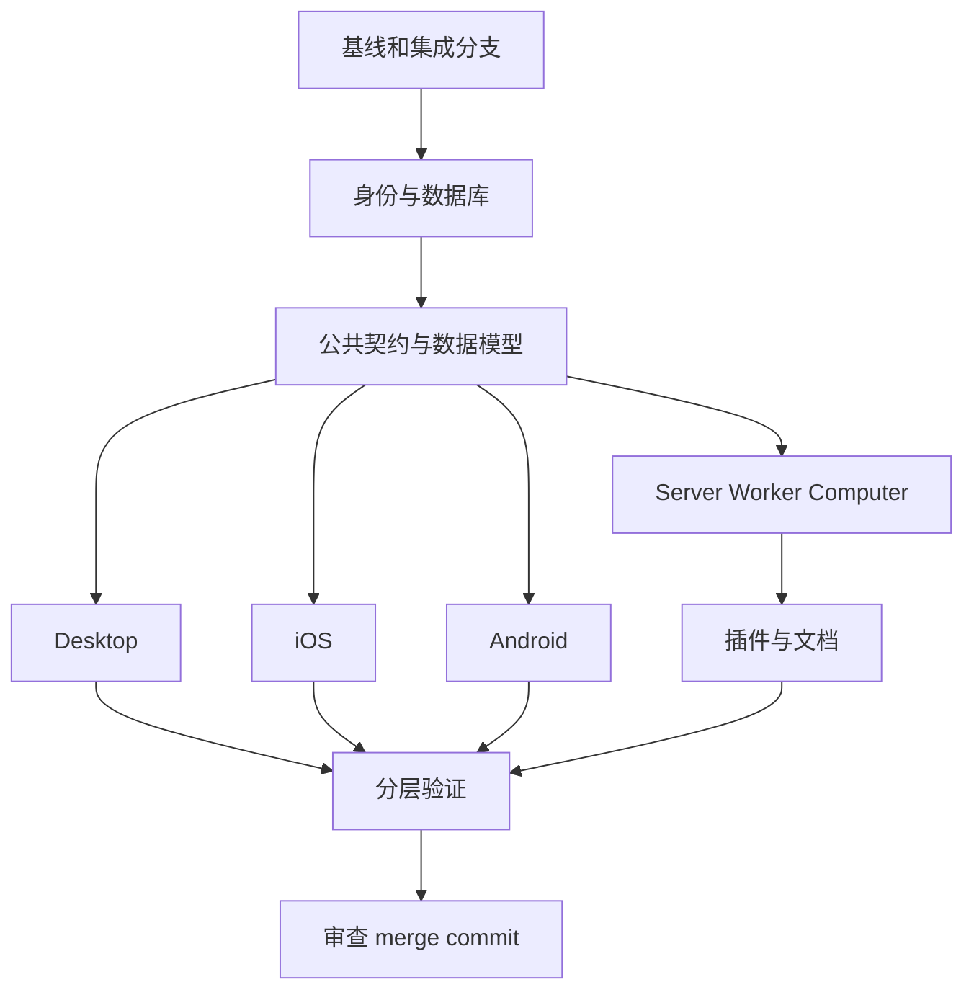

# 设计文档 - 同步上游 0.0.19

状态：COMPLETE

文档关系：

- 总览：[`README.md`](README.md)
- 父规格：[`../007-上游主分支同步/design.md`](../007-上游主分支同步/design.md)
- 需求：[`requirements.md`](requirements.md)
- 任务：[`tasks.md`](tasks.md)

## 1. 概述

### 1.1 目标

- 从 `OutcomeGo=afd276ed9` 创建集成分支，合并 `upstream/main=fd32377bf`。
- 以 OutcomeGo 身份清单和数据库映射为目标适配上游代码。
- 先统一数据库和公共契约，再按运行时、服务端、客户端和插件顺序处理。
- 将无法安全纳入本版本的上游行为明确记录为 `Intentional divergence`。

### 1.2 覆盖需求

- `requirements.md` 需求 1：合并上游 0.0.19 基线
- `requirements.md` 需求 2：保留 OutcomeGo 身份和数据库
- `requirements.md` 需求 3：接入上游可靠性和运行时功能
- `requirements.md` 需求 4：接入选定的上游产品功能
- `requirements.md` 需求 5：公共契约和客户端闭合
- `requirements.md` 需求 6：完成同步验收

### 1.3 技术约束

- Git merge：`git merge --no-commit --no-ff upstream/main`
- 数据库：Prisma schema、raw schema、idempotent deployment script、`outcomego_*` mapping
- 运行时：Server、Worker、Computer、`packages/messaging`、`packages/product-core`
- 客户端：Electron Desktop、Swift iOS、Kotlin Android
- 发布：OutcomeGo `0.1.0-beta.*` 版本线，不能被上游 `0.0.19` 元数据覆盖
- 验证：不启动开发服务器；Android 只能使用 `bash scripts/android/package-debug.sh`

## 2. 架构

### 2.1 集成顺序

### 2.2 处理规则

| 规则 | 具体做法 |
| --- | --- |
| 身份 | 保留 OutcomeGo 的用户可见名称、包名、bundle、URL scheme、artifact 和版本线；上游功能逐项迁移。 |
| 数据库 | 以 `outcomego_*` 为唯一物理目标；不得直接套用引用 `"Bot"` 等逻辑表名的上游 SQL。 |
| 公共契约 | 先修改 contracts、view、schema 和 fixtures，再修改客户端。 |
| 现有 fork 功能 | Android、实时语音、网络出口、Webhook、凭据插件和网页搜索优先保留。 |
| 上游删除 | 先实现兼容桥或记录分歧；删除用户数据必须另立迁移决策。 |
| 测试 | 先跑受影响的局部测试，再进入跨包构建和完整门槛。 |

## 3. 冲突和功能解决方案

### 3.1 基线与分支

- 上游提交：`fd32377bf` 及其可达历史。
- OutcomeGo 提交：`afd276ed9`。
- 操作：从 OutcomeGo 创建集成分支，执行 `git merge --no-commit --no-ff upstream/main`。
- 结果：保留冲突现场，禁止用 `git checkout --ours .` 或 `git checkout --theirs .` 作为整体解决方案。
- 验证：记录 `git merge-base --all`、`git diff --name-only --diff-filter=U` 和 `git log --graph`。

### 3.2 身份、版本和发布资产

- 代表路径：`README.md`、`FORK.md`、`.github/RELEASING.md`、`package.json`、`apps/*/package.json`、`apps/ios/release.json`、`.github/workflows/*`。
- 解决方案：
  1. 保留 OutcomeGo 名称、GPL 和 fork attribution。
  2. 保留 `0.1.0-beta.*` 版本线，不复制上游 `0.0.19` package version。
  3. 只迁移上游新增的 workflow 检查、依赖和功能文档。
  4. 重新执行版本一致性检查，确认 lockfile、Desktop、Server、Worker、Android、iOS 和 landing 版本没有回退。

### 3.3 数据库和删除性 schema

- 代表路径：`packages/db/prisma/schema.prisma`、`packages/db/prisma/raw-schema.sql`、`packages/db/scripts/deploy-schema.ts`、`packages/db/test/*`。
- 解决方案：
  1. 保留所有 `@@map("outcomego_*")`、索引和约束。
  2. 将上游 routine、memory、draft、question、computer 字段迁移到 OutcomeGo 物理表。
  3. 迁移脚本先检测对象和列是否存在，再执行变更，重复执行无副作用。
  4. 对上游删除 `Bot.instructions` 建立本版本兼容桥：保留字段和 Android API，记录为 intentional divergence。
  5. 对上游新增的 memory lease、namespace、routine validation 和 schedule anchor 执行空库、已有库、重复升级和失败恢复回放。

### 3.4 例程、Webhook 和调度

- 代表提交：`6d6117d16` 及其 routine regression/test commits。
- 代表路径：`packages/messaging/src/routines.ts`、`automation-files.ts`、`automation-results.ts`、`group-routine-state.ts`、`apps/worker/src/worker.ts`、`apps/desktop/src/renderer/components/outcomego/routine-panel.tsx`。
- 解决方案：
  1. 采用上游多 schedule 的最早触发、schedule anchor、validationError、编辑保存和生命周期修复。
  2. 保留 OutcomeGo 的 Webhook 配置、手动触发、Webhook/定时并行和 `CRON_TZ` 解析。
  3. 以服务端 revision、文件同步和 execution idempotency 作为唯一状态源。
  4. 先跑 routine file sync、scheduler stress、editor preservation 和 webhook tests。

### 3.5 记忆、提示和取消

- 代表提交：`4e788f36d`、`ea0f06c10`、`aeddde72b`。
- 代表路径：`packages/messaging/src/memory-*`、`agent-data.ts`、`apps/server/src/memory-tool-result.ts`、`apps/worker/src/worker.ts`、`packages/db`。
- 解决方案：
  1. 采用 corrected fact supersession、历史保留但正常召回排除、durable learning intent、owner lease 和 cancellation fencing。
  2. 保留 OutcomeGo 的 prompt identity、provider settings 和表映射。
  3. 用旧数据回放验证 memory scope、lease、namespace、重启、并发写入和取消后晚到结果。
  4. 任何上游 prompt 文案变化都要检查 OutcomeGo 的多语言和版本兼容。

### 3.6 草稿、问题卡和消息回执

- 代表提交：`3f91add45`、`f17447de2`、`cdda5241b`、`6e20295ab`、`b48e8f570`、`030746c26`、`d8fa5720b`。
- 代表路径：`apps/server/src/services/external-draft-service.ts`、`packages/product-core/src/questions.ts`、`packages/contracts`、`apps/desktop/src/renderer/components/outcomego/external-draft-card.tsx`。
- 解决方案：
  1. 采用 durable send/discard receipt、restart recovery、batch outcome notification 和 duplicate-send guidance。
  2. 采用 normal message retire question、answered/skipped/replaced persistence 和新的卡片状态。
  3. 保留 OutcomeGo 的 Inbox、Outcome 和外部 connector 扩展。
  4. Android 先完成字段兼容和旧消息解码，再决定是否复制桌面/iOS 动画。

### 3.7 删除、agent store 和 Computer 控制

- 代表提交：`f8968d8e5`、`c0805e5c8`、`6fbf93ea6`、`ceb335d49`、`1abde87fb`、`6eb05461d`、`a84ecadac`、`b362d0a40`、`652d89a47`、`ae09162e1`、`b8aa84594`、`a5fb64c66`。
- 代表路径：`apps/server/src/services/bot-service.ts`、`subagent/service.ts`、`screen-service.ts`、`apps/computer/src/bot-agent-store.ts`、`screen/control-store.ts`、`packages/messaging/src/agent-lifecycle.ts`。
- 解决方案：
  1. 采用最终删除 marker、retired agent store、late dispatch fence、symlink boundary 和 durable cleanup。
  2. 采用 reaction acknowledgement、background request preservation、computer control persistence 和 requested handoff。
  3. 保留 OutcomeGo 现有云电脑观察/接管/释放、移动端控制和网络出口身份。
  4. 补充删除、归档、重连、取消和控制权竞争的跨包测试。

### 3.8 Computer 网络和出口

- 代表提交：`4bb02542b`、`1b53ac4e0`、以及上游 network lifecycle fixes。
- 代表路径：`apps/computer/src/browser-network*`、`apps/server/src/services/*network*`、`packages/plugin-sdk/src/browser-network/*`、`docker/*network.py`。
- 解决方案：
  1. 采用上游网络 reset 诊断、startup readiness、SOCKS 生命周期和连接恢复修复。
  2. 保留 OutcomeGo Windows、Android、iOS provider、DNS/TLS health、sourceOrder、lease、route epoch 和 public-only policy。
  3. 对所有上游 `openteam` 网络脚本逐项转换为 OutcomeGo 运行身份，不做全局替换。
  4. 不重建远程 Debug Computer；只做本地静态、单元和已有 fixture 验证，远程重建另行授权。

### 3.9 Desktop ScreenBot、Keyboard 和 UI

- 代表提交：`e53b6d3a4`、`02abba399`、`c0bf70b3c`、`e2bdcd235`、`ec999e642`、`b874dd800`。
- 代表路径：`apps/desktop/src/main/*`、`apps/desktop/src/preload/*`、`apps/desktop/src/renderer/*`、`apps/desktop/native/*`。
- 解决方案：
  1. 保留 OutcomeGo renderer 目录和品牌组件作为落点。
  2. 先接入 ScreenBot ownership、shortcut persistence、native helper、resource packaging，再接入视觉动效。
  3. 将上游 `openteam` 文案、路径和资源名迁移到 OutcomeGo。
  4. ScreenBot 默认快捷键、权限、截图路径和用户数据目录必须经过 Desktop tests。
  5. file preview 先接入解析和发送状态，再接入 gooey motion，避免 UI 冲突掩盖数据问题。

### 3.10 iOS

- 代表提交：`af05e836c`、`b874dd800`、`f0f238506`、`4eb5942d1`、`ca6cf5968`、`6e20295ab`。
- 代表路径：`apps/ios/Sources/*`、`apps/ios/Tests/*`、`apps/ios/release.json`。
- 解决方案：
  1. 保留 OutcomeGo Release/Debug display name、bundle identity、scheme 和 network provider。
  2. 采用 voice note 离开聊天后继续转写、preview、question card 生命周期和 composer/voice motion 修复。
  3. 每个 Swift model/API 变化同步 bootstrap、snapshot、UI fixture 和资源检查。
  4. 不复制上游版本号、App Store 页面或 OpenTeam release identity。

### 3.11 Android 和移动共享层

- 代表路径：`apps/android`、`mobile/shared`、`packages/contracts`。
- 解决方案：
  1. OutcomeGo Android 是本次移动端实现的主线，保留聊天、附件、实时语音、网络出口、Webhook、更新签名和中文界面。
  2. 先适配上游公共 contracts 和 Server response，兼容缺失字段和未知字段。
  3. `Bot.instructions`、`dismissOnMoveOn` 等上游删除字段先保留兼容读取和写入，进入分歧表。
  4. 只接入有明确移动端实现和测试证据的上游行为；桌面专属 ScreenBot、Keyboard、maps motion 不自动移植。
  5. 使用 `bash scripts/android/package-debug.sh` 做最终 debug packaging。

### 3.12 插件、地图和文档

- 代表提交：`fc50490e9`、`36538438f`、`0a000ea9f`、`ec1ab8f89`、`5d5da5d77`、`d7abe9eb1`、`fce1fe2b9`。
- 代表路径：`packages/plugins/*`、`packages/plugin-sdk/*`、`apps/server/src/plugins/*`、`docs/*`、`README.md`。
- 解决方案：
  1. 逐插件合并 T3 Code、OpenStreetMap、Google Maps、WhatsApp、Signal 和 Ramp 的 manifest、资源、权限、README、测试。
  2. 检查 OutcomeGo marketplace 计数、插件源和安装状态，不直接复制上游数字。
  3. 用户文档采用 OutcomeGo 名称和中文文档规则，功能说明可以吸收上游新行为。
  4. 上游只描述 OpenTeam 版本的 release docs 转写为 OutcomeGo 版本语境。

## 4. 数据与状态模型

### 4.1 决策状态

| 状态 | 含义 | 处理方式 |
| --- | --- | --- |
| `ADOPT` | 可直接采用上游行为 | 合并并运行对应测试 |
| `ADAPT` | 需要改写到 OutcomeGo 身份或协议 | 以 OutcomeGo 模型完成适配 |
| `PRESERVE` | OutcomeGo 现有功能优先 | 保留 fork 实现，补兼容测试 |
| `DEFER` | 本版本不安全或超出范围 | 记录原因、影响和后续 Spec |
| `BLOCKED` | 外部依赖或验证未完成 | 不标记完成，保留失败证据 |

### 4.2 关键状态不变量

- `upstreamHead` 和 `forkHead` 固定后，集成分支不能偷偷改变基线。
- `outcomego_*` 物理表必须和 Prisma model 一致。
- routine、memory、draft、question、computer 状态必须保留 revision、lease、epoch、ownership 或等价 fencing。
- OutcomeGo Android 和实时语音协议字段不能因 Desktop/iOS 合并而失效。
- 版本检查通过时，OutcomeGo 版本号必须在所有发布包和 lockfile 中一致。

## 5. 错误处理

### 5.1 错误类型

- `merge_conflict_unclassified`：冲突没有对应功能组和决策。
- `outcomego_identity_overwritten`：上游文件覆盖了 OutcomeGo 身份。
- `mapped_schema_bypassed`：迁移直接引用逻辑表名或错误的物理表。
- `mobile_contract_break`：公共契约修改导致 Android/iOS 解码失败。
- `upstream_delete_regression`：删除性上游变更破坏现有用户功能或数据。
- `validation_gap`：代码已解决但没有足够验证证据。

### 5.2 处理策略

1. 先恢复冲突组的可读状态，禁止用整体 ours/theirs 覆盖。
2. 回到本设计对应章节，补充决策和受影响文件。
3. 数据库问题先在临时测试库回放，不使用真实用户数据库。
4. 公共契约问题先修 contracts 和 fixture，再修各端调用方。
5. 删除性变更默认进入 `PRESERVE` 或 `DEFER`，除非有独立迁移和数据保留方案。

## 6. 正确性属性

### 6.1 属性 1：OutcomeGo 身份不回退

*对于任何* 解决后的身份或发布文件，产品名称、包名、bundle、URL scheme、数据库映射和版本线都必须符合 OutcomeGo 清单。

**验证需求：** `requirements.md` 需求 2

### 6.2 属性 2：上游状态机不丢失 fencing

*对于任何* routine、memory、draft、question、deletion 或 Computer 异步回调，晚到结果不得覆盖更新状态、已删除对象或新 route。

**验证需求：** `requirements.md` 需求 3、需求 5

### 6.3 属性 3：客户端协议闭合

*对于任何* 公共字段，Server、Worker、Computer、Desktop、iOS 和 Android 对缺失、未知和新值都有明确处理。

**验证需求：** `requirements.md` 需求 5

### 6.4 属性 4：数据库升级幂等

*对于任何* OutcomeGo 空库或已有库，重复运行同步涉及的部署逻辑不会重复删除、重复插入或损坏现有数据。

**验证需求：** `requirements.md` 需求 2、需求 6

## 7. 测试策略

### 7.1 单元测试

- `packages/contracts`、`packages/product-core`、`packages/messaging` 的状态和解析测试。
- `packages/db` schema/deployment、memory、routine、draft/question migration tests。
- Computer network、provider registry、ScreenBot ownership、Desktop shortcut and preview tests。
- Plugin manifest、permissions、resource and package tests。

### 7.2 集成测试

- 数据库升级：空库、已有库、重复执行、失败恢复。
- routine scheduling/file sync/webhook、memory recovery、draft recovery、question lifecycle。
- deletion/agent store、computer control、network recovery、provider lifecycle。
- Android shared contracts、iOS model/fixture、Server/Worker integration。

### 7.3 构建与打包

- 受影响 workspace package typecheck/build。
- Desktop build and native helper/resource checks。
- iOS resource/renderer and available build checks。
- `bash scripts/android/package-debug.sh`，记录 APK absolute path and SHA-256。
- `bun scripts/release/version.ts check` 或当前 OutcomeGo 等价版本检查。

### 7.4 验证映射

| 需求 | 设计章节 | 验证方式 |
| --- | --- | --- |
| `requirements.md` 需求 1 | `design.md` §3.1 | Git branch/ref/merge inspection |
| `requirements.md` 需求 2 | `design.md` §3.2、§3.3、§4 | identity scan, schema replay, version check |
| `requirements.md` 需求 3 | `design.md` §3.4 至 §3.8 | routine, memory, draft, deletion, computer integration tests |
| `requirements.md` 需求 4 | `design.md` §3.9 至 §3.12 | Desktop/iOS/Android/plugin tests and manual review |
| `requirements.md` 需求 5 | `design.md` §3.6、§3.10、§3.11、§6.3 | contract tests, fixture checks, client builds |
| `requirements.md` 需求 6 | `design.md` §7 | full validation matrix and task status review |

## 8. 风险与待确认项

### 8.1 风险

- 272 个冲突文件中包含 `openteam` 与 `outcomego` 路径、组件重命名和 modify/delete 冲突，文件级自动选择会丢功能。
- 上游 `Bot.instructions` 删除会影响 OutcomeGo Android API、数据库和用户数据。
- 上游 routine/memory/schema 变更与 OutcomeGo 最近的 Webhook、网络出口和凭据插件同时触及共享模块。
- Maps、ScreenBot、T3 Code 等功能增加依赖、权限和资源，可能影响 Desktop build budget。
- 上游 release metadata 与 OutcomeGo beta release workflow 冲突。

### 8.2 待确认项

- 本次是否把 ScreenBot、Maps、T3 Code 作为可用功能合并，还是只完成代码适配并延后发布。
- `Bot.instructions` 是否在下一独立版本另立数据迁移规格。
- 同步后的 OutcomeGo 版本号和发布说明采用 beta.17 还是其他版本号。
