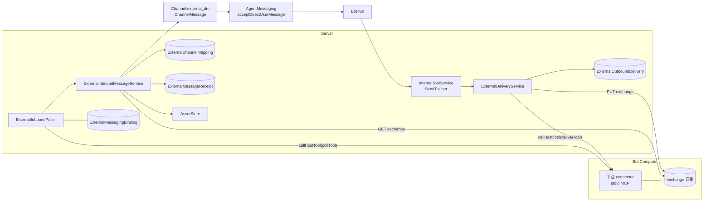

# 设计文档 - 外部消息服务

状态：IN_PROGRESS

文档关系：

- 需求：[`requirements.md`](requirements.md)
- 任务：[`tasks.md`](tasks.md)
- WeChat 子规格设计：[`../009.1-微信iLink消息服务集成/design.md`](../009.1-微信iLink消息服务集成/design.md)

## 1. 概述

### 1.1 目标

- 建立 provider 无关的外部消息入站与外发服务，connector 只负责平台协议。
- 用数据库约束保证外部账户、peer、Channel、provider message 和外发记录的稳定关系。
- 复用现有 `Channel`、`ChannelMessage`、`AgentMessaging`、`AssetStore` 和 packaged MCP 的 host-only 调用。
- 保证"入站至少一次加幂等"和"外发至多一次"。
- 首版只让账户所有者本人通过外部平台与自己的 Bot 对话。

### 1.2 覆盖需求

- `requirements.md` 需求 1、2、3、4、5、6、7、8
- `requirements.md` 非功能需求 1、2、3、4

### 1.3 技术约束

- 后端：Bun、TypeScript、Prisma/PostgreSQL、`AppService`、`AgentMessaging`、`PluginService`。
- Connector 运行位置：Bot Computer 容器内的 stdio MCP 进程，由 `StdioMcpManager`（`apps/computer/src/mcp-manager.ts`）管理；Server 只能通过 `PluginTransport.callHostTool` 和 computer HTTP 接口与它通信。
- Connector 私有状态：`OPENTEAM_PLUGIN_STATE_DIR`（`/agent-data/plugin-runtimes/accounts/<hash>`），移除账户时由 `StdioMcpManager.forget` 整体删除。
- 数据存储：只新增独立表；`PluginConnection` 等从上游同步的表不加列（非功能需求 4.3）。
- 媒体：统一经 `AssetStore`（`packages/messaging/src/asset-store.ts`）落库，沿用其大小和数量上限。
- 幂等：PostgreSQL 唯一约束加事务，不依赖进程内状态。
- 客户端：桌面端完整支持；Android、iOS 首版只做隐藏。

### 1.4 与现有机制的关系

| 现有机制 | 位置 | 本设计的处理 |
| --- | --- | --- |
| `PluginEventPoller` 与 `events.pollTool` | `apps/server/src/services/plugin/events.ts` | 不扩展。它的分发目标是 Routine、事件源是封闭枚举、间隔下限 30 秒，语义与聊天入站不同。新的 `ExternalInboundPoller` 沿用它的"条件更新抢占"和"处理成功后才保存游标"两个模式。 |
| `deliverConnectedChannel` | `apps/server/src/services/plugin/connectors.ts:81` | 保留给未声明 `messaging` 的 connector。声明了 `messaging` 的 connector 在此入口被转交给 `ExternalDeliveryService`（§2.3.5）。 |
| `PluginInvocation` | `packages/db/prisma/schema.prisma` | 不复用。其状态只有 `running`、`completed`、`failed`，无法表达 `uncertain`，且属于 Bot 发起的工具调用。 |
| `IdempotencyRecord` | 同上 | 不复用。入站需要按 Connection 级联删除、保存 `payloadHash` 并关联消息，用专用的 Receipt 表更清晰。事务内创建记录的做法与 `ChannelService.sendDirectMessage` 一致。 |
| `acceptDirectUserMessage` | `packages/messaging/src/index.ts:1224` | 直接复用。首版只接受所有者消息，因此"用户优先级、可中断当前轮次"的语义是期望行为。 |
| `sendVisible` 的 `onPersisted` 钩子 | `packages/messaging/src/index.ts:2728` | 复用它在同一事务内创建 Delivery。 |
| host-only 工具隐藏 | `packages/contracts/src/plugin-namespaces.ts`、`apps/server/src/services/plugin/invocations.ts` | 扩展 `manifestHostTools`，把 `messaging` 声明的两个工具加入隐藏集合。 |

## 2. 架构

### 2.1 系统结构



数据流向：

- **入站**：connector 把收到的消息落盘到自己的队列 → `ExternalInboundPoller` 以长等待方式调用 poll 工具取出 → `ExternalInboundMessageService` 逐条判定并在一个事务内写 Receipt、Mapping、`ChannelMessage` 和 wake → 轮询器保存该条的确认游标 → 下一次 poll 时 connector 据此清理队列。
- **外发**：Bot 在 `external_dm` 运行中调用 `SendToUser` → `InternalToolService` 识别 Channel 类型 → `sendVisible` 在同一事务内写 agent `ChannelMessage` 和 `pending` 的 Delivery → `ExternalDeliveryService` 同步调用 deliver 工具并记录结果 → 工具结果如实返回给 Bot。

### 2.2 模块职责

| 模块 | 职责 | 输入 | 输出 |
| --- | --- | --- | --- |
| `ExternalMessagingBindingService` | 绑定的读写、状态机、target Bot 校验 | connectionId、botId、enabled | Binding 视图 |
| `ExternalInboundPoller` | 租约、调用 poll 工具、逐条分发、推进游标、退避与死信 | Binding 列表 | 游标与状态更新 |
| `ExternalInboundMessageService` | 校验、准入、去重、媒体登记、Mapping、写消息、唤醒 | `ExternalMessage`、Binding | `accepted`、`duplicate`、`rejected`、`retry` |
| `ExternalMediaExchange` | 经 computer HTTP 读取入站文件、写入和清理外发文件 | connectionId、文件名 | 字节流 |
| `ExternalDeliveryService` | 创建和分发 Delivery、状态机、启动恢复 | Mapping、内容、资产 | Delivery 结果 |
| `InternalToolService`（改） | 在 `SendToUser` 入口按 Channel 类型分流 | 工具请求 | 工具结果 |
| computer exchange 端点（新） | 受控目录内的文件流式读写 | HTTP 请求 | 文件字节 |
| Plugin SDK `messaging`（新） | manifest 契约、线协议类型和校验函数 | manifest、工具结果 | 校验后的类型 |

Server 侧新代码集中在 `apps/server/src/services/external-messaging/`：`binding.ts`、`poller.ts`、`inbound.ts`、`delivery.ts`、`media-exchange.ts`、`errors.ts`、`views.ts`。

### 2.3 关键流程

#### 2.3.1 入站轮询循环

每个 Server 进程运行一个 `ExternalInboundPoller`，每 5 秒扫描一次可轮询的 Binding（`enabled`、`status = active`、Connection `ready`、manifest 声明了 `messaging`），为每个未被租用的 Binding 启动一个循环：

1. **抢租约**：`updateMany` 条件为 `leaseExpiresAt` 为空或已过期，写入本进程的 `leaseOwner` 和 60 秒后的 `leaseExpiresAt`。未抢到则跳过。
2. **调用 poll 工具**：`callHostTool(connection, pollTool, { cursor, limit: 20, waitMs })`。`waitMs` 取 manifest 的 `maxWaitSeconds`（默认 20 秒，上限 25 秒）。
3. **解析结果**：用 SDK 的 `parseExternalPollResult` 校验。整体无法解析视为调用失败。
4. **逐条处理**：按顺序把每条消息交给 `ExternalInboundMessageService.accept`。
   - 终态结果（`accepted`、`duplicate`、`rejected`）：执行 `updateMany({ where: { id, inboundCursor: 前值 }, data: { inboundCursor: ackCursor, 重试计数清零 } })`。
   - `retry`：记录或累加该 `ackCursor` 的重试计数，停止处理本批剩余消息，进入退避。
   - 单条结构非法但带有 `ackCursor`：按 `rejected`（`external_message_invalid`）处理并推进。
5. **续租并继续**：更新 `leaseExpiresAt` 和 `lastPolledAt`，立即回到第 2 步。
6. **调用失败**：保留游标，按 2、4、8……60 秒退避；累计 `consecutiveFailures` 和 `lastErrorCode`。
7. **死信**：同一 `ackCursor` 的 `retryCount` 达到 20 或 `retryFirstAt` 超过 30 分钟时，写入 `rejected` Receipt（`external_retry_exhausted`），推进游标。因 target Bot 不可用而产生的 `retry` 不计入死信，改为把 Binding 置为 `needs_attention` 并退出循环。
8. **退出条件**：Binding 被停用、Connection 不再 `ready`、`runtimeGeneration` 变化、租约被他人取得或进程停止。

两个进程因租约失效而短暂重叠时，Receipt 唯一约束保证不重复写消息，带前值条件的游标更新保证游标不回退。

#### 2.3.2 接受一条入站消息

`accept(binding, connection, message)` 返回四种结果之一。

**事务外的准备**

1. **结构与限制**：`providerMessageId`、`peer.id`、`sender.id` 非空且不超过 256 字符；`text` 不超过 20000 字符；`occurredAt` 是合法 ISO 8601；`providerMetadata` 最多 16 个键、值为标量、单值不超过 256 字符。不通过 → `rejected`。
2. **规范化**：去除 `\n`、`\t` 以外的控制字符；展示名截断到 120 字符。
3. **准入**：`peer.type !== "direct"` → `rejected`（`external_peer_type_unsupported`）；`sender.isAccountOwner !== true` → `rejected`（`external_sender_not_allowed`）。
4. **计算 `payloadHash`**（§3.2.6）。
5. **查 Receipt**：已存在且 hash 相同 → `duplicate`；hash 不同 → `rejected`（`external_message_conflict`），不改动已有 Receipt。
6. **预检 target Bot**：不存在、已归档或不可运行 → `retry`（`external_target_unavailable`）。
7. **登记媒体**（§2.3.3）：得到 `AssetRef[]` 和失败说明列表；瞬时失败 → `retry`。
8. **物化附件**：调用 `agentData.materializeAttachments`，做法与 `ChannelService.sendDirectMessage` 相同（该调用持有文件锁，必须在事务外）。

**单个事务**

9. `pg_advisory_xact_lock(hashtext('external-peer:<connectionId>:<peerId>'))`，串行化同一 peer。
10. 插入 Receipt（`status = accepted`）。唯一约束冲突 → 回滚后重新走第 5 步。
11. 重新读取 Binding 和 Bot，确认仍可用；否则抛出 `retry`。
12. 查找或创建 Mapping。创建时同时创建 Channel：`kind = external_dm`、`directKey = external:<mappingId>`、`name` 取展示名（缺省为平台名）、成员为 target Bot（`ordinal = 0`）。
13. Mapping 或 Channel 已归档 → 回滚，另起事务写入 `rejected` Receipt（`external_channel_unavailable`）。
14. 执行与应用内直发相同的前置处理：`skipBootstrapForUser`、`dismissMoveOnWidgets`。
15. `nextMessageAddress(tx, channelId, "user")` 取得地址，创建 `ChannelMessage`：`sender = user`、`clientId = external:<receiptId>`、`content` 为规范化文本、`metadata` 见 §3.2.7。
16. `acceptDirectUserMessage(tx, …)`：`content` 为 `formatUserPrompt(address, text)`，后接一行 `[Sent from <平台显示名>]` 和附件失败说明；`clientId = external:<receiptId>`；`occurredAt` 取消息时间。
17. `scheduleTranscriptProjection`、更新 `Channel.updatedAt` 和 `Mapping.lastInboundAt`，把 `channelMessageId`、`runId`、`mappingId` 回填到 Receipt。

**事务后**

18. 与 `sendDirectMessage` 一样通过 `afterDurableAcceptance` 处理被跳过的 bootstrap 和被取代的运行。
19. 清理该消息在 Exchange 中的入站文件由 connector 在确认游标推进后完成，Server 不主动删除。

永久拒绝统一由 `recordRejection` 写入 `rejected` Receipt，只保存 `payloadHash` 和错误码，不保存正文。`providerMessageId` 本身缺失时无法写 Receipt，只计数并记录日志。

#### 2.3.3 入站媒体

1. connector 在把消息放入队列前，已把媒体解密并写入 `<stateDir>/exchange/inbound/<exchangeName>`，并在消息里给出 `exchangeName`、`fileName`、`byteSize`、`sha256`。
2. Server 先做便宜的检查：数量超过 `MAX_MESSAGE_ASSETS` 的部分直接记为失败（`external_media_too_many`）；`byteSize` 超过 `AssetStore` 对该文件名的上限记为失败（`external_media_too_large`）。
3. 对剩余媒体调用 `GET /v1/mcp/connections/:id/exchange/inbound/:name`，把响应流交给 `AssetStore.ingestStream`，同时计算 SHA-256。
4. 字节数或摘要与声明不符 → 该附件失败（`external_media_mismatch`），并从 `AssetStore` 中不保留引用。
5. `AssetStore` 以 `ApiError` 拒绝（类型、大小）→ 该附件失败，错误码取其 `code`。
6. computer 不可达、读取超时 → 整条消息 `retry`。文件不存在（404）→ 该附件失败（`external_media_missing`）。
7. connector 自己下载失败的媒体通过 `mediaFailures` 上报，Server 原样并入失败说明。

失败说明以固定模板写入 Bot 可见内容，例如 `[Attachment "report.pdf" could not be received: external_media_too_large]`，文件名经过规范化和截断。

#### 2.3.4 `external_dm` 内的回复路由

入口是 `InternalToolService` 处理 `SendToUser` 的分支（`apps/server/src/services/internal-tool-service.ts`）。当请求未带 `channel` 时先读取运行所在 Channel 的类型：

1. 不是 `external_dm` → 走现有逻辑，不变。
2. 是 `external_dm` 且 `to === "dm"` → 先解析 `directKey = bot:<botId>`、未归档且属于该 Bot 的 `bot_dm`，再按该目标校验和持久化。允许类型与需求 6.3 一致；保留现有 group 的私聊类型限制，不把它复制给 external_dm。`secret-request` 的所有者检查改用解析后的目标 Channel；子代理身份仍按现有规则拒绝。此路径不创建 Delivery。所有者卡片的回执和后续 wake 归属目标 `bot_dm`。
3. 是 `external_dm` 且类型不是 `text`、`attachment` → 抛出 `external_channel_type_unsupported`，提示所有者专属卡片请使用 `to: "dm"`。
4. 其余情况：
   1. 读取 Mapping、Binding 和 Connection。Mapping 不存在或已归档 → `external_channel_unavailable`，不写消息。
   2. 调用 `sendVisible(context, input, onPersisted)`。`onPersisted(tx, messageId)` 在同一事务内创建 `status = pending` 的 Delivery，`callId = external-delivery:<toolCallId>`。`sendVisible` 已对 `tool:<callId>` 做了消息幂等，因此重放不会产生第二条消息；Delivery 的 `callId` 唯一约束保证不会产生第二条外发记录。
   3. 事务提交后调用 `ExternalDeliveryService.dispatch(deliveryId, leaseOwner)`（§2.3.6）。重放时按 `callId` 读取已有 Delivery，不重新持久化或分发；尚未结束时返回 `in_progress`，不能伪造最终成功。
   4. 工具确认统一包含消息标识和 `external: { id, platform, status, reason? }`。只有 status 为 sent 时 `sent = true`；failed 和 uncertain 返回 `sent = false`、`delivery_failed = true`；重放时仍为 pending 或 sending 则返回 `sent = false`、`in_progress = true`，等待查询或过期恢复，不新增投递。不另外创建恢复 wake，避免"失败 → 唤醒 → 再发"的循环。

只有经 `SendToUser` 产生的 `text`、`attachment` 消息会外发。系统消息、运行错误、表情回应等其他写入 `external_dm` 的记录只留在应用内。

#### 2.3.5 显式地址外发

`deliverConnectedChannel` 在解析出 Connection 之后增加一个判断：

1. 地址前缀的匹配候选增加 manifest 的 `messaging.platform`。
2. Connection 的 connector 声明了 `messaging` → 调用 `ExternalDeliveryService.deliverToAddress({ botId, runId, callId, connectionId, peerId, content, files })`：
   1. 查找 `(connectionId, peerId, botId)` 的活动 Mapping；不存在 → `external_peer_unknown`（对方需先从该平台发来消息），不外发。
   2. 在一个事务内向该 Mapping 的 Channel 写入 agent `ChannelMessage` 和 `pending` 的 Delivery。
   3. dispatch，并把 sent、failed、uncertain（或重放时的进行中状态）连同 Delivery 标识返回给 InternalToolService。
   4. `InternalToolService` 按 §2.3.4 的统一确认结构返回 Delivery 结果，不把非成功状态包装成 sent: true，也不进入旧的 `enqueueChannelDeliveryFailure` 恢复 wake 路径。相同 callId 重放先查询已有记录，不重新建消息或分发。
3. 未声明 `messaging` → 走原有的启发式工具选择逻辑，不变。

这样无论 Bot 从哪个 Channel 发起，对同一 peer 的外发都有 Channel 记录和同一套状态机。

#### 2.3.6 分发一次外发

`dispatch(deliveryId, leaseOwner)`：

1. Delivery 与 agent 消息同事务创建时分配唯一的分发操作标识 `deliveryLeaseOwner`，并写入数据库时间加 120 秒的 `deliveryLeaseExpiresAt`。从 `pending` 暂存媒体到调用结束，每 10 秒按该标识、当前状态和未过期条件续租。只有创建者的分发操作持有此标识；工具重放只查询结果。读取 Mapping、Binding、Connection；Binding 停用 → `failed`（`external_messaging_disabled`）；Connection 非 `ready` → `failed`（`external_connection_unavailable`）。
2. 按 manifest 检查能力：文本长度超过 `outbound.maxTextChars`、媒体类型或大小不在 `outbound.media` 声明内 → `failed`（`external_delivery_unsupported`）。
3. 有媒体时，逐个从 `AssetStore` 读取并 `PUT /v1/mcp/connections/:id/exchange/outbound/:deliveryId/:name`。任何一步失败 → `failed`（`external_media_staging_failed`）。此时尚未调用 provider，属于确定失败。
4. 使用 `status = pending`、匹配的 `deliveryLeaseOwner` 和未过期租约，把状态条件更新为 `sending` 并写 `startedAt`；只有更新成功的调用能够进入下一步。更新为 0 或续租失败时停止，取消本地调用，不能重新抢占该 Delivery 发送。
5. `callHostTool(connection, deliverTool, { deliveryId, peerId, text, media })`，调用上限 60 秒。
6. 用 `parseExternalDeliverResult` 解析：
   - `sent` → `sent`，保存白名单化的 `providerMessageIds` 和 `note`。
   - `failed` → `failed`，保存 `code` 和截断后的 `message`。
   - `uncertain`、超时、传输错误、`isError` 且无结构化结果、无法解析 → `uncertain`。
7. 所有失败和完成写入都带当前状态、匹配的 `deliveryLeaseOwner` 和未过期条件；终态写入与消息 metadata 更新、`external.delivery.updated` 事件同事务提交并清除租约。租约已过期或恢复器已写终态时，迟到的结果不能覆盖它，返回数据库中的记录。
8. `DELETE /v1/mcp/connections/:id/exchange/outbound/:deliveryId`，失败只记录日志。

connector 必须按 `deliveryId` 幂等：重复收到同一 `deliveryId` 时返回首次结果而不重发。Server 不依赖这一点保证正确性，但它为运维手动重试留出余地。

#### 2.3.7 启动恢复与生命周期

- **Server 启动与周期恢复**：在 `startup-recovery.ts` 执行一次，此后每 30 秒扫描租约已过期的 `pending`、`sending` Delivery。按读取到的状态、租约标识和已过期条件更新，分别置为 `failed`（`external_delivery_abandoned`）或 `uncertain`（`external_delivery_interrupted`），同步更新消息 metadata 和客户端事件。另一进程仍有效的租约不被处理；过期的 Delivery 不重新分发。
- **Connection 移除**：在删除 Connection 的事务内先归档其全部 `external_dm` Channel（写 `archivedAt`），未结束的 Delivery 置为 `failed`；Binding、Mapping、Receipt 由外键级联删除。
- **Bot 删除**：Binding 和 Mapping 由外键级联删除；Channel 随现有的 Bot 删除流程处理。
- **Channel 归档**：归档 `external_dm` 时同步把 Mapping 置为 `archived`；取消归档时恢复为 `active`。
- **Receipt 清理**：轮询器每天一次删除 90 天前的 Receipt。
- **重新链接**：Binding 和 Mapping 保留。connector 若判定账户已更换或游标失效，在 poll 结果中返回 `resetCursor: true`，Server 把确认游标清空。

## 3. 组件和接口

### 3.1 核心组件

覆盖需求：1、2、3、4、5、6、8

- `ExternalMessagingBindingService`：绑定的增删改查与状态迁移。
- `ExternalInboundPoller`：构造参数为 `prisma`、`callHostTool`、`accept`、`now`，全部可注入，便于用假 connector 测试（与 `PluginEventPoller` 的构造方式一致）。在 `AppService` 中与 `pluginEvents` 并列启动和停止。
- `ExternalInboundMessageService`：纯 Server 逻辑，不知道任何平台。
- `ExternalDeliveryService`：外发状态机的唯一写入者。
- `ExternalMediaExchange`：封装 computer exchange 端点。
- `packages/plugin-sdk/src/messaging.ts`：线协议类型与 `parseExternalPollResult`、`parseExternalDeliverResult`、`validateExternalMessage`，Server 和 connector 共用。

### 3.2 数据结构

覆盖需求：1、2、3、4、6、8

#### 3.2.1 `ExternalMessagingBinding`

表名 `outcomego_external_messaging_binding`。

| 字段 | 类型 | 必填 | 说明 | 约束 |
| --- | --- | --- | --- | --- |
| `id` | UUID | 是 | 主键 | 数据库生成 |
| `connectionId` | UUID | 是 | `PluginConnection` | 唯一；外键 `onDelete: Cascade` |
| `botId` | UUID | 是 | target Bot | 外键 `onDelete: Cascade` |
| `enabled` | Boolean | 是 | 用户开关 | 默认 `true` |
| `inboundPolicy` | String | 是 | 准入策略 | 首版只允许 `owner_only` |
| `status` | String | 是 | `active`、`needs_attention` | 默认 `active` |
| `inboundCursor` | String | 否 | 确认游标 | 不透明，最长 2048 字符 |
| `leaseOwner` | String | 否 | 持有租约的进程标识 | — |
| `leaseExpiresAt` | DateTime | 否 | 租约过期时间 | — |
| `retryAckCursor` | String | 否 | 正在重试的消息 | — |
| `retryCount` | Int | 是 | 该消息已重试次数 | 默认 0 |
| `retryFirstAt` | DateTime | 否 | 该消息首次失败时间 | — |
| `consecutiveFailures` | Int | 是 | poll 调用连续失败次数 | 默认 0 |
| `lastPolledAt` | DateTime | 否 | 最近一次 poll 返回 | — |
| `lastAcceptedAt` | DateTime | 否 | 最近一次接受消息 | — |
| `lastErrorCode` | String | 否 | 最近错误码 | 机器可读，不含密钥 |
| `lastErrorAt` | DateTime | 否 | 最近错误时间 | — |
| `rejectedCounts` | Json | 是 | 各拒绝码的累计次数 | 默认 `{}` |
| `createdAt`、`updatedAt` | DateTime | 是 | 生命周期字段 | 自动维护 |

#### 3.2.2 `ExternalChannelMapping`

表名 `outcomego_external_channel_mapping`。

| 字段 | 类型 | 必填 | 说明 | 约束 |
| --- | --- | --- | --- | --- |
| `id` | UUID | 是 | 主键 | 数据库生成 |
| `connectionId` | UUID | 是 | `PluginConnection` | 外键 `onDelete: Cascade` |
| `botId` | UUID | 是 | 所属 Bot | 外键 `onDelete: Cascade` |
| `peerId` | String | 是 | provider 稳定 peer 标识 | 最长 256；与 `connectionId`、`botId` 联合唯一 |
| `platform` | String | 是 | manifest 的 `messaging.platform` | 小写 |
| `peerType` | String | 是 | 首版只有 `direct` | — |
| `channelId` | UUID | 是 | `external_dm` Channel | 唯一；外键 `onDelete: Cascade` |
| `displayName` | String | 否 | 展示名称 | 最长 120；不作为身份键 |
| `status` | String | 是 | `active`、`archived` | 默认 `active` |
| `lastInboundAt` | DateTime | 否 | 最近入站时间 | — |
| `createdAt`、`updatedAt` | DateTime | 是 | 生命周期字段 | 自动维护 |

Mapping 不保存任何回复凭据。

#### 3.2.3 `ExternalMessageReceipt`

表名 `outcomego_external_message_receipt`。

| 字段 | 类型 | 必填 | 说明 | 约束 |
| --- | --- | --- | --- | --- |
| `id` | UUID | 是 | 主键 | 数据库生成 |
| `connectionId` | UUID | 是 | `PluginConnection` | 外键 `onDelete: Cascade` |
| `providerMessageId` | String | 是 | provider 消息 id | 最长 256；与 `connectionId` 联合唯一 |
| `peerId` | String | 是 | 外部 peer | — |
| `payloadHash` | String | 是 | 规范化 payload 的 SHA-256 | 64 位十六进制 |
| `status` | String | 是 | `accepted`、`rejected` | 没有 `processing` |
| `rejectionCode` | String | 否 | 永久拒绝原因 | `status = rejected` 时必填 |
| `mappingId` | UUID | 否 | 接受时的 Mapping | 外键 `onDelete: SetNull` |
| `channelMessageId` | UUID | 否 | 接受后写入的消息 | 外键 `onDelete: SetNull` |
| `runId` | UUID | 否 | 唤醒的运行 | 外键 `onDelete: SetNull` |
| `createdAt` | DateTime | 是 | 创建时间 | 索引，用于 90 天清理 |

Receipt 只在事务内以终态写入，因此不存在崩溃后卡在中间状态的记录。

#### 3.2.4 `ExternalOutboundDelivery`

表名 `outcomego_external_outbound_delivery`。

| 字段 | 类型 | 必填 | 说明 | 约束 |
| --- | --- | --- | --- | --- |
| `id` | UUID | 是 | 主键，同时作为传给 connector 的 `deliveryId` | 数据库生成 |
| `callId` | String | 是 | `external-delivery:<toolCallId>` | 唯一 |
| `connectionId` | UUID | 是 | `PluginConnection` | 外键 `onDelete: Cascade` |
| `mappingId` | UUID | 否 | 目标 Mapping | 外键 `onDelete: SetNull` |
| `botId` | UUID | 是 | 发起的 Bot | 外键 `onDelete: Cascade` |
| `runId` | UUID | 否 | 发起的运行 | 外键 `onDelete: SetNull` |
| `channelMessageId` | UUID | 是 | 对应的 agent 消息 | 唯一；外键 `onDelete: Cascade` |
| `status` | String | 是 | `pending`、`sending`、`sent`、`failed`、`uncertain` | 默认 `pending` |
| `errorCode` | String | 否 | 机器可读原因 | — |
| `errorMessage` | String | 否 | 脱敏后的说明 | 最长 500 |
| `providerResult` | Json | 否 | 白名单化的 provider 结果 | 只含 `providerMessageIds`、`note` |
| `startedAt`、`completedAt` | DateTime | 否 | 调用起止时间 | — |
| `deliveryLeaseOwner` | String | 否 | 唯一分发操作标识（进程实例加随机 nonce） | 创建时分配；终态清空 |
| `deliveryLeaseExpiresAt` | DateTime | 否 | 数据库时间计算的租约截止 | 默认 120 秒，每 10 秒续租；非终态必填 |
| `createdAt`、`updatedAt` | DateTime | 是 | 生命周期字段 | 自动维护 |

#### 3.2.5 `ChannelKind`

`ChannelKind` 增加 `external_dm`：Prisma 枚举（`packages/db/prisma/schema.prisma`）、`packages/contracts/src/index.ts` 的 `Schema.Literal` 同步修改，`scripts/check/contract-enum-parity.ts` 负责校验两者一致。

`external_dm` Channel 的不变量：恰好一个成员（target Bot）；`directKey = external:<mappingId>`；恰好对应一条 Mapping。

#### 3.2.6 线协议类型

定义在 `packages/plugin-sdk/src/messaging.ts`。

```ts
export type ExternalPeerType = "direct" | "group" | "channel";

export interface ExternalInboundMedia {
  /** exchange/inbound 下的文件名，匹配 ^[A-Za-z0-9][A-Za-z0-9._-]{0,119}$ */
  exchangeName: string;
  fileName: string;
  mimeType?: string;
  byteSize: number;
  /** 明文字节的 SHA-256，小写十六进制 */
  sha256: string;
}

export interface ExternalMediaFailure {
  fileName?: string;
  /** 机器可读原因，例如 wechat_media_download_failed */
  code: string;
}

export interface ExternalMessage {
  providerMessageId: string;
  peer: { id: string; type: ExternalPeerType; displayName?: string };
  sender: { id: string; displayName?: string; isAccountOwner: boolean };
  text: string;
  /** ISO 8601 */
  occurredAt: string;
  media?: ExternalInboundMedia[];
  mediaFailures?: ExternalMediaFailure[];
  providerMetadata?: Record<string, string | number | boolean>;
}

export interface ExternalInboundEnvelope {
  /** 不透明；Server 保存它表示该条及之前的消息均已处理 */
  ackCursor: string;
  message: ExternalMessage;
}

export interface ExternalPollInput {
  cursor: string | null;
  limit: number;
  waitMs: number;
}

export interface ExternalPollResult {
  messages: ExternalInboundEnvelope[];
  /** 为 true 时 Server 清空确认游标，例如账户更换或队列被重建 */
  resetCursor?: boolean;
}

export interface ExternalOutboundMedia {
  /** exchange/outbound/<deliveryId>/ 下的文件名 */
  exchangeName: string;
  fileName: string;
  mimeType: string;
  byteSize: number;
  sha256: string;
}

export interface ExternalDeliverInput {
  deliveryId: string;
  peerId: string;
  text?: string;
  media?: ExternalOutboundMedia[];
}

export type ExternalDeliverResult =
  | { status: "sent"; providerMessageIds?: string[]; note?: string }
  | { status: "failed"; code: string; message: string }
  | { status: "uncertain"; code: string; message: string };
```

说明：

- 消息里没有 `connectionId` 和 `platform`：Server 以自己发起调用的 Connection 为准，connector 无法冒充其他连接。
- 消息里没有回复凭据字段：凭据只在 connector 内部按 peer 保存。
- `payloadHash` 是下列字段规范化 JSON 的 SHA-256：`providerMessageId`、`peer.id`、`peer.type`、`sender.id`、`sender.isAccountOwner`、`text`、`occurredAt`、按顺序排列的各媒体 `sha256` 与 `byteSize`。展示名、`exchangeName`、`mediaFailures` 和 `providerMetadata` 不参与，避免重投时因临时字段变化被误判为冲突。

#### 3.2.7 `ChannelMessage.metadata` 扩展

入站消息：

```json
{
  "type": "text",
  "address": "t3u",
  "attachments": [],
  "external": {
    "platform": "wechat",
    "senderName": "…",
    "occurredAt": "2026-11-16T08:00:00.000Z",
    "mediaFailures": [{ "fileName": "a.mp4", "code": "external_media_too_large" }]
  }
}
```

外发消息在现有 metadata 上增加：

```json
{ "externalDelivery": { "id": "<deliveryId>", "status": "sent", "code": null } }
```

#### 3.2.8 manifest `messaging` 块

定义在 `packages/plugin-sdk/src/types.ts`，校验在 `packages/plugin-sdk/src/manifest.ts`。

```ts
export interface PluginMessaging {
  /** 地址前缀与展示用平台键，匹配 ^[a-z0-9][a-z0-9_.-]{0,39}$ */
  platform: string;
  inbound: {
    pollTool: string;
    /** connector 无消息时的最长挂起秒数，0 到 25，默认 20 */
    maxWaitSeconds?: number;
  };
  outbound: {
    deliverTool: string;
    /** 单次外发文本的字符上限；connector 自行分片 */
    maxTextChars: number;
    media?: {
      kinds: Array<"image" | "video" | "audio" | "file">;
      maxBytes: number;
    };
  };
}
```

校验规则：只允许 `transport = stdio`；必须同时声明 `persistentState: true`；两个工具名非空且互不相同；`maxTextChars` 为 1 到 20000 的整数。

### 3.3 接口契约

覆盖需求：1、4、5、6、7

#### 3.3.1 poll 工具（connector 实现）

- 类型：host-only MCP 工具，工具定义带 `_meta: { "outcomego/hostOnly": true }`
- 标识：manifest `messaging.inbound.pollTool`
- 输入：`ExternalPollInput`
- 输出：`structuredContent` 为 `ExternalPollResult`
- 语义：
  - 收到 `cursor` 即表示该游标及之前的队列项已被确认，connector 可以删除它们及其 Exchange 文件。
  - 返回 `cursor` 之后的最多 `limit` 条；队列为空时最多挂起 `waitMs` 毫秒，期间有新消息立即返回。
  - `cursor` 不属于当前队列（例如状态被重建）时返回 `resetCursor: true` 和从头开始的消息。
  - `ackCursor` 在同一队列内严格递增。
- 错误：账户未就绪时返回 `isError`，文本为机器可读错误码。

#### 3.3.2 deliver 工具（connector 实现）

- 类型：host-only MCP 工具
- 标识：manifest `messaging.outbound.deliverTool`
- 输入：`ExternalDeliverInput`
- 输出：`structuredContent` 为 `ExternalDeliverResult`
- 语义：
  - 在向 provider 发出任何请求之前能判定的失败一律返回 `failed`。
  - 已向 provider 发出请求但没有得到明确结果一律返回 `uncertain`。
  - 按 `deliveryId` 幂等。
  - 读取媒体时校验文件位于 `exchange/outbound/<deliveryId>/`、大小和 SHA-256 与输入一致。

#### 3.3.3 computer exchange 端点（新）

实现在 `apps/computer/src/main.ts` 和 `apps/computer/src/mcp-manager.ts`，沿用现有 `/v1/mcp/connections/:id/*` 的鉴权。

- `GET /v1/mcp/connections/:id/exchange/inbound/:name`：流式返回文件。404 表示不存在。
- `PUT /v1/mcp/connections/:id/exchange/outbound/:deliveryId/:name`：流式写入，先写临时文件再原子改名，权限 `0600`。
- `DELETE /v1/mcp/connections/:id/exchange/outbound/:deliveryId`：删除该目录。
- 校验：`name` 匹配 `^[A-Za-z0-9][A-Za-z0-9._-]{0,119}$`；`deliveryId` 是 UUID；目标经 `lstat` 确认为普通文件或不存在，父目录是真实目录而非符号链接；单文件上限取 `AssetStore` 的最大值；只对声明了 `persistentState` 且已有状态目录的连接可用。

#### 3.3.4 绑定管理 HTTP 接口

实现在 `apps/server/src/routes/plugin-query.ts` 和 `plugin-mutation.ts`。

- `GET /api/plugin-connections/:id/messaging`
  - 输出：`{ supported, platform, binding: { enabled, botId, inboundPolicy, status, lastPolledAt, lastAcceptedAt, lastErrorCode, lastErrorAt, consecutiveFailures, rejectedCounts } | null }`
- `PUT /api/plugin-connections/:id/messaging`
  - 输入：`{ enabled: boolean, botId: string }`
  - 校验：Connection 的 connector 声明了 `messaging`；Bot 存在、未归档、不是子代理身份。
  - 行为：创建或更新 Binding；`botId` 变化时保留游标；从 `needs_attention` 恢复为 `active`。
  - 错误：`external_messaging_unsupported`、`external_target_unavailable`。
- `DELETE /api/plugin-connections/:id/messaging`：删除 Binding，不删除 Mapping 和 Channel。

#### 3.3.5 视图扩展

- Channel 视图（`packages/contracts/src/service-protocol.ts`、`apps/server/src/services/snapshot/views.ts`、`view-mappers.ts`）增加可选字段 `external: { platform, connectionId, peerDisplayName, mappingStatus }`，只在 `kind = external_dm` 时出现。
- 应用内发送接口对 `external_dm` 返回 409 `external_channel_read_only`。

## 4. 数据与状态模型

### 4.1 数据关系

```text
PluginConnection 1 ── 0..1 ExternalMessagingBinding N ── 1 Bot
PluginConnection 1 ── N ExternalChannelMapping N ── 1 Bot
ExternalChannelMapping 1 ── 1 Channel(kind = external_dm) 1 ── 1 ChannelMember(Bot)
PluginConnection 1 ── N ExternalMessageReceipt 0..1 ── 1 ChannelMessage(sender = user)
ExternalChannelMapping 1 ── N ExternalOutboundDelivery 1 ── 1 ChannelMessage(sender = agent)
```

- Binding 是"这个连接的消息交给谁"的唯一事实来源，也是入站游标的持有者。
- Mapping 是外部会话的身份根；`ChannelMessage` 是 OpenTeam 的对话事实；Receipt 是 provider 去重事实；Delivery 是外发事实。
- Bot 的上下文按 Channel 隔离（`ContextSession` 的 `scope = channel`），因此 `external_dm` 自带独立上下文。

### 4.2 状态流转

**Binding**

| 状态 | 含义 | 进入条件 | 退出条件 |
| --- | --- | --- | --- |
| `active` | 正常轮询 | 创建、用户重新保存、Bot 恢复后用户确认 | target Bot 不可用 |
| `needs_attention` | 暂停轮询，游标不动 | 接受时发现 target Bot 不存在、归档或不可运行 | 用户改绑或重新保存 |

`enabled = false` 是与状态正交的用户开关，优先级最高。

**Delivery**

| 状态 | 含义 | 进入条件 | 退出条件 |
| --- | --- | --- | --- |
| `pending` | 已落库，尚未调用 provider | 与 agent 消息和分发租约同事务创建 | 开始分发、前置检查失败、租约过期 |
| `sending` | 已开始调用 deliver 工具 | 持有有效租约的条件更新成功 | 得到结果、超时、租约过期 |
| `sent` | connector 明确返回成功 | 结果为 `sent` | 终态 |
| `failed` | 确定没有发出 | 前置检查失败、结果为 `failed`、恢复时 `pending` 租约已过期 | 终态 |
| `uncertain` | 可能已发出 | 超时、传输错误、结果不可解析、恢复时 `sending` 租约已过期 | 终态 |

`sent` 的含义是"provider 接受了请求"，不等于对方已读或已展示；具体平台的语义差异由子规格说明。

**入站消息结果**

| 结果 | 是否写 Receipt | 是否推进游标 | 典型原因 |
| --- | --- | --- | --- |
| `accepted` | 是 | 是 | 正常接受 |
| `duplicate` | 否（已有） | 是 | provider 重投 |
| `rejected` | 是（`rejected`） | 是 | 非所有者、类型不支持、非法、冲突、Channel 已归档、死信 |
| `retry` | 否 | 否 | 数据库错误、computer 不可达、target Bot 不可用 |

## 5. 错误处理

### 5.1 错误类型

入站：

- `external_message_invalid`：结构或 metadata 不符合契约。
- `external_message_too_large`：文本超过 20000 字符。
- `external_sender_not_allowed`：发送者不是账户所有者。
- `external_peer_type_unsupported`：peer 不是 `direct`。
- `external_message_conflict`：同一 provider message id 的内容不一致。
- `external_channel_unavailable`：Mapping 或 Channel 已归档。
- `external_target_unavailable`：target Bot 不存在、已归档或不可运行（`retry`，置 `needs_attention`）。
- `external_retry_exhausted`：瞬时失败达到上限后的死信。
- `external_poll_failed`、`external_poll_invalid`：poll 调用失败或结果不可解析。

媒体：

- `external_media_too_large`、`external_media_too_many`、`external_media_mismatch`、`external_media_missing`、`external_media_staging_failed`。

外发：

- `external_channel_type_unsupported`：`external_dm` 内使用了不支持的 `SendToUser` 类型。
- `external_channel_read_only`：应用内向 `external_dm` 发送。
- `external_peer_unknown`：显式地址没有对应的活动 Mapping。
- `external_messaging_disabled`、`external_connection_unavailable`、`external_delivery_unsupported`。
- `external_delivery_abandoned`、`external_delivery_interrupted`：过期租约恢复产生。
- `external_delivery_timeout`：调用超过 60 秒（`uncertain`）。

配置：

- `external_messaging_unsupported`：Connection 的 connector 未声明 `messaging`。

### 5.2 错误响应格式

HTTP 接口沿用现有 `ApiError`（`packages/contracts`），不引入新格式：

```json
{
  "error": {
    "code": "external_target_unavailable",
    "message": "The selected bot is not available"
  }
}
```

工具结果沿用 `SendToUser` 的确认结构：

```json
{
  "sent": false,
  "external": { "id": "<deliveryId>", "platform": "wechat", "status": "uncertain", "reason": "external_delivery_timeout" },
  "delivery_failed": true
}
```

connector 自己的错误码以平台名为前缀（例如 `wechat_context_expired`），Server 原样保存到 `errorCode`，不解释其含义。

### 5.3 处理策略

1. **输入验证错误**：永久拒绝，写 `rejected` Receipt，推进游标，累加 `rejectedCounts`。不通知 Bot。
2. **业务规则错误**（非所有者、类型不支持、Channel 归档）：同上。
3. **外部依赖错误**（数据库、computer、connector 进程）：入站 `retry` 加指数退避；外发在调用 provider 之前失败记 `failed`，之后记 `uncertain`。
4. **重试、降级或补偿**：入站自动重试直到死信；外发从不自动重试，由 Bot 根据工具结果自行决定是否重新表述并再次发送（那是一次新的 Delivery）。
5. **附件降级**：单个附件失败不影响消息其余部分（§2.3.3）。

## 6. 正确性属性

### 6.1 属性 1：映射唯一

*对于任何* `(connectionId, peerId, botId)`，系统最多存在一条 Mapping；任何 Mapping 恰好指向一个 `external_dm` Channel，任何 `external_dm` Channel 恰好属于一条 Mapping。

**验证需求：** 需求 2（验收 2.1 到 2.4）

### 6.2 属性 2：入站幂等

*对于任何* `(connectionId, providerMessageId)`，无论被投递多少次、在哪个步骤崩溃、由几个进程并发处理，系统最多创建一条 `ChannelMessage` 和一个 Bot wake。

**验证需求：** 需求 3（验收 3.1、3.2、3.8）、非功能需求 2.1

### 6.3 属性 3：游标只在终态后推进

*对于任何* 入站消息，Binding 的确认游标只会在该消息得到 `accepted`、`duplicate` 或 `rejected` 之后越过它，且游标不回退。

**验证需求：** 需求 3（验收 3.5、3.6）、需求 4（验收 4.3、4.4）

### 6.4 属性 4：外发至多一次

*对于任何* Delivery，系统最多向 connector 发起一次 deliver 调用；`uncertain` 和 `failed` 的 Delivery 永远不会被系统自动再次发送。

**验证需求：** 需求 6（验收 6.6、6.7、6.8）

### 6.5 属性 5：只有所有者能唤醒 Bot

*对于任何* 被接受的入站消息，其 `sender.isAccountOwner` 为 `true` 且 `peer.type` 为 `direct`。

**验证需求：** 需求 1（验收 1.3、1.4）

### 6.6 属性 6：凭据与路径隔离

*对于任何* 数据库行、日志行、Bot 可见内容和工具结果，其中不包含 connector 的回复凭据、下载地址或未经 Exchange 校验的路径；Bot 只能获得 `AssetStore` 资产引用。

**验证需求：** 需求 5（验收 5.5、5.6）、非功能需求 3

### 6.7 属性 7：既有私聊不受影响

*对于任何* Bot，无论它有多少个 `external_dm` Channel，按 `kind = bot_dm` 或 `directKey = bot:<botId>` 查到的私聊 Channel 仍然唯一且不变。

**验证需求：** 需求 2（验收 2.6）

## 7. 测试策略

### 7.1 单元测试

- `packages/plugin-sdk/test/messaging.test.ts`：manifest `messaging` 校验、`parseExternalPollResult`、`parseExternalDeliverResult`、`validateExternalMessage`、`payloadHash` 稳定性。
- `packages/contracts/test/`：`ChannelKind` 字面量、`manifestHostTools` 隐藏 poll 与 deliver 工具。
- `apps/server/test/external-messaging/`：文本规范化、metadata 白名单、失败说明模板、退避与死信判定、结果分类。
- `apps/computer/test/`：exchange 端点的命名规则、符号链接拒绝、越界路径、大小上限。

### 7.2 集成测试

使用注入的假 `callHostTool` 和真实测试数据库，方式与 `apps/server/test/plugin-events.integration.test.ts` 相同。

- 绑定：创建、改绑、停用、target Bot 不可用进入 `needs_attention`。
- 映射：首次创建、复用、两个连接同 peerId、并发首条消息只建一个 Channel。
- 接受：重复、冲突、非所有者、非 direct、非法、事务中途失败不留记录、死信。
- 轮询：逐条推进、遇 `retry` 停止、两个轮询器重叠、`resetCursor`、调用失败退避。
- 媒体：正常登记、摘要不符、超限、超数量、仅媒体且全部失败、computer 不可达重试。
- 外发：自动路由、`to: "dm"`、不支持的类型、显式地址、`sent`、`failed`、`uncertain`、重放同一 `callId`、启动恢复。
- 生命周期：移除连接、删除 Bot、归档 Channel、Receipt 清理；双 Server 启动、有效租约保护、pending 媒体暂存续租、租约过期周期恢复和迟到结果不得覆盖终态。
- 回归：存在 `external_dm` 时 `dmChannelId`、密钥请求、网络策略审批、Routine 归属等按 `bot_dm` 查询的路径结果不变。

### 7.3 端到端测试

- fixture connector（一个最小的 stdio MCP，放在 `apps/server/test/fixtures/external-messaging-connector/`）经真实的 `StdioMcpManager` 跑通"poll → wake → SendToUser → deliver"，含一次图片往返。
- 桌面端：绑定设置的交互、`external_dm` 侧栏和只读会话、投递状态展示。

### 7.4 验证映射

| 需求 | 设计章节 | 验证方式 |
| --- | --- | --- |
| 需求 1 | §2.3.1、§2.3.2、§3.2.1、§3.3.4、§4.2 | 绑定与准入集成测试、HTTP 接口测试 |
| 需求 2 | §2.3.2、§3.2.2、§3.2.5、§6.1、§6.7 | migration 测试、并发映射测试、`bot_dm` 回归测试 |
| 需求 3 | §2.3.2、§3.2.3、§4.2、§6.2 | 重复、冲突、崩溃注入、死信集成测试 |
| 需求 4 | §2.3.1、§3.2.6、§3.3.1、§6.3 | 假 connector 轮询测试、双轮询器重叠测试 |
| 需求 5 | §2.3.3、§2.3.6、§3.3.3、§6.6 | exchange 端点测试、`AssetStore` 集成测试 |
| 需求 6 | §2.3.4、§2.3.5、§2.3.6、§3.2.4、§6.4 | 外发状态机测试、重放测试、启动恢复测试 |
| 需求 7 | §3.3.4、§3.3.5 | 桌面端组件测试、移动端过滤测试、只读拒绝测试 |
| 需求 8 | §2.3.7 | 生命周期集成测试 |
| 非功能需求 1 | §2.3.1、§2.3.6 | 假 connector 延迟测量、调用上限测试 |
| 非功能需求 2 | §6.2、§6.3、§6.4 | 崩溃注入与并发测试 |
| 非功能需求 3 | §3.2.6、§6.5、§6.6 | 日志与数据库内容断言、host-only 拒绝测试 |
| 非功能需求 4 | §1.4、§3.2.8、§3.3.4 | fixture connector 无需改动 Server 即可接入；诊断接口测试 |

## 8. 风险与待确认项

### 8.1 风险

- **`kind` 分支遗漏**：Server、Worker、Messaging 中约 55 处按 `kind` 判断，其中不少以"不是 `group` 即私聊"为前提。新增 `external_dm` 后需要逐处确认（任务 2.1）。TypeScript 无法自动发现字符串比较，必须人工审计加回归测试。
- **Worker 对新 Channel 类型的假设**：`apps/worker/src/worker.ts` 有按 `bot_dm` 建目录和投影的逻辑，`external_dm` 的首轮运行需要端到端验证（任务 2.1、3.5）。
- **旧版移动客户端**：已发布的 Android、iOS 版本不认识 `external_dm`，会把它显示成普通会话，发送会被 Server 以 `external_channel_read_only` 拒绝。属于可接受的降级，需在发布说明中注明。
- **长等待调用占用连接**：poll 最长挂起 25 秒。MCP 客户端支持并发请求，`StdioMcpManager.call` 不串行化，但 connector 实现必须保证 poll 挂起期间能处理 deliver。
- **computer 重建**：重建会中断 connector 进程。入站靠 connector 的落盘队列和确认游标恢复；正在进行的外发会变成 `uncertain`。
- **所有者证明依赖 connector**：`isAccountOwner` 由 connector 根据 provider 数据给出。connector 是随产品打包的第一方代码，这一信任是可接受的；子规格必须说明其判定依据。
- **`external_dm` 中的 Routine**：Bot 在 `external_dm` 运行时创建的 Routine 触发后，其输出同样会被路由到外部平台，可能因平台的会话窗口限制而失败。首版不做特殊处理，失败会如实记录在 Delivery 上。

### 8.2 待确认项

- 桌面端插件连接设置界面的具体落点（与设备链接二维码同一处）需在任务 5.1 开始时确认组件位置。
- 【已实测，2026-11-16】Server 到 computer 的 HTTP 通道对大文件流式传输的限制：computer 的 `Bun.serve` 默认请求体上限为 128 MiB，会拒绝 128 至 200 MiB 的外发文件，已改为交换上限加 1 MiB。修复后经局域网直连实测，209,711,104 字节往返 SHA-256 一致（PUT 约 6.3 秒，GET 约 4.2 秒），超限 1 字节返回 413。**未验证**：经过反向代理或公网入口时的超时和请求体上限；调试环境是直连，所以生产部署若在 computer 前加代理，需要另行确认。
- 归档 `external_dm` 后再次收到消息时"永久拒绝"是否符合产品预期，还是应当自动取消归档。当前按拒绝实现，理由是归档是用户的显式意图。

### 8.3 已定决策

| 编号 | 决策 | 理由 | 被否决的方案 |
| --- | --- | --- | --- |
| D1 | ~~新增 `ChannelKind.external_dm`~~（已被 D13 取代；`external_dm` 保留为旧数据的只读历史）| `bot_dm` 在代码中被当作"每个 Bot 恰好一个"（例如 `view-mappers.ts` 的 `dmChannelId`、`process-secrets.ts` 的所有者私聊判定），复用会破坏这些假设；`external_dm` 与平台无关，符合"不新增 provider-specific ChannelKind" | 复用 `bot_dm` 加不同 `directKey`；不建 Channel 只在 `bot_dm` 中注入 wake |
| D2 | 首版 `owner_only` | 外部消息会驱动 Bot 的 Shell、文件、浏览器能力；在没有受限能力档位之前，让非所有者唤醒 Bot 等同于远程代码执行入口 | 默认接受所有 peer；allowlist |
| D3 | 被接受的消息按所有者输入处理 | 发送者就是所有者本人，行为应与应用内输入一致；密钥请求等卡片已被现有检查限定在 `bot_dm` | 以 `origin = connector`、较低优先级唤醒 |
| D4 | Binding 用独立表 | 不向上游同步的 `PluginConnection` 加列，降低合并冲突；游标与 `events` 的 `eventCursor` 互不干扰 | 在 `PluginConnection.configuration` 中保存 |
| D5 | 新建 `ExternalInboundPoller` 和 manifest `messaging` 块 | 分发目标、节奏、游标粒度都与 `PluginEventPoller` 不同；独立声明让一个 connector 可以同时拥有 `events` 和 `messaging` | 给 `PluginEventSource` 加一个值并在 `PluginEventPoller` 里分支 |
| D6 | 逐条确认游标，由 Server 持有 | 支持部分成功；connector 无需知道 Server 的处理结果，只需按游标清理 | 整批推进；connector 自己保存"已处理"状态并提供 ack 工具 |
| D7 | Receipt 只在事务内以终态写入 | 消除崩溃后卡在 `processing` 的记录和对应的恢复逻辑 | 先写 `processing` 再更新 |
| D8 | 回复由 Server 按 Mapping 路由 | 默认回复不需要 Bot 提供外部地址；只读 peer 列表可提供稳定路由标识，回复凭据不出 connector | 让 Bot 在每次回复时带 `channel` 地址 |
| D9 | 外发同步分发、租约恢复、`uncertain` 为终态 | 聊天类平台重复发送的代价高于漏发；Bot 能在同一轮内看到真实结果 | 后台 outbox 加自动重试 |
| D10 | 媒体经 computer HTTP 端点交换 | 显式接口，不依赖 Server 与 computer 的共享挂载和用户权限一致；沿用现有鉴权 | 共享目录约定；通过 MCP 工具结果分块传 base64 |
| D11 | 单个附件失败不拒绝整条消息 | 丢掉用户的文字比丢掉一个附件更糟；Bot 和用户都能看到失败说明 | 任一附件失败即拒绝整条 |
| D12 | ~~应用内对 `external_dm` 只读~~（已被 D13 取代）| 应用内输入不应被发到所有者自己的外部账号；双向同步的语义留待后续 | 允许应用内输入并同样唤醒 Bot |
| D13 | 外部联系人的消息并入 Bot 的主会话 `bot_dm`，不再为每个联系人新建 Channel（2026-11-16 修订，取代 D1 与 D12） | 用户的期望是微信只是与同一个 Bot 对话的另一个入口：共享同一份上下文和记录，而不是一个孤立的会话。`ExternalChannelMapping` 只保留联系人身份（`channelId` 可空，仅旧数据非空）；消息以 `metadata.external` 标明来源；某一轮是否回复到外部，由该轮触发消息的 Receipt（`runId`）决定，应用内发起的轮次只回复应用；卡片、密钥请求、表单本来就在 `bot_dm`，无需 `to: "dm"`。外部回复写入的消息带 `externalDelivery`，不再触发应用推送（回复已送达用户正在使用的渠道）。应用内输入框不再只读 | 保持独立 `external_dm`（上下文隔离、群聊式外观）；把外部消息镜像进 `bot_dm` 同时保留独立 Channel（两处记录） |
