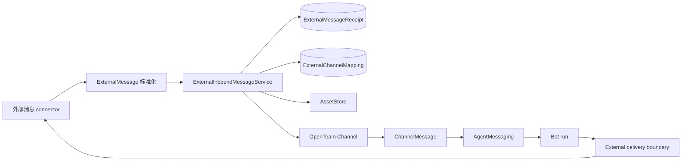

# 设计文档 - 外部消息服务

状态：IN_PROGRESS

## 1. 概述

### 1.1 目标

- 建立 provider 无关的外部消息入站服务。
- 用数据库保证外部账户、peer、Channel 和 provider message 的稳定关系。
- 复用现有 `Channel`、`ChannelMessage`、`AgentMessaging` 和 `AssetStore`。
- 为具体 connector 提供标准化输入、外发地址和媒体接口。

### 1.2 覆盖需求

- `requirements.md` 需求 1、2、3、4

### 1.3 技术约束

- Server：Prisma/PostgreSQL、`AppService`、`AgentMessaging`、`PluginService`。
- Channel：不新增 provider-specific ChannelKind。
- 媒体：通过 `AssetStore` 和现有 connector 文件传输边界处理。
- 幂等：依赖 PostgreSQL 唯一约束和事务。

## 2. 架构

### 2.1 系统结构



### 2.2 模块职责

| 模块 | 职责 | 输入 | 输出 |
| --- | --- | --- | --- |
| `ExternalInboundMessageService` | 校验、去重、映射、写消息、创建 wake | `ExternalMessage` | 接受结果、Channel、wake |
| `ExternalChannelMapping` | 保存 connection、peer 和 Channel 关系 | connectionId、peerId | channelId、状态 |
| `ExternalMessageReceipt` | 保存 provider message 幂等结果 | connectionId、messageId | accepted/duplicate/rejected |
| `AssetStore` | 保存媒体并生成内部资产引用 | 媒体字节和元数据 | assetId、附件引用 |
| 外发边界 | 根据 provider address 发送文本和媒体 | address、content、assets | provider result |

### 2.3 关键流程

#### 2.3.1 映射和消息接受

1. 校验 connection、platform、peerId、providerMessageId 和媒体边界。
2. 使用 `(connectionId, providerMessageId)` 查询或创建 receipt。
3. 已完成 receipt 直接返回 duplicate。
4. 在事务中查找或创建 `(connectionId, peerId)` mapping。
5. 由 mapping 取得目标 Channel 和 Bot。
6. 将媒体登记到 AssetStore。
7. 写入 `sender=user` 的 `ChannelMessage`。
8. 调用 `AgentMessaging.acceptDirectUserMessage` 创建 Bot wake。
9. 更新 receipt 为 accepted，保存消息和 wake id。

#### 2.3.2 外发

1. 解析 provider address，定位 ready connection 和 mapping。
2. 文本发送调用 connector message tool。
3. 媒体发送只使用 AssetStore 资产。
4. 超时或连接中断时标记 uncertain，不自动重发。

## 3. 组件和接口

### 3.1 数据结构

#### 3.1.1 `ExternalChannelMapping`

| 字段 | 类型 | 必填 | 说明 | 约束 |
| --- | --- | --- | --- | --- |
| `id` | UUID | 是 | 主键 | 数据库生成 |
| `connectionId` | UUID | 是 | PluginConnection | 外键 |
| `peerId` | string | 是 | provider 稳定 peer 标识 | 与 connectionId 联合唯一 |
| `platform` | string | 是 | provider key | 小写、有限长度 |
| `channelId` | UUID | 是 | OpenTeam Channel | 唯一 |
| `peerType` | string | 是 | direct/group/channel | connector 声明 |
| `displayName` | string | 否 | 展示名称 | 不作为身份键 |
| `status` | string | 是 | active/blocked/archived | 默认 active |
| `context` | JSON | 否 | 受控回复上下文 | 白名单字段 |
| `createdAt`/`updatedAt` | DateTime | 是 | 生命周期字段 | 自动维护 |

#### 3.1.2 `ExternalMessageReceipt`

| 字段 | 类型 | 必填 | 说明 | 约束 |
| --- | --- | --- | --- | --- |
| `id` | UUID | 是 | 主键 | 数据库生成 |
| `connectionId` | UUID | 是 | PluginConnection | 外键 |
| `providerMessageId` | string | 是 | provider 消息 id | 与 connectionId 联合唯一 |
| `peerId` | string | 是 | 外部 peer | 必须匹配消息 |
| `channelId`/`channelMessageId` | UUID | 否 | 接受后的引用 | 拒绝可为空 |
| `status` | string | 是 | processing/accepted/rejected | 受限枚举 |
| `payloadHash` | string | 是 | 标准化 payload 摘要 | 冲突检测 |
| `error` | JSON | 否 | 脱敏错误 | 不含密钥 |
| `createdAt`/`updatedAt` | DateTime | 是 | 生命周期字段 | 自动维护 |

#### 3.1.3 `ExternalMessage`

```ts
type ExternalMessage = {
  connectionId: string;
  platform: string;
  providerMessageId: string;
  peerId: string;
  peerType: "direct" | "group" | "channel";
  senderId: string;
  senderName?: string;
  text: string;
  occurredAt: string;
  replyContext?: Record<string, unknown>;
  media?: ExternalMedia[];
  providerMetadata?: Record<string, unknown>;
};
```

### 3.2 接口契约

#### 3.2.1 `acceptExternalMessage`

- 类型：Server service
- 输入：标准化 `ExternalMessage` 和显式 `targetBotId`
- 输出：`accepted | duplicate | rejected`、mapping、ChannelMessage、wake run id
- 校验：connection ready、身份字段非空、文本/媒体/metadata 受限
- 错误：`external_connection_not_found`、`external_message_invalid`、`external_message_conflict`、`external_channel_unavailable`

#### 3.2.2 `deliverExternalMessage`

- 类型：Server service/connector invocation
- 输入：provider address、文本、受控资产、可选 context
- 输出：provider message id、accepted、uncertain
- 校验：connection ready、资产受控、内容大小合法
- 错误：`external_delivery_unsupported`、`external_delivery_uncertain`

## 4. 数据与状态模型

```text
PluginConnection 1 ── N ExternalChannelMapping N ── 1 Channel
ExternalChannelMapping 1 ── N ExternalMessageReceipt
ExternalMessageReceipt 0..1 ── 1 ChannelMessage
ChannelMessage 1 ── 0..1 InboxEvent/Run
```

Channel mapping 是外部会话身份根；ChannelMessage 是 OpenTeam 对话事实；receipt 是 provider 去重事实。

## 5. 错误处理

- mapping 冲突：拒绝并保留已有 mapping。
- 重复消息：返回 duplicate，允许子规格推进 cursor。
- payload 冲突：拒绝第二条消息并记录 hash 冲突。
- 媒体失败：按 connector 能力接受文本并标记附件失败，或拒绝整条消息。
- 外发未知：记录 uncertain，禁止自动重发。

## 6. 正确性属性

### 6.1 映射唯一

*对于任何* `connectionId` 和 `peerId`，系统最多存在一个 mapping，且最多指向一个 Channel。

**验证需求：** `requirements.md` 需求 1

### 6.2 入站幂等

*对于任何* connection 内唯一的 provider message id，系统最多创建一条 ChannelMessage 和一个 Bot wake。

**验证需求：** `requirements.md` 需求 2

### 6.3 媒体边界

*对于任何* 外部媒体，Bot 只能获得 AssetStore 资产引用；provider URL、token 和未经校验的路径不能进入 Bot 可见输入。

**验证需求：** `requirements.md` 需求 3

## 7. 测试策略

- 单元：地址、metadata、receipt hash、媒体大小和路径校验。
- 集成：首次/并发 mapping、重复消息、事务回滚、AssetStore 和 Bot wake。
- 外发：文本、媒体、不支持能力和 uncertain 结果。

| 需求 | 设计章节 | 验证方式 |
| --- | --- | --- |
| 需求 1 | §3.1、§4 | migration、唯一约束、并发 mapping 测试 |
| 需求 2 | §2.3、§3.2、§6.2 | 重复消息和 Bot wake 集成测试 |
| 需求 3 | §3.1、§6.3 | AssetStore、大小和路径测试 |
| 需求 4 | §2.3.2、§3.2 | 外发和 uncertain 结果测试 |

## 8. 风险与待确认项

- 外部 peer 身份保存在 mapping，不能伪造 Bot 记录。
- 多实例必须依赖 PostgreSQL 唯一约束和事务。
- target Bot 必须由调用方明确提供，不隐式选择第一个 Bot。
- 具体平台的 automation trigger 另立 Spec。
