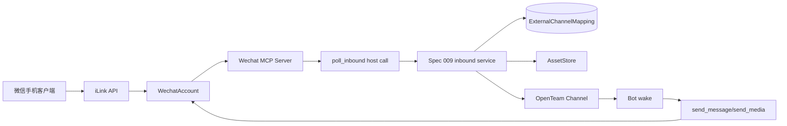

# 设计文档 - 微信 iLink 消息服务集成

状态：IN_PROGRESS

## 1. 概述

### 1.1 目标

- 复用 Spec 009 的外部消息、Channel、媒体和幂等服务。
- 使用 packaged MCP 和 persistent state 实现微信 iLink connector。
- 使用 host-only device link 实现 QR setup。
- 在 connector 进程内维护 token、cursor、peer 和 reply context。

### 1.2 覆盖需求

- `requirements.md` 需求 1、2、3、4

### 1.3 技术约束

- 插件目录：`packages/plugins/wechat`。
- 运行方式：`stdio` packaged MCP，`persistentState: true`。
- 连接方式：host-only `deviceLink` lifecycle tools。
- 协议：iLink QR、HTTP JSON、getupdates long poll、sendmessage、getconfig、sendtyping、media upload。
- Channel 和媒体服务：严格复用 Spec 009。
- 首版 peer 类型：direct。

## 2. 架构

### 2.1 系统结构



### 2.2 模块职责

| 模块 | 职责 | 输入 | 输出 |
| --- | --- | --- | --- |
| `plugin.json` | 声明 packaged MCP、persistent state 和 device link | 插件元数据 | 插件目录条目 |
| `WechatAccount` | QR、token、HTTP 请求、cursor、peer/context 状态 | 配置和私有 state | 状态、消息、发送结果 |
| `WechatApi` | 封装 iLink HTTP JSON 请求和错误码 | token、endpoint、请求体 | provider response |
| `WechatMedia` | iLink 媒体下载、上传和边界校验 | provider media、AssetStore asset | 文件和上传结果 |
| `WechatConnectorServer` | MCP tool discovery、校验、host-only 隐藏 | MCP request | MCP response |
| Spec 009 Server service | 映射、去重、ChannelMessage、Bot wake 和外发 | `ExternalMessage` | accepted/duplicate/rejected |

### 2.3 关键流程

#### 2.3.1 QR setup

1. `wechat_start_link` 请求 iLink QR。
2. `WechatAccount` 生成 sessionId，保存临时 challenge，不写原始 QR secret 到普通日志。
3. `wechat_finish_link` 触发后台 status polling。
4. confirmed 后原子保存 bot token、base URL、bot id 和 user id。
5. connector status 进入 bootstrapping/ready。
6. 取消或过期清除 challenge；已有有效 token 不受普通 restart 影响。

#### 2.3.2 入站 cursor

1. `poll_inbound` 使用保存的 `get_updates_buf` 调用 getupdates。
2. 将 provider message 转换为 `ExternalMessage`。
3. Server 调用 Spec 009 `acceptExternalMessage`。
4. 所有消息成功接受或明确 duplicate 后，才保存 next cursor。
5. Server 失败时保留旧 cursor。

#### 2.3.3 外发文本

1. Server 根据 `wechat:<peerId>` 找到连接和 mapping。
2. 从 mapping 的受控 context 读取最近有效 context token。
3. 调用 `sendmessage`，必要时先 `getconfig`/`sendtyping`。
4. 记录 provider message id 和 accepted/uncertain 状态。
5. 不自动重试不确定结果。

#### 2.3.4 媒体

1. provider 入站媒体先下载到临时受控位置。
2. 校验大小、MIME、摘要和 provider media id。
3. 交给 Spec 009 AssetStore，ChannelMessage 只保存 asset reference。
4. 外发时由 Server 提供受控 asset，connector 执行 provider media upload。

## 3. 组件和接口

### 3.1 持久状态

```ts
type WechatState = {
  botToken: string;
  baseUrl: string;
  ilinkBotId: string;
  ilinkUserId: string;
  updatesCursor: string;
  peers: Record<string, { peerId: string; displayName?: string; lastSeenAt: string }>;
  contexts: Record<string, { contextToken: string; updatedAt: string }>;
};
```

状态只存储在 `OPENTEAM_PLUGIN_STATE_DIR`；connector 工具结果不返回 token；context 按 connection/peer 隔离；cursor 通过临时文件和原子 rename 保存。

### 3.2 MCP 工具

- `connection_status`：认证、连接、cursor 更新时间、最近错误和 peer count。
- `wechat_start_link`：host-only，返回 sessionId、QR data URL、expiresAt。
- `wechat_finish_link`：host-only。
- `wechat_link_status`：host-only。
- `wechat_cancel_link`：host-only。
- `wechat_remove_account`：host-only。
- `list_peers`：返回 direct peer，不返回 token/context。
- `send_message`：输入 peerId/provider address、文本和可选 reply context。
- `send_media`：输入 Spec 009 asset reference、peerId、caption。
- `poll_inbound`：host-only，输出标准化 messages 和 next cursor。

## 4. 状态模型

| 状态 | 含义 | 进入条件 | 退出条件 |
| --- | --- | --- | --- |
| `needs_pairing` | 没有有效 token | 初次启动或 token 失效 | QR confirmed |
| `pairing` | QR 授权中 | start link | confirmed/cancelled/expired |
| `bootstrapping` | token 已确认，正在初始化 | QR confirmed | ready/error |
| `ready` | 可 poll 和 send | API 状态正常 | disconnect/token expired |
| `recovering` | 正在恢复长轮询 | transient network error | ready/terminal error |
| `logged_out` | provider 撤销授权 | provider terminal error | 新 QR |

## 5. 错误处理

- `wechat_qr_expired`：清理 challenge，保留可重新连接状态。
- `wechat_token_expired`：停止 poll/send，进入 needs_pairing。
- `wechat_cursor_invalid`：记录错误，不直接跳过未知消息。
- `wechat_peer_context_missing`：拒绝无法关联上下文的主动发送。
- `wechat_media_upload_failed`：不伪造媒体发送成功。
- `wechat_delivery_uncertain`：禁止自动重试。

## 6. 正确性属性

### 6.1 cursor 只在 Server 接受后推进

*对于任何* `poll_inbound` 批次，只有消息被 Spec 009 接受或判定为 duplicate 后，connector 才能保存 next cursor。

**验证需求：** `requirements.md` 需求 2、4

### 6.2 context 按 peer 隔离

*对于任何* 两个不同 peer 或 connection，发送请求不能读取另一个 peer 的 context token。

**验证需求：** `requirements.md` 需求 1、2、4

### 6.3 token 不出现在普通结果

*对于任何* status、peer、send 或 poll 结果，序列化结果和错误信息都不能包含 bot token。

**验证需求：** `requirements.md` 需求 1、3

## 7. 测试策略

- 单元：request headers、错误码、QR session、token/cursor 保存、peer/context 隔离、消息 item 转换。
- 集成：QR confirmed、getupdates duplicate/cursor failure/restart、send accepted/uncertain/token expired、provider media。
- 端到端：QR UI、fixture peer → Spec 009 Channel、Bot wake/reply、至少一种媒体往返。

## 8. 风险与待确认项

- iLink 协议和 token 生命周期可能调整，provider 错误映射必须可更新。
- 首版只支持 direct peer，不从 payload 猜测开启群聊。
- provider media 可能依赖短期 URL 和加密参数，不能写入普通日志。
- `poll_inbound` 必须由 Server host 调度，不能让普通 Bot 调用。
