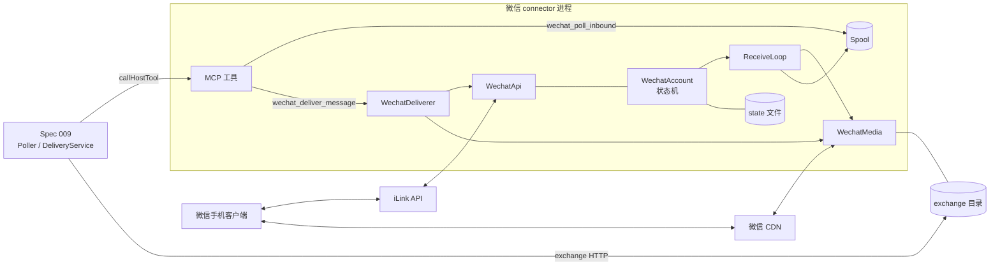

# 设计文档 - 微信 iLink 消息服务集成

状态：IN_PROGRESS

文档关系：

- 需求：[`requirements.md`](requirements.md)
- 任务：[`tasks.md`](tasks.md)
- 基础设计：[`../009-外部消息服务/design.md`](../009-外部消息服务/design.md)
- 协议事实与探测清单：[`docs/20261116-iLink协议事实与探测清单.md`](docs/20261116-iLink协议事实与探测清单.md)

## 1. 概述

### 1.1 目标

- 用 packaged MCP 和 persistent state 实现微信 iLink connector，结构对齐 WhatsApp connector。
- connector 只做平台协议；Channel、去重、唤醒、回复路由和外发状态严格复用 Spec 009。
- 用落盘队列保证"已从 provider 取回的消息不丢"，不依赖 provider 是否重放旧游标。
- bot token、会话令牌、provider 游标和媒体密钥只存在于 connector 私有状态中。
- 协议层与状态机解耦，便于跟随 iLink 的版本变化。

### 1.2 覆盖需求

- `requirements.md` 需求 1、2、3、4、5、6、7
- `requirements.md` 非功能需求 1、2、3、4

### 1.3 技术约束

- 插件目录：`packages/plugins/wechat`。
- 运行方式：`stdio` packaged MCP，`persistentState: true`，由 Bot Computer 上的 `StdioMcpManager` 启动；进程一旦启动就常驻，直到连接被关闭、重启或 computer 重建。
- 状态目录：`OPENTEAM_PLUGIN_STATE_DIR`，移除账户时由 host 整体删除。
- 连接方式：host-only `deviceLink` 生命周期工具，契约见 `packages/plugin-sdk/src/types.ts` 的 `PluginDeviceLink`。
- 与 Server 的消息契约：Spec 009 的 `messaging` manifest 块与 `packages/plugin-sdk/src/messaging.ts`。
- 外部依赖：`https://ilinkai.weixin.qq.com`（业务）、`https://novac2c.cdn.weixin.qq.com/c2c`（媒体 CDN）。
- 协议参考：`Tencent/openclaw-weixin`（MIT），具体版本在任务 1.2 固定；真实行为在任务 1.5 按能力探测。本实现是独立编写，不复制其源码。
- 运行时：Bun；加解密使用 `node:crypto`，不引入新依赖。

### 1.4 与 WhatsApp connector 的对照

| 方面 | WhatsApp（`packages/plugins/whatsapp`） | 微信（本 Spec） |
| --- | --- | --- |
| 协议实现 | 打包的原生二进制 `wacli` | 纯 TypeScript HTTP 客户端 |
| 入站 | 无；Bot 主动查询历史 | 后台长轮询加落盘队列，由 Spec 009 轮询 |
| 外发 | Bot 直接调用 `send_text`、`send_file` | host-only 的 deliver 工具，由 Spec 009 调用 |
| 设备链接 | `whatsapp_*_link` 五个 host-only 工具 | `wechat_*_link` 五个 host-only 工具，同一契约 |
| Bot 可见工具 | 二十余个读写工具 | 只读的 `connection_status`、`list_peers` |

## 2. 架构

### 2.1 系统结构



- **用户入口**：微信手机客户端与 OpenTeam 桌面端的插件连接设置。
- **数据流向（入站）**：iLink → 持久化当前批次 → `ReceiveLoop` → 媒体下载解密 → `Spool` → poll 工具 → Spec 009。
- **数据流向（外发）**：Spec 009 → deliver 工具 → `WechatDeliverer` →（媒体加密上传）→ iLink。

### 2.2 模块职责

| 模块 | 文件 | 职责 | 输入 | 输出 |
| --- | --- | --- | --- | --- |
| manifest | `plugin.json` | 声明 packaged MCP、persistent state、deviceLink 和 messaging | 插件元数据 | 插件目录条目 |
| `WechatApi` | `connector/api.ts` | iLink HTTP JSON 请求、请求头、错误码映射、域名校验 | token、基座地址、请求体 | 类型化响应或 `WechatApiError` |
| 无损 JSON | `connector/json.ts` | 保留 64 位整数的解析 | 响应文本 | 对象（大整数为字符串） |
| `StateStore` | `connector/state.ts` | 版本化状态文件的原子读写 | 状态对象 | 落盘文件 |
| `WechatAccount` | `connector/account.ts` | 账户状态机、二维码流程、会话过期处理、接收循环的启停 | 工具调用、API 结果 | 状态、事件 |
| `ReceiveLoop` | `connector/receive.ts` | 长轮询、批次持久化与恢复、过滤、标准化、入队、保存 provider 游标、退避、背压 | provider 消息 | 队列项 |
| `Spool` | `connector/spool.ts` | 入站落盘队列、去重、确认删除、等待通知 | `ExternalMessage` | 带 `ackCursor` 的消息 |
| `WechatMedia` | `connector/media.ts` | CDN 下载上传、AES-128-ECB、exchange 文件校验 | 媒体引用或 exchange 文件 | 明文文件或媒体引用 |
| `WechatDeliverer` | `connector/deliver.ts` | 会话令牌、窗口、分片、限速、幂等日志、结果归类 | `ExternalDeliverInput` | `ExternalDeliverResult` |
| 工具层 | `connector/tools.ts`、`connector/server.ts` | MCP 工具发现、参数校验、host-only 标记 | MCP 请求 | MCP 响应 |
| simulator | `connector/test/fixtures/ilink-simulator.ts` | 本地模拟 iLink 与 CDN | HTTP 请求 | 可编排的响应 |

### 2.3 关键流程

#### 2.3.1 二维码链接

1. `wechat_start_link`：调用 `get_bot_qrcode`，生成 `sessionId`，把二维码内容渲染为 PNG data URL，记录过期时间；返回 `{ sessionId, qrCodeDataUrl, expiresAt, sessionExpiresAt, challengeGeneration: 0 }`。二维码内容不写入日志。
2. `wechat_finish_link`：启动后台任务，以长轮询方式调用 `get_qrcode_status`（客户端超时 35 秒，超时视为仍在等待）。
3. 状态查询的结果：
   - 等待或已扫描：继续轮询。
   - 要求切换基座地址：经域名校验后改用新地址继续。
   - 二维码过期：在同一 `sessionId` 下重新申请，`challengeGeneration` 加 1，最多 3 次；超过后本次链接以 `wechat_qr_expired` 结束。
   - 已确认：进入第 4 步。
4. 确认后按顺序执行：
   1. 校验返回的基座地址。
   2. 停止旧接收循环并完成已持久化批次的本地入队后，再替换凭据。与已有账户比较 `ilink_bot_id` 和 `ilink_user_id`：不同则重建 Spool（生成新 queueId，清空 exchange、peer 目录和旧恢复日志）。
   3. 原子写入 account.json，删除 cursor.json；同一账户保留已观察 peer 元数据，只清除各 peer 的 contextToken 和 receivedAt。清理旧批次完成后才启动新 token 的 getupdates，不能重用旧 token 对应的 provider 游标。
   4. 状态进入 `bootstrapping`，调用 `notifystart`（失败只记录警告），启动 `ReceiveLoop`，进入 `ready`。
5. `wechat_link_status`：返回当前链接状态；二维码刷新后返回同一 `sessionId` 和新的图片与 `challengeGeneration`。
6. `wechat_cancel_link`：停止后台任务，清除临时二维码状态；已有的有效凭据和正在运行的接收循环不受影响。
7. `wechat_remove_account`：停止循环，尽力调用 `notifystop`，删除状态目录内全部文件。

如果探测项 P1 证明 provider 需要用户向客户端输入验证码，而现有设备链接契约没有输入通道，则按协议事实文档的决策门处理：返回 `wechat_link_verification_required` 和指引，并另行评估扩展设备链接契约。

#### 2.3.2 接收循环

循环在账户为 `ready` 时运行，每一轮：

1. **背压检查**：队列条数达到 500 或 exchange 入站占用达到 1 GiB 时进入 `backlogged`，每 5 秒复查，回落到 80% 以下后继续。
2. **长轮询**：`getupdates({ get_updates_buf, base_info })`，客户端超时取上一轮响应的 `longpolling_timeout_ms`（缺省 35 秒）加 5 秒。客户端超时视为空结果。
3. **先写恢复日志**：在下载媒体或更新任何业务状态前，把本批处理必需的 provider 消息字段（含回复和媒体凭据）、新旧 provider 游标、接收时间、账户与 queueId、version 写入 `receive-journal.json`（临时文件、fsync、原子改名、父目录 fsync），权限 0600；不保存请求头或无关响应字段。恢复日志只存在 connector 私有状态目录，不进入工具结果、日志或 Server 数据库。
4. **逐条处理**（按返回顺序）：
   1. bot 自身发出的消息、带 `group_id` 的消息：丢弃并计数。
   2. 持久化该 direct peer 的最近观察时间和所有者标记；有新会话令牌时更新令牌和接收时间。恢复时使用日志原始接收时间，重复恢复不能延长会话窗口；缺少令牌的消息不覆盖已有有效令牌。
   3. `message_id` 已在队列去重集合中：跳过。当前恢复日志涉及的 id 在批次提交并清理日志前不能因 Server 已确认而从去重记录中移除；重启从 spool 日志重建该集合。
   4. 标准化（§3.2.5）并处理媒体（§2.3.4）。没有文本、没有媒体也没有媒体失败的消息：丢弃并计数。
   5. 追加到 `Spool` 并刷盘，通知挂起的 poll 调用。
5. **提交批次**：本批全部完成后，把响应中的新 `get_updates_buf`（非空时）原子写入 `cursor.json` 并刷盘，再删除恢复日志并刷父目录，最后允许压缩该批去重记录。只有提交完成才能发起下一轮 getupdates。重启时先重放匹配当前账户和 queueId 的恢复日志，即使 cursor 已保存也先恢复再提交；去重保证 Server 已确认的条目不重新入队。账户更换时同步清除旧日志。
6. **失败处理**：
   - 网络错误、HTTP 5xx、业务返回非零：等待 2 秒重试；连续 3 次失败后每次等待 30 秒；状态为 `recovering`，成功一次即回到 `ready`。
   - `-14`：按 §2.3.5 处理。

"先写恢复日志、再入队、最后保存游标"保证：在媒体处理、入队或保存游标之间崩溃时，重启可以从恢复日志继续；队列去重保证已经完成的条目不会重复入队。恢复日志写入前的网络响应不属于可恢复边界。若本地写入失败，停止拉取，不更新 provider 游标；恢复日志处理失败时保留它，重启或退避后继续同一批次。

#### 2.3.3 poll 工具

`wechat_poll_inbound({ cursor, limit, waitMs })`：

1. 解析 `cursor`（格式 `<queueId>:<seq>`）。
   - `queueId` 与当前队列一致：删除 `seq` 及之前的队列项和它们的 exchange 入站文件。
   - `cursor` 非空但不一致或无法解析：本次结果带 `resetCursor: true`，从队列头开始返回。
2. 取出其后的最多 `limit` 条。
3. 没有可返回的消息时：
   - 账户为 `needs_pairing` 且队列为空：返回 `isError`，文本为 `wechat_needs_pairing`。
   - 否则挂起最多 `waitMs`，被入队事件唤醒后返回；到时返回空列表。
4. 同一时刻只保留一个挂起的 poll：新的调用到达时，旧的立即以空列表返回。

即使账户已进入 `needs_pairing`，队列中尚未确认的消息仍然照常交给 Server。

#### 2.3.4 媒体

**入站**

1. 读取消息项中的媒体引用（下载地址或加密参数、密钥、声明大小）。声明大小超过 100 MiB：不下载，记入 `mediaFailures`（`wechat_media_too_large`）。
2. 校验下载地址的协议和主机，流式下载密文到状态目录的临时文件，实际字节数超过上限即中止。
3. 按协议事实文档记录的密钥编码解出 16 字节密钥，AES-128-ECB（PKCS7）流式解密，同时计算明文 SHA-256 和大小。
4. 把明文原子改名到 `exchange/inbound/<seq>-<index>`（文件名由 connector 生成，不使用微信给的文件名），权限 `0600`。
5. 下载或解密失败时最多重试 3 次，仍失败记入 `mediaFailures`（`wechat_media_download_failed` 或 `wechat_media_decrypt_failed`）。
6. 语音：有转写文字则并入文本；没有则记入 `mediaFailures`（`wechat_voice_untranscribed`）。

**外发**

1. 对每个 `ExternalOutboundMedia`：确认路径位于 `exchange/outbound/<deliveryId>/`，`lstat` 为普通文件，大小与 SHA-256 与输入一致。任一不符 → `wechat_media_invalid`。
2. 生成随机 16 字节密钥，计算明文 MD5、明文大小和密文大小。
3. `getuploadurl` 申请上传参数。
4. AES-128-ECB 加密后以 `application/octet-stream` 上传到 CDN，从响应头 `x-encrypted-param` 取得下载引用。
5. 构造媒体消息项，交给 `WechatDeliverer` 发送。

外发语音不实现。文件和视频的外发代码路径与图片相同，但只有在探测项 P7 通过后才在 manifest 的 `messaging.outbound.media.kinds` 中声明。

#### 2.3.5 会话过期

iLink 的 `-14` 在不同接口上含义不同，按接口区分处理：

- **`getupdates` 返回 `-14`**（账户会话过期）：
  1. 停止 `ReceiveLoop`，状态进入 `needs_pairing`，原因 `session_expired`，记录 `pausedUntil = now + 1 小时`。
  2. 冷却期内不向 iLink 发出任何业务请求；deliver 返回 `failed`（`wechat_session_expired`）。
  3. 冷却结束后做一次 `getupdates` 探活：成功则回到 `ready`；仍为 `-14` 则删除 `account.json`、`cursor.json`、`contexts.json`，保持 `needs_pairing`。
  4. 用户随时可以重新扫码，成功后立即替换凭据并取消冷却。
  5. 队列保留，已取回的消息继续由 poll 交给 Server。
- **`sendmessage` 返回 `-14`**（会话窗口失效）：删除该 peer 的会话令牌，按 §2.3.6 的规则返回 `wechat_context_expired`；账户状态不变。

#### 2.3.6 外发

`wechat_deliver_message(input)`：

1. **幂等检查**：`deliveryId` 已在日志中且有结果 → 返回该结果；有 `started` 记录但没有结果 → 返回 `uncertain`（`wechat_delivery_interrupted`）。
2. **发送前检查**（任一不通过即返回 `failed`，此时没有发出任何请求）：
   - 账户不是 `ready` 或 `recovering` → `wechat_not_ready` 或 `wechat_session_expired`。
   - 该 peer 没有会话令牌 → `wechat_context_missing`。
   - 令牌年龄超过安全窗口 → `wechat_context_expired`。
   - 文本为空且没有媒体 → `wechat_delivery_empty`。
   - 媒体文件校验失败 → `wechat_media_invalid`。
3. **规划 provider 消息**：文本按 §3.2.6 的规则分片；每个媒体单独一条，排在文本之后。
4. **限速检查**：过去 60 秒已发送的 provider 消息数加本次计划数超过 20 → `failed`（`wechat_rate_limited`）。
5. **上传媒体**（§2.3.4）。任何上传失败 → `failed`（`wechat_media_upload_failed`）。
6. **写入 `started` 日志并刷盘**。
7. **按顺序发送**，每条的 `client_id` 为 `ot-<deliveryId>-<index>`，带上会话令牌：
   - 返回成功：继续下一条。
   - 明确失败且尚未成功发出任何一条：`failed`，错误码按 §5.1 映射。
   - 明确失败但此前已有成功：`uncertain`（`wechat_partial_delivery`），说明中注明已发出的条数。
   - 超时、连接中断、响应不可解析：`uncertain`（`wechat_delivery_unknown`）。
8. 全部成功 → `sent`，`note` 为 `provider_accepted`；若响应带有消息标识则放入 `providerMessageIds`。
9. **写入结果日志**并返回。日志保留最近 500 条。

`sent` 只表示 iLink 接受了请求。公开案例显示存在"返回成功但未投递"的账号级情况，connector 无法识别，这一点在技能说明和协议事实文档中注明。

## 3. 组件和接口

### 3.1 核心组件

覆盖需求：1、2、3、4、5

- `WechatApi`：唯一发起 iLink 业务请求的地方。构造参数包含 `fetch`、基座地址和主机校验函数，测试时注入 simulator；产品入口固定使用内置的校验函数。
- `WechatAccount`：单一所有者，串行化二维码流程、状态迁移和循环启停。
- `ReceiveLoop`：只读 `WechatApi`，只写恢复日志、`Spool`、`contexts.json` 和 `cursor.json`。
- `Spool`：进程内有索引，磁盘上为追加日志加定期压缩；对外只暴露 `append`、`ack`、`read`、`waitForAppend`、`stats`。
- `WechatDeliverer`：串行执行外发，保证同一时刻只有一个 Delivery 在发送。
- `WechatMedia`：两个方向的媒体处理和 exchange 目录的路径约束。

### 3.2 数据结构

覆盖需求：2、3、4、5

#### 3.2.1 状态目录布局

```text
$OPENTEAM_PLUGIN_STATE_DIR/
  account.json        凭据与账户标识（0600）
  cursor.json         provider 游标
  contexts.json       peer → 会话令牌、最近观察时间和展示名
  receive-journal.json  当前待处理 provider 批次（0600）
  spool/
    meta.json         queueId、下一个 seq
    journal.ndjson    追加日志（append、ack 记录）
  deliveries.ndjson   外发幂等日志（最近 500 条）
  exchange/
    inbound/          入站媒体明文，文件名 <seq>-<index>
    outbound/<deliveryId>/   由 Server 经 exchange 端点写入
  tmp/                下载和加密的临时文件
```

所有 JSON 文件带 `version` 字段；写入一律为"写临时文件 → `fsync` → 原子改名"。

#### 3.2.2 `account.json`

| 字段 | 类型 | 必填 | 说明 | 约束 |
| --- | --- | --- | --- | --- |
| `version` | number | 是 | 状态格式版本 | 当前为 1 |
| `botToken` | string | 是 | iLink bot token | 不得出现在任何输出中 |
| `baseUrl` | string | 是 | 业务基座地址 | 已通过域名校验 |
| `ilinkBotId` | string | 是 | bot 标识 | — |
| `ilinkUserId` | string | 是 | 扫码用户，即账户所有者 | 用于 `isAccountOwner` 判定 |
| `linkedAt` | string | 是 | 确认时间 | ISO 8601 |
| `pausedUntil` | string | 否 | 会话过期冷却截止时间 | ISO 8601 |

#### 3.2.3 `cursor.json` 与 `contexts.json`

| 文件 | 字段 | 说明 |
| --- | --- | --- |
| `cursor.json` | `getUpdatesBuf` | 不透明字符串，原样保存，不解码不修改 |
| `contexts.json` | `peers[peerId].contextToken` | 可选；最近一次存在令牌的入站消息所带值 |
| `contexts.json` | `peers[peerId].receivedAt` | 可选；该令牌的原始接收时间，用于窗口判断 |
| `contexts.json` | `peers[peerId].isAccountOwner` | 是否为扫码账户所有者；只读列表展示 |
| `contexts.json` | `peers[peerId].lastObservedAt` | 最近观察到该 peer 的时间，用于列表展示 |
| `contexts.json` | `peers[peerId].displayName` | 可选展示名；缺失时列表使用固定 WeChat user |

#### 3.2.4 队列项

| 字段 | 类型 | 必填 | 说明 | 约束 |
| --- | --- | --- | --- | --- |
| `seq` | number | 是 | 队列内序号 | 严格递增，从 1 开始 |
| `providerMessageId` | string | 是 | `message_id` 的十进制字符串 | 用于去重 |
| `message` | `ExternalMessage` | 是 | 标准化后的消息 | Spec 009 契约 |
| `enqueuedAt` | string | 是 | 入队时间 | ISO 8601 |

`ackCursor` 为 `<queueId>:<seq>`。`queueId` 在队列创建时随机生成，账户更换或状态被清空时重新生成。

#### 3.2.5 iLink 消息到 `ExternalMessage` 的映射

| `ExternalMessage` 字段 | 来源 | 说明 |
| --- | --- | --- |
| `providerMessageId` | `message_id` | 无损转为字符串 |
| `peer.id` | `from_user_id` | 单聊中 peer 即发送者 |
| `peer.type` | 固定 `"direct"` | 带 `group_id` 的消息已被丢弃 |
| `peer.displayName` | 无 | iLink 不提供昵称；Server 以平台名作为 Channel 名称 |
| `sender.id` | `from_user_id` | — |
| `sender.isAccountOwner` | `from_user_id === ilinkUserId` | 判定依据见探测项 P2 |
| `text` | 文本项按顺序拼接；语音转写文字并入 | 项之间以换行分隔 |
| `occurredAt` | `create_time_ms` | 缺失时用恢复日志中的批次接收时间 |
| `media` | 图片、文件、视频项 | 见 §2.3.4 |
| `mediaFailures` | 下载、解密、超限、无转写语音 | 错误码以 `wechat_` 为前缀 |
| `providerMetadata` | `{ itemTypes: "text,image" }` | 只放无敏感信息的摘要 |

会话令牌、`session_id`、媒体下载地址和密钥都不进入 `ExternalMessage`。缺失 `create_time_ms` 时使用恢复日志中的稳定接收时间，确保重启后的 payloadHash 不变。

#### 3.2.6 文本分片规则

- 单条上限默认 1800 字符（探测项 P5 可调整），manifest 的 `maxTextChars` 为 9000，即一次外发最多 5 条。
- 优先在空行处切分，其次在换行处，再次在中英文句末标点处，最后才硬切。
- 不在代理对中间切分；每个分片去除首尾空白，空分片丢弃。
- 不添加"(1/3)"之类的序号。

#### 3.2.7 manifest 关键片段

```json
{
  "key": "wechat",
  "connections": [
    {
      "key": "wechat",
      "name": "WeChat",
      "transport": "stdio",
      "auth": "none",
      "endpoint": "",
      "tools": [],
      "configuration": { "command": "bun", "args": ["${PLUGIN_ROOT}/connector/server.mjs"] },
      "persistentState": true,
      "deviceLink": {
        "startTool": "wechat_start_link",
        "finishTool": "wechat_finish_link",
        "statusTool": "wechat_link_status",
        "cancelTool": "wechat_cancel_link",
        "removeTool": "wechat_remove_account",
        "instructions": "…"
      },
      "messaging": {
        "platform": "wechat",
        "inbound": { "pollTool": "wechat_poll_inbound", "maxWaitSeconds": 20 },
        "outbound": {
          "deliverTool": "wechat_deliver_message",
          "maxTextChars": 9000,
          "media": { "kinds": ["image"], "maxBytes": 20971520 }
        }
      }
    }
  ]
}
```

### 3.3 接口契约

覆盖需求：1、2、3、4、5、6

#### 3.3.1 MCP 工具一览

| 工具 | 可见性 | 输入 | 输出 |
| --- | --- | --- | --- |
| `wechat_start_link` | host-only | 无 | `sessionId`、`qrCodeDataUrl`、`expiresAt`、`sessionExpiresAt`、`challengeGeneration` |
| `wechat_finish_link` | host-only | `sessionId` | 已开始等待确认 |
| `wechat_link_status` | host-only | 无 | 链接状态；刷新后的二维码 |
| `wechat_cancel_link` | host-only | `sessionId` | 已取消 |
| `wechat_remove_account` | host-only | 无 | 已移除 |
| `wechat_poll_inbound` | host-only | `ExternalPollInput` | `ExternalPollResult` |
| `wechat_deliver_message` | host-only | `ExternalDeliverInput` | `ExternalDeliverResult` |
| `list_peers` | Bot 可见，只读 | `limit?`、`afterPeerId?` | 本地已观察的 direct peer，见 §3.3.4 |
| `connection_status` | Bot 可见，只读 | 无 | 见 §3.3.3 |

host-only 工具同时满足两个条件：工具定义带 `_meta: { "outcomego/hostOnly": true }`；在 manifest 的 `deviceLink` 或 `messaging` 中被引用。

设备链接五个工具的返回字段、超时和生命周期隔离与 WhatsApp connector 保持一致，实现前先阅读 `packages/plugins/whatsapp/connector/account.ts` 与 `apps/server/src/services/plugin/device-link.ts`。

#### 3.3.2 iLink 接口（`WechatApi`）

- 类型：HTTPS JSON
- 接口：`get_bot_qrcode`、`get_qrcode_status`、`getupdates`、`sendmessage`、`getuploadurl`、`msg/notifystart`、`msg/notifystop`（`getconfig` 与 `sendtyping` 只用于输入中提示，首版不实现）
- 公共请求头：`Content-Type: application/json`、`AuthorizationType: ilink_bot_token`、`Authorization: Bearer <bot token>`、每次重新生成的 `X-WECHAT-UIN`，以及参考版本要求的应用标识头
- 公共请求体：`base_info`（含 `channel_version`）
- 校验：基座地址和 CDN 主机必须是 `weixin.qq.com` 的子域且为 `https`；请求一律 `redirect: "error"`；每个请求带超时
- 错误：统一抛出 `WechatApiError`，带 `kind`（`network`、`http`、`business`、`session_expired`、`invalid_response`）、`endpoint` 和脱敏后的业务码

各接口的字段、取值常量和已知行为以协议事实文档为准，不在本文重复。

#### 3.3.3 `connection_status`

- 类型：只读 MCP 工具，Bot 可见
- 输出：

```json
{
  "state": "ready",
  "reason": null,
  "account": "…a1b2",
  "lastPollOkAt": "2026-11-16T08:00:00.000Z",
  "consecutiveFailures": 0,
  "queueLength": 0,
  "replyWindow": { "open": true, "expiresAt": "2026-11-17T07:00:00.000Z" },
  "dropped": { "group": 0, "self": 0, "empty": 0, "duplicate": 0 }
}
```

- 校验：`account` 只显示 `ilinkBotId` 的后 4 位；不包含 token、游标、用户标识原文
- `replyWindow` 只针对账户所有者这一个 peer

#### 3.3.4 `list_peers`

- 类型：只读 MCP 工具，Bot 可见；不属于 host-only 工具。
- 输入：`{ limit?: number, afterPeerId?: string }`，limit 默认 20，上限 100；按稳定 peerId 排序，返回 `nextAfterPeerId` 或 null。
- 输出：`{ peers: [{ peerId, displayName, lastObservedAt, isAccountOwner, canReply }], nextAfterPeerId }`。
- 数据来自本地 `contexts.json` 的已观察 direct peer，空目录返回空列表；无昵称时 displayName 使用固定的 `WeChat user`，不伪造昵称。
- `canReply` 由账户收发状态、是否为所有者、是否存在令牌及其有效期计算；有 peer 不代表可主动开会话，也不代表 Server 已建立 Mapping。
- 完整 peerId 是用户要求的路由标识，可在此只读结果中返回；它不是回复凭据。token、媒体凭据、provider 游标不返回，日志不打印 peerId 原文。
- 列表不请求 iLink，不创建 Mapping、Channel 或 Delivery。发送仍须经过 Spec 009 的活动 Mapping 和外发服务，不增加 Bot 可见的直接发送工具。

## 4. 数据与状态模型

### 4.1 数据关系

```text
account.json 1 ── 1 cursor.json
account.json 1 ── 0..1 receive-journal.json（当前待处理批次）
account.json 1 ── 1 contexts.json（首版只有账户所有者一个 peer 有实际用途）
account.json 1 ── 1 spool（queueId 随账户更换而重建）
spool 项 1 ── N exchange/inbound 文件
deliveries.ndjson 项 1 ── 0..N exchange/outbound/<deliveryId>/ 文件
```

- provider 游标与确认游标是两个独立的游标：前者表示"已从 iLink 取到哪里"，由 connector 持有；后者表示"Server 已处理到哪里"，由 Spec 009 的 Binding 持有。队列是两者之间的缓冲。
- 状态目录是 connector 的全部事实来源；Server 数据库中不保存任何微信凭据。

### 4.2 状态流转

| 状态 | 含义 | 进入条件 | 退出条件 |
| --- | --- | --- | --- |
| `needs_pairing` | 没有可用凭据 | 首次启动；会话过期；账户被移除 | 二维码确认；冷却后探活成功 |
| `pairing` | 二维码授权进行中 | `wechat_start_link` | 确认、取消、过期 |
| `bootstrapping` | 凭据已保存，正在启动接收 | 二维码确认；进程启动且有凭据 | 首次轮询成功或失败 |
| `ready` | 正常收发 | 轮询成功 | 轮询失败、会话过期、队列积压 |
| `recovering` | provider 暂时不可达，正在退避重连 | 轮询失败 | 轮询成功；会话过期 |
| `backlogged` | 队列已满，暂停拉取 | 队列或媒体占用达到上限 | 回落到 80% 以下 |

补充规则：

- `pairing` 与其余状态可以并存：已有有效凭据的账户重新扫码期间，原接收循环继续运行，直到新凭据确认。
- `needs_pairing` 带 `reason`：`not_linked`、`session_expired`、`removed`。
- `recovering` 和 `backlogged` 下 deliver 仍然可用。

## 5. 错误处理

### 5.1 错误类型

链接：

- `wechat_qr_expired`：二维码多次刷新后仍未确认。
- `wechat_link_cancelled`：用户取消。
- `wechat_link_verification_required`：provider 要求当前契约无法完成的额外验证。
- `wechat_clawbot_unavailable`：账户没有 ClawBot 资格（尽力识别）。
- `wechat_base_url_rejected`：返回的基座地址未通过域名校验。

接收：

- `wechat_needs_pairing`：poll 时账户未链接且队列为空。
- `wechat_session_expired`：`getupdates` 返回 `-14`。
- `wechat_media_too_large`、`wechat_media_download_failed`、`wechat_media_decrypt_failed`、`wechat_voice_untranscribed`：进入 `mediaFailures`。

外发（`failed`）：

- `wechat_not_ready`、`wechat_session_expired`
- `wechat_context_missing`、`wechat_context_expired`
- `wechat_rate_limited`、`wechat_delivery_empty`
- `wechat_media_invalid`、`wechat_media_upload_failed`
- `wechat_send_rejected`：第一条消息被 provider 以其他业务码拒绝，附带脱敏业务码

外发（`uncertain`）：

- `wechat_delivery_unknown`、`wechat_partial_delivery`、`wechat_delivery_interrupted`

### 5.2 错误响应格式

工具级错误（无法给出结构化结果时）使用 MCP 的 `isError`，文本只包含错误码和简短说明：

```json
{ "isError": true, "content": [{ "type": "text", "text": "wechat_needs_pairing: scan the QR code again" }] }
```

deliver 的业务结果始终通过 `structuredContent` 返回 `ExternalDeliverResult`，不使用 `isError`：

```json
{ "status": "failed", "code": "wechat_context_expired", "message": "The reply window has closed; the user must message first" }
```

### 5.3 处理策略

1. **输入验证错误**：工具参数不合法时返回 `isError`；deliver 的内容问题返回 `failed`。
2. **业务规则错误**（窗口、限速、未链接）：在发出请求之前判定，返回 `failed`，由 Spec 009 记录并告知 Bot。
3. **外部依赖错误**：接收侧自动退避重连；外发侧按"是否已发出请求"归为 `failed` 或 `uncertain`。
4. **重试、降级或补偿**：接收和媒体下载自动重试；外发从不自动重试；单个媒体失败降级为 `mediaFailures`；未知的消息项类型被忽略并计数。
5. **状态文件损坏**：无法解析的 `account.json` 视为未链接；无法解析的队列日志截断到最后一条完整记录并记录告警；`cursor.json` 损坏时清空并依赖去重。

## 6. 正确性属性

### 6.1 属性 1：已持久化批次不丢

*对于任何* 已持久化到恢复日志并通过过滤的消息，在它被写入队列并刷盘之前，provider 游标不会越过它；崩溃后从恢复日志继续处理。首次日志持久化前的窗口只有在 provider 重放已验证时才能恢复。

**验证需求：** 需求 3（验收 3.2）、非功能需求 2.1

### 6.2 属性 2：队列不重复

*对于任何* `message_id`，在同一个 `queueId` 的生命周期内最多入队一次。

**验证需求：** 需求 3（验收 3.3）

### 6.3 属性 3：确认前不删除

*对于任何* 队列项及其媒体文件，只有在 Server 传来的确认游标大于等于它的 `seq` 之后才会被删除。

**验证需求：** 需求 3（验收 3.6）、需求 6（验收 6.4）

### 6.4 属性 4：外发至多一次

*对于任何* `deliveryId`，connector 最多执行一次发送序列；重复调用返回已记录的结果或 `uncertain`。

**验证需求：** 需求 4（验收 4.10）、非功能需求 2.3

### 6.5 属性 5：会话令牌按 peer 隔离

*对于任何* 外发，使用的会话令牌一定来自同一 peer 最近一条入站消息，且不会出现在工具结果中。

**验证需求：** 需求 4（验收 4.1、4.2）

### 6.6 属性 6：敏感值不外泄

*对于任何* 工具结果、错误信息和日志行，其序列化内容不包含 bot token、会话令牌、provider 游标、媒体下载地址和密钥。

**验证需求：** 需求 5（验收 5.8）、非功能需求 3.1

### 6.7 属性 7：只访问微信域名

*对于任何* 由 connector 发起的网络请求，其目标主机是 `weixin.qq.com` 的子域且协议为 `https`。

**验证需求：** 需求 1（验收 1.3、1.4）

## 7. 测试策略

### 7.1 单元测试

位于 `packages/plugins/wechat/connector/test/`。

- `json.test.ts`：64 位整数无损解析，含边界值和嵌套结构。
- `api.test.ts`：请求头、`X-WECHAT-UIN` 每次不同、`base_info`、域名校验、错误码到 `WechatApiError.kind` 的映射、拒绝重定向。
- `state.test.ts`：原子写入、权限、版本、损坏文件的处理。
- `spool.test.ts`：追加、去重、确认删除、`resetCursor`、压缩、截断恢复、等待通知。
- `media.test.ts`：两种密钥编码、加解密往返、超限中止、路径约束、符号链接拒绝。
- `deliver.test.ts`：分片规则、限速、窗口判断、幂等日志、结果归类的全部分支。
- `normalize.test.ts`：各种消息项组合到 `ExternalMessage` 的映射、`isAccountOwner` 判定。

### 7.2 集成测试

使用 `ilink-simulator`（`Bun.serve` 实现的本地 iLink 与 CDN）。

- `account.test.ts`：二维码确认、刷新、取消、过期、基座地址切换、重启恢复、账户更换。
- `receive.test.ts`：长轮询、服务端建议超时、退避、背压、`-14` 冷却与探活。
- `crash.test.ts`：覆盖日志持久化前、持久化后、媒体下载或解密中、部分入队后、Server 已确认但 cursor 未保存、cursor 保存但日志未清理等崩溃点。持久化后在重放与不重放两种模式下都不丢不重；持久化前只在重放模式可恢复，并断言不重放模式的已知限制。
- `roundtrip.test.ts`：文本和图片的入站与外发，含部分失败和结果不明。
- `tools.test.ts`：工具发现、host-only 标记、敏感值扫描；list_peers 空列表、稳定 id、排序分页、无昵称、无令牌、窗口过期和重启恢复，断言只读且不发网络请求。
- `host-integration.test.ts`：经真实的 stdio 进程和测试入口脚本驱动设备链接与 poll、deliver，结构参照 WhatsApp 的同名测试。
- `package.test.ts`：打包往返。

### 7.3 端到端测试

- 自动化：`apps/server/test/external-messaging/wechat.integration.test.ts`，用 simulator 加真实 connector 进程加 Spec 009 服务，跑通"微信消息 → Channel → Bot wake → 回复 → simulator 收到 `sendmessage`"。
- 实机联调（人工）：按 `docs/` 中的联调清单在远端 debug computer 上用真实微信号验证二维码、文本往返、图片往返、重启恢复和会话窗口过期。

### 7.4 验证映射

| 需求 | 设计章节 | 验证方式 |
| --- | --- | --- |
| 需求 1 | §3.3.2、§6.7、协议事实文档 | `api.test.ts`、`json.test.ts`、探测记录走查 |
| 需求 2 | §2.3.1、§2.3.5、§3.2.2、§3.3.4、§4.2 | `account.test.ts`、`state.test.ts`、`host-integration.test.ts`、`tools.test.ts` |
| 需求 3 | §2.3.2、§2.3.3、§3.2.4、§6.1 到 §6.3 | `spool.test.ts`、`receive.test.ts`、`crash.test.ts` |
| 需求 4 | §2.3.6、§3.2.6、§6.4、§6.5 | `deliver.test.ts`、`roundtrip.test.ts` |
| 需求 5 | §2.3.4、§6.6 | `media.test.ts`、`roundtrip.test.ts` |
| 需求 6 | §3.2.5、§3.2.7、§3.3.1、§3.3.3 | `wechat.integration.test.ts`、实机联调 |
| 需求 7 | §3.2.7 | `package.test.ts`、`packages/plugins/test/catalog.test.ts`、`bun run check:i18n` |
| 非功能需求 1 | §2.3.2、§2.3.3 | `receive.test.ts` 中的时间断言 |
| 非功能需求 2 | §3.2.1、§6.1、§6.4 | `crash.test.ts`、`state.test.ts` |
| 非功能需求 3 | §3.3.1、§6.6、§6.7 | `tools.test.ts` 的敏感值扫描、host-only 拒绝测试 |
| 非功能需求 4 | §2.2、§3.3.3、§5.3 | 代码走查、`state.test.ts` 的版本与损坏用例 |

## 8. 风险与待确认项

### 8.1 风险

- **协议无公开规范**：iLink 的行为只能从官方客户端源码和实测得知，随时可能调整。缓解：固定参考版本、协议层隔离、simulator 可快速更新、未知码不崩溃。
- **第三方客户端的合规与可用性**：iLink 是面向 OpenClaw 官方插件开放的通道。OpenTeam 作为独立客户端接入，存在被腾讯限制或要求变更的可能，且需要使用官方插件声明的应用标识。是否接受这一风险需要产品层面确认（见 §8.2）。
- **灰度资格**：没有 ClawBot 入口的微信号无法连接，connector 无法绕过，只能给出指引。
- **返回成功但未投递**：公开案例显示部分账号存在 `sendmessage` 返回成功但消息不出现的情况，connector 无法识别，会被记为 `sent`。
- **会话窗口**：用户超过约 24 小时未发消息后 Bot 无法回复；Routine 等延迟产生的输出在微信里很可能发不出去，只会留在应用内 Channel。
- **computer 重建**：重建会中断接收循环和正在进行的外发。前者靠队列和游标恢复，后者会被记为 `uncertain`。
- **二维码生成依赖**：需要复用 WhatsApp connector 的二维码 PNG 编码器。若该目录受上游同步约束不宜改动，则在 `packages/plugins/_shared/` 中单独放置并保留许可说明。

### 8.2 待确认项

以下各项的探测方法和决策规则见协议事实文档。任务 1.2 固定参考版本，任务 1.5 按能力验证；未启用的可选能力及不能立即测得的时效边界注明保守默认值和限制，不阻塞离线开发：

- P1：二维码确认是否需要用户向客户端输入验证码，以及二维码的有效期。
- P2：除扫码者之外的微信用户能否向该 bot 发消息；`from_user_id` 与 `ilink_user_id` 的对应关系。
- P3：旧 get_updates_buf 是否重放，决定首次批次日志落盘前的响应能否恢复；日志落盘后的本地恢复不依赖该结论。
- P4：同一微信号重新扫码后 `ilink_user_id`、`ilink_bot_id` 是否不变（影响是否会产生新的 Channel）。
- P5：`sendmessage` 的响应字段、单条文本上限和实际限速。
- P6：会话令牌的实际有效期，以及是否每条入站消息都会更新。
- P7：外发文件和视频是否真的会投递。
- P8：入站媒体下载地址的主机范围、有效期和密钥编码。
- P9：`-14` 在各接口上的触发条件，以及冷却后能否自愈。
- P10：`notifystart`、`notifystop` 是否必需。
- P11：Bot Computer 容器的出口策略是否允许访问 `*.weixin.qq.com`。

需要产品确认：

- 是否接受 §8.1 第二条所述的第三方接入风险，以及发布时是否需要在插件说明中做相应提示。

### 8.3 已定决策

| 编号 | 决策 | 理由 | 被否决的方案 |
| --- | --- | --- | --- |
| W1 | 先持久化批次、再入队、最后保存 provider 游标 | 持久化后的消息可本地恢复；首次持久化前是否可恢复依赖 P3，不作无条件保证 | 让 Server 持有 `get_updates_buf` 并在接受后才推进 |
| W2 | 接收用后台循环，poll 工具只读队列 | `getupdates` 会挂起约 35 秒，不适合放在 host 调用里；后台循环使延迟与 Server 轮询节奏解耦 | poll 工具内同步调用 `getupdates` |
| W3 | 会话令牌只保存在 connector | 令牌是回复能力凭据，不应进入数据库或 Bot 可见内容 | 保存在 Server 的 Mapping 上并随外发传回 |
| W4 | 外发工具为 host-only，Bot 可见只读的 `connection_status` 和 `list_peers` | 只读 peer 查询满足需求且不绕过外发状态机 | Bot 可见的直接发送工具 |
| W5 | `-14` 按接口区分，账户级过期先冷却再探活 | `sendmessage` 上的 `-14` 可能只是会话窗口失效；官方实现对账户级过期采用 1 小时冷却 | 任何 `-14` 都立即清除凭据 |
| W6 | 首版外发媒体只声明图片 | 公开资料对文件、视频外发是否投递说法不一，待 P7 实测 | 首版即声明全部类型 |
| W7 | 不提供替换基座地址的环境变量 | 环境变量会成为绕过域名限制的后门；测试通过依赖注入实现 | `OPENTEAM_WECHAT_BASE_URL` 之类的覆盖项 |
| W8 | 磁盘文件名由 connector 生成 | 微信文件名是不可信输入，只作为元数据传递 | 以原文件名落盘 |
| W9 | 账户未链接但队列非空时仍然交付消息 | 已取回的消息属于用户，不应因随后的会话过期被搁置 | 未链接时 poll 一律报错 |
