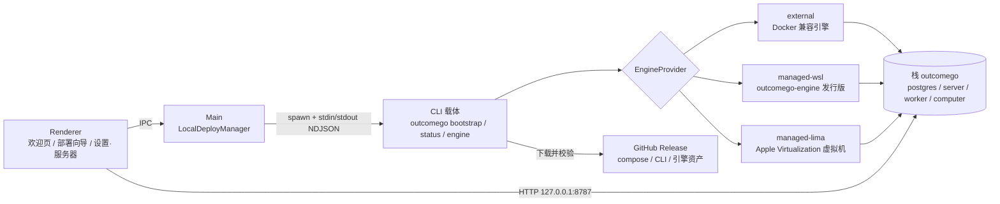
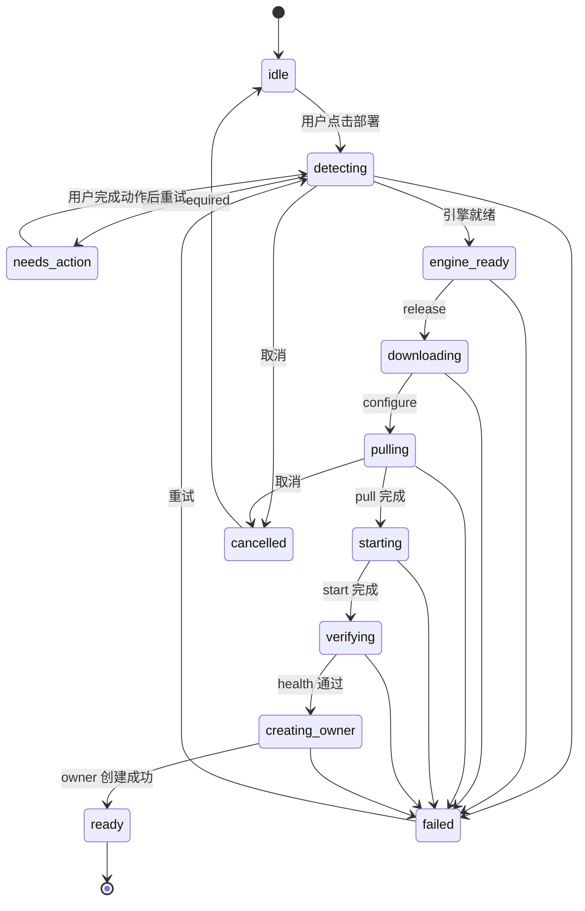

# 设计文档 - 桌面端一键本地部署

状态：Draft

关联文档：[需求文档](requirements.md)、[任务清单](tasks.md)、[现状核查记录](docs/20261123-现状核查记录.md)、[引擎方案对比与选型](docs/20261123-引擎方案对比与选型.md)

## 1. 概述

### 1.1 目标

- 桌面端在 Windows 与 macOS 上提供“连接远程服务器”和“在这台电脑部署”两种来源，部署过程在应用内完成。
- 在 CLI 内引入“引擎提供者”抽象，使同一套 `deploy/compose.yaml` 能运行在 `external` 与 `managed` 引擎上，调用方不感知差异。
- 提供无需终端的非交互部署命令 `bootstrap` 和结构化进度事件，桌面端只负责触发、展示、衔接登录。
- 不改变服务拓扑、Linux 部署方式和现有交互式 CLI 行为。

### 1.2 覆盖需求

- `requirements.md` 需求 1：服务器来源选择入口
- `requirements.md` 需求 2：一键本地部署主流程
- `requirements.md` 需求 3：非交互 CLI 部署接口
- `requirements.md` 需求 4：引擎提供者抽象与 external 引擎
- `requirements.md` 需求 5：Windows 托管引擎
- `requirements.md` 需求 6：macOS 托管引擎
- `requirements.md` 需求 7：本地服务生命周期
- `requirements.md` 需求 8：更新兼容
- `requirements.md` 需求 9：资源与容量
- `requirements.md` 需求 10：安全与隔离
- `requirements.md` 需求 11：错误诊断与可观测
- `requirements.md` 需求 12：文档、国际化与兼容
- `requirements.md` 需求 13：托盘图标与关窗常驻
- `requirements.md` 需求 14：第三方组件合规
- `requirements.md` 非功能需求 1、2、3

### 1.3 技术约束

- CLI：`apps/cli`，TypeScript，Bun 构建；命令运行器目前是同步 `spawnSync`（`process.ts:21-59`）。
- 桌面端：`apps/desktop`，Electron 43、React 19；主进程通过 `ELECTRON_RUN_AS_NODE` 调用内置 CLI（`tailscale-manager.ts:112-148`）。
- 服务端与 compose：`deploy/compose.yaml` 不改拓扑；`computer` 服务要求 rootful、cgroup v2、`systempaths=unconfined`、`/dev/net/tun`（见《现状核查记录》§4）。
- 数据存储：全部为命名卷，位于引擎内部；安装目录只放配置与密钥。
- 认证授权：本地服务使用现有 owner 账号机制（`owner-credentials`）。
- 外部依赖：GitHub Release（compose、CLI 二进制、引擎资产）、容器镜像仓库、Windows 的 WSL、macOS 的 Apple Virtualization。
- 发布签名：沿用现有 sigstore 校验链路（`release.ts` 的 `verifyArtifactSignature`）。

### 1.4 现状基线

桌面端已具备：内置 CLI、本机安装识别、回环安装才可管理的规则、IPC 发送方校验、远程连接流程。缺口集中在六处：

1. 欢迎页没有“在这台电脑部署”的动作，只有终端命令提示。
2. CLI 的引擎写死 Docker，预检只会拉起 macOS 的 Docker Desktop。
3. 安装命令要求交互终端，`--no-setup` 又不创建 owner。
4. 命令运行器是同步的，拉镜像用 `inherit`，没有结构化进度。
5. 更新代理依赖 `process.argv`，与内置 CLI 不兼容，Windows 上又不是托管服务。
6. 打包缺少托管引擎资产，macOS 缺少虚拟化 entitlement。

详见《现状核查记录》。

### 1.5 分期与里程碑

| 里程碑 | 阶段 | 内容 | 对应需求 |
| --- | --- | --- | --- |
| 前置 | 阶段 1 | Spike A–F 与合规方案，结论决定 M2、M3 是否实现 | 需求 4.6、5.7、6.6、8、9、14 |
| M1 | 阶段 2、3 | CLI 引擎抽象、`bootstrap`、进度事件、更新代理修复；桌面端向导、设置、生命周期、托盘与关窗常驻；跑在 `external` 引擎上 | 需求 1、2、3、4、7、8、9、10、11、13 |
| M2 | 阶段 4 | Windows 托管引擎 | 需求 5 |
| M3 | 阶段 5 | macOS 托管引擎 | 需求 6 |
| 收尾 | 阶段 6 | 文档、国际化、最终检查 | 需求 12、14 |

M1 不等待 Spike A–D、F 与合规方案：它跑在 `external` 引擎上，只需要 Spike E（任务 1.7，CLI 载体与更新代理）的结论。其余 Spike 与阶段检查 1.10 只关口 M2、M3（任务 4.1、5.1）。

引擎提供者接口的事件契约与 `external` 部分在 M1 定稿，M2、M3 只新增实现；仅供托管引擎使用的少数成员允许在 M2、M3 按 Spike 结论增补，增补不改变 M1 行为（见任务 2.7）。

## 2. 架构

### 2.1 系统结构



数据流：渲染进程只和主进程通过 IPC 通信；主进程以子进程方式运行 CLI，按行读取进度事件；CLI 通过引擎提供者操作栈；部署完成后渲染进程用现有流程连接 `http://127.0.0.1:<apiPort>`。

### 2.2 模块职责

| 模块 | 职责 | 输入 | 输出 |
| --- | --- | --- | --- |
| `apps/cli/src/engine/`（新增） | 引擎提供者接口与 `external`、`managed-wsl`、`managed-lima` 三个实现，以及引擎选择 | 安装清单、平台、环境 | 引擎检测结果、docker 与 compose 调用 |
| `apps/cli/src/deploy-events.ts`（新增） | 进度事件与错误码的类型、序列化、脱敏 | 阶段状态、错误 | 单行 JSON |
| `apps/cli/src/lifecycle.ts`（修改） | 新增 `bootstrap` 流程，复用下载、写配置、启动、创建 owner | 参数、stdin | 进度事件、退出码 |
| `apps/cli/src/process.ts`（修改） | 新增异步流式运行器，供拉镜像等长任务上报进度 | 命令、参数 | 逐行输出、退出状态 |
| `apps/cli/src/update-agent*.ts`（修改） | 使用稳定的 CLI 载体，不再依赖 `process.argv` | 安装目录 | 可执行的代理命令 |
| `apps/desktop/src/main/local-deploy.ts`（新增） | `LocalDeployManager`：运行 CLI、解析事件、取消、忙锁、脱敏 | IPC 请求 | 进度事件转发 |
| `apps/desktop/src/main/local-installation.ts`（修改） | 读取安装清单与栈、引擎状态 | 安装目录 | 状态快照 |
| `apps/desktop/src/main/tray.ts`（新增） | 创建托盘图标与菜单，按本地服务状态更新菜单项，首次关窗提示 | 本地服务状态、设置 | 菜单操作 |
| `apps/desktop/src/main/index.ts` 的窗口与退出处理（修改） | 把关窗隐藏从 macOS 扩展到 Windows，Linux 保留退出行为，处理 Windows 的 `session-end` | 窗口与应用事件 | 隐藏或退出 |
| `apps/desktop/src/renderer/…/local-deploy-flow.tsx`（新增） | 部署向导界面 | 进度事件、用户输入 | 界面状态 |
| `sign-in-flow.tsx`、`settings/server.tsx`（修改） | 双入口、服务器位置与生命周期设置 | 本地状态 | 用户操作 |
| 引擎资产构建（CI，新增） | 构建、签名并发布 Windows rootfs、macOS 虚拟机资产 | 固定版本清单 | Release 资产与校验文件 |

### 2.3 关键流程

#### 2.3.1 首次本地部署

1. 用户在欢迎页点击“在这台电脑部署”，渲染进程收集 owner 用户名和密码（沿用 `validateOwnerUsername` 规则与密码确认），通过 IPC 发起 `local-deploy:start`。
2. 主进程的 `LocalDeployManager` 获取忙锁，按 §3.3.5 确定 CLI 载体，以 `bootstrap --json-progress` 启动子进程，把 owner 凭据以 JSON 写入 stdin 后立即关闭 stdin。
3. CLI 的 `detect` 阶段检查平台、内存、磁盘、端口，并选择引擎（§3.3.4）；需要用户动作时发出 `action-required` 事件并以退出码 2 结束。
4. `engine` 阶段：提供者的 `ensureReady`。`external` 引擎仅确认可用；`managed` 引擎按 §2.3.2 准备。
5. `release` 阶段：下载并校验发布配置，写入 `compose.yaml`、`.env`、`installation.json`（含 `engine` 字段，§3.2.2）。首次安装失败时沿用现有回滚，不留半成品（`lifecycle.ts:393-408`）。
6. `configure` 阶段：按 §3.3.6 把内存限制写入 `.env`。
7. `pull` 阶段：按镜像拉取并上报 N/M 进度；Compose 支持时可上报字节级进度（待 Spike 确认，§8.2）。
8. `start` 与 `health` 阶段：启动栈并等待 `server` 健康，沿用现有 `startProject`。
9. `owner` 阶段：执行 `compose exec server bun main.js owner-credentials` 创建 owner，写回 `installation.json` 的 `ownerUsername`，并调用 `ensureUpdateAgent`。
10. CLI 输出 `result` 事件并以 0 退出；渲染进程用 `connectTo` 和刚输入的密码登录，登录后立即清除内存中的密码，进入现有的“选择 AI”流程。

取消：渲染进程发 `local-deploy:cancel`，主进程终止子进程树；已下载的镜像层和引擎资产保留；`installation.json` 在首次安装未完成时已按步骤 5 回滚。

#### 2.3.2 Windows 启用 WSL 与重启续跑

1. `detect` 通过 `wsl --status` 判断 WSL 是否可用。可用则跳到步骤 5。
2. 不可用时 CLI 发出 `action-required`，`kind` 为 `elevate`。桌面端展示原因与用途，用户同意后，由提权辅助程序执行启用命令（具体命令与参数由 Spike D 确定，候选为 `wsl --install --no-distribution`），这是唯一的提权步骤。
3. 启用完成后写入 `deploy-state.json`（`awaiting` 为 `reboot`，§3.2.4），并按 Spike D 的结论注册重启后的续跑入口（候选为 `RunOnce`）。
4. 重启后桌面端启动，读取 `deploy-state.json`；若 WSL 已可用，向导恢复并提示“继续部署”。密码从不落盘，所以续跑时 SHALL 重新输入密码，用户名预填。
5. 下载 rootfs 并校验 SHA-256 与签名，执行 `wsl --import outcomego-engine <目录> <tar> --version 2`，初始化 dockerd 与 Compose，验证 `docker info`。
6. 虚拟化未开启、Windows 版本过低、CPU 架构不支持时，在步骤 1 之前给出对应的具体指引。

#### 2.3.3 桌面端启动时恢复本地服务

1. 主进程读取安装清单（`readManagedInstallation` 的扩展版本）。没有安装则为“未部署”，不做任何事。
2. 安装存在且为本地模式时，异步调用 `status --json` 取得引擎与栈状态，不阻塞首屏。
3. 栈已停止则调用 `start` 拉起，并向渲染进程推送状态；失败时显示服务级状态与“一键诊断”。
4. 存在未完成的 `deploy-state.json` 时，优先恢复部署向导（§2.3.2 步骤 4）。

#### 2.3.4 服务端更新与更新代理

1. 桌面端自更新后启动，校验 CLI 载体版本是否等于桌面端期望版本；不等则按 §3.3.5 替换为经校验的版本。
2. 下一次 `start` 或 `bootstrap` 时，`ensureUpdateAgent` 重新对齐代理命令（`writeIfChanged` 语义），指向稳定的 CLI 载体。
3. 服务端更新沿用现有 `useServerUpdateStatus` 流程；本地模式下更新器可用。
4. `managed` 引擎资产升级：用户确认 → 停栈 → 替换引擎 → 启动并验证；失败时回到旧引擎，数据卷保持不动。

#### 2.3.5 移除本地服务

1. 用户在“设置 → 服务器”选择“移除”，界面区分“仅移除容器，保留数据”和“彻底删除（含数据卷）”；后者需二次确认并说明不可恢复。
2. 主进程调用 `uninstall --yes`（保留数据）或 `uninstall --purge --yes`（删除）。
3. 彻底删除且为 `managed` 引擎时，调用 `engine remove --purge-data`：Windows 注销 `outcomego-engine`，macOS 删除虚拟机与磁盘镜像；同时清理 `deploy-state.json` 与续跑入口。
4. 完成后界面回到欢迎页的双入口。

#### 2.3.6 关窗常驻与退出

现状（已核实）：macOS 关闭窗口时 `close` 事件被取消并隐藏窗口（`mainWindow.on("close", …)`），`window-all-closed` 在 macOS 上不退出（`app.on("window-all-closed", …)`）；Windows 与 Linux 关最后一个窗口即退出；没有任何 `Tray`。`quitAndInstall` 之前已有 `isQuitting = true`，用来避免关窗隐藏逻辑拦住自更新（自更新 IPC 处理中 `autoUpdater.quitAndInstall` 之前的注释说明了原因）。以上均在 `apps/desktop/src/main/index.ts`，引用符号名而不是行号，基线见《现状核查记录》§8。

1. 主进程在 `app.whenReady` 中创建主窗口之后，于 Windows 与 macOS 创建托盘图标；Linux 不创建。
2. 用户关闭主窗口：`close` 处理在 `!isQuitting` 且平台为 `darwin` 或 `win32` 时取消关闭并隐藏窗口。首次发生时显示一次性提示（§3.3.7）。
3. 唤回：托盘点击、菜单“打开 OutcomeGo”、再次启动应用（`app.on("second-instance", …)`）、macOS `activate`，都走现有的 `focusMainWindow`，它会 `show()` 并 `focus()`。
4. 退出：托盘“退出”、应用菜单“退出”调用 `app.quit()`，`app.on("before-quit", …)` 把 `isQuitting` 置真并释放资源。若“退出应用时停止服务”已开启，则先异步停止本地服务再退出，设超时后强制退出。
5. Windows 关机、重启、注销：Electron 文档说明此时不会触发 `before-quit`，因此新增对主窗口 `session-end` 的监听，把 `isQuitting` 置真，让关窗不再被取消。该事件触发后无法阻止会话结束。关机与注销不触发“退出时停止服务”。
6. 桌面端自更新：沿用 `isQuitting = true` 后 `quitAndInstall`。
7. `window-all-closed`：仅在 Linux 保留 `app.quit()`；Windows 与 macOS 因窗口只是隐藏，该事件通常不再触发。

## 3. 组件和接口

### 3.1 核心组件

覆盖需求：1、2、3、4、7、8

- `EngineProvider`：引擎抽象，`external`、`managed-wsl`、`managed-lima` 三个实现。
- `bootstrap` 命令：非交互部署流水线。
- `DeployProgressEvent`：CLI 与桌面端之间的事件契约。
- `LocalDeployManager`：桌面端主进程内的部署与生命周期管理器。
- `DeployState`：保存跨重启续跑所需的非敏感状态。
- CLI 载体：运行 CLI 与更新代理的稳定可执行文件（§3.3.5）。

### 3.2 数据结构

#### 3.2.1 `EngineProvider`

覆盖需求：4、5、6、9

| 成员 | 类型 | 必填 | 说明 | 约束 |
| --- | --- | --- | --- | --- |
| `kind` | `"external" \| "managed-wsl" \| "managed-lima"` | 是 | 引擎类型 | 与安装清单 `engine.kind` 一致 |
| `detect()` | `Promise<EngineDetection>` | 是 | 返回 `state`（`ready`、`stopped`、`needs-setup`、`unsupported`）、原因列表、引擎与 Compose 版本 | 不得有副作用 |
| `ensureReady(onEvent)` | `Promise<void>` | 是 | 使引擎进入可用状态；需要用户动作时通过事件上报 | 幂等 |
| `docker(args, options)` | `RunResult` | 是 | 对该引擎执行 docker CLI，取代散落的 `runner.run("docker", …)` | 仅此一处决定如何连接引擎 |
| `composeInvocation(project, args)` | 调用描述 | 是 | 供 `ComposeProject.invocation` 使用 | 见 §3.3.4 |
| `memoryBytes()` | `number \| null` | 是 | 引擎客户机的实际内存 | 用于 §3.3.6 |
| `stop()` | `Promise<void>` | 否 | 停止引擎；`external` 不实现 | 仅 `managed` |
| `remove({ purgeData })` | `Promise<void>` | 否 | 移除引擎；`external` 不实现 | 仅 `managed` |
| `describe()` | `EngineInfo` | 是 | 名称、版本、位置，供界面和 `doctor` 展示 | 不含敏感信息 |

#### 3.2.2 `InstallationManifest.engine`

覆盖需求：4

在 `apps/cli/src/config.ts:28` 的 `InstallationManifest` 上新增可选字段，`schemaVersion` 保持为 1。

| 字段 | 类型 | 必填 | 说明 | 约束 |
| --- | --- | --- | --- | --- |
| `engine.kind` | `"external" \| "managed-wsl" \| "managed-lima"` | 否 | 创建栈时所用的引擎 | 缺省视为 `external`，兼容旧安装 |
| `engine.name` | `string` | 否 | 托管引擎的实例名，如 `outcomego-engine` | 仅 `managed` |
| `engine.version` | `string` | 否 | 托管引擎资产版本 | 仅 `managed` |
| `engine.createdAt` | `string` | 否 | 创建时间 | ISO 8601 |

约束：栈创建且数据卷存在后，`engine.kind` 不得被静默修改；更换引擎属于数据迁移，不在本 Spec 范围。

#### 3.2.3 `DeployProgressEvent`

覆盖需求：2、3、11

每行一个 JSON 对象，写到 `bootstrap` 的 stdout。

| 字段 | 类型 | 必填 | 说明 | 约束 |
| --- | --- | --- | --- | --- |
| `schemaVersion` | `1` | 是 | 事件契约版本 | 不认识的版本，桌面端提示更新应用 |
| `type` | `"stage" \| "log" \| "action-required" \| "error" \| "result"` | 是 | 事件类型 | |
| `ts` | `string` | 是 | 时间戳 | ISO 8601 |
| `stage` | `"detect" \| "engine" \| "release" \| "configure" \| "pull" \| "start" \| "health" \| "owner"` | `stage`、`error` 时必填 | 当前阶段 | |
| `status` | `"started" \| "progress" \| "completed" \| "skipped" \| "failed"` | `stage` 时必填 | 阶段状态 | |
| `current`、`total` | `number` | 否 | 可确定的进度，如镜像 N/M | `0 ≤ current ≤ total` |
| `message` | `string` | 否 | 面向用户的说明 | 已脱敏 |
| `code` | `string` | `error` 时必填 | 错误码，见 §5.1 | |
| `retryable` | `boolean` | `error` 时必填 | 是否可直接重试 | |
| `field` | `"username" \| "password" \| "apiPort" \| "stdin"` | 否 | `INVALID_INPUT` 时指出出错字段 | 不回显取值 |
| `action` | `{ kind: "elevate" \| "reboot" \| "install-engine" \| "free-disk" \| "free-port" \| "confirm-low-memory", detail?: string }` | `action-required` 时必填 | 需要用户做的事 | |
| `result` | `{ url, username, directory, engine, version }` | `result` 时必填 | 部署结果 | 不含密码 |

#### 3.2.4 `DeployState`

覆盖需求：2、5

文件 `deploy-state.json`，位于安装目录，权限 0600，不含任何密钥。

| 字段 | 类型 | 必填 | 说明 | 约束 |
| --- | --- | --- | --- | --- |
| `schemaVersion` | `1` | 是 | 状态文件版本 | |
| `phase` | `string` | 是 | 最近一次进入的阶段 | 取 §3.2.3 的 `stage` 值或 `awaiting-reboot` |
| `engineKind` | `string` | 是 | 本次部署选择的引擎 | |
| `awaiting` | `"reboot" \| "elevation" \| null` | 是 | 正在等待的用户动作 | |
| `startedAt`、`updatedAt` | `string` | 是 | 时间 | ISO 8601 |
| `lastError` | `{ code, message }` | 否 | 最近一次失败 | 已脱敏 |

#### 3.2.5 `BootstrapRequest`（stdin）

覆盖需求：3、10

只有秘密通过 stdin 传入；非秘密选项使用命令行参数（§3.3.1）。

| 字段 | 类型 | 必填 | 说明 | 约束 |
| --- | --- | --- | --- | --- |
| `schemaVersion` | `1` | 是 | 请求契约版本 | |
| `owner.username` | `string` | 是 | owner 用户名 | 通过 `validateOwnerUsername`（3–30 位等规则） |
| `owner.password` | `string` | 是 | owner 密码 | 沿用现有密码强度规则；永不写日志 |

### 3.3 接口契约

覆盖需求：2、3、4、7、8、10

#### 3.3.1 CLI：`outcomego bootstrap`

- 类型：Function（CLI 命令）
- 标识：`outcomego bootstrap --json-progress [--dir <路径>] [--engine auto|external|managed] [--api-port <端口>] [--version <版本>] [--accept-low-memory]`
- 输入：stdin 为 `BootstrapRequest` JSON；不要求 TTY。
- 输出：stdout 为 `DeployProgressEvent` 的 NDJSON；stderr 为脱敏的诊断文本。
- 校验：缺少或非法的 stdin、不合规的用户名或密码，以 `INVALID_INPUT` 在触碰安装目录之前结束；重复的变更类操作（安装目录已被锁）以 `BUSY` 结束。
- 幂等：安装已存在且 owner 已配置时，只做启动与健康检查并输出 `result`，不覆盖 `.env`；`installation.json` 缺失但目录残留时按首次安装处理。
- 退出码：0 成功；2 需要用户动作（含 `action-required`）；3 可重试的失败；130 被取消；1 其他错误。现有 CLI 只使用 1（默认）、2（预检或诊断未通过，见 `lifecycle.ts`、`tailscale-command.ts:278`）和 130，退出码 3 是新增约定，不与现有用法冲突。
- 错误：见 §5.1。

阶段与跳过规则：每个阶段先发 `started`，结束发 `completed`；已满足的阶段（例如引擎已就绪、镜像已存在）发 `skipped`。

#### 3.3.2 CLI：`engine` 与 `status --json`

- 类型：Function（CLI 命令）
- `outcomego status --json`：只读，输出 `{ engine, stack: { state, services[] }, version, apiPort, ownerUsername }`，不要求 TTY。
- `outcomego engine status --json`：输出引擎检测结果与 `describe()`。
- `outcomego engine docker -- <docker 参数>`：对安装清单记录的引擎执行 docker CLI，用于诊断和备份文档。
- `outcomego engine start | stop | remove [--purge-data]`：只对 `managed` 引擎有效；对 `external` 返回明确的“不适用”错误。
- `outcomego resources set --computer-memory <大小> --desktop-memory <大小>`：用 `replaceEnvironmentValue`（`config.ts:163`）改写 `.env` 中的两个内存上限，随后重建 `computer` 与 `computer-memory-init`。现有 `runtime-settings.ts` 只处理推理设置，不改 `.env`，所以这里需要新增入口。大小沿用 `parseMemoryLimit` 的格式与下限（`desktop-memory.ts`）。
- 校验：所有子命令按安装清单中的 `engine.kind` 选择提供者，不接受调用方临时指定。

#### 3.3.3 桌面端 IPC 与 preload

覆盖需求：1、2、7、10

所有处理函数先调用 `requireAuthSender`，并校验参数类型与长度。

| 通道 | 方向 | 参数 | 返回或事件 | 说明 |
| --- | --- | --- | --- | --- |
| `outcomego:local-deploy:start` | invoke | `{ username, password, engine?, apiPort?, acceptLowMemory? }` | `{ deployId }` | 获取忙锁并启动 `bootstrap`；忙时抛出 `BUSY` |
| `outcomego:local-deploy:cancel` | invoke | `{ deployId }` | `void` | 终止子进程树 |
| `outcomego:local-deploy:progress` | main → renderer | | `DeployProgressEvent` | 逐事件转发，已脱敏 |
| `outcomego:local-server:status` | invoke | 无 | `{ engine, stack, version, apiPort, ownerUsername, awaiting }` | 扩展现有 `local-server:detect`，后者保持兼容 |
| `outcomego:local-server:start`、`stop` | invoke | 无 | 状态快照 | 受忙锁保护 |
| `outcomego:local-server:remove` | invoke | `{ purgeData: boolean }` | 状态快照 | `purgeData` 为真时界面必须已做二次确认 |
| `outcomego:local-server:diagnostics` | invoke | 无 | `string`（脱敏诊断文本） | 供“复制诊断信息” |

preload 暴露：在 `localServer` 上新增 `status`、`start`、`stop`、`remove`、`diagnostics`；新增 `localDeploy: { start, cancel, onProgress }`；类型同步到 `renderer/env.d.ts`。

安全约束：参数中的密码只存在于该次 IPC 调用与主进程内存，写入子进程 stdin 后立即丢弃，不进入日志、事件、`localStorage` 或磁盘。

#### 3.3.4 引擎调用方式

覆盖需求：4、5、6、10

三个提供者共享同一接口，只在“如何连接引擎、如何执行 compose”上不同。

| 提供者 | 平台 | 连接方式 | `compose` 执行 | 备注 |
| --- | --- | --- | --- | --- |
| `external` | 三端 | 当前 docker context 与 `DOCKER_HOST` | 宿主机 `docker compose` | 与现状一致；判据为 `docker info` 成功且 Compose ≥ 2.20 |
| `managed-wsl` | Windows | 专用发行版 `outcomego-engine` 内的 dockerd | `wsl.exe -d outcomego-engine --cd <WSL 路径> --exec docker compose …` | 安装目录经 `/mnt/c/…` 读取 `compose.yaml` 与 `.env`；不暴露 TCP socket |
| `managed-lima` | macOS | 专用虚拟机内的 dockerd | 在虚拟机内执行 compose，安装目录以只读方式共享 | 由 Spike C 确定共享与端口转发方式 |

要点：

- `deploy/compose.yaml` 只用命名卷，所以“在引擎内执行 compose”只需要读取 `--file` 与 `--env-file`，不需要映射任何数据目录。
- 备选方案（Spike B 失败时启用）：把安装目录复制到引擎内作为执行副本，宿主机目录为权威来源，每次变更前同步。
- `ComposeProject.invocation`（`docker.ts:102-121`）改为向提供者索取调用描述；`disk-maintenance.ts`（第 39、58、108、190、202、240 行）、`doctor-probes.ts:52`、`stack.ts:61` 的直接 `docker` 调用改走 `EngineProvider.docker`。
- 预检（需求 4.6）：提供者在 `detect` 内检查 `computer` 所需能力（cgroup v2、`systempaths` 选项支持、`/dev/net/tun`），缺失时列出具体项。
- 引擎选择规则：安装清单已记录 `engine` 时必须使用它；首次部署且 `--engine auto` 时，优先使用可用的 `external`，其次是当前平台的 `managed`；Linux 只允许 `external`。
- 端口：托管引擎只转发到 `127.0.0.1`，端口集合固定为 API 端口与 6200–6299。
- 保活（待 Spike D 验证，Q13）：需求 7.3 与需求 13 要求关闭窗口、退出应用后本地服务仍运行。macOS 的虚拟机预期由独立的管理进程持有，应用退出后可继续运行（凭对 Lima 架构的理解，需 Spike C 确认）。Windows 的 WSL 实例在其进程退出后会被回收；第三方资料给出实例空闲超时默认约 15 秒，微软官方文档未核实。因此 `managed-wsl` 预计需要一个脱离桌面端进程树的保活进程，并在发行版内启用 systemd 让 dockerd 自动启动，具体做法由 Spike D 确定。

#### 3.3.5 CLI 载体与更新代理

覆盖需求：8、10

问题：`updateAgentCommand` 用 `process.argv[0]`、`process.argv[1]` 拼命令（`update-agent.ts:161-173`）。内置 CLI 下它们指向 Electron 可执行文件和带版本号的 `app.asar.unpacked` 路径，桌面自更新后失效；Windows 上常驻进程还会占用将被替换的可执行文件（`update-agent.ts:204-215` 的注释已指出这类问题）。

| 方案 | 做法 | 优点 | 缺点 |
| --- | --- | --- | --- |
| (a) 内置独立二进制 | 把 Bun 编译的 `outcomego` 单文件随应用分发，复制到标准位置 | 离线可用 | 安装包增大；版本随桌面端 |
| **(b) 按需下载独立二进制（默认）** | 首次部署时从 Release 下载并校验，放到标准位置（macOS `~/.local/bin`，Windows `%LOCALAPPDATA%\OutcomeGo\bin`），与现有安装脚本一致 | 复用现有分发与校验流程；安装包不增大；更新代理走既有的 Bun 单文件路径 | 需要网络（拉镜像本就需要） |
| (c) 继续 Electron 作为 Node | 复制 Electron 运行时并带 `ELECTRON_RUN_AS_NODE` | 无需新增分发物 | 体积大；仍有占用文件的风险 |

默认采用 (b)，最终选择由 Spike E（任务 1.7）确认。落地要求：

- 标准位置已有版本兼容的 CLI 时直接复用，不重复下载。
- 桌面端记录自己期望的 CLI 版本（与桌面端版本一致），启动时比对，不一致则按校验后的版本替换。
- 桌面端内置的 `outcomego-cli.js` 继续服务 Tailscale 管理，后续可统一到同一载体，但不属于本 Spec。
- 更新代理的 `DOCKER_*` 环境透传保留，供 `external` 引擎使用；引擎选择改由安装清单承担，不再依赖环境变量。

#### 3.3.6 资源公式

覆盖需求：9

初始值，来自《引擎方案对比与选型》§4 的估算，由 Spike F 实测校准。

- `guestMem`：`EngineProvider.memoryBytes()` 读到的引擎客户机实际内存。
- `computerLimit = min(12 GiB, floor(guestMem × 0.75))`，与 `outcomego-memory-init.c` 的 75% 规则一致。
- `desktopLimit = max(1 GiB, computerLimit − 1 GiB)`。
- 仅当 `computerLimit < 12 GiB` 时写入 `OUTCOMEGO_COMPUTER_MEMORY_LIMIT` 与 `OUTCOMEGO_DESKTOP_MEMORY_LIMIT`，否则保持 compose 默认值。
- macOS 托管引擎：虚拟机内存由 OutcomeGo 设定，`guestMem = clamp(宿主机内存 × 0.5, 4 GiB, 8 GiB)`。
- Windows 托管引擎：WSL2 虚拟机内存是全局的，不修改 `.wslconfig`，只读取实际值；低于 4 GiB 时警告并给出手工调整说明（需求 9.5）。
- 宿主机内存低于 8 GiB（沿用 `MINIMUM_RECOMMENDED_MEMORY_BYTES`）或 `guestMem` 低于 4 GiB 时，`detect` 发出 `confirm-low-memory` 动作，用户确认后才继续。
- 磁盘：下载前检查引擎资产与镜像所需空间；具体数值待 Spike F 测得总体积。

#### 3.3.7 托盘与窗口生命周期

覆盖需求：7、13

实现位置：`apps/desktop/src/main/tray.ts`（新增）、`apps/desktop/src/main/index.ts` 的 `close`、`window-all-closed`、`session-end` 处理（修改）。

平台行为：

| 场景 | macOS | Windows | Linux |
| --- | --- | --- | --- |
| 托盘图标 | 菜单栏状态项，使用模板图标 | 任务栏通知区域图标，使用 `.ico` | 无 |
| 关闭主窗口 | 隐藏（现有） | 隐藏（新增，现状为退出） | 退出（现有） |
| `window-all-closed` | 不退出（现有） | 不退出（新增） | 退出（现有） |
| 点击图标 | 弹出菜单 | 左键显示主窗口，右键弹出菜单 | 无 |
| 退出入口 | 托盘“退出”、应用菜单“退出”（⌘Q） | 托盘“退出” | 现有 |
| 关机、注销 | `before-quit` 触发，`isQuitting` 置真 | `before-quit` 不触发，监听 `session-end` 置位 | 现有 |
| 自更新 | `isQuitting = true` 后 `quitAndInstall`（现有） | 同左 | 现有 |

已核实的 Electron 事实（官方文档）：

- `app` 的 `before-quit`：“On Windows, this event will not be emitted if the app is closed due to a shutdown/restart of the system or a user logout.”
- `BrowserWindow` 的 `session-end`（Windows）：关机、重启或注销时触发，“Once this event fires, there is no way to prevent the session from ending.”
- `Tray`：传入构造函数的图标应为模板图标，文件名以 `Template` 结尾，`@2x` 图片与标准图片同名，建议 16×16 与 32×32@2x（144dpi）；Windows 推荐 `ICO`；macOS 上设置了上下文菜单时不会触发 `mouse-up`；Linux 的点击语义不统一，因此本 Spec 不做 Linux 托盘。

菜单结构：

1. `打开 OutcomeGo`
2. 分隔线（仅本地模式）
3. `本地服务：<状态>`，不可点击，状态取自 `local-server:status`（§3.3.3）
4. `启动本地服务` 或 `停止本地服务`，按状态二选一，与其他变更操作共用 `LocalDeployManager` 的忙锁；忙时置灰
5. 分隔线
6. `退出 OutcomeGo`。本地模式且“退出应用时停止服务”关闭时，文案为“退出 OutcomeGo（本地服务继续运行）”

远程模式只显示第 1 项和第 6 项。

首次关窗提示：用现有的桌面通知机制显示一次，内容说明“OutcomeGo 仍在后台运行，可从菜单栏或通知区域图标打开或退出”。“已提示”标记存放在桌面端本地设置中，具体位置在任务 3.6 沿用现有机制确定。

图标资产：`packages/design-tokens/assets/` 目前只有应用图标，没有托盘图标，需要新增单色模板图（macOS）和 `.ico`（Windows），由现有品牌素材派生。Dock 与应用图标保持现状。

#### 3.3.8 支持矩阵与最低版本

覆盖需求：4、5、6

| 平台与条件 | 托管引擎 | external 引擎 | 远程服务器 |
| --- | --- | --- | --- |
| Windows x64，Windows 10 22H2（build 19045）及以上，或 Windows 11 23H2（build 22631）及以上，且虚拟化已开启 | 支持 | 支持 | 支持 |
| Windows 低于上述版本 | 不支持 | 视引擎自身要求 | 支持 |
| Windows ARM64（已决定不支持） | 不支持 | 视引擎自身要求 | 支持 |
| macOS 13.5 及以上，Apple Silicon | 支持（待 Spike C） | 支持 | 支持 |
| macOS 13.5 及以上，Intel | 支持（待 Spike C 确认客户机内核） | 支持 | 支持 |
| macOS 低于 13.5 | 不支持 | 视引擎自身要求 | 支持 |
| Linux | 无 | 支持 | 支持 |

选取依据：

- **macOS 13.5。** Lima 官方文档写明 `vmType: vz` 需要 macOS 13.0 及以上，并说明 Intel Mac 在 macOS 13.5 之前存在内核启动问题：Linux 6.2 无法启动，6.3 及以上需经 GRUB 启动，该问题在 13.5 修复。取 13.5 可以让 Apple Silicon 与 Intel 共用一个下限，不必维护 13.0–13.4 的内核特例。同时 Electron 官方 breaking changes 写明 Electron 44.0.0 起要求 macOS 13，所以该下限不会成为应用升级路径上的额外负担；当前 Electron 43.4.1 仍支持 macOS 12，12 及以下的用户可继续使用应用本身，只是不能使用托管引擎。
- **宿主与客户机架构一致。** Lima 文档说明 Virtualization.framework 不支持在 ARM 上运行 Intel 客户机，反之亦然。发布流水线已构建 amd64 与 arm64 两种镜像（`.github/workflows/release.yml` 的 `images` 矩阵），两种 Mac 都可以直接使用。
- **Windows 版本。** 没有更低版本的实测，因此沿用已核实的 Docker Desktop 官方文档对 WSL 2 后端公布的下限：Windows 10 22H2（build 19045）、Windows 11 23H2（build 22631）。Spike A、D 若证明更低版本可行再放宽。WSL 软件包版本的下限由 Spike D 确认，起点参考 Docker 文档中的 2.1.5。
- **仅 x64。** CLI 单文件二进制只构建 Windows x64（`apps/cli/scripts/build-release-binaries.ts`），已决定首期不做 ARM64。
- **未核实。** 某第三方资料称 Intel Mac 上运行 Linux 6.12 及以上需要 macOS 15.5，Lima 官方文档没有此说法。Spike C 须选定能在 macOS 13.5 的 Intel Mac 上启动的客户机内核；做不到则上调 Intel 的下限，并回写本表。Windows Home 是否支持 WSL 2 见 Q12。

#### 3.3.9 第三方组件合规

覆盖需求：14

详见《许可证评估与建议》。设计约束：

- 仓库根目录新增 `THIRD-PARTY-NOTICES`，随 Release 资产发布，并在桌面端“关于”页提供链接。每个组件登记名称、版本、许可证、来源，Apache-2.0 组件附 NOTICE 内容。
- 每个自托管的引擎资产旁写明对应源码的获取方式（采用 GPLv3 第 6(d) 的做法），保持可用至少三年。
- 托管引擎只包含 Moby、Compose 等开源组件，不包含 Docker Desktop。引擎实例名为 `outcomego-engine`，不使用第三方产品名称作为本产品名。
- 发布流程检查：新增或升级第三方二进制时，必须同步更新 `THIRD-PARTY-NOTICES`。
- “自托管并附源码”还是“安装时从上游下载并校验摘要”两种分发方式，由 Spike A、C 的工程结论决定，合规机制两者通用，见任务 1.9。

## 4. 数据与状态模型

### 4.1 数据关系

| 位置 | 内容 | 归属 | 备注 |
| --- | --- | --- | --- |
| 安装目录（`%LOCALAPPDATA%\OutcomeGo` 或 `~/.outcomego`） | `installation.json`（含 `engine`）、`.env`、`compose.yaml`、`backups/`、`logs/`、`deploy-state.json` | 宿主机 | `.env` 权限 0600，含随机密钥；`logs/` 与 `deploy-state.json` 为新增 |
| 引擎内命名卷 | postgres、`computer_home`、`computer_local`、`agent_data`、`assets`、`workspace`、`box_store` 等 | 引擎 | `managed` 引擎下，数据在 WSL 虚拟磁盘或 macOS 虚拟机磁盘内 |
| 托管引擎资产 | Windows：`%LOCALAPPDATA%\OutcomeGo\engine\`；macOS：`~/.outcomego/engine/` | 宿主机 | 删除数据时一并清理 |
| CLI 载体 | 标准位置（§3.3.5） | 宿主机 | 版本由桌面端期望值决定 |

`managed` 引擎下，`docs/manage/backups.md` 中直接在宿主机执行 `docker compose` 的命令需要改为经 `outcomego engine docker -- …` 执行，见任务 6.1。

### 4.2 状态流转

部署流程：



本地服务状态：

| 状态 | 含义 | 进入条件 | 退出条件 |
| --- | --- | --- | --- |
| `not-installed` | 没有受管安装 | 初始，或彻底删除后 | 部署成功 |
| `stopped` | 已安装，栈未运行 | 停止，或宿主机重启后 | 启动 |
| `starting` | 正在启动栈 | 启动操作开始 | 全部服务健康或失败 |
| `running` | 全部服务健康 | 健康检查通过 | 停止或出现不健康服务 |
| `unhealthy` | 有服务不健康 | 健康检查失败 | 恢复，或用户停止 |
| `updating` | 服务端更新中 | 更新开始 | 更新成功或回滚 |
| `removing` | 正在移除 | 移除操作开始 | 完成或失败 |

引擎状态：

| 状态 | 含义 | 进入条件 | 退出条件 |
| --- | --- | --- | --- |
| `unsupported` | 平台或环境不满足，附原因 | `detect` 判定 | 环境变化后重新检测 |
| `needs-setup` | 需要用户动作（提权、重启、安装） | `detect` 判定 | 动作完成 |
| `stopped` | 引擎存在但未运行 | | `ensureReady` |
| `ready` | 引擎可用 | `docker info` 与能力检查通过 | 引擎停止 |

## 5. 错误处理

### 5.1 错误类型

覆盖需求：2、11

| 错误码 | 触发场景 | 可重试 | 退出码 | 用户动作 |
| --- | --- | --- | --- | --- |
| `INVALID_INPUT` | stdin 缺失或格式错误；owner 用户名不合规（3–30 位，规则同 `validateOwnerUsername`）；密码不是 8–128 个字符（同 `validateOwnerPassword` 与服务端 `minPasswordLength: 8`）；API 端口越界 | 是 | 2 | 按 `field` 修改后重试 |
| `VIRTUALIZATION_DISABLED` | BIOS/UEFI 虚拟化未开启 | 否 | 2 | 按指引开启后重试 |
| `WSL_NOT_ENABLED` | WSL 或虚拟机平台未启用 | 否 | 2 | 同意提权启用 |
| `REBOOT_REQUIRED` | 启用功能后需要重启 | 否 | 2 | 重启后回到应用继续 |
| `ELEVATION_DENIED` | 用户拒绝管理员授权 | 是 | 2 | 重新授权，或改用已有引擎 |
| `WINDOWS_UNSUPPORTED` | 低于 Windows 10 22H2（build 19045）或 Windows 11 23H2（build 22631），或不是 x64（见 §3.3.8） | 否 | 2 | 升级系统，或改用远程服务器 |
| `MACOS_UNSUPPORTED` | macOS 低于 13.5，不能使用托管引擎（见 §3.3.8） | 否 | 2 | 升级系统，或改用已有的 Docker 兼容引擎或远程服务器 |
| `ENGINE_UNAVAILABLE` | 没有可用引擎且无法托管 | 否 | 2 | 安装 Docker 兼容引擎，或使用托管引擎 |
| `ENGINE_START_FAILED` | 引擎启动失败 | 是 | 3 | 重试，或查看日志 |
| `ENGINE_INCOMPATIBLE` | 引擎缺少 `computer` 所需能力，附具体缺失项 | 否 | 2 | 更换引擎或使用托管引擎 |
| `ASSET_DOWNLOAD_FAILED` | 引擎资产或 CLI 下载失败 | 是 | 3 | 检查网络或代理后重试 |
| `ASSET_VERIFICATION_FAILED` | 摘要或签名校验失败 | 否 | 1 | 重新下载；持续失败请反馈 |
| `PORT_IN_USE` | API 端口或 6200–6299 被占用 | 是 | 2 | 更换端口，或释放占用者 |
| `DISK_SPACE_LOW` | 磁盘空间不足 | 是 | 2 | 释放空间后重试 |
| `MEMORY_LOW` | 内存低于最低配置 | 是 | 2 | 确认继续，或增加内存 |
| `IMAGE_PULL_FAILED` | 镜像拉取失败 | 是 | 3 | 检查网络、代理或镜像仓库后重试 |
| `STACK_START_FAILED` | `compose up` 失败 | 是 | 3 | 查看日志后重试 |
| `HEALTH_TIMEOUT` | 服务未在时限内健康 | 是 | 3 | 查看服务状态与日志 |
| `OWNER_CREATE_FAILED` | 创建 owner 失败 | 是 | 3 | 重试；用户名或密码不合规时修改后重试 |
| `BUSY` | 同一安装目录已有变更类操作 | 是 | 3 | 等待当前操作完成 |
| `CLI_VERSION_MISMATCH` | CLI 载体与桌面端不兼容 | 是 | 3 | 允许替换 CLI 载体 |
| `CANCELLED` | 用户取消 | 是 | 130 | 无 |
| `UNKNOWN` | 其他错误 | 是 | 1 | 复制诊断信息反馈 |

### 5.2 错误响应格式

进度事件示例：

```json
{ "schemaVersion": 1, "type": "stage", "ts": "2026-11-23T08:00:00Z", "stage": "pull", "status": "progress", "current": 2, "total": 7, "message": "正在拉取镜像 2/7" }
```

```json
{ "schemaVersion": 1, "type": "action-required", "ts": "2026-11-23T08:00:00Z", "action": { "kind": "elevate", "detail": "启用 Windows 的 WSL 功能需要一次管理员授权" } }
```

错误事件：

```json
{
  "schemaVersion": 1,
  "type": "error",
  "ts": "2026-11-23T08:00:00Z",
  "stage": "engine",
  "code": "VIRTUALIZATION_DISABLED",
  "retryable": false,
  "message": "这台电脑的虚拟化功能未开启",
  "action": { "kind": "install-engine", "detail": "请在 BIOS/UEFI 中开启虚拟化后重试" }
}
```

约束：`message` 与 `detail` 不含密码、令牌、`.env` 内容；任何来自子进程的文本都先经 `safeErrorMessage` 脱敏。

### 5.3 处理策略

1. 输入验证错误（用户名、密码、端口、版本）：在 `detect` 之前以 `INVALID_INPUT` 拒绝并用 `field` 指出出错字段，不触碰安装目录。规则只在 CLI 里定义一份，桌面端渲染进程不重复实现，只做“非空、两次密码一致”的前置检查，其余以 CLI 返回为准。
2. 业务规则错误（端口占用、磁盘、内存、引擎不兼容）：在拉取镜像之前发现，退出码 2，附具体数值与处理建议。
3. 外部依赖错误（网络、镜像仓库、引擎启动）：保留已完成步骤，退出码 3，界面提供“重试”。
4. 重试：重新执行 `bootstrap`，各阶段按幂等规则跳过已满足的步骤。
5. 取消：终止子进程树；首次安装未完成时回滚安装目录；已下载内容保留。
6. 未知版本：事件 `schemaVersion` 不被识别时，界面提示“请更新应用”，不继续解析。

## 6. 正确性属性

### 6.1 属性 1：凭据不泄露

*对于任何* `bootstrap` 调用，owner 密码都不会出现在命令行参数、环境变量、日志文件、进度事件、诊断文本和 `deploy-state.json` 中。

**验证需求：** 需求 3、需求 10

### 6.2 属性 2：引擎固定

*对于任何* 已创建数据卷的安装，后续所有 CLI 命令都使用安装清单记录的同一引擎；环境变化不会导致切换到另一引擎而找不到数据。

**验证需求：** 需求 4

### 6.3 属性 3：部署幂等且可恢复

*对于任何* 阶段中的中断（取消、进程被杀、断网、断电），再次执行 `bootstrap` 都收敛到可用状态，不覆盖已有 `.env` 与数据。

**验证需求：** 需求 2、非功能需求 2

### 6.4 属性 4：只管理本机

*对于任何* 桌面端发起的写操作，目标都必须是 `canManageLocalInstallation` 命中的本机回环安装；远程服务器不会被执行任何本地管理命令。

**验证需求：** 需求 10

### 6.5 属性 5：单写者

*对于任何* 安装目录，同一时刻至多有一个变更类操作（部署、启动、停止、移除、升级）在执行，其余立即返回 `BUSY`。

**验证需求：** 需求 7、非功能需求 2

### 6.6 属性 6：既有路径不回归

*对于任何* Linux、`external` 引擎、终端安装和远程服务器的用户，行为与升级前一致；现有 CLI 与桌面端测试全部通过。

**验证需求：** 需求 3、需求 4、需求 12

### 6.7 属性 7：更新不断链

*对于任何* 桌面端自更新之后的时刻，更新代理的启动命令都指向存在且可执行的 CLI 载体，并且不占用桌面端自身的可执行文件。

**验证需求：** 需求 8

### 6.8 属性 8：取消安全

*对于任何* 取消操作，不会留下阻止下次部署的半成品安装，也不会遗留孤儿子进程。

**验证需求：** 需求 2、非功能需求 2

### 6.9 属性 9：关窗不退出，且不阻止会话结束

*对于任何* Windows 或 macOS 上的主窗口关闭操作，应用进程、托盘图标和本地服务都保持运行；*对于任何* 系统关机、重启、注销或桌面端自更新引起的退出请求，关窗隐藏逻辑都不会阻止或延迟它们。

**验证需求：** 需求 13、需求 7

### 6.10 属性 10：分发必登记

*对于任何* 随发布分发或安装时下载的第三方组件，`THIRD-PARTY-NOTICES` 都有对应登记；*对于任何* 含 GPL 类组件的自托管资产，都有写明位置的源码获取方式。

**验证需求：** 需求 14

## 7. 测试策略

### 7.1 单元测试

- 引擎选择规则：已记录引擎优先、自动选择顺序、Linux 仅 `external`。
- 资源公式（§3.3.6）：边界值，包括 4 GiB、6 GiB、16 GiB 的客户机内存。
- 进度事件序列化、脱敏与 `schemaVersion` 处理；NDJSON 逐行解析，含半行与超长行。
- 错误码到退出码的映射。
- 桌面端 `LocalDeployManager`：忙锁、取消、事件转发、脱敏，仿 `tailscale-manager` 的测试方式。
- 托盘菜单构造：本地模式与远程模式的菜单项、各服务状态下的启停项、退出文案随设置变化。
- 窗口生命周期：`close` 在 Windows、macOS、Linux 三个平台值下的取消与隐藏判断，`isQuitting` 置位后不再取消。

### 7.2 集成测试

- CLI 使用 FakeRunner 与现有夹具（如 `test/fixtures/windows-docker.ts`）覆盖：`external` 引擎的 `bootstrap` 全流程、各阶段失败、重试幂等、取消回滚、首次安装失败回滚。
- 回归：现有 `bun test`、`test:doctor`、`test:install` 全部通过。
- 桌面端 IPC：参数校验、发送方校验、`BUSY` 行为。
- 渲染进程：向导各状态、双入口、设置页的状态与确认流程。
- 主进程退出路径：托盘“退出”、应用菜单退出、`session-end`、`quitAndInstall` 之前置位，逐条验证窗口不被取消。
- 体积预算：每个改动桌面端主进程或预加载脚本的任务都运行 `bun scripts/performance/check-desktop-budgets.ts`，发布前运行带 `--release` 的版本（`apps/desktop` 的 `bun run package` 已包含）。
- 文案目录：`bun scripts/check/i18n-catalog.ts`（桌面端）与 `bun scripts/check/i18n-cli-catalog.ts`（CLI）。二者都包含在仓库根目录的 `bun run check:architecture` 中。

### 7.3 端到端测试

- M1：已装 Docker 的 Windows 与 macOS 上，从欢迎页到登录，全程无终端（手工清单加可脚本化部分）。
- M2：干净的 Windows 11（仅 WSL 能力），含启用功能、重启续跑、托管引擎、部署、登录、重启后恢复。
- M3：未装 Docker 的 macOS，同上。
- 更新：桌面端自更新后，更新代理仍可用（需求 8）。
- 托盘与关窗（手工，Windows 与 macOS 各一遍）：关窗后托盘仍在、点击唤回、再次启动唤回、首次提示只出现一次、托盘退出、关机与注销不被阻止、桌面端自更新成功、手动运行 NSIS 安装包升级时常驻的应用可被正常关闭（后一项凭记忆认为 electron-builder 的安装程序会提示关闭运行中的应用，需实测）。
- 扩展现有 `apps/cli/scripts/test-windows-install.ts`。CI 托管 runner 是否支持 WSL2 与 Apple Virtualization 嵌套虚拟化未验证（§8.2），不支持时端到端改在真机或自托管 runner 上执行。

### 7.4 验证映射

| 需求 | 设计章节 | 验证方式 |
| --- | --- | --- |
| `requirements.md` 需求 1 | §2.2、§2.3.3、§3.3.3、§4.2 | 渲染进程测试（双入口、已检测到本机服务、设置页）；M1 手工清单 |
| `requirements.md` 需求 2 | §2.3.1、§3.2.3、§3.3.1、§5 | CLI 集成测试（全流程、失败、取消、重试）；M1 端到端 |
| `requirements.md` 需求 3 | §3.2.3、§3.2.5、§3.3.1、§5.2、§6.1 | CLI 单元与集成测试（无 TTY、stdin、退出码、`schemaVersion`）；凭据泄露扫描 |
| `requirements.md` 需求 4 | §3.2.1、§3.2.2、§3.3.2、§3.3.4、§6.2 | 引擎选择单元测试；直接 `docker` 调用清零的静态检查；Linux 回归 |
| `requirements.md` 需求 5 | §2.3.2、§3.3.4、§4.2、§8.2 | Spike A、B、D；M2 端到端；资产校验测试 |
| `requirements.md` 需求 6 | §3.3.4、§4.2、§8.2 | Spike C；签名与公证检查；M3 端到端 |
| `requirements.md` 需求 7 | §2.3.3、§2.3.5、§3.3.3、§4.2、§6.5 | 主进程测试（忙锁、状态）；移除与彻底删除的端到端 |
| `requirements.md` 需求 8 | §2.3.4、§3.3.5、§6.7 | Spike E；更新代理单元测试（命令指向稳定载体）；桌面自更新后的手工验证 |
| `requirements.md` 需求 9 | §3.3.6 | 资源公式单元测试；Spike F 实测；低内存确认流程测试 |
| `requirements.md` 需求 10 | §3.3.3、§3.3.4、§6.1、§6.4 | IPC 参数与发送方测试；`canManageLocalInstallation` 回归；端口绑定检查；资产校验失败测试 |
| `requirements.md` 需求 11 | §5.1、§5.2、§5.3 | 错误码覆盖测试；诊断文本脱敏测试；各常见故障的手工验证 |
| `requirements.md` 需求 12 | §1.5、§7 | 文档审阅；i18n 缺失检查；既有用户回归 |
| `requirements.md` 需求 13 | §2.3.6、§3.3.7、§6.9 | 窗口生命周期与托盘菜单单元测试；退出路径测试；Windows 与 macOS 手工清单（关窗、托盘、重复启动、关机、自更新） |
| `requirements.md` 需求 14 | §3.3.9、§6.10、§8.2 | 文档审阅；`THIRD-PARTY-NOTICES` 完整性检查；法务确认记录 |
| `requirements.md` 非功能需求 1 | §2.3.1、§3.3.1、§7.3 | 首个事件计时测试；Spike F 记录基线 |
| `requirements.md` 非功能需求 2 | §4.2、§5.3、§6.3、§6.5、§6.8 | 中断恢复测试（各阶段注入失败）；并发操作测试 |
| `requirements.md` 非功能需求 3 | §3.2.1、§3.2.3、§5.2、§7.4 | 新增提供者无需改动调用方的单元测试；日志与诊断还原检查 |

## 8. 风险与待确认项

### 8.1 风险

- **引擎兼容风险：** `computer` 容器特权很高，`managed` 引擎的内核或安全选项支持不足会让整个方案落空。Spike A、C 是 M2、M3 的硬门槛。
- **提权与重启风险：** Windows 首次启用 WSL 必须提权，通常需要重启；重启续跑的可靠性取决于 Spike D。
- **签名与公证风险：** macOS 辅助二进制需要虚拟化 entitlement，现有构建 `hardenedRuntime: false`、entitlements 中没有虚拟化项，签名公证链路改动可能影响正式发布。
- **体积与耗时风险：** 虚拟机镜像加 `computer` 镜像（含 Chromium、XFCE、Office 套件）可能有数 GB，首次部署耗时未知。
- **资源风险：** 8 GB 内存的机器在托管引擎下只能勉强运行单个机器人；Windows 上受 WSL 全局内存设置制约。
- **更新风险：** CLI 载体变更会触及更新代理，需要严格验证“桌面自更新后代理仍可用”。
- **测试环境风险：** 托管 CI runner 可能无法验证虚拟化相关路径。
- **许可风险：** 候选组件为 Apache-2.0 或 MIT，与 `GPL-3.0-only` 可共存（Apache 基金会页面已核实）。风险在于 rootfs 与虚拟机镜像里的 GPL 类组件需要提供源码获取方式，现有 GHCR 镜像也需要同样处理，见《许可证评估与建议》。法务确认前不得公开发布托管引擎资产。
- **行为变更风险：** Windows 关闭窗口不再退出，会改变所有 Windows 用户的现有习惯，也可能影响手动安装升级。需要首次提示、发布说明，并验证 NSIS 安装与桌面自更新不被常驻进程阻塞。
- **会话结束风险：** Windows 关机与注销不会触发 `before-quit`，若关窗隐藏逻辑拦截关闭，可能延迟系统关机。必须监听 `session-end` 并在真机实测。
- **保活风险：** Windows 上托管引擎在应用退出后能否继续运行，取决于 WSL 实例的回收策略，见 Q13。
- **桌面端体积预算风险：** `scripts/performance/check-desktop-budgets.ts` 对主进程设了很紧的预算：`main.js` ≤ 175,000 字节、`preload.cjs` ≤ 10,500 字节、“Electron runtime bytes” ≤ 2,460,000 字节（脚本注释写明合计余量不足 1%），安装包 ASAR ≤ 25 MiB、dmg ≤ 135 MiB、nsis ≤ 160 MiB。本地 `dist-electron` 中 `main.js` 约 166,638 字节、`preload.cjs` 约 10,405 字节（本地构建可能不是最新，需重新测量），也就是 `preload.cjs` 只剩不到 100 字节余量。新增 IPC 通道、托盘、部署管理器必然触碰预算。应对：新模块（`local-deploy.ts`、`tray.ts`）用动态 `import()` 懒加载；预加载的增量按实测上调预算，并在预算脚本里写明增量与原因，沿用该文件的既有惯例；引擎资产与虚拟机运行时优先按需下载，不随安装包分发。

### 8.2 待确认项

下列项目在阶段 1 逐一验证，结论回写本文档。未验证前，任何依赖它们的需求都不得标记为完成。

| 编号 | 待确认问题 | 验证任务 | 影响 |
| --- | --- | --- | --- |
| Q1 | `computer` 容器能否在 WSL2 私有发行版内启动并运行（cgroup v2 可写、nftables、tun、`systempaths=unconfined`、`pid: service:`） | 1.3 | 不通过则需求 5 不发布（Go/No-Go） |
| Q2 | `wsl.exe -d … --cd … --exec docker compose` 的 stdin 透传、`/mnt/c` 读取 `.env` 的行为与速度；失败时是否采用“复制执行副本”备选方案 | 1.4 | §3.3.4 的调用方式 |
| Q3 | macOS 虚拟机内能否运行 `computer` 容器；Lima（vz）与 vfkit 的选择；entitlement、签名与公证；主目录共享方式 | 1.5 | 不通过则需求 6 不发布（Go/No-Go） |
| Q4 | Windows 启用 WSL 的准确命令与参数、重启后续跑入口（`RunOnce` 等）的可靠性 | 1.6 | §2.3.2 |
| Q5 | CLI 载体选型 (a)/(b)/(c)；Windows 上常驻进程是否真的会阻塞桌面自更新 | 1.7 | §3.3.5、需求 8 |
| Q6 | 单个桌面的真实内存占用；镜像总体积；首次部署耗时基线；WSL2 虚拟机默认内存比例 | 1.8 | §3.3.6、需求 9、非功能需求 1 |
| Q7 | Compose 2.20 是否支持 `pull --progress=json`；不支持时是否接受“按镜像”粒度进度 | 2.4 | 进度粒度 |
| Q8 | 托管 CI runner 是否支持 WSL2 与 Apple Virtualization | 1.3、1.5 | §7.3 的测试位置 |
| Q9 | 已决定（2026-11-23）：默认保持本地服务运行。Windows 与 macOS 都有托盘图标，关闭窗口不退出应用 | 3.6、3.7 | 需求 7.3、需求 13 |
| Q10 | 已决定（2026-11-23）：只支持 Windows x64；托管引擎最低 macOS 13.5，依据见 §3.3.8。仍待 Spike C 确认 Intel Mac 的客户机内核，Spike A、D 验证后可放宽 Windows 版本下限 | 1.3、1.5、1.6 | 范围、§3.3.8 |
| Q11 | 已评估，待法务确认：未发现硬性冲突，需做登记与源码获取方式，问题清单见《许可证评估与建议》§6 | 1.9、4.1、5.1 | 发布、需求 14 |
| Q12 | Windows Home 对 WSL2 的支持 | 1.3 | 范围与文案 |
| Q13 | 应用退出或窗口关闭后，Windows 托管引擎能否继续运行：WSL 实例回收策略、脱离进程树的保活进程、发行版内启用 systemd 自动启动 dockerd；macOS 虚拟机管理进程在应用退出后是否继续运行 | 1.5、1.6 | §3.3.4、需求 7.3、需求 13 |
| Q14 | 是否提供“登录系统时自动启动桌面端”，让重启后服务不必等用户手动打开应用。建议提供，作为可选项且默认关闭；不提供则保持需求 7.4 的行为，即下次打开桌面端时恢复 | 3.7 | 需求 7.4 |
