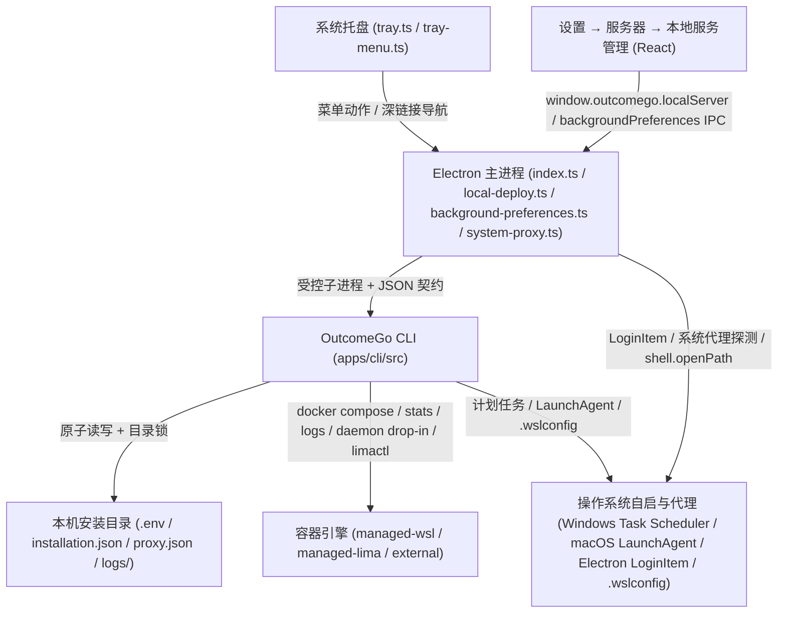

# 设计文档 - 本地服务托盘管理与引擎配置

状态：Draft

## 1. 概述

### 1.1 目标

- 修复任务栏托盘状态不同步的既有缺陷，并在本地部署模式下提供完整的右键服务管理菜单（状态展示、直达服务管理、启停/重启、开机自启开关、打开日志目录、退出）。
- 在桌面端「设置 → 服务器」内构建「本地服务管理」模块，提供容器列表与实时资源指标、单容器重启、脱敏日志查看、开机自启独立配置、性能资源调优与本地代理服务器配置。
- 延续 Spec 012“CLI 负责配置落盘与引擎执行，桌面端负责展示与 IPC 编排”的架构边界，所有读写均通过带 `schemaVersion` 的 CLI 结构化 JSON 子命令完成，确保 Windows（`managed-wsl` / `external`）与 macOS（`managed-lima` / `external`）行为一致且可自动化测试。

### 1.2 覆盖需求

- `requirements.md` 需求 1：任务栏托盘菜单增强与状态实时同步
- `requirements.md` 需求 2：本地容器视图、指标查看与单容器运维
- `requirements.md` 需求 3：开机自启动独立配置（本地服务 + 桌面端）
- `requirements.md` 需求 4：性能与资源配置（容器级 + 托管引擎级）
- `requirements.md` 需求 5：本地服务与引擎代理服务器配置
- `requirements.md` 需求 6：CLI 运维与配置子命令（结构化契约与跨平台兼容）
- `requirements.md` 需求 7：安全脱敏、并发保护与国际化

### 1.3 技术约束

- **CLI 与运维执行层**：TypeScript / Bun（`apps/cli`），继续以单文件可执行载体运行，遵循 `OUTCOMEGO_DESKTOP_CLI_VERSION` 版本握手与 `acquireUpdateLock` 目录互斥锁。
- **桌面端主进程与预加载层**：Electron Main & Preload（`apps/desktop/src/main`、`apps/desktop/src/preload`），通过 `LocalDeployManager` 串行互斥调用 CLI，不直接在主进程拼接 Docker / WSL / Lima 命令。
- **桌面端渲染层**：React + TypeScript + Tailwind（`apps/desktop/src/renderer/components/outcomego/settings`），复用现有 `SettingsPanel` 深链接锚点体系（`packages/contracts/src/app-deep-links.ts`）与 `useI18n` 国际化体系。
- **编排与网络层**：`deploy/compose.yaml` 保持向后兼容，新增环境变量均带空值或安全默认值；`docker/outcomego-computer-network.py` 需确保宿主机代理目标地址与端口对 `computer` 容器可达。
- **平台边界**：仅面向 Windows（x64，`managed-wsl` / `external`）与 macOS（arm64/x64，`managed-lima` / `external`）；不修改第三方外部引擎（Docker Desktop / OrbStack）的自启或守护进程配置。

## 2. 架构

### 2.1 系统结构



核心分层原则：

1. **状态单一来源**：托盘和设置页共享主进程内的 `LocalDeployManager` 状态缓存与事件广播，任何生命周期或配置变更完成后主动刷新缓存并通知托盘重绘，彻底消除状态漂移。
2. **CLI 统一落盘**：安装目录下的 `.env`、`installation.json`、新增配置（自启偏好、代理配置）、Docker daemon drop-in、Windows 计划任务、macOS LaunchAgent、Lima 配置与 `.wslconfig` 全部由 CLI 维护。
3. **桌面端专责宿主集成**：Electron 主进程负责操作系统 GUI 相关能力——托盘渲染、唤起窗口并定位设置锚点、Electron `setLoginItemSettings` 登录自启、读取系统代理配置（供“跟随系统代理”模式使用）、用系统文件管理器打开日志目录。

### 2.2 模块职责

| 模块 | 职责 | 输入 | 输出 |
| --- | --- | --- | --- |
| `apps/desktop/src/main/tray.ts` & `tray-menu.ts` | 托盘菜单模板构建、状态同步刷新、右键菜单弹出与动作派发 | 本地模式标识、最新栈状态、引擎类型、自启偏好、忙碌态 | Electron 原生托盘菜单与用户动作触发 |
| `apps/desktop/src/main/local-deploy.ts` | 封装 CLI 子命令调用、参数校验、并发互斥（`mutate`）、状态缓存与敏感信息脱敏 | 主进程/IPC 请求参数 | 结构化 JSON 结果与状态更新事件 |
| `apps/desktop/src/main/background-preferences.ts` | 持久化桌面端偏好（`stopServiceOnQuit`、`warnedOnClose`、`launchAtLogin`、`launchHidden`）并同步 Electron LoginItem | 偏好读写请求 | 偏好对象与系统登录项状态 |
| `apps/desktop/src/main/system-proxy.ts` | 读取当前 Windows/macOS 系统代理设置供渲染进程展示和同步下发 | 平台代理查询请求 | 解析后的 `httpProxy` / `httpsProxy` / `noProxy` 快照 |
| `apps/cli/src/local-ops.ts`（新增） | 实现 `containers`、`restart`、`logs --json`、`autostart`、`resources status/set`、`proxy status/set/test` 核心业务逻辑 | `InstallationPaths`、CLI 参数、`CommandRunner` | 规范 JSON 输出或 `CliError` |
| `apps/cli/src/engine/managed-wsl.ts` & `managed-lima.ts` | 托管引擎自启注册/查询、Lima 资源编辑、WSL `.wslconfig` 读写、Docker daemon 代理 drop-in 同步与宿主机网关 IP 解析 | 引擎配置变更参数 | 引擎生效状态与回滚保障 |
| `apps/desktop/src/renderer/components/outcomego/settings/local-service/` | 「本地服务管理」UI 组件群（概览、容器列表与日志弹窗、自启配置、性能资源、代理配置） | `window.outcomego.localServer` & `backgroundPreferences` | 用户交互界面与实时状态呈现 |

### 2.3 关键流程

#### 2.3.1 托盘状态同步与“服务管理…”直达

1. 在以下任意时机完成后，主进程自动调用 `syncLocalTrayState(snapshot)` 更新 `trayState`、`trayEngineKind`、`trayAutostartEnabled` 并重绘托盘菜单：
   - 桌面端启动与 `manager.restore()` 完成；
   - `bootstrap`（一键本地部署）流式收到 `type: "result"` 或失败退出；
   - IPC 执行 `start` / `stop` / `restart` / `restartContainer` / `remove` / `resources` / `proxy` / `autostart` 任意变更；
   - `enrollmentServerUrl` 发生切换（本地 ↔ 远程）。
2. 右键点击托盘图标时：若距离上次成功同步超过 `10s` 且当前不处于忙碌态，主进程先触发一次带 `1200ms` 超时保护的快速状态同步（`Promise.race`）；超时内返回则直接用最新菜单弹出，超时则先以缓存状态弹出并在后台补刷新。
3. 点击托盘“服务管理…”时：主进程唤起并聚焦主窗口，通过现有 `outcomego:deep-link` 机制派发 `outcomego://app/v1/settings?id=local-services`，渲染进程自动打开 `SettingsPanel`、切换到 `server` 页并滚动高亮至「本地服务管理」区域。

#### 2.3.2 容器状态、指标查看与单容器重启

1. 前端打开「本地服务管理」后分两步并行拉取：先加载 `localServer.status()` 与 `localServer.containers({ includeStats: false })` 快速呈现列表；再异步拉取 `localServer.containers({ includeStats: true })` 填充 CPU/内存指标。
2. 点击单容器“重启”时：
   - 若目标为普通服务（`server`、`worker`、`postgres`），CLI 执行 `docker compose restart <service>`；
   - 若目标为 `computer`，CLI 协同执行 `docker compose up -d --no-deps --force-recreate computer computer-memory-init`（或按依赖顺序先重启 `computer` 再强制重建 `computer-memory-init`），随后等待 `/health` 或健康检查恢复。
3. 点击“查看日志”时：CLI 执行 `docker compose logs --no-color --timestamps --tail <N> <service>`，按行脱敏后以 JSON 返回，前端支持切换行数、关键词筛选与一键复制。

#### 2.3.3 本地服务代理应用与宿主机回环映射

1. 用户在界面选择模式（直连 / 跟随系统 / 手动）并可点击“测试代理连接”：
   - “跟随系统”模式由主进程 `system-proxy.ts` 解析系统代理（调用 Electron `session.defaultSession.resolveProxy` 对探测域名解析，并辅以系统注册表/scutil 读取完整代理与例外列表），再交由 CLI 执行实际连通性探测。
2. 用户点击“保存并应用”：
   - CLI 获取 `acquireUpdateLock`，先持久化规范化的用户配置至 `<installDir>/proxy.json`（密码加密或仅写受限权限文件 `0o600`）；
   - 解析容器侧生效代理 URL：若主机为 `127.0.0.1` / `localhost` / `::1`，按引擎类型自动转换为宿主机可达地址（`managed-wsl` 探测 WSL2 NAT 默认网关 IP；`managed-lima` 使用 `host.lima.internal`；`external` 使用 `host.docker.internal`）；
   - 合并强制 `NO_PROXY` 内网保护列表，原子更新 `.env` 中的 `OUTCOMEGO_HTTP_PROXY`、`OUTCOMEGO_HTTPS_PROXY`、`OUTCOMEGO_NO_PROXY` 及 `OUTCOMEGO_HOST_PROXY_TARGET`（仅当代理指向宿主机/私有地址时，用于 `computer` 网络策略放行该目标 `ip:port`）；
   - 若勾选“应用于托管引擎镜像拉取”且引擎为托管类型，CLI 在引擎内原子写入 `/etc/systemd/system/docker.service.d/outcomego-proxy.conf`（直连时删除）并执行 `systemctl daemon-reload && systemctl restart docker.service`；
   - 按需重建 `server`、`worker`、`computer`、`computer-memory-init` 使新环境变量生效；任意一步失败时回滚 `.env` 与 daemon drop-in 并返回具体阶段错误。

## 3. 组件和接口

### 3.1 核心组件

覆盖需求：1、2、3、4、5、6、7

- **托盘模块**（`apps/desktop/src/main/tray.ts`、`tray-menu.ts`）：构建本地/远程差异化托盘菜单，处理菜单动作与实时重绘。
- **桌面端本地服务桥**（`apps/desktop/src/main/local-deploy.ts`、`index.ts`、`apps/desktop/src/preload/index.ts`）：扩展 `window.outcomego.localServer` 与 `window.outcomego.backgroundPreferences` IPC 契约。
- **系统代理探测模块**（`apps/desktop/src/main/system-proxy.ts`）：封装 Windows/macOS 系统代理读取，屏蔽平台差异。
- **CLI 本地运维模块**（`apps/cli/src/local-ops.ts`、`apps/cli/src/proxy-config.ts`、`apps/cli/src/wsl-config.ts`）：统一实现容器运维、自启动、资源配置与代理配置子命令。
- **托管引擎扩展**（`apps/cli/src/engine/managed.ts`、`managed-wsl.ts`、`managed-lima.ts`）：新增自启查询/切换、macOS LaunchAgent 管理、Lima 资源编辑、Docker daemon 代理 drop-in 管理与宿主机网关探测。
- **本地服务管理 UI**（`apps/desktop/src/renderer/components/outcomego/settings/local-service/`）：替代并升级现有 `server-location.tsx` 中的简陋内联操作，以清晰分组承载状态概览、容器管理、开机自启、性能资源和代理配置。

### 3.2 数据结构

覆盖需求：1、2、3、4、5、6

#### 3.2.1 `LocalContainerInfo`（容器详情与指标）

| 字段 | 类型 | 必填 | 说明 | 约束 |
| --- | --- | --- | --- | --- |
| `service` | `string` | 是 | Compose 服务名 | 白名单校验，如 `server`、`worker`、`computer`、`postgres`、`computer-memory-init` |
| `containerName` | `string` | 是 | 容器实例名 | 例如 `outcomego-server-1` |
| `role` | `"core" \| "init"` | 是 | 常驻核心服务或一次性初始化任务 | 默认主列表显示 `core`，折叠区显示 `init` |
| `state` | `string` | 是 | 容器状态 | `running` / `exited` / `restarting` / `created` / `paused` / `dead` |
| `health` | `"healthy" \| "starting" \| "unhealthy" \| "none"` | 是 | 健康检查状态 | 无健康检查时为 `"none"` |
| `statusText` | `string` | 是 | 人类可读运行时长/状态文本 | 例如 `Up 2 hours (healthy)` |
| `image` | `string` | 是 | 镜像名称与标签 | 截断上限 256 字符 |
| `exitCode` | `number \| null` | 否 | 退出码 | 运行中为 `null` |
| `restartable` | `boolean` | 是 | 是否允许用户单容器重启 | 仅 `core` 服务为 `true` |
| `stats` | `{ cpuPercent: number; memoryUsageBytes: number; memoryLimitBytes: number; memoryPercent: number } \| null` | 否 | 实时资源占用 | 未传 `--stats` 或容器未运行时为 `null` |

#### 3.2.2 `LocalAutostartStatus`（开机自启状态）

| 字段 | 类型 | 必填 | 说明 | 约束 |
| --- | --- | --- | --- | --- |
| `schemaVersion` | `1` | 是 | 契约版本 | 固定 `1` |
| `serviceSupported` | `boolean` | 是 | 当前引擎是否支持控制本地服务自启 | `managed-wsl` / `managed-lima` 为 `true`，`external` 为 `false` |
| `serviceEnabled` | `boolean` | 是 | 本地服务开机自启是否开启 | 反映已持久化偏好且与系统注册项校验结果对齐 |
| `serviceRegistered` | `boolean` | 是 | 系统级计划任务或 LaunchAgent 当前是否已实际注册 | 便于检测漂移并修复 |
| `engineKind` | `"managed-wsl" \| "managed-lima" \| "external"` | 是 | 当前安装引擎类型 | — |
| `unsupportedReason` | `string \| null` | 否 | 不支持时的可读原因 | `external` 时说明由外部引擎管理 |

桌面端扩展偏好 `BackgroundPreferenceState`（`background-preferences.json`）：

| 字段 | 类型 | 必填 | 说明 | 约束 |
| --- | --- | --- | --- | --- |
| `stopServiceOnQuit` | `boolean` | 是 | 退出桌面端时是否停止本地服务 | 默认 `false`（延续 Spec 012） |
| `warnedOnClose` | `boolean` | 是 | 首次关窗常驻托盘提示是否已展示 | 默认 `false` |
| `launchAtLogin` | `boolean` | 是 | 登录系统时启动 OutcomeGo 桌面端 | 默认 `false`，同步 `app.setLoginItemSettings` |
| `launchHidden` | `boolean` | 是 | 登录自启时最小化到托盘不弹主窗 | 默认 `true`，仅在 `launchAtLogin=true` 时生效 |

#### 3.2.3 `LocalResourceSnapshot` & `LocalResourceUpdate`（性能与资源配置）

| 字段 | 类型 | 必填 | 说明 | 约束 |
| --- | --- | --- | --- | --- |
| `schemaVersion` | `1` | 是 | 契约版本 | 固定 `1` |
| `host` | `{ memoryBytes: number; cpuCores: number; diskAvailableBytes: number \| null }` | 是 | 宿主机硬件资源 | — |
| `containers` | `{ computerMemory: string; desktopMemory: string; computerCpu: number \| null; workerConcurrency: number }` | 是 | 当前 `.env` 生效容器配置 | `computerCpu` 为 `null` 表示未限制 |
| `engine` | `{ kind: string; memoryBytes: number \| null; cpuCores: number \| null; configurable: "direct" \| "wslconfig" \| "readonly"; wslConfig?: { path: string; exists: boolean; memory: string \| null; processors: number \| null } }` | 是 | 托管/外部引擎资源分配及可配置方式 | `managed-lima` 为 `"direct"`，`managed-wsl` 为 `"wslconfig"`，`external` 为 `"readonly"` |

#### 3.2.4 `LocalProxyConfig` & `LocalProxyTestResult`（代理服务器配置）

| 字段 | 类型 | 必填 | 说明 | 约束 |
| --- | --- | --- | --- | --- |
| `schemaVersion` | `1` | 是 | 契约版本 | 固定 `1` |
| `mode` | `"off" \| "system" \| "manual"` | 是 | 代理模式 | 默认 `"off"` |
| `protocol` | `"http" \| "https" \| "socks5"` | 否 | 手动代理协议 | `mode="manual"` 必填 |
| `host` | `string` | 否 | 代理主机名或 IP | 禁止换行、空白、斜杠、控制字符 |
| `port` | `number` | 否 | 代理端口 | `1..65535` 整数 |
| `username` | `string \| null` | 否 | 可选代理用户名 | 长度 `<= 128` |
| `hasPassword` | `boolean` | 是 | 是否已保存密码（查询态返回，不回传明文密码） | 写入态可选传 `password?: string \| null` 与 `clearPassword?: boolean` |
| `noProxy` | `string` | 是 | 用户自定义不走代理列表（逗号分隔） | 实际注入时与强制内网保护列表合并去重 |
| `applyToContainers` | `boolean` | 是 | 是否同步到服务端容器环境变量 | 默认 `true` |
| `applyToDockerDaemon` | `boolean` | 是 | 是否同步到托管引擎 Docker daemon | 托管引擎默认 `true`，`external` 恒为 `false` |
| `loopbackMappedHost` | `string \| null` | 否 | 若为本机回环代理，实际映射后的容器可达主机 | 只读提示字段，便于用户排障 |
| `systemResolved` | `{ httpProxy: string \| null; httpsProxy: string \| null; noProxy: string \| null } \| null` | 否 | `mode="system"` 时当前解析到的系统代理快照 | 脱敏展示 |

`LocalProxyTestResult`：

| 字段 | 类型 | 必填 | 说明 | 约束 |
| --- | --- | --- | --- | --- |
| `ok` | `boolean` | 是 | 是否整体可用 | 关键检查均通过为 `true` |
| `effectiveProxy` | `string \| null` | 是 | 脱敏后的实际测试代理 URL | 隐藏认证密码 |
| `checks` | `Array<{ target: "proxy-tcp" \| "model-api" \| "github" \| "registry"; ok: boolean; latencyMs: number \| null; statusCode?: number; error?: string }>` | 是 | 分项连通性检测结果 | 单项超时 `<= 8s` |

### 3.3 接口契约

覆盖需求：1、2、3、4、5、6、7

#### 3.3.1 CLI 新增与扩展子命令

| 命令 | 参数 | 输出 / 行为 | 错误码 |
| --- | --- | --- | --- |
| `outcomego containers --json` | `[--stats]` | 输出 `{ schemaVersion: 1, engineRunning: boolean, containers: LocalContainerInfo[] }` | `ENGINE_UNAVAILABLE`、`UNKNOWN` |
| `outcomego restart [service] --json` | `[service]`、`--yes` | 重启全部服务或指定核心服务（`computer` 联动 `computer-memory-init`），返回最新 `statusJson` | `INVALID_INPUT`、`BUSY`、`STACK_START_FAILED` |
| `outcomego logs <service> --json` | `--tail <10..1000>` | 输出 `{ schemaVersion: 1, service, lines: string[], truncated: boolean }`，自动脱敏 | `INVALID_INPUT`、`ENGINE_UNAVAILABLE` |
| `outcomego autostart status --json` | 无 | 输出 `LocalAutostartStatus` | `ENGINE_UNAVAILABLE` |
| `outcomego autostart set --json` | `--enabled <true\|false>` | 持久化偏好至 `installation.json` 并立即注册/卸载计划任务或 LaunchAgent，返回 `LocalAutostartStatus` | `INVALID_INPUT`、`ENGINE_UNAVAILABLE`、`BUSY` |
| `outcomego resources status --json` | 无 | 输出 `LocalResourceSnapshot` | `ENGINE_UNAVAILABLE` |
| `outcomego resources set --json` | `[--computer-memory] [--desktop-memory] [--computer-cpu] [--worker-concurrency] [--engine-memory] [--engine-cpu] [--apply-wslconfig] [--restart-wsl] --yes` | 校验并原子应用容器与/或引擎资源，失败自动回滚，返回 `LocalResourceSnapshot` | `INVALID_INPUT`、`MEMORY_LOW`、`BUSY`、`STACK_START_FAILED` |
| `outcomego proxy status --json` | 无 | 输出 `LocalProxyConfig`（不含明文密码） | `ENGINE_UNAVAILABLE` |
| `outcomego proxy set --json` | `--config-stdin --yes`（经 stdin 传入 JSON，避免命令行参数暴露代理密码） | 校验、落盘 `proxy.json`、同步 `.env` 与托管 Docker daemon drop-in、重建受影响容器，返回 `LocalProxyConfig` | `INVALID_INPUT`、`BUSY`、`STACK_START_FAILED` |
| `outcomego proxy test --json` | `--config-stdin` | 不改正式配置，实测待测配置对代理 TCP、DeepSeek/模型 API、GitHub、Docker Registry 的连通性，返回 `LocalProxyTestResult` | `INVALID_INPUT` |

> 安全说明：`proxy set` 和 `proxy test` 复用 `bootstrap --password-stdin` 的成熟模式，通过 stdin 传递含可选代理密码的 JSON 载荷，杜绝密码出现在操作系统进程参数表（`ps` / 任务管理器命令行）中。

#### 3.3.2 桌面端 IPC 桥扩展（`apps/desktop/src/preload/index.ts` & `main/index.ts`）

在 `window.outcomego.localServer` 下扩展以下方法（全部经由主进程窗口校验 + 本地安装归属校验）：

- `restart(service?: string): Promise<LocalServerStatus>`（IPC：`outcomego:local-server:restart`）
- `containers(options?: { includeStats?: boolean }): Promise<LocalContainersSnapshot>`（IPC：`outcomego:local-server:containers`）
- `logs(options: { service: string; tail?: number }): Promise<LocalContainerLogs>`（IPC：`outcomego:local-server:logs`）
- `openLogsFolder(): Promise<void>`（IPC：`outcomego:local-server:open-logs-folder`，调用 `shell.openPath` 打开 `<installDir>/logs` 或安装根目录）
- `autostartStatus(): Promise<LocalAutostartStatus>`（IPC：`outcomego:local-server:autostart-status`）
- `setAutostart(enabled: boolean): Promise<LocalAutostartStatus>`（IPC：`outcomego:local-server:autostart-set`）
- `resourcesStatus(): Promise<LocalResourceSnapshot>`（IPC：`outcomego:local-server:resources-status`）
- `updateResources(input: LocalResourceUpdate): Promise<LocalResourceSnapshot>`（IPC：`outcomego:local-server:resources-update`；保留现有 `resources()` 方法兼容旧调用）
- `proxyStatus(): Promise<LocalProxyConfig>`（IPC：`outcomego:local-server:proxy-status`）
- `detectSystemProxy(): Promise<SystemProxySnapshot>`（IPC：`outcomego:local-server:system-proxy`）
- `saveProxy(input: LocalProxyUpdate): Promise<LocalProxyConfig>`（IPC：`outcomego:local-server:proxy-save`）
- `testProxy(input: LocalProxyUpdate): Promise<LocalProxyTestResult>`（IPC：`outcomego:local-server:proxy-test`）

在 `window.outcomego.backgroundPreferences` 扩展：

- `get(): Promise<BackgroundPreferenceState>`
- `set(patch: Partial<Pick<BackgroundPreferenceState, "stopServiceOnQuit" | "launchAtLogin" | "launchHidden">>): Promise<BackgroundPreferenceState>`（保持对旧签名 `set(stopServiceOnQuit: boolean)` 向后兼容）

深链接锚点扩展（`packages/contracts/src/app-deep-links.ts` & `apps/desktop/src/renderer/lib/app-deep-links.ts`）：

- 新增锚点 `"local-services"`，映射至 `SettingsView: "server"`，绑定到 `ServerLocationSettings` / `LocalServiceManagement` 的根容器 `data-settings-anchor="local-services"`。

#### 3.3.3 `deploy/compose.yaml` 与容器网络配合

1. `deploy/compose.yaml` 增补可选环境变量（均设安全默认值，不破坏旧 `.env` 与远程部署）：
   - `server`、`worker` 新增 `extra_hosts: ["host.docker.internal:host-gateway"]`；
   - `server`、`worker`、`computer` 的 `environment` 新增透传：
     ```yaml
     HTTP_PROXY: ${OUTCOMEGO_HTTP_PROXY:-}
     HTTPS_PROXY: ${OUTCOMEGO_HTTPS_PROXY:-}
     NO_PROXY: ${OUTCOMEGO_NO_PROXY:-}
     http_proxy: ${OUTCOMEGO_HTTP_PROXY:-}
     https_proxy: ${OUTCOMEGO_HTTPS_PROXY:-}
     no_proxy: ${OUTCOMEGO_NO_PROXY:-}
     ```
   - `computer` 新增：
     - `cpus: ${OUTCOMEGO_COMPUTER_CPU_LIMIT:-0}`（注意 Docker Compose 对 `cpus: 0` 或省略的兼容性：为避免不同 Compose 版本对 `0` 报错，改为仅在配置了 `OUTCOMEGO_COMPUTER_CPU_LIMIT` 时由 CLI 生成可选 `compose.override.yaml` 或在 `compose.yaml` 使用校验通过的环境变量策略；**设计决策：为彻底兼容所有 Docker Compose 版本，资源覆盖中涉及 `cpus` 的可选限制通过安装目录下的 `compose.local.yaml`（CLI `ComposeProject` 自动追加 `-f compose.local.yaml` 当文件存在时）注入，而内存与代理环境变量继续走 `.env` 注入，既不破坏远程/旧版 `compose.yaml` 又规避 `cpus: 0` 解析差异**）；
     - `OUTCOMEGO_HOST_PROXY_TARGET: ${OUTCOMEGO_HOST_PROXY_TARGET:-}` 传递给 `computer`，供 `docker/outcomego-computer-network.py` 读取并在初始化/策略刷新时将代理目标 `ip:port` 加入 `@host_bridge_v4`（仅放通用户显式配置的单个代理端口，不放大私有网段访问面）。

## 4. 数据与状态模型

### 4.1 数据关系与持久化位置

- `<installDir>/installation.json`（扩展 `InstallationManifest`）：
  - 新增可选字段 `autostart?: { enabled: boolean }`（默认为 `true` 以兼容既有安装行为；用户显式关闭后设为 `false`）。
- `<installDir>/.env`：
  - 新增可选键：`OUTCOMEGO_HTTP_PROXY`、`OUTCOMEGO_HTTPS_PROXY`、`OUTCOMEGO_NO_PROXY`、`OUTCOMEGO_HOST_PROXY_TARGET`；继续复用 `OUTCOMEGO_COMPUTER_MEMORY_LIMIT`、`OUTCOMEGO_DESKTOP_MEMORY_LIMIT`、`OUTCOMEGO_WORKER_CONCURRENCY`。
- `<installDir>/proxy.json`（文件权限 `0o600`）：
  - 保存用户原始填写的代理模式、协议、主机、端口、凭据、自定义 `noProxy` 与作用范围开关；与 `.env` 分离的目的是保留“用户填写的 `127.0.0.1` 原始值”与“容器内映射后的宿主机地址”，并供 CLI 下载器直接读取。
- `<installDir>/compose.local.yaml`（可选，仅在用户设置了 `computer` CPU 限额时生成，取消限制时删除）：
  - 仅声明 `services.computer.cpus`，CLI 的 `ComposeProject` 在该文件存在时自动叠加 `-f compose.local.yaml`。
- `<userData>/background-preferences.json`（桌面端偏好）：
  - 保存 `stopServiceOnQuit`、`warnedOnClose`、`launchAtLogin`、`launchHidden`。
- 系统级自启配置：
  - Windows：`OutcomeGo-ManagedEngine` 计划任务（免 UAC，复用 `managed-wsl.ts` 现有实现）；桌面端登录自启走 Electron `app.setLoginItemSettings`（附带 `--autostart-hidden` 参数）。
  - macOS：`~/Library/LaunchAgents/com.outcomego.managed-engine.plist`（调用受信任的 CLI `engine start` / `start`，支持 `RunAtLoad`）；桌面端登录自启走 Electron `app.setLoginItemSettings`（`openAtLogin` + `openAsHidden` / `--autostart-hidden`）。

### 4.2 状态流转

#### 托盘状态同步模型

| 状态 | 含义 | 进入条件 | 退出条件 |
| --- | --- | --- | --- |
| `unknown` / 初始化 | 启动初期尚未拉取本地状态 | 托盘刚创建 | `restore()` 或首次 `refreshLocalTray()` 返回 |
| `running` | 本地服务栈健康运行 | `status.stack.state === "running"` | 停止、重启、异常或切换为远程服务器 |
| `starting` | 正在启动、重启或部署 | 触发 `bootstrap`/`start`/`restart` 或容器处于启动中 | 变为 `running`、`unhealthy` 或 `stopped` |
| `stopped` | 本地引擎或服务栈已停止 | 触发 `stop` 或探测为 `stopped` | 触发 `start`/`restart` |
| `unhealthy` | 容器异常或健康检查失败 | 任一核心容器崩溃/不健康或探测报错 | 重启恢复为 `running` 或停止为 `stopped` |
| `busy`（叠加态） | 正在执行互斥运维动作 | 托盘或设置页触发启停/重启/配置应用 | 动作结束并同步最新状态 |

#### 自启偏好与手动启停的解耦规则

- `startCommand`：仅在 `manifest.autostart?.enabled !== false` 时调用 `engine.ensureAutostart()`；若用户已明确关闭自启，手动启动服务不会重新打开开机自启。
- `stopCommand`：仅停止容器栈，**不再**无条件删除计划任务/LaunchAgent（避免用户临时停一下服务就丢掉开机自启设置）。
- `autostart set --enabled false`：显式持久化 `autostart.enabled = false` 并移除系统级计划任务/LaunchAgent。
- `uninstallCommand`：始终移除系统级计划任务/LaunchAgent（原有行为保留）。

## 5. 错误处理与回滚策略

1. **容器资源变更回滚**：`resources set` 修改 `.env` 和 `compose.local.yaml` 前保留内存快照；若 `docker compose up -d --no-deps --force-recreate` 失败，立即恢复原文件并重新尝试拉起原配置，同时向上返回失败原因。
2. **Lima VM 资源变更回滚**：修改 `lima.yaml`（通过 `limactl edit`）前先备份实例配置文件；若编辑后 `limactl start` 或 `waitForDocker` 失败，恢复原配置文件并重试启动。
3. **Windows `.wslconfig` 安全修改**：修改前写入 `%USERPROFILE%\.wslconfig.outcomego.bak`；解析 INI 仅更新 `[wsl2]` 下的 `memory=` 与 `processors=` 行，保持文件其余节与注释原样；若文件无写权限或格式异常则中止写入并返回可读提示，不损坏用户配置。
4. **代理应用失败回滚**：`proxy set` 修改 `proxy.json`、`.env` 和托管引擎 `/etc/systemd/system/docker.service.d/outcomego-proxy.conf` 前保存旧版本；若 Docker daemon 重载或容器重建失败，逐项恢复原文件并重载 Docker，确保不会因为填错代理导致本地服务永久失联。
5. **敏感信息脱敏**：所有日志输出（`logs --json`）、错误消息、代理状态回显与诊断导出均经过统一脱敏函数，移除代理 URL 中的 `user:pass@` 密码段及常见 `*_PASSWORD`、`*_TOKEN`、`*_SECRET`、`*_KEY`、`DATABASE_URL`、`Authorization` 值。

## 6. 正确性属性

### 6.1 属性 1：内网通信免代理不变量

*对于任何* 代理配置（包括用户清空或篡改 `noProxy` 的输入），注入到 `.env` 与 Docker daemon 的最终 `NO_PROXY` 值都必须包含完整的内网保护清单（`127.0.0.1,localhost,::1,postgres,server,worker,computer,10.0.0.0/8,172.16.0.0/12,192.168.0.0/16,host.docker.internal`），确保本地栈内部数据库、RPC、健康检查和桌面端回环连接永远不经过外部代理。

**验证需求：** `requirements.md` 需求 5（验收 5.3）、非功能需求 2（可靠性 2.3）

### 6.2 属性 2：`computer` 重启协同不变量

*对于任何* 触发 `computer` 容器重启或资源/代理重建的操作，`computer-memory-init` 都必须随 `computer` 一同重建，防止出现 `memory-init helper did not become ready` 死循环。

**验证需求：** `requirements.md` 需求 2（验收 2.4）、需求 4（验收 4.3）

### 6.3 属性 3：凭据不入命令行与日志不变量

*对于任何* 包含用户名/密码的代理配置写入或测试操作，凭据仅通过 stdin 传递给 CLI，永不出现在子进程 `argv`、前端状态回显、日志弹窗或诊断包中。

**验证需求：** `requirements.md` 需求 5（验收 5.7）、需求 7（验收 7.3）

### 6.4 属性 4：托盘与本地连接身份一致性不变量

*对于任何* 时刻的桌面端运行态，仅当 `canManageLocalInstallation(enrollmentServerUrl, readManagedInstallation())` 为真时托盘才显示本地服务管理菜单项；且任意本地状态变更结束后托盘状态必与最新 `LocalServerStatus` 一致。

**验证需求：** `requirements.md` 需求 1（验收 1.1、1.3、1.4）

## 7. 测试策略

### 7.1 单元测试

- **CLI 单元测试**（`apps/cli/test/`）：
  - `containers` JSON 解析（含 `core`/`init` 分类、`docker stats` 字节与百分比解析）；
  - `restart` 命令参数白名单校验与 `computer` 联动 `computer-memory-init` 参数断言；
  - `logs --json` 行数裁剪与多模式敏感信息脱敏；
  - `autostart` 偏好持久化、Windows 计划任务脚本与 macOS LaunchAgent plist 生成/卸载逻辑、解耦后的 `start`/`stop` 行为；
  - `resources` 预设校验、`compose.local.yaml` 生成与回滚、`.wslconfig` 增量保留更新与备份逻辑；
  - `proxy` URL 校验、回环地址映射（WSL NAT / Lima / External）、强制 `NO_PROXY` 合并、daemon drop-in 生成与回滚、stdin 载荷读取与脱敏。
- **桌面端单元测试**（`apps/desktop/test/`）：
  - `buildTrayMenu` 在本地/远程/运行/停止/异常/忙碌/托管与外部引擎下的菜单项快照测试；
  - `BackgroundPreferences` 扩展字段读写及旧文件兼容迁移；
  - `LocalDeployManager` 新增命令的参数校验、互斥锁冲突（`BUSY`）与状态变更回调；
  - `app-deep-links` 新锚点 `local-services` 解析与视图映射；
  - 系统代理字符串解析（`PROXY host:port`、`SOCKS5 host:port`、`DIRECT`）单元测试。

### 7.2 集成测试

- 使用 Mock `CommandRunner` 跑通完整链路：`proxy set`（含失败回滚）、`resources set`（含失败回滚）、`autostart set` 与 `start`/`stop` 联动。
- 验证 `docker/outcomego-computer-network.py` 在设置 `OUTCOMEGO_HOST_PROXY_TARGET` 时正确向 nftables `@host_bridge_v4` 与 `ip rule` 放通代理目标地址和端口（通过 Python 单元测试）。
- 验证 `deploy/compose.yaml` 在旧版 `.env`（不含新增变量）与新版 `.env`（含代理变量 + `compose.local.yaml`）下均可被 `docker compose config` 正常解析。

### 7.3 端到端与实机验收

- **Windows 11 实机（`managed-wsl`）**：
  - 验证托盘右键菜单状态准确（不再停在“正在启动本地服务”）、点击“服务管理…”直达面板、单容器重启 `worker` 与 `computer`、查看脱敏日志；
  - 验证“开机自动启动本地服务”开关实时增删计划任务 `OutcomeGo-ManagedEngine`、“登录时启动桌面端（静默到托盘）”生效；
  - 验证修改性能资源与配置本地代理（如宿主机 `127.0.0.1` 代理端口），一键测试通过且模型/网页搜索与 Docker 镜像拉取均经代理成功。
- **macOS 实机（`managed-lima` 或 `external`）**：
  - 验证托盘菜单、LaunchAgent 注册/卸载、Lima 资源编辑回显及代理配置测试。

### 7.4 验证映射

| 需求 | 设计章节 | 验证方式 |
| --- | --- | --- |
| `requirements.md` 需求 1 | `design.md` §2.3.1、§3.1、§4.2 | 桌面端单测（`tray-menu` / `local-deploy`）+ Windows/macOS 实机托盘走查 |
| `requirements.md` 需求 2 | `design.md` §2.3.2、§3.2.1、§3.3.1、§6.2 | CLI 单测（`containers`/`restart`/`logs`）+ 实机容器重启与日志验证 |
| `requirements.md` 需求 3 | `design.md` §3.2.2、§3.3.1、§4.1、§4.2 | CLI 单测（`autostart` + LaunchAgent/Task）+ 桌面端 LoginItem 单测与实机验证 |
| `requirements.md` 需求 4 | `design.md` §3.2.3、§3.3.1、§3.3.3、§5 | CLI 单测（`resources`/`.wslconfig`/`compose.local.yaml` 回滚）+ 实机调整验证 |
| `requirements.md` 需求 5 | `design.md` §2.3.3、§3.2.4、§3.3.3、§5、§6.1、§6.3 | CLI 单测（`proxy` 映射/合并/回滚）+ `computer-network` 单测 + 实机代理测通 |
| `requirements.md` 需求 6 | `design.md` §3.3.1、§3.3.3 | CLI 契约单测 + `docker compose config` 兼容检查 |
| `requirements.md` 需求 7 | `design.md` §3.3.2、§5、§6.3 | 脱敏/校验/互斥单测 + 中英文 UI 切换走查 |

## 8. 风险与待确认项

### 8.1 风险

- **Windows WSL2 代理连通依赖宿主机代理软件设置**：若用户本机代理工具（如 Clash / v2rayN）未开启“允许局域网连接（Allow LAN）”，WSL2 容器即使映射到正确宿主机 IP 也会连接被拒。**缓解**：在一键测试失败且检测到回环映射时，界面直接给出明确指引“请在本机代理软件中开启允许局域网连接并放行 Windows 防火墙”。
- **Windows `.wslconfig` 全局影响**：修改 `.wslconfig` 会影响同机其他 WSL2 发行版，且需要 `wsl --shutdown` 或重启电脑生效。**缓解**：界面显式警示全局影响、默认不自动执行 `wsl --shutdown`（仅在用户二次勾选确认时执行），并保留 `.wslconfig.outcomego.bak` 备份。
- **修改 Docker daemon 代理导致短时容器断连**：托管引擎应用镜像拉取代理需重启 `docker.service`，会中断运行中容器。**缓解**：保存前弹窗提示“应用代理将短暂重启本地服务并中断进行中的任务”，失败自动回滚。
- **桌面端打包体积与内置 CLI 版本一致性**：延续 Spec 012 经验，桌面端新增依赖的 CLI 子命令需要与发布版内置 CLI 版本同步（发版时一并打包）。

### 8.2 待确认项

- **独立管理小窗 vs 设置页内嵌**：当前设计以「设置 → 服务器 → 本地服务管理」作为统一主面板，由托盘“服务管理…”通过深链接直达，保持单窗架构简洁；如后续用户高频诉求无登录前也能管理异常容器，可在二期补充未登录状态下的轻量弹窗入口。
- **macOS LaunchAgent 路径稳定性**：当 macOS 用户移动 `OutcomeGo.app` 位置时，LaunchAgent 引用的 CLI 路径应优先指向用户数据目录下的稳定缓存载体（`prepareDesktopCli` 落盘路径），避免引用 `.app` 内部临时路径。
